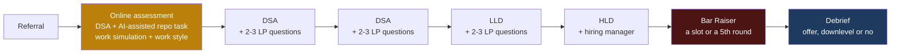

# Amazon SDE-2 Loop — India

2026-11-11 · researched for a referral from a friend who is SDE-2 at Amazon

> [!abstract] What this file is
> What Amazon actually asks in an SDE-2 (L5) loop in India, with 2025 and 2026 reports weighted above everything older. Amazon's own prep pages are the base layer; every row of candidate reports is self-reported and anecdotal, and is marked with its source.

---

## The shape of the process

The official SDE II page describes **four 55-minute interviews** after the online assessment ([amazon.jobs SDE II prep](https://amazon.jobs/content/en/how-we-hire/sde-ii-interview-prep)). Several India reports describe five, with the Bar Raiser as its own round. Every round carries Leadership Principle questions, so roughly a quarter of every hour is behavioural.

---

## The online assessment changed in 2026

| Source | What it says |
|---|---|
| [Amazon official SDE II page](https://amazon.jobs/content/en/how-we-hire/sde-ii-interview-prep) | Two coding questions in 90 minutes, about 20 minutes of systems design scenarios, an 8-minute work style survey |
| [Amazon hiring post](https://www.aboutamazon.com/news/workplace/artificial-intelligence-resume-jobs-hiring-amazon) | Technical assessments redesigned so candidates work with an interactive AI assistant on a real coding platform |
| Bengaluru SDE-2, June 2026, [Glassdoor](https://www.glassdoor.co.in/Interview/Amazon-SDE-2-Interview-Questions-EI_IE6036.0,6_KO7,12.htm) | First question DSA, second question AI-assisted debugging |
| Chennai candidate, 2026, [Glassdoor](https://www.glassdoor.co.in/Interview/Amazon-SDE-2-Interview-Questions-EI_IE6036.0,6_KO7,12.htm) | One DSA question plus a repo-based AI-assisted task; rejected at this stage |
| June to October 2026 reports, [Calibrd](https://www.calibrd.com/interview-prep/amazon-interview) | 100-minute coding section with one algorithm problem and one repository task, then about 45 minutes of work simulation and a 6-minute survey |
| Prime Video Bangalore, joined April 2026, [LeetCode](https://leetcode.com/discuss/post/8420230/amazon-sde-2-interview-experience-2026-e-t1g8/) | Old format: HackerRank, two problems in 90 minutes, 15-minute work simulation, 10-minute work style section |

What the AI-assisted repo task looks like, from candidate reports ([1point3acres](https://www.1point3acres.com/interview/problems/company/amazon/ai-assistant-repo-bug-fix), [PracHub](https://prachub.com/resources/amazon-ai-assisted-coding-oa-guide-2026-repository-bugs-ai-prompts-and-hidden-tests)):

- An existing application with several bugs to find and fix, or a feature to add. One report counted six bugs (four in the controller, one in routes, one in middleware) against two in the sample test, so hidden tests catch what the visible ones do not.
- Reported stacks are MERN, Django and **Spring Boot**.
- The embedded assistant narrows the bug down but is instructed not to hand over the fix.
- This is the only part where AI is allowed. Amazon asks candidates not to use AI tools in the interviews.

> [!note] Two formats are live at once
> Amazon's own prep pages still describe the older format, while most June to October 2026 candidates report the AI-assisted one. The recruiter's invitation is the authority on which one arrives.

---

## Reported India loops, 2025 and 2026

| When | Where | Rounds | Source |
|---|---|---|---|
| Apr 2026 | Pune | DSA medium with full code, DSA hard with full code, LLD **BookMyShow** with no code, HLD **stock broker** | [Glassdoor](https://www.glassdoor.co.in/Interview/Amazon-Interview-E6036-RVW103603903.htm) |
| Mar 2026 | Bangalore | Online assessment, then four rounds of DSA, LLD and HLD; LP questions in every round | [Glassdoor](https://www.glassdoor.co.in/Interview/Amazon-SDE-2-Interview-Questions-EI_IE6036.0,6_KO7,12.htm) |
| Jun 2026 | Bengaluru | Online assessment of DSA plus AI debugging, then a coding round of one medium and one hard, LLD, HLD | [Glassdoor](https://www.glassdoor.co.in/Interview/Amazon-SDE-2-Interview-Questions-EI_IE6036.0,6_KO7,12.htm) |
| Jul 2026 | India | Phone screen on **subarray sum equals K** with follow-ups, then Bar Raiser plus LLD, two DSA rounds, hiring manager plus HLD | [LeetCode](https://leetcode.com/discuss/post/8457154/amazon-sde-ii-interview-experience-2026-19lzv/) |
| Early 2026 | India | LLD **restaurant token system** with Redis atomic operations and concurrency; HLD **learning management system** with search, presigned uploads and progress tracking | [LeetCode roundup](https://leetcode.com/discuss/post/8519174/questions-asked-by-amazon-in-past-6-mont-zxfk/) |
| 2026 | Bengaluru, Fulfillment Technologies | Two coding questions plus LPs per round; a modified LC 316 asking for the largest lexicographic result | [DesiQnA](https://www.desiqna.in/19233/amazon-sde-2-recent-interview-experiences-2026-set-66) |
| Jul to Aug 2025 | Bangalore, Devices | **Serialize and deserialize a binary tree**; design a **file filter by size and extension** | [LeetCode](https://leetcode.com/discuss/post/7132680/amazon-sde-2-bangalore-onsite-interview-pr26m/) |
| Mar 2025 | India | Phone screen on Word Break I and II, onsite **Bus Routes** as the hard, LRU Cache in the final round, LLD **Amazon Locker** | [LeetCode](https://leetcode.com/discuss/post/6585102/amazon-interview-sde-2-march-2025-by-ano-9nha/) |
| 2025 | India, 2 years 8 months experience | DSA, LLD on ride matching with SOLID, HLD **Uber** with driver matching, location updates and caching, Bar Raiser on past projects and technical decisions | [dev.to](https://dev.to/nikhil_sharma19/amazon-sde-2-l5-interview-experience-india-2-years-8-months-312k) |

Experience levels in these reports run from 2 years 8 months to about 4 years.

---

## The question bank by round

| Round | What it checks | Reported prompts, 2025 and 2026 |
|---|---|---|
| **DSA** | One medium and one hard, full working code, follow-ups | Subarray sum equals K, Word Break I and II, Bus Routes, LRU and LFU cache, Course Schedule II, Merge Intervals, Product of Array Except Self, Serialize and Deserialize Binary Tree, Maximum Sum BST, BFS on a graph, LC 316 variant, stack with O(1) middle operations, House Robber II, Boats to Save People |
| **LLD** | Classes, interfaces, SOLID, extensibility | BookMyShow, Amazon Locker, file search and filter, rate limiter with a named algorithm, pub-sub with subscribe and unsubscribe, ride matching, pizza pricing by size and toppings, restaurant token system, meeting scheduler, Tic-Tac-Toe |
| **HLD** | Scalability, reliability, data choices, asking clarifying questions | Uber, stock broker, Pastebin, learning management system, flash sale, artifact repository like JFrog, device backup scheduler, eBay-style marketplace, order emails at 150M+ orders, Amazon Lockers, event booking |
| **Bar Raiser** | Long-term fit, depth on your own work | Current work, projects, technical decisions, challenges, a root-cause investigation story; sometimes coding as well |

The recurring families are rate limiters, pub-sub, schedulers, booking systems and ride or delivery systems, and many prompts are Amazon-shaped: lockers, flash sales, orders.

---

## Leadership Principles weigh as much as the code

What Amazon says itself ([SDE II prep](https://amazon.jobs/content/en/how-we-hire/sde-ii-interview-prep), [SDE III prep](https://amazon.jobs/content/en/how-we-hire/sde-iii-interview-prep), [interview guide](https://www.aboutamazon.com/news/workplace/amazon-interview-guide)):

- Each interviewer typically asks two or three behavioural questions tied to the Leadership Principles.
- Answers should follow STAR and **carry metrics**, because Amazon describes itself as data-driven.
- Past behaviour is treated as the predictor of future performance, and brain teasers are not used.

What candidates add:

- Each interviewer is assigned two or three specific principles to cover, and guides recommend a bank of 10 to 12 STAR stories mapped to principles.
- One candidate was told by HR **never to repeat a story across rounds**, because the Bar Raiser reads the earlier interviewers' feedback ([Glassdoor](https://www.glassdoor.com/Interview/Amazon-SDE-2-Interview-Questions-EI_IE6036.0,6_KO7,12.htm)).
- The Bar Raiser comes from outside the hiring team and decides together with the hiring manager.

---

## The two ways it goes wrong

| Risk | What happens | Evidence |
|---|---|---|
| **Downlevel** | An SDE-2 loop ends in an SDE-1 offer, usually after a weak design round. LLD and HLD decide the level; DSA decides whether there is an offer at all | [LeetCode, India loop offered SDE-1](https://leetcode.com/discuss/post/6657524/offer-amazon-india-sde-2-loop-offered-sd-yn0n/), [Blind](https://www.teamblind.com/post/amazon-sde-1-if-not-suitable-for-sde-2-mvamdrb4) |
| **Cooldown** | After a failed loop, most reports say about six months before interviewing again; one Blind user was told two years | [Blind](https://www.teamblind.com/post/amazon-2-year-cooldown-div0mdde), [Blind](https://www.teamblind.com/post/interview-again-before-cooldown-at-amazon-kkbvgd7k) |

> [!warning] The referral is one shot
> Nothing found says a referral shortens the cooldown. A referral spent before the design rounds are ready buys an SDE-1 offer at best and a six-month lockout at worst.

---

## Not verified

- **A strong referral skipping the online assessment** — one secondary guide claims it ([CarrerLens](https://www.carrerlens.com/blog/how-to-crack-amazon-sde-interview-in-india-2026-the-complete-insider-playbook)); no candidate report confirms it.
- **A hybrid loop** with the first rounds virtual and the last two or three in person at the Bangalore or Hyderabad campus — the same single secondary guide.
- **Cooldown length and downlevelling patterns** — forum posts only, no Amazon policy found.
- **Exact 2026 online assessment timings** — sources disagree, and the official page still shows the older format.

## Questions for the friend

- [ ] Which online assessment format is their org sending right now — classic two-problem or the AI-assisted repo task?
- [ ] Is the Bar Raiser a separate fifth round on their team, or one of the four?
- [ ] Does the hiring manager run the HLD round?
- [ ] In person or virtual for the final rounds?
- [ ] Which teams in their org have open L5 headcount, and which of them is closest to AI or LLM work?
