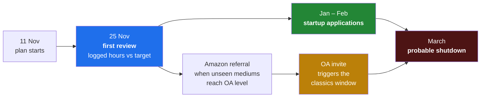
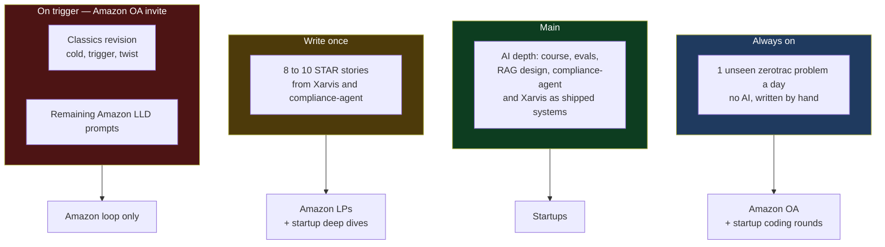

# Plan — November 2026 to March

2026-11-11 · follows [[11-Amazon-SDE2-Loop]]

> [!abstract] What this file is
> Where I actually stand on 2026-11-11, who the prep is for, and how the weekday hours split. It replaces the September course plan in [[07-Course-Strategy-And-Lab-2]] and the timeline in [[08-Action-Plan-To-December]]: the deadline is now a probable shutdown in March, and the targets are an Amazon SDE-2 referral plus AI-engineer roles at startups.

---

## Where I stand on 2026-11-11

| Area | Now | Evidence |
|---|---|---|
| **AI engineering** | Building compliance-agent since about 5 October: an agentic interface over Compliflow that files and pays Professional Tax on state portals, with HR consent before every filing | 5,083 source lines, **5,592 test lines, 153 tests, 375 assertions**, mypy strict, ruff with security rules, a PRD, **95 ADRs**, 28 tickets, 15 bug write-ups |
| **Xarvis** | Sole author, verified in September | 99.7% of 25,789 lines ([[05-Repo-Audit-xarvis]]) |
| **Testing** | The worst September finding is reversed | Xarvis had 0 assertions in ten months; compliance-agent's tests outweigh its source |
| **DSA** | Idle since **2026-06-26**, about 4.5 months | ~108 problem notes from May and June, ~1530 contest rating in May, 3 contests logged |
| **DSA, the real wall** | ~300 classics known from watched solutions and solved several times; unseen problems fail | Self-report, and the June diagnosis in `LC/reflexes/00-install-roadmap.md`: derivation speed |
| **DSA, open families** | Tree-DP 0 of 2, monotonic stack 1 of 2, graph and DP reflex tracks never started | `LC/topic-install-ledger.md` |
| **LLD** | 30 notes with Java code: BookMyShow, Parking Lot, Splitwise, thread-safe LRU, rate limiter, mostly October | `Low Level Design/` |
| **Hand-written code** | Rusty, since coding agents write nearly all of it at work | Self-report |
| **HLD** | LeetDezine case studies, pattern reactivation in progress | `System Design/` |
| **AI course** | At module 16, RAG; about 3 hours of recorded lectures a week | `camp/16-RAG/` |

Dropped from the September plan: Kafka with the outbox, Testcontainers and the VPS deploy. No loop I am targeting asks for them.

---

## The deadline

- **The fixed date is March.** An offer has to land in February, so startup applications go out in January and February.
- **Amazon has no fixed date.** The shortlist is uncertain, so the referral goes in once unseen mediums are at online-assessment level, not on a calendar date.
- **A failed Amazon loop costs about six months of cooldown**, which would overlap the shutdown. Amazon is never the only line.

---

## Who the prep is for

| Target | What the loop asks | How likely |
|---|---|---|
| **Amazon SDE-2**, by referral | OA of one DSA problem plus an AI-assisted repo task; two DSA rounds of one medium and one hard with full code; LLD as class design; HLD; Leadership Principles in every round ([[11-Amazon-SDE2-Loop]]) | Shortlist uncertain |
| **AI-engineer roles at startups**, the March fallback | Shorter live coding with AI off, graded on decomposition, complexity and debugging; AI system design such as RAG pipelines; a deep dive on a system I shipped ([AITechConnect](https://aitechconnect.in/tips/ai-engineer-interview-2026-live-coding-ai-assisted-rounds), [Taggd](https://taggd.in/blogs/how-to-hire-ai-engineers/), [Kalvium](https://kalvium.com/blog/ai-engineer-india-skill-stack/)) | Where my profile carries weight |
| **Indian product startups** with a machine-coding round | 60 to 90 minutes of code that must run, then review (`Low Level Design/00-Round-Formats.md`) | Some of the fallback list |

The startup sources are vendor and career-guide blogs, not first-hand reports, so the shape is indicative.

---

## Four tracks

| Track | What | Serves | When |
|---|---|---|---|
| **Always on** | Unseen zerotrac problems in my band, no AI, written by hand | Amazon OA and startup coding rounds | Daily from now |
| **Main** | The AI course at full depth, AI system design, compliance-agent and Xarvis as shipped systems | Startups | Daily from now; work covers the practice |
| **Write once** | 8 to 10 STAR stories with numbers | Amazon Leadership Principles and startup project deep dives | About one a week, never re-revised for nothing |
| **On trigger** | Classics revision and the remaining Amazon LLD prompts: Amazon Locker, file search and filter, pub-sub, meeting scheduler | Amazon loop only | Only after an OA invite arrives |

> [!important] Why the classics wait for a trigger
> Classics cannot train unseen solving, because I already know where each one starts. Re-revising them without an interview call is the exact pattern from the past: revise everything, get no call, revise again. They are revised once, inside the window between an OA invite and the loop.

---

## The weekday

| | Hours | Split |
|---|---|---|
| **Target day** | 4 | DSA 2, AI 1, LLD 1 |
| **Minimum day** | 1 | One unseen zerotrac problem, nothing else |

- **DSA, 2 hours:** one or two unseen zerotrac problems in band. Contests sit on the weekend.
- **AI, 1 hour:** the course's ~3 hours of recorded lectures a week, plus notes. Work on compliance-agent is the practice.
- **LLD, 1 hour:** machine coding — build the problem by hand, no AI, until it runs. This prepares the startup machine-coding round and rebuilds hand-written code at the same time.
- **Minimum day:** the streak is what failed last time — two months of daily DSA in May and June, then 4.5 months of nothing. On a bad day, one problem counts as a done day.

Four hours is the ceiling, not the expectation. My measured number once staffed was about 18 hours a week, and four hours on every weekday is already 20.

---

## DSA method

- **Band:** set by current contest rating, 50 to 100 below it (`LC/TT.md`). After 4.5 months idle, 1500 to 1550 may fit the first week or two better than 1550 to 1600.
- **No AI anywhere while solving,** and code typed in a plain editor. Both Amazon and the startups grade hand-written code.
- **Readiness to use the referral:** an unseen Amazon-tagged medium solved in 20 minutes or less, with clean code, explained out loud.

## The Amazon window, once an OA invite arrives

- **Classics revision:** cold attempt from the statement only, name the trigger line out loud, then change one constraint and solve the variant without looking. Amazon's 2025 and 2026 questions are mostly classics with a twist: LC 316 asking for the largest result, Subarray Sum Equals K with follow-ups, a stack with O(1) middle operations.
- **The list is prepared now, solved later:** about 60 Amazon classics, written down so the window starts on day one.
- **Remaining LLD prompts** as whiteboard class design, since Amazon's round is design discussion rather than running code.

---

## LLD course under consideration

[Strike — Low-Level Design and Machine Coding, Java](https://strikes.in/course/lld-java): about two months, 45+ hours, 8 modules, ₹3,999, live classes with recordings. Topics listed are OOP and SOLID, UML and requirements, design patterns, machine-coding problems, concurrency and LLD interview simulations. No independent reviews were found; the testimonials are on Strike's own site.

It fits the LLD hour on two counts: machine coding is the format chosen above, and two months ends around mid-January, just before the application window. The overlap with what `Low Level Design/` already covers is large on OOP, SOLID and patterns.

> [!warning] The rule if I take it
> Attempt every machine-coding problem by hand, with no AI, before watching the instructor's solution. Watching first is how 300 classics turned into answers I can recall but cannot derive.

---

## Review on 2026-11-25

Two weeks of the study log against the 20-hour weekday target. If the real number sits near 18 or below, a track gets cut rather than carried as guilt.

## Open items

- [ ] Check the current contest rating and set the starting band
- [ ] Ask the friend: which OA format their org sends now, the usual gap from OA to loop, whether the Bar Raiser is a separate round, and which teams have L5 headcount near AI or LLM work
- [ ] Write down the ~60 Amazon classics list, without solving it
- [ ] Decide on the Strike course
- [ ] Settle the weekend: hours, contest slot, STAR stories, RAG design practice out loud
- [ ] Review on 2026-11-25
