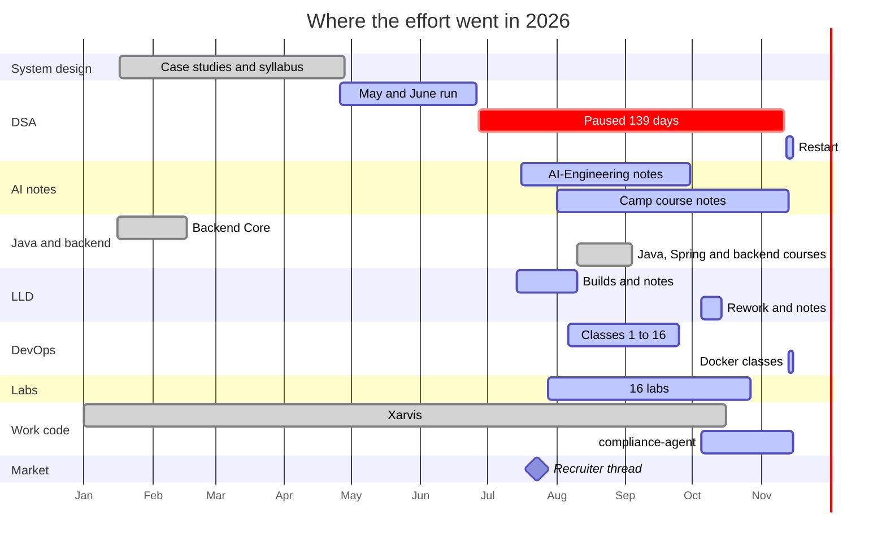
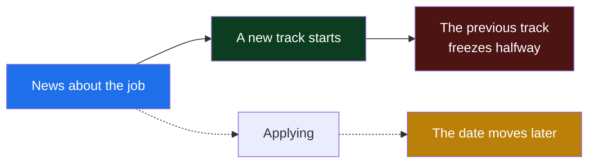

# Trajectory — January to November 2026

2026-11-15 · follows [[12-Plan-Nov-2026]]

> [!abstract] What this file is
> An evaluation of where my effort went between January and November 2026, judged on direction rather than on what I can do cold: whether it pointed at the goal, whether it was the kind of practice that moves the goal, and whether it would compound if continued. The evidence is the wiki and camp notes, the daily log, the labs, and the commit history of the wiki, Xarvis and compliance-agent.

---

## How it was measured

| Benchmark | The question it answers |
|---|---|
| **Direction** | What share of the effort served the goal of its month, and what share serves today's goal? |
| **Form** | Was the activity the kind that moves this track's number? |
| **Dose and continuity** | How many hours and active weeks, and how long were the gaps? |
| **Coverage** | How much of the track's own map has notes? |
| **Depth stage** | How far did each topic travel: absent, read once, revised, used in a lab, used at work? |
| **Stability** | How often did the goal change, and what was left halfway? |
| **Projection** | At the observed pace and form, where does each track land by March? |
| **Bet quality** | Does the AI effort land on the layers that last, and on what employers ask for? |
| Market contact | A sanity check: applications, assessments, interviews, offers |
| Engineering level | A sanity check: work output against a public career ladder |

Effort compounds only when two things hold at once:

| | **The form moves the number** | **The form does not** |
|---|---|---|
| **The topic serves the target** | Compounds: unseen solves move a contest rating | Busy without movement: re-solving watched solutions |
| **The topic does not** | Grows the wrong thing | Pure cost |

> [!note] Limits of the evidence
> Commit days undercount, because I commit in batches. The daily log covers only 22 August to 28 September and 11 to 15 November. Camp, the labs and the public site are dated from file timestamps rather than git. An edit made a week or more after a note was written counts as a revision, and re-reading leaves no trace at all.

---

## The year at a glance

I committed something on 210 of the 319 days, and the weeks on the bench logged 41 to 57 hours. Outside work, no study track lasted more than about four months before the next one replaced it, and work is the only line that ran all year.

---

## Scorecard

| Benchmark | What the evidence shows | Verdict |
|---|---|---|
| Dose | Commits on 210 of 319 days across the wiki and both work repos; 41 to 57 hours a week logged on the bench | Strong |
| Continuity | Outside work no track ran past about four months; DSA paused 139 days, system design 121 and counting | Weak |
| Direction | Effort mostly matched the goal of its month; in the first week of the November plan DevOps took half the logged hours without a line in the plan | Mixed |
| Form | DSA was mostly unseen first attempts, but only 7 rated contests all year; labs were built on the same days work needed them | Mixed |
| Coverage | AI syllabi 35% done, the measurement topics 6%; DSA 12 of 24 ledger topics; system design case studies 8 of 26; LLD 5 of 24 problems | Mixed |
| Depth stage | Agents, tools, human review, streaming, config and tests reached work code; RAG and evals never left the notes | Mixed |
| Stability | The goal changed 7 times between 31 March and 11 November; no plan got past about half done by its own deadline | Weak |
| Bet quality | My July call that evals beats RAG matches the market; since 30 July RAG gained 112 notes and evals none | Weak |
| Market contact | One recruiter thread in July; no applications, assessments or interviews in 2026 | Weak |
| Engineering level | Ownership and design at the ladder's IC3 line; code review, CI and monitoring below its IC2 line | Split |

---

## Effort was steady, tracks were not

| Window | Logged study hours |
|---|---|
| 22 to 31 August, on the bench | 48.7 a week |
| Weeks of 24 August, 31 August, 7 and 14 September | 43, 57, 45, 41 |
| 22 to 28 September | about 4 in total |
| October | no log |
| 11 to 15 November, staffed | 20.5 in five days |

| Date | Change | Trigger | Left halfway |
|---|---|---|---|
| 26 Apr | System design → DSA plus agent work | A résumé gap that needed a bridge | LeetDezine at 8 of 53 case studies, idle since 9 May |
| 26 Jun to July | DSA → Xarvis archaeology, an SDE-2 sprint, LLD | Repo access ending on 1 August | The 1600 band at 28 problems; the 1700 queue never opened |
| 29 Jul | Backend SDE-2 → the backend engineer who owns the AI layer | Two openings closed | The sprint checklist |
| August | Five courses at once, plus a planned project | News about the company's runway | Java series stopped 17 Aug, Spring 28 Aug, backend course 3 Sep; the project never started |
| 3 Sep | Courses → the Xarvis build plan | Repo access ending on 31 December | Kafka and Testcontainers |
| About 5 Oct | Xarvis plan → compliance-agent at work, the RAG module, LLD | The new work project | Xarvis items 3 to 8; the tracker after 17 Sep; the daily log after 28 Sep |
| 11 Nov | → Amazon referral plus startups | The referral, and a probable shutdown in March | The April timeline and the June DSA system |

August is the clearest case: five courses at once and more than 550 new notes in the month. The Java series produced 157 notes in six days, and none of them was edited again a week later.

My own account of the switches: I started on Google prep; news that the company might shut moved me to development and Java; halfway through I concluded that with my current DSA only startups were reachable, so I moved to state-of-the-art work with the AI course, and to DevOps because I did not know what Docker or CI were; choosing the AI plus backend lane meant leaving the Java and backend track until a new company; in November the news that the company may survive to March brought DSA back.

Each step makes sense on its own. The pattern across them is that news about the job started a new track each time, while the one step that news points at most directly, applying, moved later every time:

| Plan written | Applications planned | Company expected to end |
|---|---|---|
| 26 Apr | Q1 to Q2 2027 | Not expected |
| 21 Aug | From 15 Nov | December |
| 3 Sep | October | 31 December |
| 11 Nov | January to February | March |
| 15 Nov | February, earlier if the outlook changes | March, or break-even |

No application went out against any of the first four dates.

---

## Where the AI effort went

No AI note predates 16 July. By November there are 530, across agents, RAG, streaming, MCP and memory, and 16 labs were built between July and October. That growth is real, and a skills test would have missed it.

| Layer | Notes | Share | Stays true for |
|---|---|---|---|
| Framework API | 242 | 46% | Until the next major version |
| Pattern | 234 | 44% | A few years |
| Principle | 54 | 10% | A career |

| | Evals | RAG |
|---|---|---|
| Notes | 7, all written on 30 July | 144, about 190,000 words |
| Since 30 July | None | 112 |
| In code | Never automated | None anywhere |

What did reach code is the backend half of the lane: streaming, config, dependency wiring, logging, request IDs and testing. The labs for those were built on the same day the work needed them: config-lab with the Xarvis config on 11 September, logging-lab and ids-lab with the compliance-agent logging on 8 October. That is the one learning pattern in the year that converted within days.

In a sample of five 2026 job posts in India, eval pipelines and observability appeared in all five and RAG in two. The sample leaned toward eval roles, but the general three-to-five-year post still asks for eval frameworks and regression testing. The field itself looks sound: [CIEL HR data reported by Business Today](https://www.businesstoday.in/jobs/story/ai-job-shift-agentic-ai-engineers-emerge-as-the-hottest-tech-hire-demand-up-260-percent-553968-2026-09-08) counts demand for agentic AI engineers in India up 260% in 2026 over 2025, and for LLM engineers up 86.5%.

---

## DSA: what May and June show

| Indicator | Earlier | Later |
|---|---|---|
| Median difficulty attempted | 1472 in April | 1626 in June |
| Clean rate in the 1600s | 53% in May | 59% in June |
| Clean within 30 minutes | 32% in May | 22% in June |
| My bar of 7 in 10 within 30 minutes | | 7 of 28 in June |
| Contest rating | About 1530 in April | About 1500 in September |

The form was mostly right, with 120 unseen first attempts in the two months, and the difficulty climbed while the quality did not. The rating had no way to move: it is computed only from contests, and 2026 has 7 rated ones against a plan of two a week, with no third question solved. The run ended on 26 June and restarted on 12 November, 139 days later, and `LC/CLAUDE.md` records that the July plan change never wired it back in.

---

## Work is what compounds

| [Dropbox career ladder](https://dropbox.github.io/dbx-career-framework/ic3_software_engineer.html) line | My evidence |
|---|---|
| IC3: owns and delivers projects, and solves ambiguous problems independently | Sole author of Xarvis, about 21,500 lines with 99.95% of current lines mine, and of compliance-agent at 100% |
| IC3: designs components for simplicity and testability | compliance-agent has 153 tests and 367 assertions from its first day, 96 ADRs and 17 bug write-ups |
| [IC2](https://dropbox.github.io/dbx-career-framework/ic2_software_engineer.html): takes part constructively in code reviews | No review trail in git in either repo |
| IC2: responds to operational incidents | No CI, monitoring or alerts in either repo; Xarvis has no tests |

That is IC3-level ownership with IC2-level gaps in review and operations, which is the shape an 8 to 10 person startup produces. Deploying compliance-agent myself starts closing the operations gap.

---

## By March, had nothing changed

| Track | Where it was heading | Why |
|---|---|---|
| Work | Kept compounding | Tests, ADRs and labs fed it every week |
| DSA | Fading by early February with the rating flat | One two-month run so far, 7 contests this year, and the forecast in `LC/CLAUDE.md` |
| AI notes | Awareness kept growing | 530 notes in four months |
| RAG and evals | Still no code | Nothing since July |
| LLD | Not interview-ready | 5 of 24 problems, 0 hours in the first plan week |
| Market | First contact in January or February at best | The dates in the November plan |

---

## Decided on 2026-11-15

| Track | Decision |
|---|---|
| DevOps | In work hours, on the compliance-agent deploy to the dev environment from 16 November: Docker, Kubernetes, Helm. It tapers once the deploy is integrated |
| AI | Evals and tracing built into compliance-agent first, then RAG. Each counts as done when compliance-agent shows a result, such as a pass rate on its 17 hand-judged scenarios and a trace for every run |
| DSA | 1 to 2 hours every morning, with the Sunday contest inside that slot |
| LLD | 1 hour every evening, by hand; the Strike decision is still open |
| Amazon | Use the referral once an unseen medium in 20 minutes is routine |
| Applications | Start in February, or the week the company outlook changes |

The early warning for the old pattern is the first missed Sunday contest.
