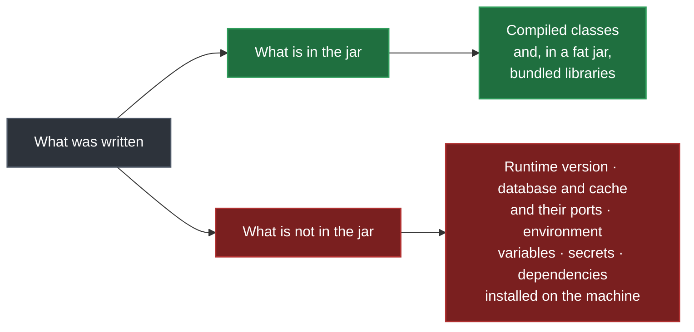
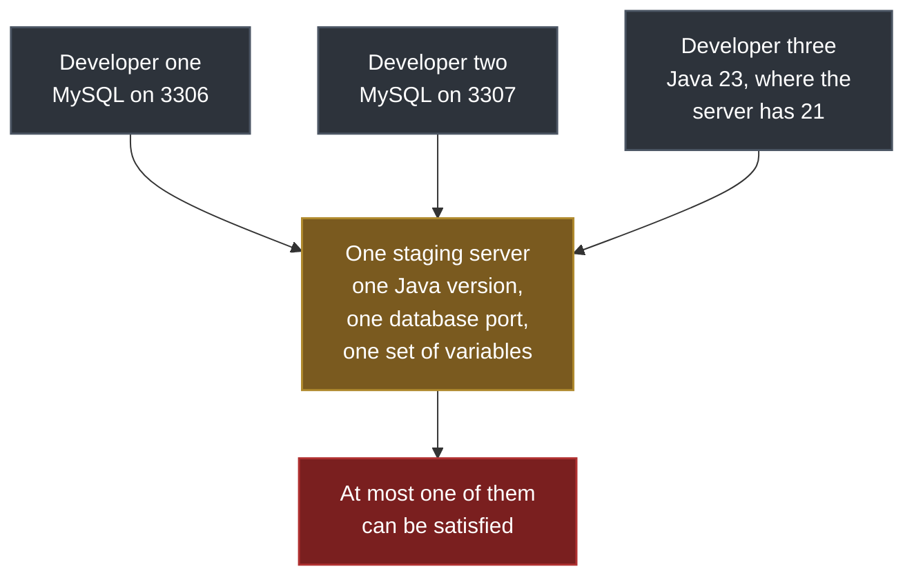
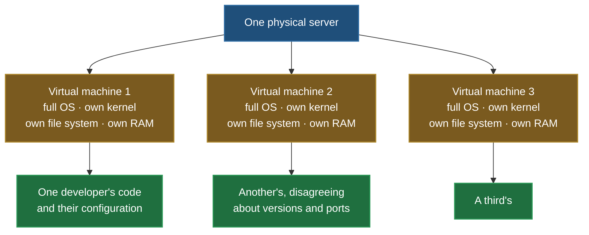
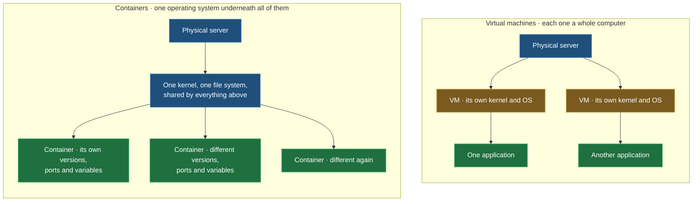

The job is to get code onto a server and keep it working there. Everything in this folder follows from one awkward fact about that job: code that runs perfectly on the machine it was written on has a habit of refusing to run anywhere else, and the reasons are almost never in the code.

Anybody who has worked on a team has met the sentence that comes next. A developer hands their work over, it fails on the other machine, and the first response is:

> It works on my machine.

It is famous enough to be printed on t-shirts, and it is usually said with complete sincerity, because it is true — it did work. The trouble is that **a developer's job was never to make code run on their own machine.** It was to make it run on a server, and the gap between those two things is the subject here.

## An application is more than the code

Consider what actually changes hands. A Java project is built into a jar, and the jar goes to whoever needs to run it. That feels like handing over the application, and it is not.

Adding a feature to an application is not only writing code. Alongside it you write configuration — a flag that turns the new behaviour on and off, the address and port of the database, the address and port of the cache, the user the application connects as. You set environment variables and secrets on your machine, quietly, months ago, and you have long since stopped thinking about them. And underneath all of it sits a set of things you did not write at all: which version of Java this compiles and runs against, which version of the database is installed, which libraries the build pulls in.

| What an application is made of | Where it lives |
|---|---|
| Code | in the jar |
| Libraries and dependencies | in the jar, if it is a fat jar; otherwise on the machine |
| Configuration | partly in the jar, partly in files on the machine |
| Environment variables and secrets | on the machine, and deliberately not in the jar |
| Runtime version | installed on the machine |
| Database, cache and their versions and ports | installed on the machine |

A jar carries the first row reliably and the second row sometimes. The jar is the build's **artifact** — the finished, deployable package a build produces, versioned and kept, and the thing that actually gets copied onto a server. **Everything below that first row is a property of the machine, not of the artifact** — and a modern fat jar, which bundles libraries and often some configuration, is a recent convenience. Older ones carried compiled code and nothing else.

## The two machines

Put numbers on it. One developer builds against Java 21, with MySQL installed on its default port of 3306, a Redis cache running on its default 6379, and a handful of environment variables set on their laptop last spring.

The machine it is sent to has Java 8. Its MySQL is on 3307. It has no Redis installed at all. It has none of those environment variables, because they were never written down anywhere that could be shared.

| | The machine it was built on | The machine it was sent to | What happens |
|---|---|---|---|
| Java | 21 | 8 | The classes will not load |
| Database | MySQL on 3306 | MySQL on 3307 | The connection is refused |
| Cache | Redis on 6379 | not installed | Anything that writes to the cache fails |
| Environment variables | set | absent | Configuration reads come back empty |

Four failures, none of them a bug. The code is identical in both places.

> [!important] The Java version failure only runs in one direction, and it is worth getting the direction right.
> Java works hard to keep old programs running on new runtimes, so code written for Java 8 will generally run on a Java 21 runtime. The reverse is not true and is not meant to be: something compiled for 21 will not load on an 8 runtime, because it may use classes and language features that did not exist yet. So the machine with the newer runtime is the safe one and the machine with the older runtime is where the handover breaks — which is the awkward way round, because the older machine is usually the one nobody has updated.

## Putting it on a shared server does not fix it

The obvious objection is that nobody passes jars between laptops. You put the build on a server — not production, but a staging server, an Ubuntu box that exists to run everybody's work and see whether it holds up.

That helps exactly once. Take a developer whose code needs Java 23 arriving at a server that has 21 — the same mismatch as before, one version further along. They say so, somebody installs Java 23 on the server, and now it runs. Fine.

Then a second developer arrives whose application connects to MySQL on 3307, and a third whose connects on 3308, while the first is still written against 3306. **The server can hold one port.** Set it to 3307 and the other two break; leave it on 3306 and the other two never run. There is no arrangement of one machine that satisfies three people, and it gets worse with every person added.

The obvious reply is to stop sharing: buy a server each. That is not a fix, it is the same bill paid in hardware — a machine per developer, each one mostly idle, and the arrangement falls over again the moment the number of people grows.

## Cutting the server into smaller machines

If the problem is that one machine holds one configuration, the first-principles response is to stop having one machine.

This is already an ordinary thing to do, and it is probably sitting on somebody's desk nearby. A MacBook runs macOS, and inside it, at the same time, Ubuntu runs in a **virtual machine** — a complete computer simulated in software, with its own operating system, running on hardware it shares with its host. One physical laptop, two independent machines, and whichever one is being worked in does not care that the other exists.

One word is needed before going further, because everything below turns on it. An operating system has a core called the **kernel**: the part that talks to the hardware, hands out memory, decides which program gets the processor next, and owns the file system. Everything else — the programs, the libraries, the directory layout — sits above it and asks the kernel for what it needs. **How many kernels are involved is the question that separates a virtual machine from a container**, so it is worth having the word fixed now.

So divide the staging server the same way. Create five virtual machines on it, give each developer one, and let each of them install whatever they need inside it: their runtime version, their database on their port, their cache, their variables. The virtual machines do not have to agree with each other and do not have to run the same operating system.

This genuinely works. Everybody's code can be tested separately on one piece of hardware, and whatever passes can be promoted. It is a real solution, and it is worth seeing it work before seeing what is wrong with it — because the same reasoning will be needed again on production, where each service has the same disagreements.

## Why a virtual machine is the wrong size for this

Two questions break it.

**Is a virtual machine lightweight?** Not remotely. A virtual machine is an entire operating system. **It has its own kernel**, its own file system, its own allocation of memory and its own share of the processor, and all of that exists before a single line of your application has run. You are not paying for your code; you are paying for a second, third and fourth computer.

**So how many fit?** Count it rather than guessing. Take a host with 16 GB of memory and 8 processor cores, and give one virtual machine 8 GB and 2 cores — not a generous size for an operating system with a service and a database on it. That host now holds two such machines and has nothing left to give a third. **The five proposed a moment ago do not fit on one server** — they need three, and those three spend most of what they have running operating systems rather than anybody's code.

The natural objection is that the hardware underneath is the same hardware, so what is actually being duplicated. The answer is the allocation. **Those 8 GB are genuinely set aside**: the operating system inside that virtual machine stores what it stores within them, schedules its threads across its 2 cores, and the other 8 GB and 6 cores are not available to it under any circumstances. The hardware is shared; the carve-up is not, and the carve-up is the thing being bought.

So the shape of what is wanted is now clear. The isolation of a virtual machine — each developer's versions and ports kept away from everybody else's — without a full operating system underneath each one.

## Containers

Divide the server into **containers** instead.

Give each developer a container. Inside it goes their code, their runtime version, their database port, their variables, their dependencies. It runs independently of every other container on the machine and cannot interfere with them, which is the property the virtual machines were bought for.

**And they do not have to be the same kind of thing at all.** One container holds the order service's jar and the Java 21 it was built against; the one beside it holds MySQL on 3306 and nothing else; a third holds Redis. The machine underneath is not asked to agree with any of them, and is not asked to have any of it installed.

Because there is no operating system per tenant, the 8 GB that a virtual machine reserves before running anything is never spent. A container costs what its own process and its own files cost, and nothing is set aside in advance. **There is still a ceiling** — every container draws on the same memory and the same cores, and the host does not grow — but it is a ceiling on what the applications actually use, rather than a fixed charge collected per tenant before any of them start.

**Dividing an application and everything it needs into containers like this is called containerization**, and the tool that brought it to ordinary use is **Docker**. It is not optional knowledge for this work.

## What a container actually is

The definition, stated plainly:

> A container packages an application together with the environment, configuration and dependencies required to run it.

That is the whole idea, and it is worth reading against the table near the top of this note.

> Every row that was a property of the machine — runtime version, database port, environment variables, installed dependencies — **becomes a property of the package instead**.

It works on my machine stops being an excuse and starts being a description, because the machine travels with the code.

A lunch box with dividers is the picture most people reach for, and it is worth knowing exactly where that picture stops.

> [!important] A container is not a virtual machine, and the convenient way of picturing it is wrong.
> It is extremely common to be told that a container is a lightweight virtual machine. That sentence is useful for getting a first grip on the idea, and it is false. **A container does not get a kernel of its own** — every container on a machine is asking the one operating system underneath them all for what it needs, where a virtual machine brings a second operating system with it. **Nor does a container get a reserved share of the machine.** A virtual machine is handed 8 GB of the host's 16 and holds them whether it uses them or not; a container is a process on the host, drawing on the same memory and the same cores as everything else running there. What a container gets instead is a **view**: from inside one, the file system looks like the whole disk, no other container's files are anywhere to be seen, and the ports all look like its own. The dividers in the lunch box are real walls. A container's are a presentation, and **how that presentation is produced is a Linux mechanism this folder comes back to later.**

The useful word for it is **process**. Jenkins running on a server is a process; a container is a process too, started with its view of the machine deliberately narrowed, and that is the whole of the difference.

Two follow-on confusions are worth naming because they come from the same root. **Creating a container is not creating a virtual machine** — if it were, nothing would have been gained and the whole argument of this note would have gone in a circle. And **running an application in a container is not running it on a virtual machine**, because running it on a virtual machine means there really is a second operating system underneath it, with a kernel of its own and a reserved allocation of memory and processor, and here there is neither.

One more, worth heading off because it comes from reading the diagram too literally: the containers above are one per developer, not one per user. Nothing here says that a thousand people using an application need a thousand containers. The containers are holding different configurations that disagree with each other, and it is developers who disagree about which version of Java they need — end users never enter into it.

## They still talk over the network

Isolation cuts both ways. A container cannot see another container's files or ports, which is the entire point — and it also means a container cannot simply reach into the one beside it when it needs something from it.

So when the application in one container needs the database in another, it does what any machine does to reach any other machine: it opens a network connection. The same protocols, the same addresses and ports, the same security concerns as between two servers in two different buildings. A database in one container and an application in another are, as far as the conversation between them goes, two servers, and the fact that both are processes on one host changes nothing about how that conversation has to be conducted.
