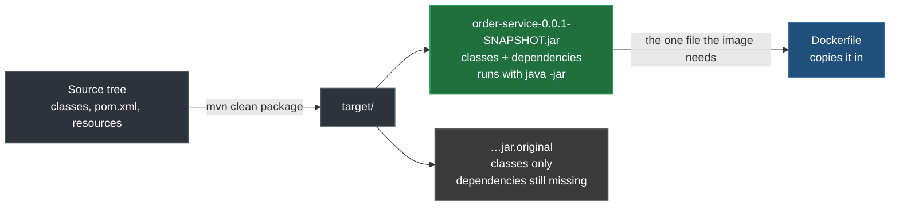
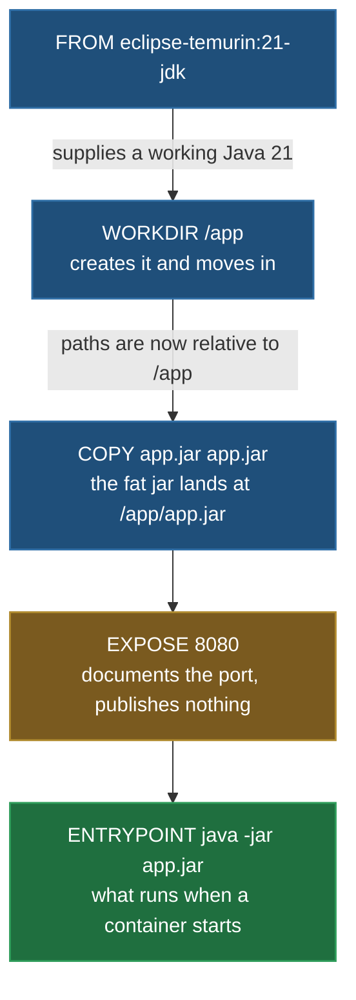

A container's view of its machine is false and its isolation is real, and that combination is what makes it safe to put something substantial inside one. So far nothing has gone in but a file holding a single word. An actual application brings a problem that file did not have: an application is not one file, and working out which of its files belong in the image is the first real decision.

## The application

The running example is the bookshop's order service, a Spring Boot application built with Maven. It has one endpoint on it, so that there is something to call and something to see come back.

```java
// src/main/java/in/bookcart/orderservice/HelloController.java
package in.bookcart.orderservice;

import org.springframework.web.bind.annotation.GetMapping;
import org.springframework.web.bind.annotation.RequestMapping;
import org.springframework.web.bind.annotation.RestController;

@RestController
@RequestMapping("/api")
public class HelloController {

    @GetMapping("/greet")
    public String greet() {
        return "Hello Docker!";
    }
}
```

Two details matter later. The path is `/api/greet`, because the annotation on the class contributes `/api` and the annotation on the method contributes `/greet`, and the two join into one path. And the project sets no port anywhere:

```properties
# src/main/resources/application.properties
spring.application.name=order-service
```

So the service listens on **8080**. That is Spring Boot's default rather than anybody's decision, and it becomes important the moment two things on one machine both want it.

## What you actually deploy is not the application

The source tree is not what gets shipped. What gets shipped is what the build produces, and for a Maven project that means running the build through to the packaging step:

```bash
mvn clean package
```

Two separate things happen there, from two separate Maven lifecycles. `clean` removes everything the previous build generated, so that nothing stale survives into this one. `package` is a phase of the default lifecycle, defined as taking the compiled code and packaging it in its distributable format — for this project, a jar. Reaching `package` means Maven has already run every earlier phase in that lifecycle, compiling the sources and running the tests on the way.

What lands afterwards is a single file:

```text
target/order-service-0.0.1-SNAPSHOT.jar
```

The name is not arbitrary. It is the project's artifact name and version joined together, which is why the version string appears in a filename you then have to type.

## Two jars come out, not one

Look in `target/` after a Spring Boot build and there are two jars, not the one you expected. This is worth understanding rather than ignoring, because which of them you put in the image decides whether the image works at all.

Spring Boot's build plugin takes the ordinary jar Maven produced and repackages it into an executable one that contains all of the application's dependencies and can be started with `java -jar`. The plain jar it started from is kept, renamed with a `.original` suffix.

| | What is inside | Can it run alone |
|---|---|---|
| `order-service-0.0.1-SNAPSHOT.jar` | the compiled classes **and every dependency**, bundled in | yes |
| `order-service-0.0.1-SNAPSHOT.jar.original` | the compiled classes only | no |

The names for these are **fat jar** and **slim jar**. A fat jar carries its dependencies inside itself. A slim jar does not, and whatever machine receives it has to resolve and install those dependencies separately before the code can start.

> [!important] **The fat jar is the reason a Dockerfile for a Java service is four lines rather than forty.**
> Every library the service needs is already inside that one file. Nothing has to be downloaded during the build, no dependency list has to be reproduced in the image, and the instruction that copies the application in copies exactly one thing. A slim jar would push all of that work into the Dockerfile, which is how a simple image turns into a complicated one.



## The Dockerfile for a real service

An earlier note copied the jar straight out of `target/`, because the build and the image were happening in the same place. Here they are not. The jar is carried to wherever the image will be built and renamed to `app.jar` on arrival, so the build directory holds two files side by side: the `Dockerfile` and `app.jar`, and the copy instruction names it directly rather than reaching into a build directory that will not exist on the far machine. That renaming is worth doing — it keeps the version string out of the Dockerfile, so a new release does not require editing the file that describes how to build the image.

```dockerfile
# Dockerfile
FROM eclipse-temurin:21-jdk

WORKDIR /app

COPY app.jar app.jar

EXPOSE 8080

ENTRYPOINT ["java", "-jar", "app.jar"]
```

Four of those five instructions have been met already and need only a line each. `FROM eclipse-temurin:21-jdk` starts from an image that already has Java 21 installed and working. `WORKDIR /app` creates `/app` and moves into it, doing the work of `mkdir` and `cd` in one instruction, so every path after it is read relative to `/app`. `COPY app.jar app.jar` takes the jar from the build directory and puts it in the image at `/app/app.jar`. `ENTRYPOINT` sets the command the container runs when it starts.

The base image is the one choice here that deserves a second look later, and it is worth being honest now about why it was made. A Java Development Kit is the obvious thing to reach for: it is the tag most people know, and it unquestionably contains everything a Java application could want. An earlier note's illustrative file named the runtime tag instead, and the difference between the two was left standing as a remark about what each one holds rather than as advice. Reaching for the kit is what happens in practice when nobody has yet been given a reason not to, and whether it contains considerably more than this particular application needs is not a question anyone asks until something forces it.

The fifth is new.

## EXPOSE declares a port and publishes nothing

`EXPOSE 8080` says that the container listens on port 8080 at runtime. That is all it says. Docker's own reference is explicit that the instruction does not actually publish the port, and describes it as a form of documentation between the person who builds the image and the person who runs the container.

| | |
|---|---|
| **EXPOSE guarantees** | anyone reading the image can see which port the application listens on |
| **EXPOSE does not guarantee** | that the port is reachable from outside the container |

Reachability is a decision made when the container starts, not when the image is built, and it is made with the publishing flag on the run command — the one that maps a port on the host to a port inside the container. An image with no `EXPOSE` line at all can still have its ports published, and an image with `EXPOSE` on every port it owns is still unreachable until somebody publishes one.

So the instruction earns its place for a reason that has nothing to do with networking: it is the only part of the image that records what the application inside it expects. Delete it and the image still works, and the next person to run it has to read the source to find out which port to map.

## ENTRYPOINT rather than CMD, and in that form

The last line is written as a list of strings rather than as one string, and that form is deliberate. Arguments given to the run command are appended after every element of an `ENTRYPOINT` in this form, and they override a `CMD` entirely. For a service that must always start the same way, `ENTRYPOINT` is the honest choice: it states that this image runs this jar, and an argument passed at run time extends that rather than replacing it.



## Where this leaves things

There is now a fat jar that runs on its own, and five lines of text describing an image that would run it. Both of them are sitting on the machine the code was written on.

That machine is not the one the service is meant to run on. A laptop is where an application is built; a server is where it answers requests, and the two are different computers with different file systems, reachable at different addresses. Nothing written so far has crossed that distance, and the instruction that copies the jar into the image assumes the jar is already sitting next to the Dockerfile — on whichever machine the build is about to happen.
