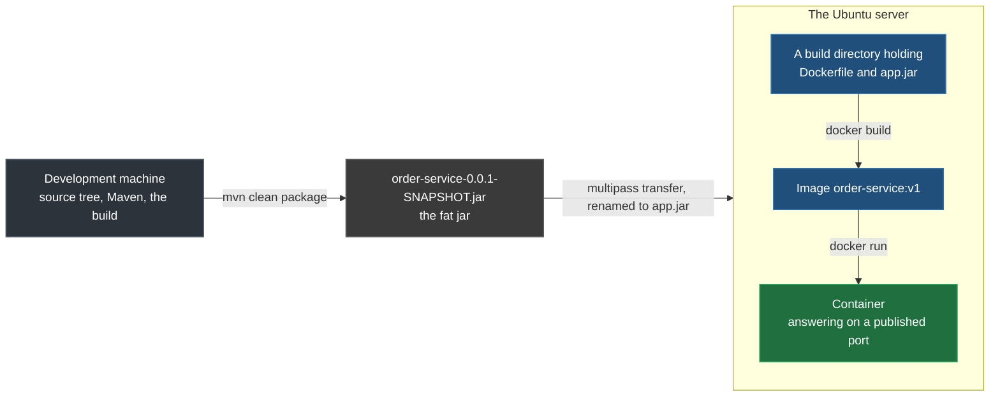

The fat jar and the Dockerfile that would containerise it are both sitting on the machine the code was written on. That machine is not where the service is supposed to run. Everything from here on is about the distance between those two computers, and it turns out to be where most of the confusion about deployment lives.

## What deploying meant before any of this

Strip the containers away for a moment and look at what deploying this service by hand would involve, because the manual version is what every later tool is automating.

A Linux server has a file system like any other Linux machine, with conventional places to put things — `/opt` for software installed outside the package manager, or a directory made for the purpose. The jar is copied into one of them. Then it is started:

```bash
java -jar app.jar
```

The service comes up on 8080 on that machine, and a request sent to the server's IP address on that port reaches it. That is the whole of deployment in its simplest honest form.

> [!note] **Deployment is putting a file on a computer and starting it.**
> Every pipeline, every automation tool and every orchestration layer is a way of carrying out that one act reliably and repeatedly. None of them is a different act. Holding on to that sentence makes the rest of the subject much easier, because it means the question is never what deployment is, only who performs it and how many times it can be trusted to go the same way.

What breaks is not the single jar. It is everything the jar needs around it. A real service wants a database, probably a cache, a set of configuration values and a set of environment variables, and each one has to be installed and configured on that server by hand before anybody finds out whether the application even starts. That is the argument this folder opened with, and it is why the jar goes into an image instead.

## The artifact has to physically cross

An image built on the server needs the jar on the server, because the instruction that copies it in reads from the directory the build is given, on the machine the build runs on.

The server from here on is an Ubuntu machine with Docker installed on it. It does not have to be a rented one to follow any of this — a virtual machine on your own laptop behaves identically, and **Multipass** is a tool that creates and manages Ubuntu virtual machines with a single command, which is where the examples below are run. Everything that follows is the same on a machine in a data centre; only the address changes.

For an Ubuntu virtual machine managed with Multipass, there is a command for exactly that. Its form is a source, then a destination, and a path inside an instance is written as the instance name, a colon, and the path:

```bash
multipass transfer target/order-service-0.0.1-SNAPSHOT.jar devops:/home/ubuntu/order-service/app.jar
```

The rename happens here rather than in the Dockerfile. The jar arrives as `app.jar`, which is why the image's copy instruction names `app.jar` on both sides, and why cutting a new version of the service does not mean editing the file that describes how to build its image.



The Dockerfile is written on the server too, in the same directory, with whatever editor is available there — `nano Dockerfile` is enough. The build directory then holds two files and nothing else, which is exactly what the build needs and no more.

## Building it where it will run

```bash
docker build -t order-service:v1 .
```

The tag names the image and gives it a version, and the trailing dot hands the current directory to the build as its context — the set of files the copy instruction is allowed to read from.

**Run that as an ordinary user on a fresh server and it fails before it starts.** The failure is a permission error about connecting to the Docker daemon's socket, and it is not a misconfiguration. The daemon runs as root and listens on a Unix socket at `unix:///var/run/docker.sock`, which by Docker's own description allows only local connections by the root user. An ordinary user has no access to it.

| | |
|---|---|
| Reach the daemon with elevated privileges | prefix the command with `sudo` |
| Reach it as yourself | add your user to the `docker` group, then log out and back in |

The second is the one worth doing on a machine you use often, and it has a consequence worth stating plainly: membership of that group is equivalent to root access on the host, because anything the daemon can do, a member of the group can ask it to do.

## Running it, and the port that was already taken

```bash
docker run -d --name order-v1 -p 8080:8080 order-service:v1
```

`-d` detaches, so the container runs in the background and the terminal comes back instead of being held by the application's output. `--name order-v1` gives it a name you can refer to afterwards. The publishing flag maps a port on the host to a port inside the container, written host first and container second.

**This fails on a server that has been used for anything else.** The run cannot bind port 8080 on the host because something is already holding it — in this case a container from an earlier experiment, still running, still bound. A container that cannot get the host port it was asked for does not start.

The fix is to leave the application where it is and move the host side of the mapping:

```bash
docker run -d --name order-v1 -p 8081:8080 order-service:v1
```

Nothing about the image changed, nothing about the application changed, and nothing inside the container changed. The service still listens on 8080 because that is what Spring Boot defaults to and nothing configured otherwise. Only the host's side of the mapping moved, which is the point of there being two numbers.

| | Inside the container | On the host |
|---|---|---|
| Port the application binds | 8080 | — |
| Port a client connects to | — | 8081 |
| What the application believes | it is serving 8080 | — |
| What changed to make it work | nothing | the published port |

## Checking that it actually works

The first check is from the server itself, using `curl` — a command-line tool that sends an HTTP request and prints what comes back, which is how you test a web service on a machine with no browser on it:

```bash
curl http://localhost:8081/api/greet
```

**Guessing the path is the easy mistake here**, and asking for `/hello` returns a 404 rather than a greeting. The path is not a matter of convention — it is whatever the controller declares, and this one declares `/api` on the class and `/greet` on the method. A 404 at this point means the container is running and answering; it is the application rejecting a path that does not exist, which is a completely different problem from the service being down.

The second check is the one that matters, from a browser, at the server's own address rather than at localhost:

```text
http://<server-ip>:8081/api/greet
```

That returns the greeting from outside the machine entirely. At that moment the service is live: it is running on a computer that is not the one it was written on, reachable by address, started from an image built out of a five-line file.

## Why not just use a repository for this

The obvious objection, once the jar has been copied across by hand, is that real projects do not copy jars by hand. They push to a repository and something else takes it from there. Both halves of that are true and they are easy to tangle together.

GitHub, and any host like it, manages the code base. It holds the history, it handles review, and it is where the source lives. **It is not something you install on a server.** The server never needs the repository; it needs the built artifact and something to run it.

What connects the two is a pipeline, and a pipeline performs exactly the manual act described at the top of this note — take the artifact, put it on the machine, start it — without a person doing it. Push to a branch, open a pull request, merge it, the pipeline triggers, and the artifact lands on the server. The act is unchanged. The reliability is what improved.

> [!tip] **Knowing when the pipeline is overkill is part of knowing what it is for.**
> For a service with one endpoint, being demonstrated once, the full sequence of push, pull request, merge and triggered pipeline is more machinery than the task deserves, and copying one file is both faster and clearer about what is actually happening. For anything that will be deployed more than a handful of times, by more than one person, the manual version stops being honest simplicity and starts being a source of difference between what is running and what anybody believes is running.

The second thing worth separating: the image and the container this produced exist on that server, in Docker's own storage, and not in the repository. Nothing about building an image puts it anywhere a repository can see. Moving images between machines is its own problem with its own answer, and GitHub is not that answer — it stores what you wrote, not what you built.

## What the server now holds

Two commands show the state of it. One lists the images Docker has stored, the other lists containers:

```bash
docker images
docker ps
```

The image listing has a column that turns out to be the most interesting number on the screen, and it is not the name or the tag. It is the size.
