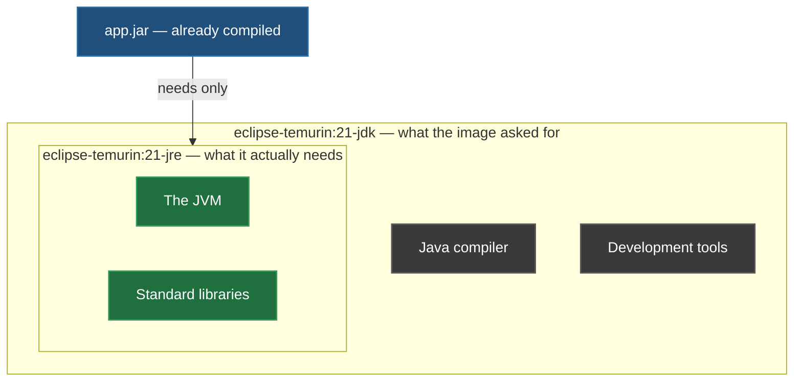

The size column reads **782 MB**.

That is the image for a service whose entire behaviour is to answer one path with one line of text. The jar it was built from is a few megabytes. Before reading on it is worth sitting with the question the number poses: is 782 MB normal, and if not, what is actually in there?

## Where 782 MB comes from

An image is built in layers, each instruction in the Dockerfile adding one, and the finished image is all of those layers stacked. The first instruction contributes by far the most, because it does not describe a small change — it names an entire prepared image to start from.

```text
order-service:v1
├── Linux user-space environment
│   ├── libraries
│   ├── utilities
│   └── system files
├── Java Development Kit
│   ├── the JVM
│   ├── the Java compiler
│   └── development tools
└── the application
    └── app.jar
```

Read that from the bottom and the shape of the problem is obvious. **The application is the smallest thing in its own image.** Everything above it is the environment the application needs in order to be a running process at all: a file system with the libraries and utilities a Linux process expects to find, and on top of that a complete Java installation.

None of that is waste in principle. A container shares the host's kernel but not its user space, so the image has to carry a user space of its own or there would be nothing for the process to run inside. The question is not whether to carry an environment. It is whether this is the right environment.

## What a JDK actually is

The first line of the Dockerfile asks for `eclipse-temurin:21-jdk`, and the last three letters are the whole story.

JDK stands for Java Development Kit, and a kit is exactly what it is — a bundle of several things that happen to ship together.

| | What it contains | What it is for |
|---|---|---|
| **JVM** | the virtual machine that executes bytecode | running compiled Java |
| **JRE** | the JVM plus the standard libraries | running compiled Java |
| **JDK** | the JRE plus the compiler plus development tooling | writing and compiling Java |

To execute a jar that has already been built, the JVM is what is needed, and the JRE is the smallest packaging of it that is useful. Everything the JDK adds on top exists to turn source code into bytecode.

> [!important] **Asking for a JDK installs everything needed to develop Java, inside an image that never develops anything.**
> The jar arrives already compiled — that is what the build on the development machine produced. Nothing inside this container will ever edit a source file, and a compiler with nothing to compile is several hundred megabytes of software that will never be executed. The compiler is not idle because the image is small or the application is simple; it is idle because compiling is not something that happens at this point in the process at all.



## The change is one word

Nothing else in the file moves. The working directory, the copy, the exposed port and the entry point are all unaffected, because none of them depended on a compiler being present.

```dockerfile
# Dockerfile
FROM eclipse-temurin:21-jre

WORKDIR /app

COPY app.jar app.jar

EXPOSE 8080

ENTRYPOINT ["java", "-jar", "app.jar"]
```

Build it as a second version rather than overwriting the first, so that both exist side by side and the sizes can be compared directly:

```bash
docker build -t order-service:v2 .
```

## Proving it still works before believing the number

A smaller image that does not start is not an improvement, so the second version gets run before its size is celebrated. The first container is still holding host port 8081, so this one takes another:

```bash
docker run -d --name order-v2 -p 8082:8080 order-service:v2
```

```bash
curl http://localhost:8082/api/greet
```

The greeting comes back. Inside the container the application still binds 8080, exactly as before — the image changed underneath it and the application did not notice, because nothing it uses at runtime was removed.

## What that bought

```bash
docker images
```

| Image | Base | Size |
|---|---|---|
| `order-service:v1` | `eclipse-temurin:21-jdk` | 782 MB |
| `order-service:v2` | `eclipse-temurin:21-jre` | 512 MB |
| | **Difference** | **270 MB** |

Two hundred and seventy megabytes, for changing three characters in one line, with no change to the application, no change to how it is built, and no change to how it behaves.

That is worth stating as a general lesson rather than a Java one: **the largest single decision about an image's size is the first line of its Dockerfile**, and the common version of this mistake is asking for a toolchain when all that is needed is a runtime. The same shape appears with any language that distinguishes a development installation from a runtime one.

## Why this technique is now spent

Look at what 512 MB still consists of, and the second half of the problem is visible. The Linux user space is still there in full — its libraries, its utilities, its system files, its environment variables and configuration. The Java runtime is still there, with configuration of its own. The application is still a few megabytes sitting on top of all of it.

| | v1 | v2 |
|---|---|---|
| Linux user space | present in full | present in full |
| Java compiler and tooling | present | **removed** |
| Java runtime | present | present |
| The application | a few MB | a few MB |

Removing the runtime is not an option, because without it there is nothing to execute the jar. Removing the Linux user space is not an option either, because a container shares the host's kernel and nothing else, so the process needs a file system of its own to run in.

So the base image can be swapped for a more appropriate one exactly once, and after that the lever stops working. Getting the number down further means attacking the problem from a different direction entirely — not choosing a better image to start from, but changing how the image is assembled, so that the things needed to build an application and the things needed to run it stop ending up in the same place.
