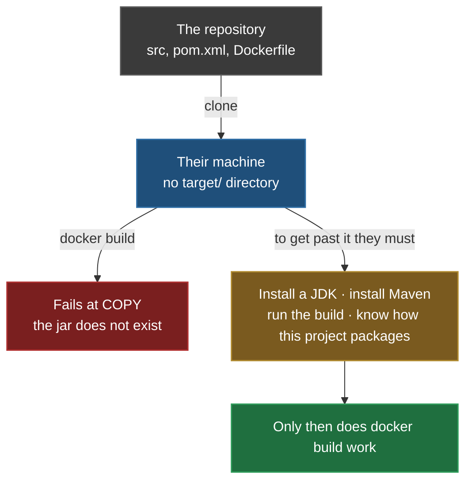
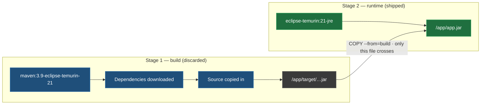

Cutting the base image from a development kit to a runtime took 270 MB off, and then the lever stopped working. The technique that moves the number again is the one hinted at there: stop letting the things that build an application and the things that run it end up in the same image. Before reaching it, though, there is a second problem with the Dockerfile as it stands, and it has nothing to do with size at all.

## The Dockerfile only works on the machine that built the jar

Here is the file as it stands, after the base image was swapped:

```dockerfile
# Dockerfile
FROM eclipse-temurin:21-jre

WORKDIR /app

COPY app.jar app.jar

EXPOSE 8080

ENTRYPOINT ["java", "-jar", "app.jar"]
```

The copy instruction reads a jar that exists because somebody ran a Maven build first. That jar lives in `target/`, the directory Maven creates, and `target/` is **not in version control** — it is build output, it is regenerated every build, and every sensible project ignores it.

Now hand this project to somebody else. They clone the repository and get the source tree, the `pom.xml` and the Dockerfile. They do not get `target/`, because it was never committed. They run the build command and it fails on the copy, because the file it names is not there.



So the Dockerfile has a hidden prerequisite. To use it, the recipient needs a Java development kit, needs Maven, and needs to know how this particular project is packaged. That holds for a colleague, and it holds for every server the service is ever deployed to.

> [!important] **This defeats a large part of the reason for containerising anything.**
> The promise was that the image carries whatever the application needs, so that the machine running it does not have to. A Dockerfile that only works if you have already installed a toolchain and run a build has handed that work straight back. And the person on the other end is frequently someone who does not read the language at all — plenty of people who deploy an application could not package it from source if asked.

What you actually want to hand over is a source tree with a Dockerfile in it, and for two commands to be enough: build the image, run the container. Nothing installed, nothing known about the language.

## First attempt: do the build inside the image

If the problem is that the build happens outside the image, move it inside. Start from an image that already has Maven and a JDK, copy the source in, and run the build as one of the instructions.

```dockerfile
# Dockerfile
FROM maven:3.9-eclipse-temurin-21

WORKDIR /app

COPY pom.xml .
COPY src ./src

RUN mvn clean package -DskipTests

EXPOSE 8080

ENTRYPOINT ["java", "-jar", "target/order-service-0.0.1-SNAPSHOT.jar"]
```

`COPY pom.xml .` brings the build file into `/app`, and `COPY src ./src` brings the whole source tree in beside it. The build then runs where it can see both, writes its output to `/app/target/`, and the entry point names the jar at that path rather than a copied one.

This genuinely solves the problem it was aimed at. Anybody can clone the repository and build the image, with no Maven and no JDK on their machine, knowing nothing about how the project is packaged.

## And the image is now worse than it has ever been

Look at what ended up inside it.

```text
the image this Dockerfile produces
├── Linux environment
├── Java Development Kit
├── Maven
├── the Maven dependency cache
├── the source code
├── the compiled application
└── build-related files
```

Every one of those is in the image that gets deployed, and exactly one of them runs. The compiler is back, having just been removed in the previous note. Maven is there. The entire dependency cache that Maven downloaded during the build is there. The source code is there, in the production image, which is its own problem quite apart from the size.

> [!warning] **Shipping source code inside a production image is a disclosure risk, not just dead weight.**
> Anyone who can pull or run the image can read the application's source straight out of it. Size is the obvious cost of this Dockerfile; this is the one that actually matters.

So there is a dilemma, and it is worth naming because the solution is only interesting once the dilemma is felt. Either the image is self-sufficient and enormous, or it is lean and the person receiving it has to do the build themselves. Both options were just rejected. There is no third option available with one `FROM` line.

## Two stages in one file

A Dockerfile may contain more than one `FROM`. Each one begins a new stage, starting from a fresh base image, and a later stage can reach back into an earlier one and take files out of it. That is the whole mechanism, and a Dockerfile written this way is called a **multi-stage build**.

```dockerfile
# Dockerfile
# -------- stage 1: build --------
FROM maven:3.9-eclipse-temurin-21 AS build

WORKDIR /app

COPY pom.xml .
RUN mvn -B dependency:go-offline

COPY src ./src
RUN mvn -B -DskipTests package

# -------- stage 2: runtime --------
FROM eclipse-temurin:21-jre AS runtime

WORKDIR /app

COPY --from=build /app/target/order-service-0.0.1-SNAPSHOT.jar app.jar

EXPOSE 8080

ENTRYPOINT ["java", "-jar", "app.jar"]
```

`AS build` gives the first stage a name. The second `FROM` discards everything the first stage accumulated and starts again from a plain runtime image. Then `COPY --from=build` reaches into the finished first stage and takes one file out of it — the jar, at the path the build left it.

**The final image is built from the second stage only.** The first stage is an intermediate image: it did its work, handed over one file, and is not part of what gets deployed. Maven, the compiler, the dependency cache and the source code all stayed behind in it.



## Why the pom is copied separately from the source

The build stage copies two things in two instructions with a build command between them, and that ordering is deliberate rather than tidy.

Each instruction is a layer, and a layer is reused when nothing it depends on has changed. `mvn -B dependency:go-offline` resolves and downloads every dependency the project declares, and it depends only on `pom.xml`. Copying the source in afterwards means that **editing a Java file does not invalidate the dependency layer** — the download is reused and only the compile is redone. Copy the whole project in first and every source change throws the dependency cache away and downloads everything again.

| Change made | With pom copied first | With everything copied at once |
|---|---|---|
| A source file edited | dependencies reused, recompile only | **every dependency downloaded again** |
| A dependency added to `pom.xml` | downloaded again, as it must be | downloaded again |

`-B` runs Maven in batch mode, which stops it emitting progress animations that are meaningless when nothing is watching the terminal.

## Proving the toolchain is gone

The claim is that the shipped image contains no Maven. That is checkable rather than something to take on trust, once there is an image to check. Build it:

```bash
docker build -t order-service:v3 .
```

Then start a container from it, override its entry point with a shell, and ask where Maven is:

```bash
docker run --rm --entrypoint sh order-service:v3 -c "command -v mvn || echo 'Maven not found'"
```

It prints that Maven is not found. `--rm` removes the container as soon as it exits, which is what you want for a one-off question.

And the application still works, which is the other half of the claim:

```bash
docker run -d --name order-v3 -p 8083:8080 order-service:v3
curl http://localhost:8083/api/greet
```

What the build does now, in order: pull the Maven and JDK image, copy the pom, download dependencies, copy the source, compile, produce the jar, start a fresh runtime stage, copy the jar across, and finish. Nine steps, one file, one command for whoever receives it.

## Keeping junk out of the build in the first place

One loose end. The build context — the directory handed to the build by that trailing dot — is everything in the folder, and it is sent to the daemon before the build starts. If `target/` happens to exist on the machine doing the build, it gets sent too, pointlessly, and can be copied into the image by a careless instruction.

A `.dockerignore` file solves this and works exactly like a `.gitignore`:

```text
# .dockerignore
target/
.git/
.idea/
*.iml
*.log
.env
```

Each line names something that must not enter the build context. `target/` because the image builds its own. `.git/` because the history is of no use inside an image and can be large. Editor directories and log files for the same reason. **`.env` because it holds configuration that frequently includes secrets**, and a file copied into an image is readable by anyone who can run it.

A project laid out for this has four things at its root, and the reader of the repository can see the whole arrangement at a glance:

```text
order-service/
├── Dockerfile
├── .dockerignore
├── pom.xml
└── src/
```

## Questions this raises

**If the steps are the same, where is the gain?** The steps the build performs are indeed the same steps somebody would have run by hand. The difference is who runs them and where. They are now written down once, in a file that travels with the source, and carried out inside a container by whoever runs one command. Nobody installs a toolchain to deploy the service.

**Why copy the jar across at all — why not just start it from the build stage?** Because the build stage is a different image. The runtime stage begins from a fresh base, and nothing from the earlier stage exists in it unless it is explicitly copied over. That copy is the only channel between them, which is exactly why the final image stays clean.

**What becomes of the intermediate image?** It stays on the machine that did the build, and it can be cleaned up. It is usually left alone, because keeping it means a later build can reuse its layers instead of repeating the download and the compile.
