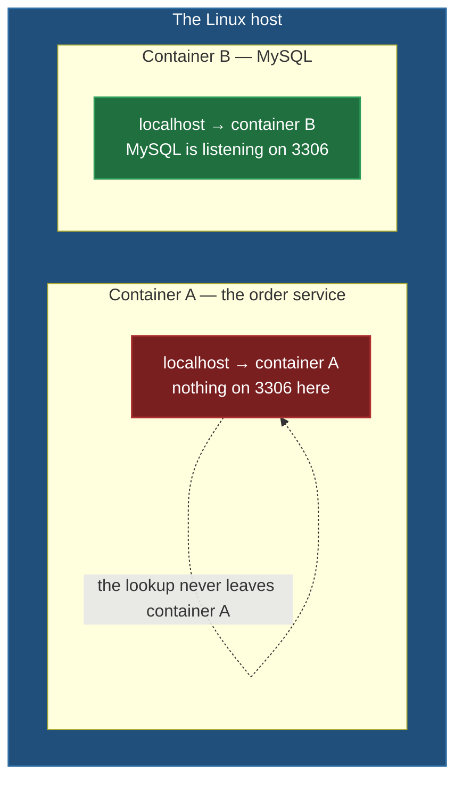

The image is now clean and anyone can build it from source alone. What it still assumes is that the application is the only thing running — and almost nothing real is. An order service needs somewhere to keep orders, which means a database, which means a second container, and the moment there are two the question is how either one finds the other.

This folder opened by saying that isolation cuts both ways: a container cannot reach into the one beside it, so when it needs something from it, it opens a network connection like any machine reaching any other. That is the bill arriving.

## The configuration that worked stops working

On a single machine this is unremarkable. The application runs, MySQL runs beside it on its default port, and the application is told where to look:

```properties
# src/main/resources/application.properties
spring.datasource.url=jdbc:mysql://localhost:3306/shopdb
```

That line says: the database is on this machine, on port 3306. Both halves are true when both processes are on the same machine.

Put each in its own container and the line is still syntactically fine, still points at port 3306, and fails. **Localhost inside a container means that container.** It is not a figure of speech or a configuration detail — an earlier note established that each container is given its own view of the network, with its own interfaces and its own ports, and localhost resolves within that view. The application container looks at its own port 3306, finds nothing listening, and gives up.



The isolation that made containers worth using is the same isolation that has just broken the application. That is the trade being paid for, and the answer is not to weaken it but to connect the two deliberately.

## Three ways a container can be attached to a network

Docker ships three network drivers, and they are visible without creating anything:

```bash
docker network ls
```

```text
NETWORK ID     NAME      DRIVER    SCOPE
abc123         bridge    bridge    local
def456         host      host      local
ghi789         none      null      local
```

| Driver | What the container gets | When it is the right answer |
|---|---|---|
| `bridge` | its own address on a private virtual network | almost always — the default |
| `host` | the host's network stack, no network of its own | a few containers on a machine you control, where indirection is not worth it |
| `none` | no network at all | something that must not reach anything, and that nothing must reach |

## Bridge, and the trap in the obvious version

A bridge network is a virtual network on the host that containers attach to, each with its own address on it. Those addresses are real and reachable from each other:

```text
Container A                 Container B
172.17.0.2                  172.17.0.3
     |                           |
   eth0                        eth0
     |                           |
     +-------------+-------------+
                   |
             Docker bridge
                   |
              Linux host
```

So the obvious fix is to stop saying localhost and say the other container's address instead:

```properties
spring.datasource.url=jdbc:mysql://172.17.0.3:3306/shopdb
```

This works. It also breaks the next time anybody touches anything, because **a container's address is assigned when it starts and is not promised to be the same one afterwards.** Restart the database, recreate it after a crash, rebuild it from a newer image, and it may come back on a different address — at which point the application is configured to talk to something that is no longer there, and the fix is to edit configuration and restart it too.

> [!important] **Addressing containers by IP is correct and unusable.**
> It is worth seeing once, because it makes clear that the containers really can reach each other and that the problem was never connectivity. But configuration that has to be rewritten whenever a container is replaced is configuration that will be wrong at the worst possible moment.

## Names instead of addresses

The usable form is to create a network yourself and put both containers on it. On a network you created, **Docker resolves container names to addresses automatically** — a container can be reached by its name, and the name is something you chose rather than something assigned at startup.

```bash
docker network create shop-network
```

```bash
docker run -d \
  --name shop-db \
  --network shop-network \
  -e MYSQL_ROOT_PASSWORD=change-me \
  -e MYSQL_DATABASE=shopdb \
  mysql:8.4
```

`--name shop-db` is both the container's name and the hostname other containers on that network use to reach it. `--network shop-network` attaches it. The two environment variables are how the MySQL image is configured on first start: one sets the root password, the other creates a database. `mysql:8.4` pins the version rather than taking whatever latest happens to mean this month.

The application container joins the same network, and its configuration names the database container:

```properties
spring.datasource.url=jdbc:mysql://shop-db:3306/shopdb
```

That line survives restarts, recreations and rebuilds, because `shop-db` is a name and not an address.

> [!warning] **This works on a network you created, and does not work on the default one.**
> Docker's documentation is explicit on the point: user-defined bridges provide automatic DNS resolution between containers, while containers on the default `bridge` network can only access each other by IP address. A container started with no `--network` lands on that default network, where names do not resolve. **The `docker network create` step is not ceremony — it is what makes the naming work.**

Note also that nothing published the database's port to the host. `-p 3306:3306` would make MySQL reachable from outside the machine, which for a database that only its own application talks to is an exposure with no benefit. Containers on the same network reach each other directly; publishing is for traffic arriving from outside.

## Host networking removes the separation entirely

The second driver takes the opposite approach. A container attached to the host's network does not get a network of its own at all — it uses the host's, directly.

```bash
docker run -d \
  --name host-web \
  --network host \
  nginx:alpine
```

Such a container has no address of its own and no ports of its own. A server inside it binding 8080 is binding the host's 8080, as though it were an ordinary process on the machine. Localhost means the host, so the configuration that failed at the start of this note would work unchanged.

What it costs is the thing that made publishing useful. Two containers that both want 8080 now genuinely collide, exactly as two ordinary processes would, and the mapping that let a container keep its own port while the host published another one is gone. It is a reasonable choice on a machine running a small number of containers where the indirection buys nothing, and a poor one anywhere containers are numerous or arbitrary.

## None is for things that must not reach anything

The third is the simplest and the least obvious.

```bash
docker run -it --network none alpine sh
```

A container started this way has no address, no ports, and no route anywhere. Nothing outside can reach into it, and it cannot reach out. Asking it for its interfaces shows nothing useful, and trying to fetch anything fails:

```bash
ip addr
wget https://example.com
```

The fetch does not fail slowly or return an error from the far end — it cannot start, because a machine with no address of its own cannot act as a client. The container is not participating in networking at all.

This is for running something in isolation on purpose. A database migration script is the example worth holding on to: a job that transforms data from one shape to another, which you want executed in a controlled environment and which has no business talking to the internet while it does so. The same script would run perfectly well in an ordinary container — removing the network does not make it work, it removes the possibility of it doing something it was never meant to do.

| | `bridge` (user-defined) | `host` | `none` |
|---|---|---|---|
| Own IP address | yes | no, uses the host's | no |
| Own ports | yes, published to the host as chosen | no, binds the host's directly | no |
| Reached by other containers | by name | as a host process | not at all |
| Reaches the internet | yes | yes | no |

With two containers able to find each other, the application works again — until the database container is replaced, at which point everything it was holding turns out to have gone with it.
