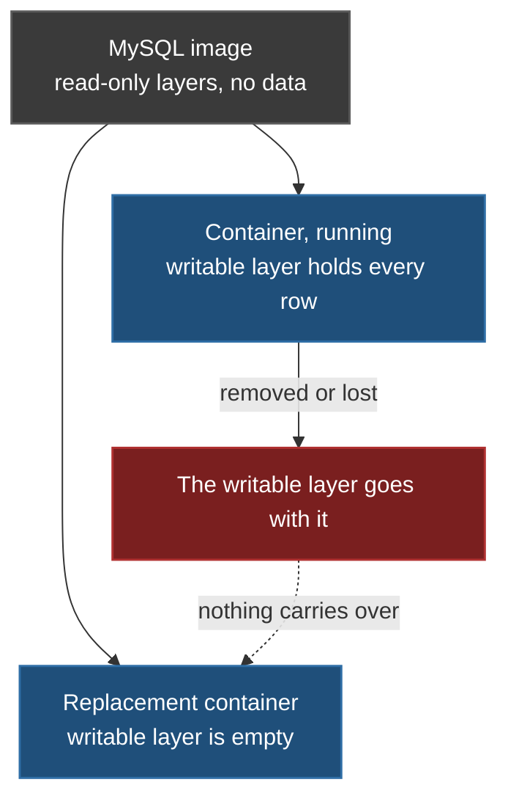

Two containers can now find each other, and the order service is writing to its database. The arrangement has a hole in it that does not show up until something goes wrong, and the first time it shows up it takes everything with it.

## What a running database container accumulates

The application connects on startup and begins creating what it needs. Over a few weeks in production the database fills up with exactly the things a shop would have:

```text
Customers: 500
Products:  100
Orders:    250
```

None of that came from the image. The image for MySQL contains a database server and no data at all, which is right — an image is a template, and the whole point is that the same one serves everybody. Everything in those tables was written after the container started.

An earlier note established where writes like that go. The image's layers are read-only, and a container adds one writable layer on top of them; anything created or changed while the container runs lives in that layer and nowhere else. **The writable layer belongs to the container, not to the image, and it exists for exactly as long as the container does.**

## Stopping is safe, losing it is not

The distinction matters and is easy to get backwards.

| What happens to the container | What happens to the data |
|---|---|
| Stopped and started again | **kept** — it is the same container, with the same writable layer |
| Crashed and restarted | **kept**, for the same reason |
| Removed, then recreated from the image | **gone** |
| Lost with the machine, replaced elsewhere | **gone** |

The last two are not exotic. Recreating a container is the ordinary way to change its configuration, move it to a newer image, or bring it back somewhere else. The thing that made containers attractive — that they are disposable, and a replacement built from the same image is as good as the original — is precisely what destroys a database running inside one.



So the data has to live somewhere that is not inside the container, and that somewhere has to outlast any particular container. That is all a volume is.

## A volume is storage that no container owns

The answer was named early in this folder and then left alone: storage kept outside the container, managed and attached by Docker, called a **volume**. This is what one actually is and how it is used.

A volume is a passive store that Docker manages on the host, separate from every container's lifecycle. It holds files and does nothing else — no process, no configuration, no behaviour. It is reasonable to picture it as a directory that Docker looks after, which containers can be attached to and detached from without it noticing.

```text
Container
   |
   | mounted
   v
Docker volume
   |
   v
Host storage
```

Because it is independent, a container can be removed and a replacement attached to the same volume, and the replacement finds everything the first one wrote.

## Creating one and attaching it

A volume gets a name, for the same reason a container did in the previous note — so that configuration refers to something stable rather than to something generated:

```bash
docker volume create mysql-data
```

```bash
docker volume ls
```

```text
DRIVER    VOLUME NAME
local     mysql-data
```

Attaching happens when a container starts, with a flag that takes two parts separated by a colon:

```bash
docker run -d \
  --name shop-db \
  --network shop-network \
  -e MYSQL_ROOT_PASSWORD=change-me \
  -e MYSQL_DATABASE=shopdb \
  -v mysql-data:/var/lib/mysql \
  mysql:8.4
```

The two parts read **volume name first, then the path inside the container**. So `-v mysql-data:/var/lib/mysql` says: take the volume called `mysql-data`, and make it appear at `/var/lib/mysql` inside this container. Anything the database writes to that path is written into the volume instead of into the container's writable layer.

> [!question] **How would you know the path is `/var/lib/mysql`?**
> Not by guessing, and not from the application — it is a property of the image. MySQL's official image documents that `/var/lib/mysql` is where MySQL writes its data files by default, which is why that is the path worth mounting. Every image that stores something has such a path and states it; a cache, a message broker and a search index each have their own. **Mounting the wrong path is a silent failure**: the container runs, the volume exists, it stays empty, and the data continues to go where it always did.

With that one flag added, removing the container stops being destructive. A replacement started with the same `-v` finds the database files already there and comes up with every row intact.

## The whole arrangement, by hand

Put the last two notes together and a modest application — a service, a database, and a cache in front of it — looks like this to set up. The containers left running from the earlier version experiments are finished with, and clearing them away first releases the host ports they were holding:

```bash
docker rm -f order-v1 order-v2 order-v3
```

`-f` is what allows a container that is still running to be removed; Docker's reference describes it as forcing the removal of a running container, killing its process to do so. Without it, `docker rm` refuses to touch anything that has not been stopped.

```bash
docker network create shop-network
```

```bash
docker run -d \
  --name shop-db \
  --network shop-network \
  -e MYSQL_ROOT_PASSWORD=change-me \
  -e MYSQL_DATABASE=shopdb \
  -v mysql-data:/var/lib/mysql \
  mysql:8.4
```

```bash
docker run -d \
  --name shop-redis \
  --network shop-network \
  redis:alpine
```

```bash
docker run -d \
  --name order-service \
  --network shop-network \
  -p 8080:8080 \
  -e SPRING_DATASOURCE_URL=jdbc:mysql://shop-db:3306/shopdb \
  -e SPRING_DATASOURCE_USERNAME=root \
  -e SPRING_DATASOURCE_PASSWORD=change-me \
  order-service:v3
```

The three `SPRING_DATASOURCE_` variables are the settings that went into `application.properties` in the previous note, supplied from outside the image instead of from a file inside it. Spring Boot's documented rule for turning a property name into an environment variable name is to replace dots with underscores, remove dashes, and convert to upper case, so `SPRING_DATASOURCE_URL` and `spring.datasource.url` are one setting under two spellings rather than two settings. Environment variables sit above packaged configuration files in Spring Boot's documented order of precedence, so where both exist the environment variable is the one that takes effect.

That is what makes one image usable against a different database without rebuilding it, and it is why the password belongs here rather than in a file that travels with the source.

The cache gets no volume on purpose. A cache holds a copy of something that can be recomputed, so losing it costs a slow first request rather than a record, and persisting it would be work in exchange for very little.

Every one of those commands is correct and together they are a problem. Four commands to stand the arrangement up, in an order that matters, carrying names that have to agree across three of them — the network name in all four, the database container's name inside the application's configuration, the volume name matching the path the image expects. Hand this to somebody else and you are handing them a sequence to memorise and a set of strings to keep consistent by hand, with no indication anywhere of what depends on what.
