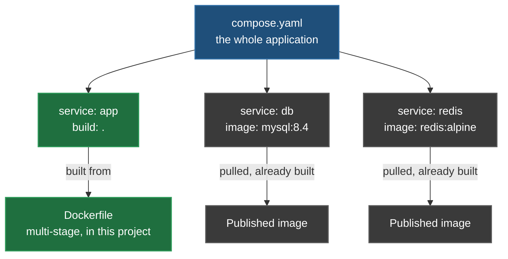
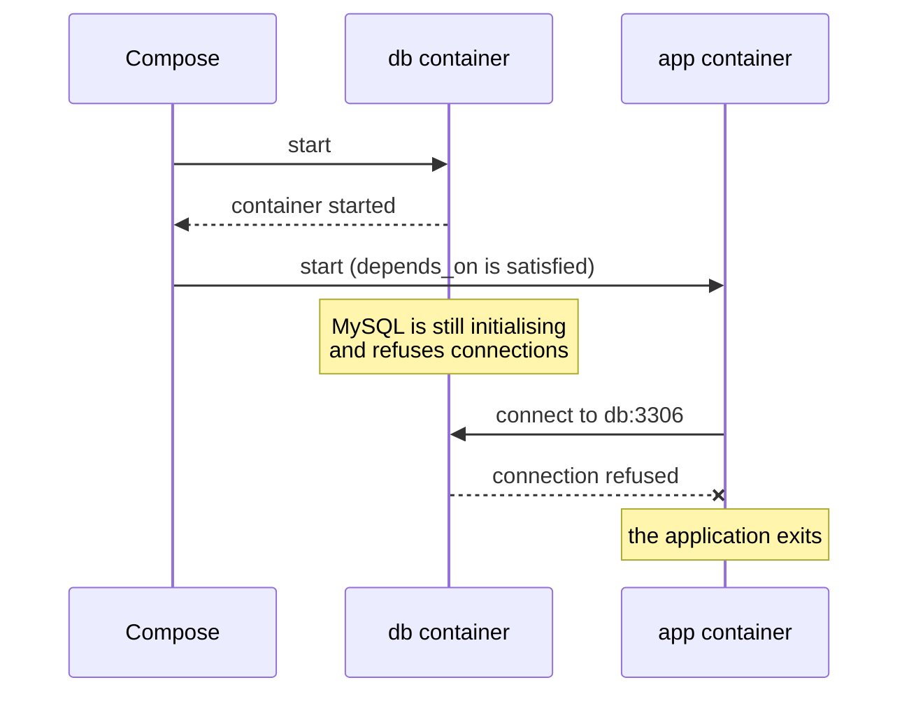

Four commands, in an order that matters, with names that have to agree across them by hand. That is the state the previous note ended in, and it is the smallest realistic application there is — one service, one database, one cache. Adding anything makes it worse. Compose exists to replace the whole sequence with a file and a single command.

## Saying what you want instead of how to get it

The run commands are instructions carried out in order: create this network, then create this volume, then start this container with these flags, then start that one. Each is a step, and the person running them is responsible for knowing which step comes next and what every flag was for.

A compose file is a description of the finished arrangement — which containers make up this application, what network they share, which volumes they use, how each is configured. Nothing in it is a step. **The file says what the result should look like, and Compose works out what to do to produce it.**

| | The commands | The file |
|---|---|---|
| What is written down | the actions, in sequence | the desired end state |
| Who knows the order | you do, and you must | Compose derives it |
| What a reader learns | which flags were typed | how the application fits together |
| What happens on a change | you work out which commands to rerun | the file is reapplied |

That distinction has a name worth knowing because it recurs everywhere in this subject: the step-by-step form is **imperative**, the description form is **declarative**. A pipeline written as a file rather than configured by hand is the same shift.

## The smallest file that does anything

The file lives at the root of the project and is called `compose.yaml`. The smallest useful one declares a single service:

```yaml
# compose.yaml
services:
  web:
    image: nginx:alpine
    ports:
      - "8080:80"
```

```bash
docker compose up
```

`services` is the list of containers that make up this application. `web` is a name chosen here, not a keyword. `image` says which published image to run. `ports` publishes, host first and container second, exactly as the flag did — and it is a list, which is why each entry has a dash in front of it, because a container may publish more than one.

Nothing limits a container to one published port either — if something inside it listens on two, map both. In practice services are kept to one job each and one port each, not because of any restriction but because two unrelated things in one container stop being separately replaceable, which was most of the reason for using containers.

A web server is now answering on 8080. Nothing was created by hand.

Adding `-d` detaches, the same as it does on the run command, so the terminal comes back instead of being held by the containers' output:

```bash
docker compose up -d
```

## Three top-level sections

A full file has three, and they correspond exactly to the three things the previous notes created by hand:

```yaml
services:
  ...
networks:
  ...
volumes:
  ...
```

Services are the containers: an application, a database, a cache, anything else the project is made of. Networks and volumes are declared once at the top level and referred to by name inside the services that use them.

## Your own application is the only one that gets built

Inside a service, two keys are alternatives, and choosing between them is the thing most worth understanding in the file.

```yaml
services:
  db:
    image: mysql:8.4
```

```yaml
services:
  app:
    build: .
```

`image` names something already published and ready to run. `build` names a directory containing a Dockerfile, and Compose builds an image from it first. The dot means the directory the compose file is in.

> [!question] **Why does the database not need a Dockerfile?**
> Because you did not write MySQL. It is published as an image, already built, by the people who maintain it, and running it is a matter of pulling it and configuring it. The same goes for the cache. **Your own application is the only part of this project that nobody has built an image for**, which is why it is the only service with a `build` key and the only one with a Dockerfile.

That also settles a question the two file types invite. A **Dockerfile describes how to build one image.** A **compose file describes a whole application** — every container in it, however each one is obtained, plus the network and storage they share. One builds a thing; the other assembles several.



## The network you no longer have to create

Compose creates a network for the project and attaches every service to it, with no instruction to do so. And because it is a network Compose created rather than the default one, name resolution works on it — which means **a service's name is its hostname**.

So the configuration that needed a `docker network create` and a `--name` flag in the previous note becomes a consequence of what the services are called:

```yaml
    environment:
      SPRING_DATASOURCE_URL: jdbc:mysql://db:3306/shopdb
```

`db` there is the service name from the file. Rename the service and that is the hostname that changes, in one place.

The services here are called `db` and `app`, where the containers started by hand in the previous note were `shop-db` and `order-service`. That is a deliberate change rather than an inconsistency. **A service name only has to be unique within its own project**, so the prefix that kept hand-started containers from colliding on a shared machine is doing no work inside a file that already describes one application. Compose puts a prefix back on when it names the actual containers, which is visible further down.

## Ordering, and why ordering is not enough

Start everything at once and the application frequently fails on startup with a connection refused, because it tried to reach a database that was not up yet.

The first half of the fix states the dependency:

```yaml
  app:
    depends_on:
      - db
```

Compose then starts `db` before `app`. **What it does not do is wait for the database to be ready**, and Compose's own documentation is explicit about it: with this short form, Compose does not wait for a dependency to be healthy before starting the service that depends on it. It waits for the container to have started, which is a different and much weaker claim.

That gap is not theoretical for a database. MySQL's official image documents that when no database has been initialised yet, the first start creates one, and the server will not accept connections until that finishes — and it names Compose specifically as where this causes trouble, because Compose starts several containers at once.



The second half of the fix is to define what ready means and make the dependency wait for it:

```yaml
  db:
    image: mysql:8.4
    healthcheck:
      test:
        [
          "CMD-SHELL",
          "mysqladmin ping -h localhost -u root -p$$MYSQL_ROOT_PASSWORD --silent"
        ]
      interval: 5s
      timeout: 5s
      retries: 10
      start_period: 20s
```

`test` is the command Compose runs inside the container to decide whether it is healthy — here, asking the database server whether it is answering at all. `interval` is how often to repeat it, `timeout` how long one attempt may take, `retries` how many consecutive failures mean unhealthy, and `start_period` an initial grace window during which failures do not count, which is what covers a first-time initialisation.

> [!warning] **The double dollar sign is not a typo and must not be reduced to one.**
> Compose substitutes variables into the file before anything runs. `$$` is how you tell it to leave one alone — it produces a literal dollar sign and stops Compose interpolating what follows. The password is meant to be expanded by the shell inside the database container, where that variable exists, not by Compose on the way in. Written with a single dollar sign, Compose would substitute its own value, usually an empty one, and the health check would fail forever.

With a health check defined, the dependency can finally ask for readiness rather than existence:

```yaml
  app:
    depends_on:
      db:
        condition: service_healthy
```

## The whole application in one file

```yaml
# compose.yaml
services:
  db:
    image: mysql:8.4
    environment:
      MYSQL_ROOT_PASSWORD: change-me
      MYSQL_DATABASE: shopdb
    volumes:
      - mysql-data:/var/lib/mysql
    healthcheck:
      test:
        [
          "CMD-SHELL",
          "mysqladmin ping -h localhost -u root -p$$MYSQL_ROOT_PASSWORD --silent"
        ]
      interval: 5s
      timeout: 5s
      retries: 10
      start_period: 20s

  app:
    build: .
    ports:
      - "8080:8080"
    environment:
      SPRING_DATASOURCE_URL: jdbc:mysql://db:3306/shopdb
      SPRING_DATASOURCE_USERNAME: root
      SPRING_DATASOURCE_PASSWORD: change-me
    depends_on:
      db:
        condition: service_healthy

  redis:
    image: redis:alpine

volumes:
  mysql-data:
```

The cache needs a name and an image and nothing else. No volume, for the reason the previous note gave — what it holds can be recomputed. No published port, because only the application talks to it and they share the project's network. No configuration, because there is nothing here to configure. It is reachable at `redis` for the same reason the database is reachable at `db`.

The volume is declared at the bottom with nothing under it, which is enough to say that it exists and Compose should manage it. Inside the database service it is referenced in the same two-part form the flag used — volume name, then the path inside the container.

## Keeping the passwords out of it

That file has a database password written into it twice, and it is about to be committed to version control along with everything else.

Compose substitutes variables into values before running, written either as `${VARIABLE}` or as `$VARIABLE`, and it loads them from a file called `.env` sitting beside the compose file in the project directory. So the secret moves out of the description and into something that is never committed:

```text
# .env
MYSQL_PASSWORD=change-me
```

```yaml
  db:
    environment:
      MYSQL_ROOT_PASSWORD: ${MYSQL_PASSWORD}
```

```yaml
  app:
    environment:
      SPRING_DATASOURCE_PASSWORD: ${MYSQL_PASSWORD}
```

Both occurrences go, and both read from the same variable, because they are the same password seen from two sides — the one the database is created with and the one the application authenticates with. Keeping them as one name is worth more than tidiness: written out twice they can be changed in one place and not the other, and the failure that produces is an authentication error at startup with nothing in the file to suggest why.

The compose file is now safe to share, and the previous note already put `.env` in `.dockerignore` so it does not travel into an image either. Note the difference from the health check above: a single dollar sign is a value Compose substitutes on its way in, and a double one is a literal dollar that Compose leaves alone for something inside the container to expand later.

Reading that file tells somebody who has never seen the project what it is made of, how the parts find each other, where the data lives and what has to be up before what. The four commands it replaces told them none of that.

## Working with it

```bash
docker compose up
docker compose up -d
docker compose up --build
```

`--build` forces the application's image to be rebuilt rather than reusing the one from last time, which is what you want after changing code.

```bash
docker compose ps
```

```text
NAME                     SERVICE   STATUS
order-service-app-1      app       running
order-service-db-1       db        healthy
order-service-redis-1    redis     running
```

The first column is not the service name. Compose builds a container name out of the project name, the service name and an index, and **the project name defaults to the name of the directory holding the compose file** — `order-service/` here. That is the prefix the service names themselves no longer need to carry.

The status column reflects the health check — `healthy` is a stronger statement than `running`, and it is the one `condition: service_healthy` waits for.

```bash
docker compose logs
docker compose logs -f
```

Logs from every service together, and `-f` follows them as they arrive.

The last pair is the one to get right, because they are not interchangeable:

```bash
docker compose stop
docker compose down
```

| | `stop` | `down` |
|---|---|---|
| Containers | halted, still there | removed |
| The project's network | kept | removed |
| Named volumes | kept | kept |
| Getting back | `docker compose start` | `docker compose up` rebuilds the arrangement |

Volumes survive both, which is the entire reason the data went into one.

## What this costs

Everything about the application is now described in a single file, which is a form of coupling — the services, their configuration and their relationships are bound together in one place rather than being independently invokable. That is a real trade and it is worth stating rather than glossing over.

It is also the right trade here, and the reason is the four commands at the end of the previous note. The alternative to describing the relationships in one place is not having them described anywhere, with the order and the matching names living only in somebody's memory or a README that drifts out of date. One file that is wrong is fixable. A sequence that only one person remembers is not.
