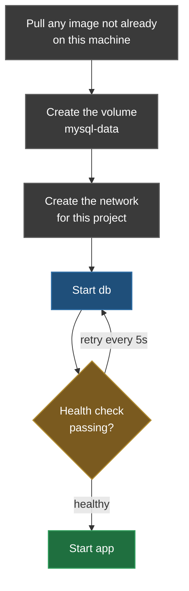
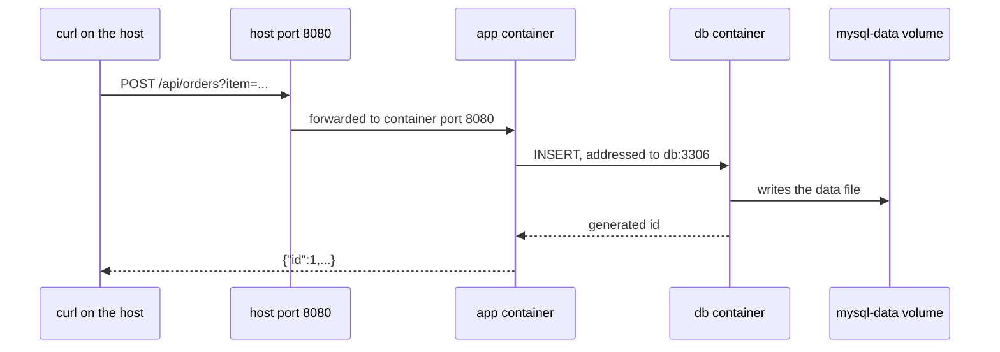

The previous note ended with a file that describes an entire application — the service itself, the database behind it, the network between them and the volume underneath — and nothing in it has ever been started. A description is not a running system. This note runs that file, watches what it creates, proves the application actually works, and takes it down again.

It is also the first step of a longer route. The application has to end up on a server, and the four stages of getting it there are the shape of the rest of this folder.


Everything that follows assumes the first stage is done, which is the point of doing it first. A deployment that fails on a server you cannot see is a far worse problem than the same failure on the machine in front of you.

## The file being run

```yaml
# order-service/compose.yaml
services:
  db:
    image: mysql:8.4
    environment:
      MYSQL_ROOT_PASSWORD: change-me
      MYSQL_DATABASE: shopdb
      MYSQL_USER: shop
      MYSQL_PASSWORD: shop-secret
    volumes:
      - mysql-data:/var/lib/mysql
    healthcheck:
      test:
        [
          "CMD-SHELL",
          "mysqladmin ping -h localhost -u root -p$$MYSQL_ROOT_PASSWORD --silent"
        ]
      interval: 5s
      timeout: 5s
      retries: 10
      start_period: 20s

  app:
    build: .
    image: order-service:v3
    ports:
      - "8080:8080"
    environment:
      SPRING_DATASOURCE_URL: jdbc:mysql://db:3306/shopdb
      SPRING_DATASOURCE_USERNAME: shop
      SPRING_DATASOURCE_PASSWORD: shop-secret
    depends_on:
      db:
        condition: service_healthy

volumes:
  mysql-data:
```

This is the file from the previous note with two changes. The cache is gone, because the application being deployed here does not use one and an unused service is noise in a file meant to be read. And two environment variables have been added, which are worth a paragraph because the rest of this note leans on them.

`MYSQL_ROOT_PASSWORD` alone gives you one account that can do anything to anything. `MYSQL_USER` and `MYSQL_PASSWORD` ask the database image to create a second account at startup and grant it rights over the one database named in `MYSQL_DATABASE` — nothing else on the server. The application connects as that account, and root exists only for administration.

> [!tip] **This is the same argument as the one about not working as root on a Linux machine, arriving in a different place.**
> An account that can do everything will eventually do something you did not intend, and the damage is bounded by what the account was allowed to reach rather than by what you meant to type. A database user scoped to one schema cannot drop a different one, however wrong the query is.

## Checking the file before running it

A compose file is not executed line by line. It is parsed in full, variables are substituted into it, and the result is handed to the engine as one description. That means a mistake anywhere in it surfaces at the moment you try to start everything, which is the least convenient moment.

```bash
docker compose config
```

This parses the file, resolves every variable, merges anything that needs merging and prints the finished configuration — the exact thing the engine would be asked to create. Reading that output is how you confirm a variable actually resolved to what you expected rather than to an empty string.

When you only want the verdict and not the document:

```bash
docker compose config --quiet
```

That validates and prints nothing. Silence means the file is well formed. It does not mean the application works — a perfectly valid file can still name an image that does not exist.

## Starting it

```bash
docker compose up
```

Without `-d` the terminal stays attached and the interleaved output of every container runs down the screen, which is what you want the first time. The order in which things appear is not arbitrary.



The resources come before the containers because the containers refer to them. The database comes before the application because the file said so, and the application waits on the health check rather than on the database process existing — the distinction the previous note drew between started and ready, now visible as a delay you can watch.

The application's own image is not pulled. It is built, because the service says `build: .`, and the first run therefore carries out the whole multi-stage build from earlier in this folder. That is the slow part, and it is slow once.

The `image:` line beside it is doing something easy to miss. **With `build` alone, Compose derives a name for the image it produces from the project and service names, and that derived name is awkward to refer to anywhere else.** Setting `image` as well tells Compose what to call the image it builds, so the result is the same `order-service:v3` that was built by hand earlier in this folder, under a name that can be typed. That matters later, because an image cannot be published under a name nobody chose.

## Seeing what is actually running

```bash
docker compose ps
```

```
NAME                    SERVICE   STATUS
order-service-app-1     app       running
order-service-db-1      db        healthy
```

Two columns are worth reading carefully.

The names are not the service names. Compose builds a container name from the project name, the service name and an index, and the project name defaults to the directory holding the file. The index exists because one service can have more than one container.

The status of the database is `healthy` rather than `running`, and that is a stronger statement. `running` means the process has not exited. `healthy` means the command in the health check succeeded — the server is answering queries. Only the second one is a reason to start something that depends on it.

```bash
docker compose logs app
docker compose logs db
```

Naming a service limits the output to it, which matters when two containers are writing at once. The database's log is the initialisation sequence; the application's is the ordinary startup of the service, ending with the port it has bound.

## Proving it works

The service had one endpoint when it was first containerised, a greeting that returned a fixed string and touched nothing. Now that there is a database behind it, it has a second one that actually writes something — because an endpoint that only returns a constant cannot tell you whether the database is wired up at all.

```java
// src/main/java/in/bookcart/orderservice/OrderController.java
package in.bookcart.orderservice;

@RestController
@RequestMapping("/api/orders")
public class OrderController {

    private final OrderItemRepository repository;

    public OrderController(OrderItemRepository repository) {
        this.repository = repository;
    }

    @PostMapping
    public OrderItem create(@RequestParam String item) {
        return repository.save(new OrderItem(item));
    }
}
```

A POST to `/api/orders` with an `item` parameter stores a row and returns it. `OrderItemRepository` is a one-line interface the framework implements at startup, and `save` is the method on it that writes a row; neither needs any code of its own. That is the whole of the application, and it is enough.

```bash
curl -X POST "http://localhost:8080/api/orders?item=running-in-docker"
```

`curl` is a command-line program that makes an HTTP request and prints the response. `-X POST` chooses the method. The address is the host side of the port mapping, so the request arrives at the host's port 8080, is forwarded into the application container's 8080, and is handled by the process that the image's entry point started.

```json
{"id":1,"item":"running-in-docker"}
```

The response carries an identifier the application did not invent, which is the useful part — the database generated it, so the row reached the database.

```bash
curl -X POST "http://localhost:8080/api/orders?item=second-order"
```

```json
{"id":2,"item":"second-order"}
```

Two requests, two identifiers, incrementing. The application is talking to the database by the name `db`, over the project's own network, exactly as the earlier note on connecting containers said it would.



> [!question] **Does sending the writes to a volume cost a network round trip?**
> No. The last hop in that diagram is the only one that is not a network call at all. A volume is storage on the host, attached into the container's filesystem, so writing to it is a file write — the same kind of operation as writing inside the container would have been. The hop that costs something is the one before it, where the application reaches the database by name over the project's network, and that hop exists whether the data ends up in a volume or in the writable layer. Persistence is bought with disk, not with latency.

The object-relational mapping in the application is upstream of all of this and changes none of it. Its job is to turn a Java object into a row and back, which decides what the insert statement looks like, not where the resulting bytes land. Where they land is decided by the volume.

## Looking at the data where it lives

Trusting the response is reasonable. Confirming it is better, and the way in is to run a command inside the container that is already running.

```bash
docker compose exec db mysql -u shop -pshop-secret shopdb -e "select * from order_items"
```

`docker compose exec` executes a command in a running service's container, naming the service rather than the container. Everything after `db` is an ordinary MySQL client invocation that happens to be running inside the database container, where the server is reachable without going over any network at all.

```
+----+-------------------+
| id | item              |
+----+-------------------+
|  1 | running-in-docker |
|  2 | second-order      |
+----+-------------------+
```

> [!bug] **The first attempt at this fails on a misspelling, and the error does not say so.**
> The subcommand is `exec`, and typing `exac` gets you a complaint about an unknown command rather than a suggestion about what you meant. The line around it is long enough that the eye slides straight over the four-letter word in the middle of it, and the instinct is to start doubting the credentials or the table name instead.

## Where the table name comes from

The table is `order_items`. It is tempting to explain that as the framework pluralising the class name, and that explanation is wrong.

```java
// src/main/java/in/bookcart/orderservice/OrderItem.java
package in.bookcart.orderservice;

@Entity
@Table(name = "order_items")
public class OrderItem {

    @Id
    @GeneratedValue(strategy = GenerationType.IDENTITY)
    private Long id;

    @Column(nullable = false)
    private String item;

    protected OrderItem() {
    }

    public OrderItem(String item) {
        this.item = item;
    }
}
```

The name is written down. Without that annotation the default strategy lower-cases the class name and inserts an underscore at each camel-case boundary, so `OrderItem` would become `order_item` — singular, and different from what is actually there. The framework does transform the name, but it does not pluralise it, and the only reason this table matches the endpoint is that somebody said so explicitly.

> [!note] **This matters when you are the one reading an unfamiliar schema.**
> If you assume table names are derived, you will go looking for `order_item` and conclude the data is missing. The annotation is the single source of truth, and it is in the entity class.

## The third command, and the one that deletes your data

The previous note set out the difference between halting the containers and removing them, and the line worth recalling is that **named volumes survive both** — that is the entire reason the data went into one.

```bash
docker compose down
```

The output names each thing as it goes: both containers removed, then the network. The volume is not mentioned, because it is not touched. Start the application again and the two rows are still there, which is that claim demonstrated rather than asserted.

There is a third form, and it is the one the previous note did not cover.

```bash
docker compose down -v
```

This additionally removes named volumes declared in the file's `volumes` section, along with anonymous volumes attached to the containers. The output gains a line for `mysql-data`, and the rows are gone for good.

| | Containers | Network | Named volume |
|---|---|---|---|
| `docker compose down` | removed | removed | **kept** |
| `docker compose down -v` | removed | removed | **removed** |

> [!danger] **`down -v` is the command that deletes a database, and nothing warns you.**
> It is one character away from the command you run a dozen times a day, it prints no confirmation prompt, and a named volume removed this way is not recoverable from Docker. Volumes declared as external are the exception — those are never removed by either form, which is one reason production data tends to live in an external volume.

## Two things this is not

**Running more containers is not scaling.** Scaling means putting the application on more machines and sharing requests out between them, so that the total amount of memory and processor available to it goes up. Everything in this note happens inside one host. Starting a second copy of a container there divides the same machine further rather than adding to it, and under real load two containers on an exhausted host are slower than one. Containers make an application easy to place on more machines; placing it is a separate act that nothing here performs.

**Reading rows from the command line is not a worse version of a database client.** A graphical client is the right tool when you are exploring data. It is not available when you are checking whether a container came up correctly, because a server has no desktop on it — the whole reason it exists is to run processes, and the only way in is a shell. The command above is what verification looks like everywhere the application actually runs.
