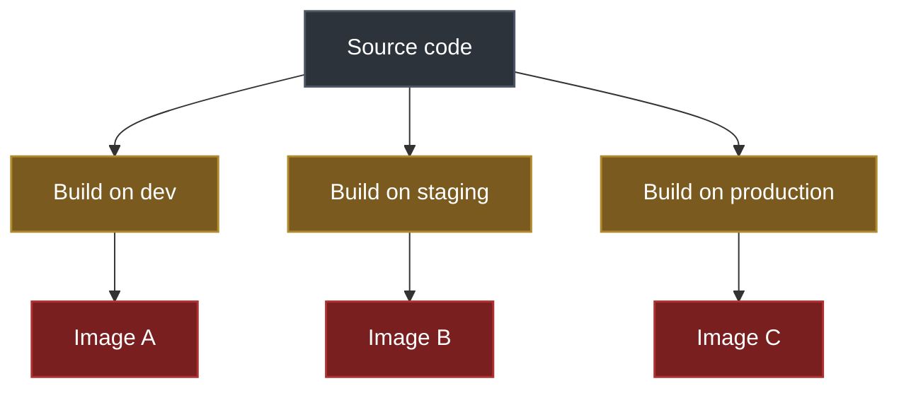
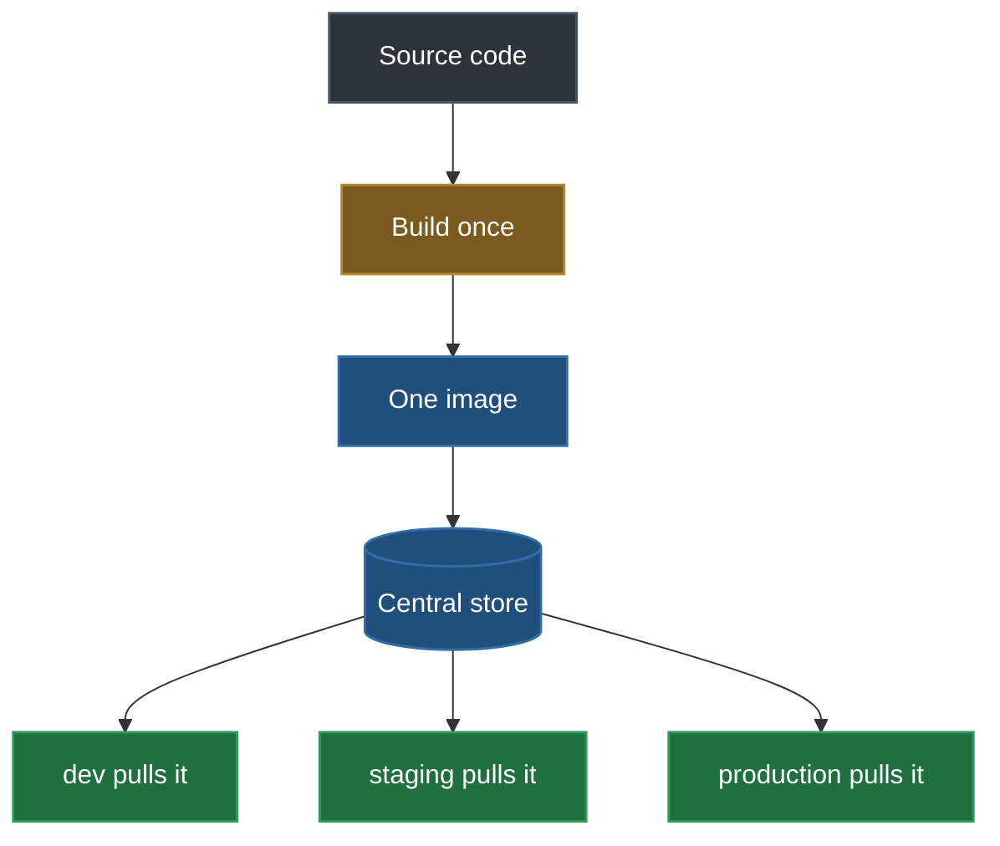

The application now runs on one machine and the rows survive a teardown. The machine it runs on is a laptop, and the point of all this was to get it somewhere else.

An earlier note in this folder got it there, by hand, and the way it did so is the thing to look at again. The jar was copied across to an Ubuntu server, the Dockerfile was written on that server, and `docker build` was run there. **The image was never moved. It was produced a second time, on the far machine, from ingredients that were shipped separately.**

That works, and it stops working the moment there is more than one server. A development server, a staging server and three production servers mean five builds, and nothing in that arrangement can tell you whether the five produced the same image.

## The thing that does not work: building it again in each place

Follow the approach from that earlier note out to its natural conclusion. Every machine ends up with what it needs to build: the source or the artifact, a Dockerfile, and a toolchain to run the build with.



Three builds produce three images, and nothing guarantees they are the same image. A dependency published a new version between Tuesday and Thursday. One machine had a warm build cache and one did not. The base image tag moved underneath you. Each of those is ordinary, and each of them means the thing you tested is not the thing now serving requests — which is the failure this entire folder opened by describing, reintroduced by the deployment process itself.

It also puts the source code and the build toolchain on the production server, where neither belongs. The multi-stage note went to some trouble to keep a compiler out of the shipped image; putting one on the host instead gives most of that back.

## Build once, and move the result



One build, one image, stored somewhere every environment can reach, and each environment pulls that exact image down. The thing tested in development is the same bytes as the thing running in production, not a rebuild that ought to be equivalent.

The word for the thing being stored is one this folder has used since the jar first appeared: an **artifact**, the finished output of a build, kept as a thing rather than as instructions for making one. An image is an artifact in exactly the sense a jar is. What is new is not the word but the storage — somewhere central that every machine can reach, so that the artifact is built once and afterwards only ever copied.

**The place artifacts are kept is called a registry.**

## What an image name actually says

Every image reference you have typed in this folder has had the same shape, mostly with pieces left out.

```
[HOST[:PORT]/]NAMESPACE/REPOSITORY[:TAG]
```

| Part | What it is | If omitted |
|---|---|---|
| Host | The registry the image lives in, optionally with a port | Docker Hub, `docker.io` |
| Namespace | The account or organisation that owns it | `library`, the namespace reserved for official images |
| Repository | The image's own name, which is required | — |
| Tag | A version or variant | `latest` |

Written out in full, a published image looks like this:

```
docker.io/bookcart/order-service:1.0.0
```

The registry is `docker.io`. The namespace `bookcart` is an account on it. The repository `order-service` is one image within that account. The tag `1.0.0` picks a version of it.

> [!important] **This retroactively explains every base image in this folder.**
> `mysql:8.4` has no host and no namespace, so it means `docker.io/library/mysql:8.4` — an image in the reserved namespace for official images, on Docker Hub. The same is true of `eclipse-temurin:21-jre`, `maven:3.9-eclipse-temurin-21`, `redis:alpine` and `alpine`. Every one of those was being pulled from a registry the whole time; the short name simply let two defaults do the work.

The comparison worth holding on to is GitHub. A registry is to images almost exactly what GitHub is to source: you have an account, repositories sit inside it, and versions sit inside those. The difference is only in what gets stored. **GitHub keeps what you wrote; a registry keeps what you built.** Everything else — logging in from a terminal, pushing, pulling, the repository being public or private — reads the same way in both.

## The mechanism, in one command

The registry is not a thing you opt into. It has been in every `docker run` you have issued.

```bash
docker run hello-world
```

Nothing called `hello-world` exists on a fresh machine, and the command works anyway. The engine checks its local image cache first, finds nothing, and the missing image is then pulled from the registry before the container is created. The container that runs prints a short message describing those same steps and exits.

This behaviour has a flag controlling it, and its default is the thing just described:

```bash
docker run --pull missing hello-world
```

`missing` pulls only when the image is not already in the cache, which is why the second run of anything is instant. `always` fetches every time, and `never` fails rather than reaching the network.

> [!tip] **This is the smallest possible check that a Docker installation works.**
> It exercises the daemon, the local cache, the network path to the registry, the pull, image storage and container creation, in one command that downloads a few kilobytes. If it prints its message, nothing fundamental is broken.

> [!failure] **If the shell reports that `docker` is not a command at all, the installation is probably fine and the terminal is stale.**
> Installing Docker puts its binaries on the system and adds them to the search path, and a shell that was already open took its copy of that path when it started. It will not see the change. This bites hardest in an editor's built-in terminal, which can sit open for days. Open a new one before concluding anything is wrong.

## The registries you will actually meet

| Registry | Who runs it | Why you would choose it |
|---|---|---|
| Docker Hub | Docker | The default. Where nearly every public base image lives |
| Elastic Container Registry | Amazon Web Services | The machines are already in AWS, so this is the closest and the permissions are the ones you already manage |
| Artifact Registry | Google Cloud | The same argument, on Google's platform |
| Harbor | You, on your own infrastructure | Nothing leaves your network |

The pattern is the same one that exists for source code, where GitHub, a cloud provider's own offering and a self-installed server such as GitLab all coexist. Nothing stops an application running on one cloud from pulling images from a different provider's registry — it is a network request like any other. The reason it is usually not done is latency, egress charges, and having two sets of credentials to manage instead of one.

## Public against private

Every registry distinguishes repositories that anybody may pull from and repositories that only authenticated accounts may reach.

A public repository is listed in the registry's search and can be pulled by anyone in the world who knows its name. For a base image that is the entire point. For an application image it means your compiled code, your dependency list and your layer history are readable by anyone who looks, and the only thing between a reader and your source is a decompiler.

A private repository restricts pulling to accounts you have granted access. The image is still stored on somebody else's infrastructure; the difference is who may fetch it.

> [!warning] **Private is not the same as absent, and a published image carries more than the code.**
> An image is a stack of layers and every one of them is readable once pulled. A secret written into a file during the build, then deleted in a later instruction, is still sitting in the earlier layer. Marking the repository private reduces who can look. It does not remove anything from what you published.

## When the registry has to be yours

Private repositories on a hosted registry solve the access problem and leave one thing unsolved: the artifact is on infrastructure you do not control. For most organisations that is fine. For a bank, a hospital system or anything operating under rules about where data may physically sit, it is not a preference but a constraint.

Harbor is the usual answer. It is an open source registry, a graduated project of the Cloud Native Computing Foundation, which you install on your own infrastructure — so the images never leave the network you operate.

It describes itself as a registry that secures artifacts with policies and role-based access control, and the features that follow from that are the reason it gets chosen over simply running a bare registry:

- Permissions by user role, and integration with the identity system the organisation already uses, so registry access is governed by the same accounts as everything else.
- Vulnerability analysis of stored artifacts, which turns the registry into the place where a known-bad dependency gets caught rather than the place it gets distributed from.
- Content signing and validation, so a consumer can establish that an image is the one that was published and not something substituted along the way.
- Replication between registries, including between Harbor instances, which is how an artifact gets from a build network into an isolated production network without anybody carrying a file.

That last one is worth noticing. It is the hand-carried transfer from the start of this note, except performed by the registry, on a schedule, with a record of what moved.
