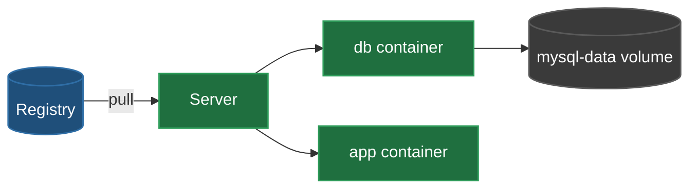

The image is now in a registry that any machine can reach. The server still has nothing on it, and what it needs turns out to be remarkably little.

Work through what the server actually requires in order to run this application. It needs to know which images to run, how they connect, which ports to publish and where the data goes. All of that is in the compose file. It does not need the source code, because the code is already compiled into the image. It does not need Maven, a JDK or the Dockerfile, for the same reason. It does not even need the jar.

**One text file travels to the server.** That is the entire payload of this deployment.

## The production file is a second file, not an edited one

The file from earlier builds the application image from the directory it sits in. On the server there is no directory to build from, and building there is the thing the registry exists to avoid. One line has to change.

The temptation is to edit the file in place and change it back afterwards. That is how a file ends up committed in whichever state somebody last left it, and how a production deployment ends up running a locally built image that only ever existed on a laptop. Keep both, and name them for what they are.

```yaml
# order-service/compose.prod.yaml
services:
  db:
    image: mysql:8.4
    environment:
      MYSQL_ROOT_PASSWORD: change-me
      MYSQL_DATABASE: shopdb
      MYSQL_USER: shop
      MYSQL_PASSWORD: shop-secret
    volumes:
      - mysql-data:/var/lib/mysql
    healthcheck:
      test:
        [
          "CMD-SHELL",
          "mysqladmin ping -h localhost -u root -p$$MYSQL_ROOT_PASSWORD --silent"
        ]
      interval: 5s
      timeout: 5s
      retries: 10
      start_period: 20s

  app:
    image: bookcart/order-service:1.0.0
    ports:
      - "8080:8080"
    environment:
      SPRING_DATASOURCE_URL: jdbc:mysql://db:3306/shopdb
      SPRING_DATASOURCE_USERNAME: shop
      SPRING_DATASOURCE_PASSWORD: shop-secret
    depends_on:
      db:
        condition: service_healthy
    restart: unless-stopped

volumes:
  mysql-data:
```

Two differences from the file that ran locally.

**`build: .` became `image:`,** naming the published image rather than a directory of source. This is the same choice the compose note described between the two keys, now made in the other direction for the other environment — and it is why the database service needed no change at all. It was always naming a published image.

**A restart policy appeared.** On a laptop a stopped container is a container you stopped. On a server it is usually an application that crashed at three in the morning, and nobody wants that to stay down until somebody notices.

| Policy | What it does |
|---|---|
| `no` | The default. Never restarts |
| `always` | Restarts until the container is removed |
| `on-failure` | Restarts only when the exit code indicates an error |
| `unless-stopped` | Restarts whatever the exit code, but stops restarting once the service is stopped or removed |

`unless-stopped` is the one to reach for on a server. It covers a crash, and it respects a deliberate stop — if an operator took the service down on purpose, it stays down rather than fighting them. `always` does not make that distinction.

Nothing else differs, and that is the claim this whole sequence was built to make. The image running on the server is the identical image that was tested on the laptop — same layers, same identifier, same compiled jar. What distinguishes the two environments is a handful of values in a text file, supplied as environment variables that override the defaults packaged inside the image. **Configuration varies; the artifact does not.**

> [!note] **A restart policy is not a substitute for finding out why it stopped.**
> It keeps the service answering while you investigate, and it will happily mask a container that crashes and restarts every forty seconds for a week. The logs are where that shows up, not the status column, because a container restarted a thousand times still reads as running.

## Getting the file across

The server here is an Ubuntu virtual machine managed by Multipass, which has its own copy command for moving files in and out of an instance.

```bash
multipass transfer compose.prod.yaml devops:/home/ubuntu/order-service/compose.yaml
```

The syntax is source first and destination last, with a path inside an instance prefixed by that instance's name and a colon. Paths without a prefix are on the host. `-r` copies a directory, and `-p` creates missing parent directories.

Any other server is an ordinary copy over SSH, and the shape is the same:

```bash
scp compose.prod.yaml user@server:/home/user/order-service/compose.yaml
```

Notice the rename. The file is `compose.prod.yaml` in the repository because the repository holds both, and it arrives as `compose.yaml` because on the server there is only one and the tooling finds it without being told.

## Starting it on the server

The server needs Docker installed, which is worth confirming before anything else rather than after a confusing failure:

```bash
docker --version
docker compose version
```

Then pull and start. Pulling is not strictly necessary — starting would fetch anything missing — but doing it as its own step separates a download problem from a startup problem, and downloads are where the slow and interesting failures live.

```bash
docker compose pull
docker compose up -d
```



Both images arrive — the database from the official namespace, the application from the account it was pushed to. The volume, the network and the containers are created exactly as they were on the laptop, because the file describing them is the same file.

`-d` detaches, which on a server is not a convenience but a requirement. An attached command dies with the terminal, and the terminal is an SSH session that will eventually close.

> [!tip] **If `docker` on the server complains about permission to the daemon socket, that is the failure an earlier note in this folder diagnosed.**
> The fix was adding the user to the `docker` group, after which these commands run without `sudo`. On a server where that has not been done, every command here needs `sudo` in front of it.

## The port is already taken, and this was predictable

```
Error response from daemon: failed to bind host port 0.0.0.0:8080: address already in use
```

This is not bad luck. **It is the same server, and the same port, that failed earlier in this folder** — the first container deployed here could not bind 8080 either, and was published on 8081 instead to get past it. Nothing has removed whatever was holding 8080 since, and two further containers from the notes in between are still running on 8082 and 8083. A server accumulates, and the production file was written on a laptop where 8080 happened to be free.

Find out what is actually holding it:

```bash
sudo lsof -i :8080
```

`lsof` lists open files, and on a system where a network socket is a kind of file, `-i` restricts that to network connections. The output names the process and its identifier.

Then it is a decision, not a command. Something is serving on that port and it is either still wanted or it is not.

Here it is not. What `lsof` names is a container left over from experimenting, and the three named containers from earlier in this folder are leftovers in exactly the same sense — a first attempt, a smaller rebuild of it and a multi-stage rebuild of that, none of which anybody needs now that the real thing is being deployed. They come down by name:

```bash
docker rm -f order-v1 order-v2 order-v3
```

With 8080 free, the deployment starts as written.

The other answer is worth knowing for the case where the port belongs to something that should stay. The deployment moves rather than the incumbent, and only the host side of the mapping changes:

```yaml
    ports:
      - "9090:8080"
```

The application inside the container still listens on 8080 and knows nothing about any of this, which is the property that makes a two-sided mapping worth having at all.

> [!warning] **Killing the process that holds a port is the fastest way to take down something you did not know was in use.**
> Find out what it is before stopping it. A process identifier tells you nothing; the command and the user behind it tell you whether this is a stale container from last month or the service somebody depends on.

## Proving it from outside

Testing on the server itself proves the containers talk to each other. It does not prove the application is reachable, because a request from the server to its own address never leaves the machine.

The instance's address is the one the host knows it by:

```bash
multipass list
```

```
Name      State     IPv4             Image
devops    Running   192.168.64.12    Ubuntu 24.04 LTS
```

Then the same request as before, aimed at the server instead of at the laptop:

```bash
curl -X POST "http://192.168.64.12:8080/api/orders?item=hello-from-server"
```

```json
{"id":1,"item":"hello-from-server"}
```

The identifier restarts at 1, and that is the correct answer rather than a problem — this is a different database, on a different machine, with its own volume. The rows written during local testing were never going to be here.

Reading the rows back means being on the server again, because the database is only reachable from inside the project's own network and the command that gets inside it runs where the containers are. So this one is typed in the server's shell, not the laptop's:

```bash
docker compose exec db mysql -u shop -pshop-secret shopdb -e "select * from order_items"
```

The rows are in the volume declared in the file, not in the database container's writable layer. The difference is invisible until the container is replaced, at which point it is the only thing that matters.

## Shipping a change

Everything above was setup. The thing it bought is what happens on an ordinary Tuesday when the code changes.


```yaml
    image: bookcart/order-service:1.1.0
```

```bash
docker compose up -d
```

Starting an already-running project does not restart everything. Compose compares what the file now asks for against what exists, and recreates only the containers whose definition changed. The database is untouched, so it keeps running and its data is never at risk.

**Rollback is the same move with an older number.** Put `1.0.0` back, start again, and the previous image is still in the registry, still has the same contents, and is running within the time it takes to pull. There is no rebuild, no branch to find and no hope that the old code still compiles — the artifact from the last release was never destroyed.

> [!danger] **This is the one argument against ever pushing to `latest` and nothing else.**
> A tag that moves cannot be rolled back to, because there is no older version of it to name. Every deployment overwrites the only reference you have, and the question of which build is running has no answer. Version the tag, and let a moving tag be a convenience that points at one, never the only name an image has.

## All of this is meant to be done by a machine

Every step so far was typed by hand, and that was the point — a sequence you have performed yourself is one you can debug when it breaks. It is not how the sequence runs in an organisation.

Read back what the steps actually are. Build the image. Tag it with a version. Push it to a registry. Change one line in a file on the server. Start it. Every one of those is a command with no judgement in it, triggered by the same event every time: code arriving on the main branch.

That is the definition of something that should be automated, and the automation is a pipeline — the build server watches the branch, runs the tests, builds the image, pushes it under a version derived from the commit, and deploys it. The deployment step at the end of that pipeline is the one command from this note. Nothing about the container work changes when it moves into a pipeline; what changes is who types it, and how reliably.

> [!info] **The same is true one level up, where the server itself stops being a machine you set up by hand.**
> This deployment assumes a server that exists, with Docker on it, at an address you know. In a cloud environment that machine is itself created from a description, and the deployment targets whatever came out of that. The shape stays the same at every level: describe the thing, store the description, let something else carry it out.
