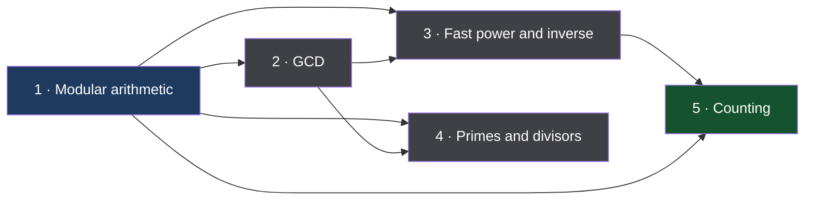

# Maths for LeetCode — syllabus

> [!abstract] How to use this folder
> **Skim:** read only the Recall card at the top of each note, in the order below.
> **Test:** answer the Check yourself questions at the end of each note before opening the answers.
> **Relearn:** read a note's body only where its card does not come back.

## How much of LeetCode is maths

**About 39% of contest problems rated below 1900 use maths: 657 of 1,666.** A problem counts when any maths idea is part of its solution, even as one ingredient (hand-classified in May 2026).

| Band      | Problems | Use maths | Share |
| --------- | -------: | --------: | ----: |
| 1100-1399 |      724 |       286 |   40% |
| 1400-1499 |      213 |        81 |   38% |
| 1500-1599 |      194 |        77 |   40% |
| 1600-1699 |      186 |        64 |   34% |
| 1700-1799 |      185 |        71 |   38% |
| 1800-1899 |      164 |        78 |   48% |

LeetCode's own Math tag is stricter: it was on 19% of 2025 Q2s and 25% of 2026 Q2s.

## The learning order

Part 1 is built only from what the class notes cover. Each arrow means the later folder uses the earlier one.

Every note follows the same shape: **the problem → the naive way, broken with numbers → why → the fix, step by step**, with Java that was run and LeetCode problems that carry their slug and zerotrac rating.

## Part 1 — from the class notes

| #   | Folder                       | Notes                                                                                        | Share of maths problems | Status |
| --- | ---------------------------- | -------------------------------------------------------------------------------------------- | ----------------------- | ------ |
| 1   | `01-modular-arithmetic/`     | [[01-modulo-operator]], [[02-mod-rules]], [[03-remainder-buckets]], [[04-encode-two-values]] | 17% (12-22%)            | ⬜      |
| 2   | `02-gcd/`                    | [[01-gcd-euclid]], [[02-gcd-of-array]]                                                       | 4% (0-6%)               | ⬜      |
| 3   | `03-fast-power-and-inverse/` | [[01-fast-power]], [[02-modular-inverse]]                                                    | 2% (0-4%)               | ⬜      |
| 4   | `04-primes-divisors/`        | [[01-primality]], [[02-sieve]], [[03-spf-factorisation]], [[04-divisors]]                    | 4% (1-6%)               | ⬜      |
| 5   | `05-counting/`               | [[01-counting-rules]], [[02-permutations-combinations]], [[03-ncr-mod-p]]                    | 9% (7-11%)              | ⬜      |

| #   | Why it sits here                                                                                                                              |
| --- | --------------------------------------------------------------------------------------------------------------------------------------------- |
| 1   | The atom. Every later note takes a remainder, and in Java a negative `%` is a silent trap.                                                    |
| 2   | Needs only `%`. Comes before the inverse, because whether an inverse exists is a gcd question.                                                |
| 3   | Needs the mod rules and gcd. The two tools `nCr mod p` is built from; the inverse hides inside counting problems, so its tag share reads low. |
| 4   | Builds on the √n idea and on gcd. Rare, so one solid pass is enough.                                                                          |
| 5   | Needs the mod rules and the inverse.                                                                                                          |

> [!tip] For the 1450-1599 band
> Folder 1 and the first two counting notes carry most of what Q2 asks. The rest of Part 1 is tools (fast power, the inverse, the sieve, `nCr mod p`): they cannot be derived in contest time, so they are read once and kept.

## Part 2 — not in the class notes, discuss first

Nothing here gets a note until it has been discussed in chat. Sorted by share.

| Topic                                             | Share of maths problems                 | Why LeetCode needs it                                                   | Sits near |
| ------------------------------------------------- | --------------------------------------- | ----------------------------------------------------------------------- | --------- |
| Geometry: distances, rectangle overlap, slopes    | 18% (9-31%)                             | The biggest maths topic overall, peaking at 1700-1799                   | after 5   |
| Pair and triple counting with a frequency map     | 12% (8-16%)                             | Counting pairs i < j with a property without the O(n²) loop             | 5         |
| Parity                                            | 9% (7-11%)                              | Reachability and invariants by odd and even                             | before 1  |
| Digit operations                                  | 8% (4-12%)                              | Extracting and rebuilding digits; the `Math.pow(10, i)` trap            | before 1  |
| Subarray sums divisible by k                      | 4% (0-11%), all subarray counting       | The prefix-sum version of remainder buckets                             | 1         |
| Arithmetic sums and the inverse triangular number | 3.5% (3-5%)                             | n(n+1)/2, and the largest k with k(k+1)/2 ≤ S                           | before 5  |
| Contribution technique                            | 3% (1-7%)                               | Sum over all subarrays or pairs without listing them                    | 5         |
| Game theory: parity and mirror games, Nim         | 2% (0-4%)                               | Optimal play that collapses to a parity or symmetry rule                | after 5   |
| Stars and bars                                    | 1% (0-3%)                               | Splitting identical items into groups                                   | 5         |
| LCM                                               | shares the 4% GCD tag                   | a / gcd × b, in that order, to avoid overflow                           | 2         |
| Inverse factorials precomputed in O(n)            | inside the 9% counting problems         | Many `nCr` queries at O(1) each                                         | 5         |
| Floor and ceiling division                        | 1 of 371 as a tag; a step inside others | Java division truncates toward zero; (a + b − 1) / b                    | 1         |
| Overflow and the constraint-to-complexity budget  | no tag; it applies everywhere           | `int` wraps silently; n ≤ 10⁵ read as a time budget picks the algorithm | before 1  |
| Extended Euclid                                   | 0 of 371                                | The inverse under a non-prime modulus                                   | 3         |

## Left out entirely

| Topic                                  | Share of maths problems            | Why                                                            |
| -------------------------------------- | ---------------------------------- | -------------------------------------------------------------- |
| Bit operations, XOR                    | 16% (11-22%)                       | Big, but it is its own toolkit and gets its own concept folder |
| Bitmask DP, digit DP, probability DP   | 4% (0-14%) bitmask, 1% probability | DP first; they belong with `DP/01-syllabus.md` #10-#11         |
| Lucas, CRT, matrix exponentiation, FFT | 1 of 371 (matrix exponentiation)   | Codeforces territory                                           |

## Rules for these notes

> [!warning] [[03-remainder-buckets]] gives away old #06
> maximum-sum-of-three-numbers-divisible-by-three (1585) uses the same idea. Read that note after the #06 re-solve.

> [!note] Problems are cited seen or unseen
> Each note cites the problems that best teach its idea, because these notes are revised on every return from a break. Every problem named in `concepts/` therefore counts as seen when dealing, and is never handed out as an unseen timed problem.

> [!question]- How the Share column is counted
> Of the 371 maths problems rated 1400-1899 (`zerotrac-data/band_*_final.tsv`), the share whose tags include the concept, pooled over the five bands, with the lowest and highest single band in brackets. 111 of the 371 carry more than one tag, so a concept counts whether it is the main idea or a second one. A concept used only as a small step inside another idea is not tagged, so tool topics (overflow, ceiling division, the inverse) read low against how often they are typed.
