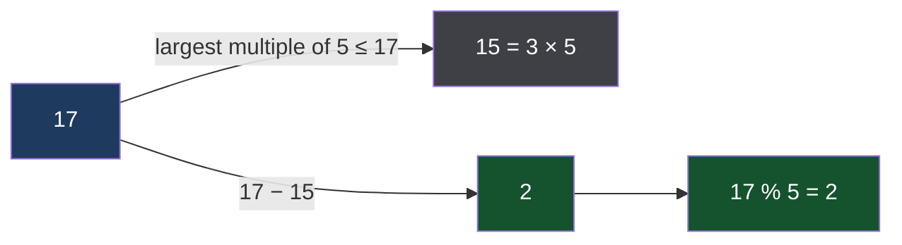
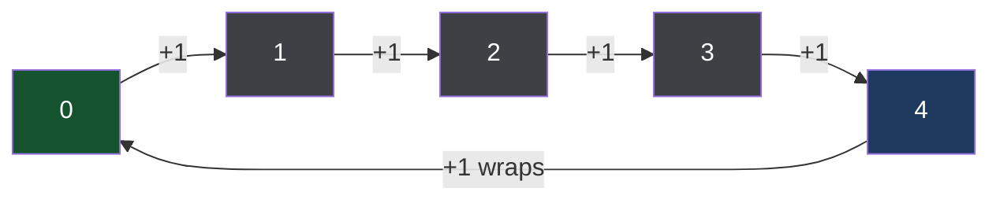
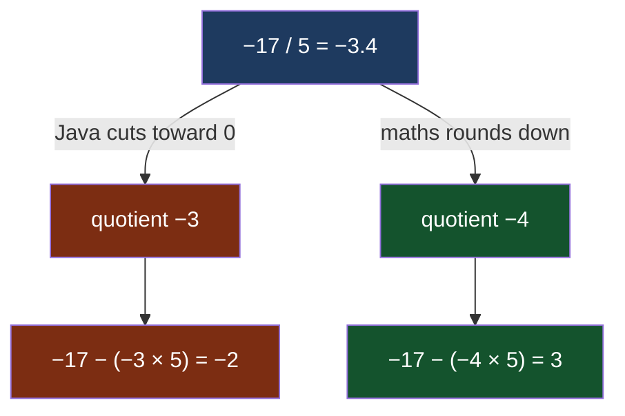
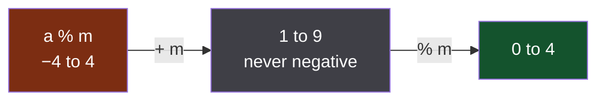

## Modulo is the remainder after division

Divide 17 by 5. The largest multiple of 5 that fits in 17 is 15 = 3 × 5, and 17 − 15 = 2 is what remains. That remainder is **17 mod 5**, written `17 % 5` in Java.



Written as one line, 17 = 3 × 5 + 2:

| Part          | In 17 = 3 × 5 + 2 | In Java |
| ------------- | ----------------: | ------- |
| the number    |                17 | `a`     |
| the divisor   |                 5 | `m`     |
| the quotient  |                 3 | `a / m` |
| the remainder |                 2 | `a % m` |

## The remainder is always 0 to m − 1

If 5 or more remained, 5 would fit in one more time, so the quotient was not the largest yet. The remainder of mod 5 is therefore one of 0, 1, 2, 3, 4, and in general `a % m` lies between 0 and m − 1.

A remainder of 0 means the division is exact: `15 % 5 = 0`, so 5 divides 15.

## Mod wraps around in a circle

Count upward and take each number mod 5:

| n     | 0   | 1   | 2   | 3   | 4   | 5   | 6   | 7   | 8   | 9   | 10  | 11  | 12  |
| ----- | --- | --- | --- | --- | --- | --- | --- | --- | --- | --- | --- | --- | --- |
| n % 5 | 0   | 1   | 2   | 3   | 4   | 0   | 1   | 2   | 3   | 4   | 0   | 1   | 2   |

The remainder climbs to 4 and then drops back to 0, because at 5 the divisor fits in once more. It goes round in a circle:



## Numbers m apart share a remainder

Moving 5 steps goes once round the circle and lands on the same remainder, so 2, 7, 12 and 17 all leave 2. Mod 5 sorts every whole number into 5 families:

| Remainder | The family          |
| --------: | ------------------- |
|         0 | 0, 5, 10, 15, 20, … |
|         1 | 1, 6, 11, 16, 21, … |
|         2 | 2, 7, 12, 17, 22, … |
|         3 | 3, 8, 13, 18, 23, … |
|         4 | 4, 9, 14, 19, 24, … |


## What mod is used for

| You want to know           | Write             | Example                           |
| -------------------------- | ----------------- | --------------------------------- |
| is n even                  | `n % 2 == 0`      | `14 % 2` is 0, so 14 is even      |
| the last digit of n        | `n % 10`          | `4728 % 10` is 8                  |
| does m divide a            | `a % m == 0`      | `91 % 7` is 0, so 7 divides 91    |
| the next index in a circle | `(i + 1) % n`     | with n = 5, after index 4 comes 0 |
| a huge answer, kept small  | `% 1_000_000_007` | see the rules below               |

## Negative numbers keep going round the circle

The families do not stop at zero. Counting down from 0, the circle simply runs backwards, 4, 3, 2, 1, 0, 4, …:

| n       | −6  | −5  | −4  | −3  | −2  | −1  | 0   | 1   | 2   | 3   | 4   | 5   | 6   |
| ------- | --- | --- | --- | --- | --- | --- | --- | --- | --- | --- | --- | --- | --- |
| n mod 5 | 4   | 0   | 1   | 2   | 3   | 4   | 0   | 1   | 2   | 3   | 4   | 0   | 1   |

So −17 belongs to family 3, together with −12, −7, −2, 3, 8 and 13. To find it by hand, step down to the multiple of 5 at or below −17, which is −20, and count up: −17 is 3 above it, so −17 = −4 × 5 + 3.

> Here Q = -4 because remainder can only have values [0,m-1] always a non negative value , but if have Q = -3 then -17=-3 * 5 - 2 => remainder is negative but that's not Valid at all.
## Java's % goes negative

Java does not follow the circle below zero:

| n            | −6  | −5  | −4  | −3  | −2  | −1  |
| ------------ | --- | --- | --- | --- | --- | --- |
| n mod 5      | 4   | 0   | 1   | 2   | 3   | 4   |
| Java `n % 5` | −1  | 0   | −4  | −3  | −2  | −1  |

The reason is how Java picks the quotient. −17 / 5 is −3.4, and Java cuts off the fraction instead of **rounding down**:



−2 and 3 are 5 apart, so Java still names the right family. The trouble is that −2 cannot be an array index, and comparing `-2 == 3` says two numbers of the same family differ. Python's `%` follows the circle(same as Maths) and gives 3.

## The fix: add m, then take % m again

Java has two ways to get the circle's answer, `((a % m) + m) % m` and `Math.floorMod(a, m)`. Here is why the first one works, with m = 5:



> [!warning] Adding m once is not enough
> `-15 % 5` is 0, and 0 + 5 is 5, which is outside 0 to 4. A positive number breaks too: `17 % 5 + 5` is 7. The last `% m` folds both back, 5 to 0 and 7 to 2.

```java
public class Mod {
    public static void main(String[] args) {
        int m = 5;
        int[] values = {17, -17, -15};
        for (int a : values) {
            System.out.println(a + ":  a % m = " + (a % m)
                    + ",  a % m + m = " + (a % m + m)
                    + ",  safe = " + ((a % m) + m) % m
                    + ",  floorMod = " + Math.floorMod(a, m));
        }
    }
}
```

Run:
```text
17:  a % m = 2,  a % m + m = 7,  safe = 2,  floorMod = 2
-17:  a % m = -2,  a % m + m = 3,  safe = 3,  floorMod = 3
-15:  a % m = 0,  a % m + m = 5,  safe = 0,  floorMod = 0
```

## + and × can work on remainders


| Modular Arithmetic Properties         |
| ------------------------------------- |
| (a + b) % m = (a % m + b % m) % m     |
| (a × b) % m = (a % m) × (b % m) % m   |
| (a − b) % m = (a % m − b % m + m) % m |
| (a) % m = (a + m) % m                 |


Swapping a number for its remainder keeps it in the same family, and adding or multiplying members of the same families lands in the same family. With m = 5, 17 is in family 2 and 9 is in family 4:

| Operation | With the numbers           | With the remainders      | Same answer |
| --------- | -------------------------- | ------------------------ | ----------- |
| add       | (17 + 9) % 5 = 26 % 5 = 1  | (2 + 4) % 5 = 6 % 5 = 1  | yes         |
| multiply  | (17 × 9) % 5 = 153 % 5 = 3 | (2 × 4) % 5 = 8 % 5 = 3  | yes         |
| subtract  | (17 − 9) % 5 = 8 % 5 = 3   | (2 − 4) % 5 = −2 in Java | after + m   |

**Why multiplying works:** write 17 = 3 × 5 + 2 and 9 = 1 × 5 + 4 and multiply out. Every piece except 2 , 4 contains a 5, so it is a multiple of 5 and adds nothing to the remainder:

Subtraction can go below zero, hence + m fix from above: (−2 + 5) % 5 = 3.
