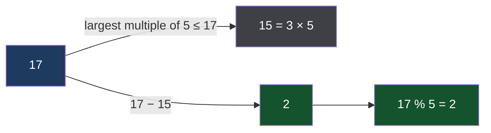
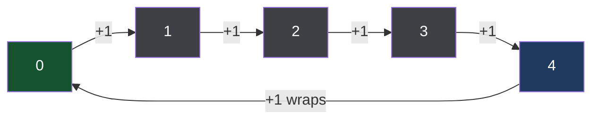
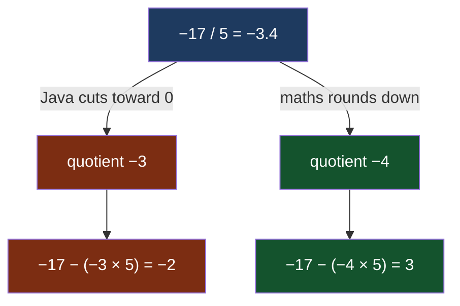
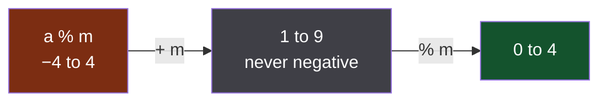
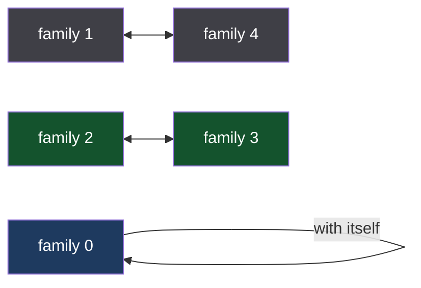
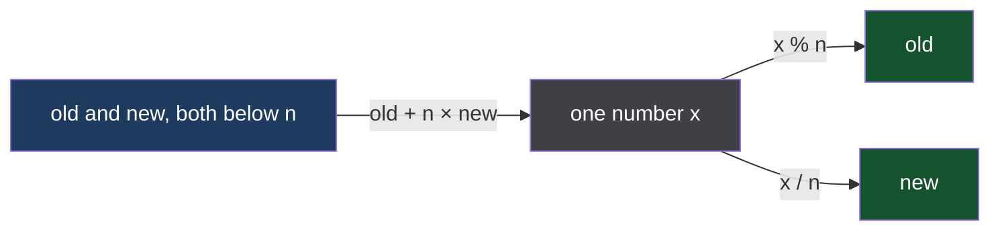

## Modulo is the remainder after division

Divide 17 by 5. The largest multiple of 5 that fits in 17 is 15 = 3 × 5, and 17 − 15 = 2 is what remains. That remainder is **17 mod 5**, written `17 % 5` in Java.



Written as one line, 17 = 3 × 5 + 2:

| Part          | In 17 = 3 × 5 + 2 | In Java |
| ------------- | ----------------: | ------- |
| the number    |                17 | `a`     |
| the divisor   |                 5 | `m`     |
| the quotient  |                 3 | `a / m` |
| the remainder |                 2 | `a % m` |

## The remainder is always 0 to m − 1

If 5 or more remained, 5 would fit in one more time, so the quotient was not the largest yet. The remainder of mod 5 is therefore one of 0, 1, 2, 3, 4, and in general `a % m` lies between 0 and m − 1.

A remainder of 0 means the division is exact: `15 % 5 = 0`, so 5 divides 15.

## Mod wraps around in a circle

Count upward and take each number mod 5:

| n     | 0   | 1   | 2   | 3   | 4   | 5   | 6   | 7   | 8   | 9   | 10  | 11  | 12  |
| ----- | --- | --- | --- | --- | --- | --- | --- | --- | --- | --- | --- | --- | --- |
| n % 5 | 0   | 1   | 2   | 3   | 4   | 0   | 1   | 2   | 3   | 4   | 0   | 1   | 2   |

The remainder climbs to 4 and then drops back to 0, because at 5 the divisor fits in once more. It goes round in a circle:



## Numbers m apart share a remainder

Moving 5 steps goes once round the circle and lands on the same remainder, so 2, 7, 12 and 17 all leave 2. Mod 5 sorts every whole number into 5 families:

| Remainder | The family          |
| --------: | ------------------- |
|         0 | 0, 5, 10, 15, 20, … |
|         1 | 1, 6, 11, 16, 21, … |
|         2 | 2, 7, 12, 17, 22, … |
|         3 | 3, 8, 13, 18, 23, … |
|         4 | 4, 9, 14, 19, 24, … |

> [!note] The idea everything below builds on
> Two numbers leave the same remainder mod m exactly when their difference is a multiple of m. Most remainder problems stop caring about the numbers and work with their families instead.

For example, the values of m > 1 that give 38 and 14 the same remainder are exactly the divisors of 38 − 14 = 24: 2, 3, 4, 6, 8, 12 and 24.

## What mod is used for

| You want to know           | Write             | Example                           |
| -------------------------- | ----------------- | --------------------------------- |
| is n even                  | `n % 2 == 0`      | `14 % 2` is 0, so 14 is even      |
| the last digit of n        | `n % 10`          | `4728 % 10` is 8                  |
| does m divide a            | `a % m == 0`      | `91 % 7` is 0, so 7 divides 91    |
| the next index in a circle | `(i + 1) % n`     | with n = 5, after index 4 comes 0 |
| a huge answer, kept small  | `% 1_000_000_007` | see the rules below               |

## Negative numbers keep going round the circle

The families do not stop at zero. Counting down from 0, the circle simply runs backwards, 4, 3, 2, 1, 0, 4, …:

| n       | −6  | −5  | −4  | −3  | −2  | −1  | 0   | 1   | 2   | 3   | 4   | 5   | 6   |
| ------- | --- | --- | --- | --- | --- | --- | --- | --- | --- | --- | --- | --- | --- |
| n mod 5 | 4   | 0   | 1   | 2   | 3   | 4   | 0   | 1   | 2   | 3   | 4   | 0   | 1   |

So −17 belongs to family 3, together with −12, −7, −2, 3, 8 and 13. To find it by hand, step down to the multiple of 5 at or below −17, which is −20, and count up: −17 is 3 above it, so −17 = −4 × 5 + 3.

## Java's % goes negative

Java does not follow the circle below zero:

| n            | −6  | −5  | −4  | −3  | −2  | −1  |
| ------------ | --- | --- | --- | --- | --- | --- |
| n mod 5      | 4   | 0   | 1   | 2   | 3   | 4   |
| Java `n % 5` | −1  | 0   | −4  | −3  | −2  | −1  |

The reason is how Java picks the quotient. −17 / 5 is −3.4, and Java cuts off the fraction instead of rounding down:



−2 and 3 are 5 apart, so Java still names the right family. The trouble is that −2 cannot be an array index, and comparing `-2 == 3` says two numbers of the same family differ. Python's `%` follows the circle and gives 3.

## The fix: add m, then take % m again

Java has two ways to get the circle's answer, `((a % m) + m) % m` and `Math.floorMod(a, m)`. Here is why the first one works, with m = 5:



> [!warning] Adding m once is not enough
> `-15 % 5` is 0, and 0 + 5 is 5, which is outside 0 to 4. A positive number breaks too: `17 % 5 + 5` is 7. The last `% m` folds both back, 5 to 0 and 7 to 2.

```java
public class Mod {
    public static void main(String[] args) {
        int m = 5;
        int[] values = {17, -17, -15};
        for (int a : values) {
            System.out.println(a + ":  a % m = " + (a % m)
                    + ",  a % m + m = " + (a % m + m)
                    + ",  safe = " + ((a % m) + m) % m
                    + ",  floorMod = " + Math.floorMod(a, m));
        }
    }
}
```

Run:
```text
17:  a % m = 2,  a % m + m = 7,  safe = 2,  floorMod = 2
-17:  a % m = -2,  a % m + m = 3,  safe = 3,  floorMod = 3
-15:  a % m = 0,  a % m + m = 5,  safe = 0,  floorMod = 0
```

## + and × can work on remainders

Swapping a number for its remainder keeps it in the same family, and adding or multiplying members of the same families lands in the same family. With m = 5, 17 is in family 2 and 9 is in family 4:

| Operation | With the numbers           | With the remainders      | Same answer |
| --------- | -------------------------- | ------------------------ | ----------- |
| add       | (17 + 9) % 5 = 26 % 5 = 1  | (2 + 4) % 5 = 6 % 5 = 1  | yes         |
| multiply  | (17 × 9) % 5 = 153 % 5 = 3 | (2 × 4) % 5 = 8 % 5 = 3  | yes         |
| subtract  | (17 − 9) % 5 = 8 % 5 = 3   | (2 − 4) % 5 = −2 in Java | after + m   |

Why multiplying works: write 17 = 3 × 5 + 2 and 9 = 1 × 5 + 4 and multiply out. Every piece except 2 × 4 contains a 5, so it is a multiple of 5 and adds nothing to the remainder:

| ×         | 1 × 5         | 4             |
| --------- | ------------- | ------------- |
| **3 × 5** | multiple of 5 | multiple of 5 |
| **2**     | multiple of 5 | **2 × 4 = 8** |

Subtraction can go below zero, so it needs the + m fix from above: (−2 + 5) % 5 = 3.

| Rule                                  | In Java with `M`  |
| ------------------------------------- | ----------------- |
| (a + b) % m = (a % m + b % m) % m     | `(a + b) % M`     |
| (a × b) % m = (a % m) × (b % m) % m   | `a * b % M`       |
| (a − b) % m = (a % m − b % m + m) % m | `(a - b + M) % M` |

The Java column assumes `a` and `b` are already remainders, below `M`.

## Why answers are asked mod 10⁹ + 7

Some answers outgrow every type. 2ⁿ in a `long`:

|   n |             2ⁿ in a `long` | Right?  |
| --: | -------------------------: | ------- |
|  62 |  4,611,686,018,427,387,904 | yes     |
|  63 | −9,223,372,036,854,775,808 | wrapped |
|  64 |                          0 | wrapped |

So problems ask for the answer % 1,000,000,007 instead. That number is chosen for three reasons:

| Property of 1,000,000,007                                   | What it buys                                   |
| ----------------------------------------------------------- | ---------------------------------------------- |
| it is prime                                                 | division becomes possible, through the inverse |
| it is below 2³¹                                             | a remainder, and a sum of two, fits in `int`   |
| (m − 1)² ≈ 10¹⁸, under the `long` limit of about 9.2 × 10¹⁸ | a product of two remainders fits in `long`     |

## Take % m after every step, not at the end

The rules allow reducing at any point, and reducing after every step keeps every value below m, so a product of two values never leaves `long`:


25! with m = 10⁹ + 7:

| Way                 |      Result | Right?                           |
| ------------------- | ----------: | -------------------------------- |
| % m once at the end | 332,217,180 | no, the `long` had wrapped first |
| % m after each step | 440,732,388 | yes, matches exact arithmetic    |

```java
long ans = 1;
for (int i = 2; i <= 25; i++) ans = ans * i % 1_000_000_007L;
```

> [!warning] Two remainders multiplied in `int` overflow
> `1_000_000_006 * 1_000_000_006` in `int` gives 1,923,446,820, a wrong number with no error. Keep remainders in `long`.

## Division does not work on remainders

24 / 6 = 4. With remainders mod 7, 24 % 7 = 3 and 6 % 7 = 6, and 3 / 6 is 0. Remainders forget how many copies of m were thrown away, and division needs exactly that. Dividing under a mod is done by multiplying with a different number, the **modular inverse**, covered in [[03-fast-power-and-inverse]].

## Count by remainder, not by number

Whether x + y is divisible by k depends only on x % k and y % k. So a question about pairs of numbers becomes a question about pairs of families. Pairs with a sum divisible by 5 in [3, 7, 12, 8, 2, 5, 10, 13]:

| Number    |   3 |   7 |  12 |   8 |   2 |   5 |  10 |  13 |
| --------- | --: | --: | --: | --: | --: | --: | --: | --: |
| Remainder |   3 |   2 |   2 |   3 |   2 |   0 |   0 |   3 |

Two remainders add up to a multiple of 5 when their sum is 0 or 5, so the families pair up like this:



| Families  | Count in each |         Pairs |
| --------- | ------------- | ------------: |
| 0 with 0  | 2             | 2 × 1 / 2 = 1 |
| 1 with 4  | 0 and 0       |     0 × 0 = 0 |
| 2 with 3  | 3 and 3       |     3 × 3 = 9 |
| **Total** |               |        **10** |

Checking all 28 pairs one by one also gives 10. When k is even, family k / 2 pairs with itself, the same way as family 0. A negative number must be put in its family with the safe `((x % k) + k) % k`.

## Two numbers below n fit in one slot

If old and new are both below n, store x = old + n × new. Then x % n gives back old and x / n gives back new, because old is too small to reach the next multiple of n. With n = 10 this is just decimal digits: 47 = 7 + 10 × 4.



This is how an array is rewritten in place when every slot must keep its old value until others have read it. Making each a[i] equal to the old a[a[i]] for a = [3, 2, 0, 1], with n = 4:

|   i | old a[i] | reads old a[j] there | stored old + 4 × new | x / 4 |
| --: | -------: | -------------------: | -------------------: | ----: |
|   0 |        3 |         a[3] % 4 = 1 |                    7 |     1 |
|   1 |        2 |         a[2] % 4 = 0 |                    2 |     0 |
|   2 |        0 |         a[0] % 4 = 3 |                   12 |     3 |
|   3 |        1 |         a[1] % 4 = 2 |                    9 |     2 |

At i = 2, slot 0 already holds 7, but 7 % 4 is still the old 3. Overwriting directly would have read 1 and given [1, 0, 1, 0] instead of [1, 0, 3, 2].

> [!warning] The stored value needs `long`
> It reaches (n − 1) + n × (n − 1), which for n = 100,000 is 9,999,999,999, past the `int` limit of 2,147,483,647.
