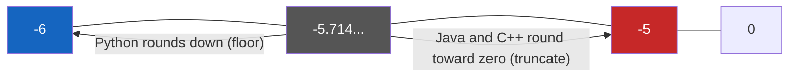

## The starting problem — sort numbers into remainder buckets

**The task.** You get a list of whole numbers and the number `m = 7`. Make 7 counters, called **buckets**, numbered 0 to 6. Put each number into the bucket equal to its remainder when divided by 7, and return how many numbers ended up in each bucket.

**Example.** `nums = [40, 12, -40]`, `m = 7`:

| Number | As a multiple of 7 plus a remainder | Remainder | Bucket |
| -----: | ----------------------------------- | --------: | -----: |
|     40 | 40 = 5 × 7 + 5                      |         5 |      5 |
|     12 | 12 = 1 × 7 + 5                      |         5 |      5 |
|    −40 | −40 = −6 × 7 + 2                    |         2 |      2 |

Expected output: `[0, 0, 1, 0, 0, 2, 0]`. Bucket 2 holds one number, bucket 5 holds two, and the other buckets are empty.

**Why it matters.** Counting by remainder is the first step of most remainder problems. For example, two numbers have a sum divisible by 7 exactly when their remainders add up to 7, or are both 0, so counting such pairs starts from these bucket counts.

The obvious code uses the remainder itself as the bucket index:

```java
public class Buckets {
    public static void main(String[] args) {
        int[] nums = {40, 12, -40};
        int m = 7;
        int[] count = new int[m];
        for (int a : nums) {
            System.out.println(a + " % " + m + " = " + (a % m));
            count[a % m]++;
        }
    }
}
```

Run:
```text
40 % 7 = 5
12 % 7 = 5
-40 % 7 = -5
Exception in thread "main" java.lang.ArrayIndexOutOfBoundsException: Index -5 out of bounds for length 7
	at Buckets.main(Buckets.java:8)
```

The two positive values land in bucket 5. The negative one asks for bucket `-5`, which does not exist. Java's `%` returned a negative number, so before fixing anything, the question is what `%` actually computes.

## What `a % b` means — dividend = quotient × divisor + remainder

In `a / b` and `a % b`, the **dividend** is `a`, the number being divided; the **divisor** is `b`, the number dividing it; the **quotient** `a / b` is how many whole times the divisor goes in; and the **remainder** `a % b` is what is left over. They are tied together by one identity, which every language keeps: **dividend = quotient × divisor + remainder**, for example `40 = 5 × 7 + 5`. So `%` is not computed on its own. The language first picks the quotient, and the remainder is whatever is left to make the identity true: `remainder = dividend - quotient × divisor`. Run all four sign combinations of `40` and `7` in Java and check the identity on each:

```java
public class Definition {
    public static void main(String[] args) {
        int[][] pairs = {{40, 7}, {-40, 7}, {40, -7}, {-40, -7}};
        for (int[] p : pairs) {
            int a = p[0], b = p[1];
            int q = a / b, r = a % b;
            System.out.printf("a=%4d b=%3d  q=%3d r=%3d  q*b+r=%4d%n", a, b, q, r, q * b + r);
        }
    }
}
```

Run:
```text
a=  40 b=  7  q=  5 r=  5  q*b+r=  40
a= -40 b=  7  q= -5 r= -5  q*b+r= -40
a=  40 b= -7  q= -5 r=  5  q*b+r=  40
a= -40 b= -7  q=  5 r= -5  q*b+r= -40
```

The last column always gives back `a`. The identity never breaks; only the choice of quotient decides the remainder.

## A negative dividend: Java and C++ round toward zero, Python rounds down

`-40 / 7` is `-5.714...` on paper. It sits between two whole numbers, `-6` and `-5`, and a language has to pick one:



**Truncate** means cut off the fraction, which moves toward zero. **Floor** means go to the next whole number below, which for a negative value moves away from zero. For a positive value like `5.714...` both give `5`, which is why the difference never shows up until a negative number appears.

The remainder then follows from the identity: Java and C++ pick `-5` and get `-40 - (-5) × 7 = -5`, while Python picks `-6` and gets `-40 - (-6) × 7 = 2`. Python, on the two pairs whose signs differ (`//` is Python's whole-number division):

```python
for a, b in [(-40, 7), (40, -7)]:
    q, r = a // b, a % b
    print(f"a={a:4d} b={b:3d}  q={q:3d} r={r:3d}  q*b+r={q * b + r:4d}")
```

Run:
```text
a= -40 b=  7  q= -6 r=  2  q*b+r= -40
a=  40 b= -7  q= -6 r= -2  q*b+r=  40
```

C++, same two pairs, compiled and run here:

```cpp
#include <cstdio>
int main() {
    int pairs[2][2] = {{-40, 7}, {40, -7}};
    for (auto& p : pairs) {
        int a = p[0], b = p[1];
        int q = a / b, r = a % b;
        std::printf("a=%4d b=%3d  q=%3d r=%3d  q*b+r=%4d\n", a, b, q, r, q * b + r);
    }
}
```

Run:
```text
a= -40 b=  7  q= -5 r= -5  q*b+r= -40
a=  40 b= -7  q= -5 r=  5  q*b+r=  40
```

C++ prints exactly Java's rows 2 and 3. Python differs on both. When the signs of `a` and `b` match (rows 1 and 4 of the Java run) the quotient is positive, rounding down and rounding toward zero are the same thing, and all three languages agree.

## A negative divisor: `40 % -7`

Row 3 is the negative divisor. `40 / -7` is again `-5.714...`, so the same split happens: Java and C++ truncate to `-5` and get `40 - (-5) × (-7) = 5`, while Python floors to `-6` and gets `40 - (-6) × (-7) = -2`.

Putting both cases together gives the rule to remember:

| Language     | Quotient rounds | Remainder takes the sign of | `-40 % 7` | `40 % -7` |
| ------------ | --------------- | --------------------------- | --------: | --------: |
| Java and C++ | toward zero     | the dividend `a`            |        -5 |         5 |
| Python       | down            | the divisor `b`             |         2 |        -2 |

On LeetCode the divisor is almost always a positive constant (`k`, `m`, `10^9 + 7`), so the negative-divisor row is rare. The negative-dividend row is the one that crashes code: a negative input, a prefix sum that dips below zero, or a difference of two remainders.

> [!note] A bucket index has to lie in `0 .. m - 1`, and with a positive `m` that is exactly Python's answer. Every fix below is a way of making Java produce Python's remainder.

## Adding `m` once fixes most negatives, and breaks on multiples

For a negative dividend and positive `m`, Java's remainder lies in `-(m - 1) .. 0`. Python's answer is exactly `m` more whenever Java's is nonzero: `-5 + 7 = 2`. So the first fix that comes to mind is to add `m`:

```java
public class PlusM {
    public static void main(String[] args) {
        int m = 7;
        int[] values = {-40, 40, -14};
        for (int a : values) {
            int plusOnce = a % m + m;
            int safe = ((a % m) + m) % m;
            System.out.printf("a=%4d  a %% m=%3d  a %% m + m=%3d  ((a %% m) + m) %% m=%2d  floorMod=%2d%n",
                    a, a % m, plusOnce, safe, Math.floorMod(a, m));
        }
    }
}
```

Run:
```text
a= -40  a % m= -5  a % m + m=  2  ((a % m) + m) % m= 2  floorMod= 2
a=  40  a % m=  5  a % m + m= 12  ((a % m) + m) % m= 5  floorMod= 5
a= -14  a % m=  0  a % m + m=  7  ((a % m) + m) % m= 0  floorMod= 0
```

Row 1 works. Row 3 is the bug: `-14` is a multiple of `7`, so `-14 % 7` is `0`, and `0 + 7` is `7`, which is not a valid bucket. Row 2 shows the other failure: applied to a positive value, adding `m` pushes `5` up to `12`.

> [!warning] `a % m + m` returns m for every negative multiple of m
> Adding `m` maps Java's range `-(m - 1) .. 0` onto `1 .. m`. Every value lands right except `0`, which lands on `m`, one past the last bucket. Inputs like `-14`, `-7` or a prefix sum that returns to exactly `-k` hit it, and on a bucket array it is an `ArrayIndexOutOfBoundsException` or a silently wrong count.

## The second `% m` folds `m` back to 0

`((a % m) + m) % m` adds one more `% m` at the end. Track the range of values through each step, for any sign of `a` and a positive `m`:

| Step                | Negative `a`                      | Positive `a`  |
| ------------------- | --------------------------------- | ------------- |
| `a % m`             | `-(m - 1) .. 0`                   | `0 .. m - 1`  |
| `(a % m) + m`       | `1 .. m`                          | `m .. 2m - 1` |
| `((a % m) + m) % m` | `1 .. m - 1`, and `m` becomes `0` | `0 .. m - 1`  |

After the first two steps the value is never negative, so the last `%` behaves the same in every language: it leaves `1 .. m - 1` alone and folds `m .. 2m - 1` back down by exactly `m`. That one extra `%` repairs both failures from the run above, the `7` from `-14` and the `12` from `40`.

## `Math.floorMod` does it in one call

Java has Python's remainder built in. `Math.floorMod(a, b)` floors the quotient instead of truncating it, and `Math.floorDiv(a, b)` returns that floored quotient:

```java
public class FloorMod {
    public static void main(String[] args) {
        int[][] pairs = {{40, 7}, {-40, 7}, {40, -7}, {-40, -7}};
        for (int[] p : pairs) {
            int a = p[0], b = p[1];
            System.out.printf("a=%4d b=%3d  a %% b=%3d  floorMod=%3d  floorDiv=%3d%n",
                    a, b, a % b, Math.floorMod(a, b), Math.floorDiv(a, b));
        }
    }
}
```

Run:
```text
a=  40 b=  7  a % b=  5  floorMod=  5  floorDiv=  5
a= -40 b=  7  a % b= -5  floorMod=  2  floorDiv= -6
a=  40 b= -7  a % b=  5  floorMod= -2  floorDiv= -6
a= -40 b= -7  a % b= -5  floorMod= -5  floorDiv=  5
```

The `floorMod` column is the Python `r` column, row for row, including `-2` for `40 % -7`. With a positive `m` it is always in `0 .. m - 1`, the same as `((a % m) + m) % m`.

Both were checked against a brute force that tries every `r` in `0 .. m - 1` and returns the one where `a - r` is a multiple of `m`, which is the identity used directly:

```java
import java.util.Random;

public class CrossCheck {
    static int bruteRemainder(int a, int m) {
        for (int r = 0; r < m; r++) {
            if ((a - r) % m == 0) return r;
        }
        throw new IllegalStateException();
    }

    public static void main(String[] args) {
        Random rng = new Random(42);
        int tests = 100_000, safeWrong = 0, floorModWrong = 0;
        int negatives = 0, plusOnceWrong = 0, wrongAndMultiple = 0;
        for (int t = 0; t < tests; t++) {
            int a = rng.nextInt(2_000_001) - 1_000_000;
            int m = 1 + rng.nextInt(20);
            int expected = bruteRemainder(a, m);
            if (((a % m) + m) % m != expected) safeWrong++;
            if (Math.floorMod(a, m) != expected) floorModWrong++;
            if (a < 0) negatives++;
            if (a < 0 && a % m + m != expected) {
                plusOnceWrong++;
                if (a % m == 0) wrongAndMultiple++;
            }
        }
        System.out.printf("random tests %d: safe form wrong %d, floorMod wrong %d%n",
                tests, safeWrong, floorModWrong);
        System.out.printf("negative a %d: a %% m + m wrong %d, of those a multiple of m %d%n",
                negatives, plusOnceWrong, wrongAndMultiple);
    }
}
```

Run:
```text
random tests 100000: safe form wrong 0, floorMod wrong 0
negative a 49878: a % m + m wrong 9009, of those a multiple of m 9009
```

Both safe forms matched the brute force on all 100,000 random inputs. The single `+ m` failed on 9009 of the 49878 negative inputs, and every one of those failures was a multiple of `m`, the `-14` case and nothing else.

## The buckets, fixed

The starting program with the safe form as the index, and `-14` added to the input:

```java
public class BucketsFixed {
    public static void main(String[] args) {
        int[] nums = {40, 12, -40, -14};
        int m = 7;
        int[] count = new int[m];
        for (int a : nums) {
            int r = ((a % m) + m) % m;
            System.out.println(a + " -> bucket " + r);
            count[r]++;
        }
        System.out.println(java.util.Arrays.toString(count));
    }
}
```

Run:
```text
40 -> bucket 5
12 -> bucket 5
-40 -> bucket 2
-14 -> bucket 0
[1, 0, 1, 0, 0, 2, 0]
```

`-40` lands in bucket 2, because `-40 = -6 × 7 + 2`, and `-14` lands in bucket 0, because it is a multiple of 7.

## On LeetCode

- check-if-array-pairs-are-divisible-by-k (LC 1497, 1787): values go down to `-10^9`, and pairing is done by remainder bucket, so a raw `a % k` is the crash from the top of this note.
- subarray-sums-divisible-by-k (LC 974, 1676): values go down to `-10^4`, so prefix sums go negative and must be bucketed with the safe form before counting.
- make-sum-divisible-by-p (LC 1590, 2039): every value is positive, but the lookup key is a difference of two remainders, `prefix - target`, which goes negative and needs `+ p` and a second `% p`.
- count-of-interesting-subarrays (LC 2845, 2073): the same difference of remainders, `count - k`, reduced modulo `modulo`.
