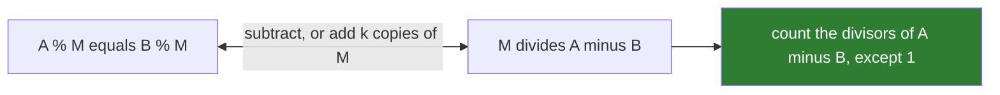

## The starting problem — which moduli give the same remainder?

**The task.** You get two positive numbers `A` and `B`. Count the numbers `M`, bigger than 1, that give `A` and `B` the same remainder, meaning `A % M == B % M`.

**Example.** `A = 38`, `B = 14`. The table tries the first few values of `M`:

|   M | 38 % M | 14 % M | Same |
| --: | -----: | -----: | ---- |
|   2 |      0 |      0 | yes  |
|   3 |      2 |      2 | yes  |
|   4 |      2 |      2 | yes  |
|   5 |      3 |      4 | no   |
|   6 |      2 |      2 | yes  |
|   7 |      3 |      0 | no   |
|   8 |      6 |      6 | yes  |
|   9 |      2 |      5 | no   |
|  10 |      8 |      4 | no   |
|  11 |      5 |      3 | no   |
|  12 |      2 |      2 | yes  |

Expected output: **7**, for M = 2, 3, 4, 6, 8, 12 and 24. The last one is past the table: 38 % 24 = 14 and 14 % 24 = 14.

**Why it matters.** Grouping numbers that share a remainder is how pairing, cycle and every-k-th-day problems are solved, and this is the smallest version of that question.

The naive way tries every `M` from 2 up to `max(A, B)` (past that, `A % M = A` and `B % M = B`, which differ). That is O(max), shown broken below.

## Same remainder means M divides A − B

Write `A = q1·M + r` and `B = q2·M + r` with the same remainder `r`. Subtracting, `A − B = (q1 − q2)·M`, so **M divides A − B**. The other direction: if `A − B = k·M`, then `A = B + k·M`, and adding whole copies of `M` never changes a remainder (`a % m = (a + m) % m`, applied `k` times), so `A % M = B % M`.



So the answer is the number of divisors of `D = |A − B|`, minus one for `M = 1`. For `(38, 14)`, `D = 24`, whose divisors are 1, 2, 3, 4, 6, 8, 12, 24: seven values of `M`, exactly the yes rows above plus 24. Divisors come in pairs `i` and `D / i`, one of them at most `√D`, so counting them is O(√D).

```java
public class SameRemainder {
    static long countBrute(long a, long b) {
        long count = 0;
        for (long m = 2; m <= Math.max(a, b); m++) {
            if (a % m == b % m) count++;
        }
        return count;
    }

    static long countDivisors(long a, long b) {
        long d = Math.abs(a - b), count = 0;
        for (long i = 1; i * i <= d; i++) {
            if (d % i == 0) {
                count++;
                if (i != d / i) count++;
            }
        }
        return count - 1;
    }

    public static void main(String[] args) {
        long a = 38, b = 14;
        System.out.println("(38, 14): brute = " + countBrute(a, b) + ", divisors of 24 except 1 = " + countDivisors(a, b));

        long s = System.nanoTime();
        long r = countBrute(1_000_000_000L, 999_999_000L);
        System.out.println("brute (1e9, 1e9-1000): " + r + "  time = " + (System.nanoTime() - s) / 1_000_000 + " ms");
        s = System.nanoTime();
        r = countDivisors(1_000_000_000_000L, 999_999_999_000L);
        System.out.println("divisors (1e12, 1e12-1000): " + r + "  time = " + (System.nanoTime() - s) / 1_000_000 + " ms");
    }
}
```

Run:
```text
(38, 14): brute = 7, divisors of 24 except 1 = 7
brute (1e9, 1e9-1000): 15  time = 1347 ms
divisors (1e12, 1e12-1000): 15  time = 0 ms
```

The brute force needed 1347 ms for numbers near 10^9, and by projection would need about a thousand times longer near 10^12, where the divisor count took no measurable time. The divisor count matched the brute force on 100,000 random unequal pairs.

> [!warning] If `A == B`, then `D = 0`, every `M` works and the answer is infinite (the code above returns −1); handle it before counting. For negative inputs, compare `((A % M) + M) % M` instead, because Java's `-3 % 5` is `-3` while `2 % 5` is `2`, although both leave 2 in the mathematical sense.

## The second problem — pairs whose sum is divisible by k

Count pairs `i < j` with `(a[i] + a[j]) % k == 0`. The naive way checks every pair: `n·(n−1)/2` of them, about 5·10^9 for `n = 100,000`.

**The key fact:** by the addition rule, `(x + y) % k = (x % k + y % k) % k`. So whether a pair works depends **only on the two remainders**, never on the numbers themselves. Group the numbers into **buckets**, one per remainder `0..k−1`, and count how many land in each.

For `a = [3, 7, 12, 8, 2, 5, 10, 13]` and `k = 5`:

| Number |   3 |   7 |  12 |   8 |   2 |   5 |  10 |  13 |
| ------ | --: | --: | --: | --: | --: | --: | --: | --: |
| x % 5  |   3 |   2 |   2 |   3 |   2 |   0 |   0 |   3 |

| Remainder |   0 |   1 |   2 |   3 |   4 |
| --------- | --: | --: | --: | --: | --: |
| Count     |   2 |   0 |   3 |   3 |   0 |

Two remainders `r` and `s` sum to a multiple of `k` exactly when `r + s` is 0 or `k`. That pairs bucket `r` with bucket `k − r`:

- **Remainder `r` with `k − r`, where `r < k − r`:** every number in one bucket pairs with every number in the other, `cnt[r] · cnt[k − r]` pairs. Here buckets 2 and 3 give `3 · 3 = 9`, buckets 1 and 4 give 0.
- **Remainder 0 pairs with itself:** any two of them work, `cnt[0]·(cnt[0] − 1)/2` pairs. Here `2·1/2 = 1`.
- **Remainder `k/2`, only when `k` is even, also pairs with itself:** `cnt[k/2]·(cnt[k/2] − 1)/2`. Using `cnt[r]·cnt[k − r]` there would pair each number with itself and count every pair twice.

Total for the example: `9 + 0 + 1 = 10`. For `[3, 9, 15, 4, 2, 6, 12]` with `k = 6` the remainders are 3, 3, 3, 4, 2, 0, 0, so bucket 0 gives 1, buckets 2 and 4 give `1 · 1 = 1`, and bucket 3 (the `k/2` bucket) gives `3·2/2 = 3`, a total of 5.

```java
import java.util.*;

public class PairsDivisible {
    static long pairsBrute(int[] a, int k) {
        long count = 0;
        for (int i = 0; i < a.length; i++)
            for (int j = i + 1; j < a.length; j++)
                if ((a[i] + a[j]) % k == 0) count++;
        return count;
    }

    static long pairs(int[] a, int k) {
        long[] cnt = new long[k];
        for (int x : a) cnt[((x % k) + k) % k]++;
        long count = cnt[0] * (cnt[0] - 1) / 2;
        for (int r = 1; r < k - r; r++) count += cnt[r] * cnt[k - r];
        if (k % 2 == 0) count += cnt[k / 2] * (cnt[k / 2] - 1) / 2;
        return count;
    }

    public static void main(String[] args) {
        int[] a = {3, 7, 12, 8, 2, 5, 10, 13};
        int[] b = {3, 9, 15, 4, 2, 6, 12};
        System.out.println("k = 5: pairs = " + pairs(a, 5) + ", brute = " + pairsBrute(a, 5));
        System.out.println("k = 6: pairs = " + pairs(b, 6) + ", brute = " + pairsBrute(b, 6));

        Random rnd = new Random(4);
        int[] big = new int[100_000];
        for (int i = 0; i < big.length; i++) big[i] = rnd.nextInt(1_000_000_000);
        long s = System.nanoTime();
        long fast = pairs(big, 60);
        System.out.println("n = 100000, k = 60: table " + fast + "  time = " + (System.nanoTime() - s) / 1_000_000 + " ms");
        s = System.nanoTime();
        long slow = pairsBrute(big, 60);
        System.out.println("n = 100000, k = 60: brute " + slow + "  time = " + (System.nanoTime() - s) / 1_000_000 + " ms");
    }
}
```

Run:
```text
k = 5: pairs = 10, brute = 10
k = 6: pairs = 5, brute = 5
n = 100000, k = 60: table 83344232  time = 1 ms
n = 100000, k = 60: brute 83344232  time = 5296 ms
```

The table version matched the brute force on 100,000 random arrays with negative numbers and `k` from 1 to 12. At `n = 100,000` the brute force took 5296 ms and the table 1 ms: one pass to fill the buckets, then O(k) to combine them.

> [!tip] The count can reach `n·(n−1)/2`, about 5·10^9 for `n = 100,000`, which is past `int`. That is why `cnt` and `count` are `long`.

## Negative numbers need the safe mod to pick a bucket

Java's `%` keeps the sign of the left operand, so a negative number gives a negative remainder, and a negative remainder used as a bucket index crashes:

```java
public class NegativeBucket {
    public static void main(String[] args) {
        int k = 5;
        int[] a = {7, -2, 3};
        long[] cnt = new long[k];
        System.out.println("-2 % 5 = " + (-2 % 5) + "   ((-2 % 5) + 5) % 5 = " + (((-2 % 5) + 5) % 5));
        try {
            for (int x : a) cnt[x % k]++;
        } catch (ArrayIndexOutOfBoundsException e) {
            System.out.println("cnt[x % k] crashed: " + e.getMessage());
        }
    }
}
```

Run:
```text
-2 % 5 = -2   ((-2 % 5) + 5) % 5 = 3
cnt[x % k] crashed: Index -2 out of bounds for length 5
```

`((x % k) + k) % k` moves the remainder into `0..k−1` (adding `k` does not change a remainder), which is why `pairs` fills its buckets that way. `-2` lands in bucket 3, and indeed `-2 + 7 = 5` pairs with 7 from bucket 2.

> [!warning] With `cnt[x % k]` and a negative `x`, the code throws `ArrayIndexOutOfBoundsException`. Any input that allows negative numbers needs `((x % k) + k) % k`.

## On LeetCode

- pairs-of-songs-with-total-durations-divisible-by-60 (LC 1010, 1377): the pair count with `k = 60`, where both 0 and 30 pair with themselves.
- count-pairs-that-form-a-complete-day-ii (LC 3185, 1385): the same count with `k = 24` and `n` up to 5·10^5, so the answer needs `long`.
- count-pairs-that-form-a-complete-day-i (LC 3184, 1150): the small version, where the brute force passes but the buckets are the practice.
- check-if-array-pairs-are-divisible-by-k (LC 1497, 1787): the buckets again, now asking whether every number can be paired, with negative numbers in the input.
