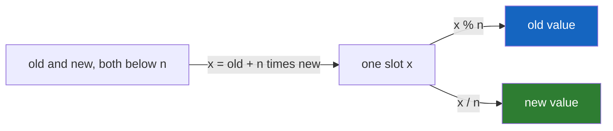

## The starting problem — a[i] becomes a[a[i]], in place

**The task.** You get an array `a` of size `n` that holds each of the numbers 0, 1, ..., n − 1 exactly once, in some order (a **permutation**). Change it in place so that position `i` ends up holding `a[a[i]]`, where both reads use the **original** values. You may not make a second array: only O(1) extra space.

**Example.** `a = [3, 2, 0, 1]`:

|   i | a[i] | a[a[i]]  |
| --: | ---: | -------- |
|   0 |    3 | a[3] = 1 |
|   1 |    2 | a[2] = 0 |
|   2 |    0 | a[0] = 3 |
|   3 |    1 | a[1] = 2 |

Expected output: `[1, 0, 3, 2]`.

**Why it matters.** With a second array this is one line. Doing it in place forces one slot to hold two numbers at once, a trick that comes back whenever extra memory is not allowed.

## The naive way — overwrite as you go

The obvious loop writes `a[i] = a[a[i]]` left to right. A copy of the array gives the right answer but costs O(n) extra space, which the problem forbids.

```java
import java.util.*;

public class Rearrange {
    static void naiveInPlace(int[] a) {
        for (int i = 0; i < a.length; i++) a[i] = a[a[i]];
    }

    static int[] withCopy(int[] a) {
        int[] out = new int[a.length];
        for (int i = 0; i < a.length; i++) out[i] = a[a[i]];
        return out;
    }

    static void encoded(long[] a) {
        int n = a.length;
        for (int i = 0; i < n; i++) {
            long newValue = a[(int) (a[i] % n)] % n;
            a[i] = a[i] + newValue * n;
        }
        for (int i = 0; i < n; i++) a[i] = a[i] / n;
    }

    public static void main(String[] args) {
        int[] a = {3, 2, 0, 1};
        System.out.println("wanted:         " + Arrays.toString(withCopy(a)));
        int[] b = a.clone();
        naiveInPlace(b);
        System.out.println("naive in place: " + Arrays.toString(b));
        long[] c = {3, 2, 0, 1};
        encoded(c);
        System.out.println("encoded:        " + Arrays.toString(c));
    }
}
```

Run:
```text
wanted:         [1, 0, 3, 2]
naive in place: [1, 0, 1, 0]
encoded:        [1, 0, 3, 2]
```

The naive loop is wrong at index 2. It needs the old `a[0]`, which was 3, but index 0 was already overwritten with 1 on the first step, so it reads 1. Same at index 3: it needs the old `a[1]` (2) and finds the new one (0).

**Diagnosis:** each slot must hold its old value until every reader has used it, and also hold its new value once it is written. One slot, two values.

## One slot can hold two numbers below n: old + n · new

Both the old and the new value lie in `0..n−1`. Store

`x = old + n · new`

in the slot. Both values can be read back from `x`:

- **`x % n` is the old value.** `x` is `old` plus a whole number of copies of `n`, adding copies of `n` never changes a remainder (`a % m = (a + m) % m`), and `old < n`, so `x % n = old % n = old`.
- **`x / n` is the new value.** `x = n · new + old` with `0 ≤ old < n`, so integer division by `n` drops exactly the `old` part and leaves `new`.



The key property: `x % n` returns the old value **whether or not the slot has been encoded yet**. An untouched slot holds `old` itself, and `old % n = old`. So the first pass reads every old value with `% n`, and a second pass replaces each slot with `x / n`.

## Tracing the encoding on [3, 2, 0, 1]

```java
import java.util.*;

public class EncodeTrace {
    public static void main(String[] args) {
        long[] a = {3, 2, 0, 1};
        int n = a.length;
        for (int i = 0; i < n; i++) {
            int j = (int) (a[i] % n);
            long newValue = a[j] % n;
            a[i] = a[i] + newValue * n;
            System.out.println("i = " + i + ": old = " + (a[i] % n) + ", read a[" + j + "] % 4 = " + newValue + ", store " + a[i] + "   array " + Arrays.toString(a));
        }
        for (int i = 0; i < n; i++) a[i] = a[i] / n;
        System.out.println("after a[i] / 4: " + Arrays.toString(a));
    }
}
```

Run:
```text
i = 0: old = 3, read a[3] % 4 = 1, store 7   array [7, 2, 0, 1]
i = 1: old = 2, read a[2] % 4 = 0, store 2   array [7, 2, 0, 1]
i = 2: old = 0, read a[0] % 4 = 3, store 12   array [7, 2, 12, 1]
i = 3: old = 1, read a[1] % 4 = 2, store 9   array [7, 2, 12, 9]
after a[i] / 4: [1, 0, 3, 2]
```

|   i | old `a[i] % 4` | reads index | `a[j] % 4` (old value there) | stored `old + 4 · new` | `/ 4` |
| --: | -------------: | ----------: | ---------------------------: | ---------------------: | ----: |
|   0 |              3 |           3 |                            1 |                      7 |     1 |
|   1 |              2 |           2 |                            0 |                      2 |     0 |
|   2 |              0 |           0 |                            3 |                     12 |     3 |
|   3 |              1 |           1 |                            2 |                      9 |     2 |

Step `i = 2` is the one the naive loop got wrong. It reads index 0, which already holds 7, and `7 % 4 = 3` is still the old value. The encoded version matched the copy-based answer on 100,000 random permutations of sizes 1 to 50.

> [!warning] The stored value reaches `(n − 1) + n·(n − 1)`, which for `n = 100,000` is 9999999999, past `Integer.MAX_VALUE` (2147483647); in an `int` it becomes 1410065407, so do the encoding in `long`.

## The same trick in general

Any time two values below `n` must share one slot, `old + n · new` stores both, `% n` reads the first and `/ n` reads the second. It works because `n` is bigger than either value, so the two never overlap, the same way the last digit and the rest of a decimal number never overlap when `n = 10`.

| Need                          | Expression      |
| ----------------------------- | --------------- |
| store both                    | `old + n * new` |
| read the old value, any time  | `x % n`         |
| read the new value at the end | `x / n`         |

## On LeetCode

- build-array-from-permutation (LC 1920, 1160): exactly this problem; its follow-up asks for O(1) extra space.
- shuffle-the-array (LC 1470, 1121): two values below 1001 share a slot as `x + 1001 · y` to rearrange in place.
