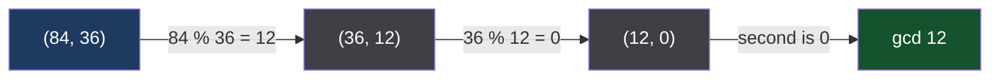
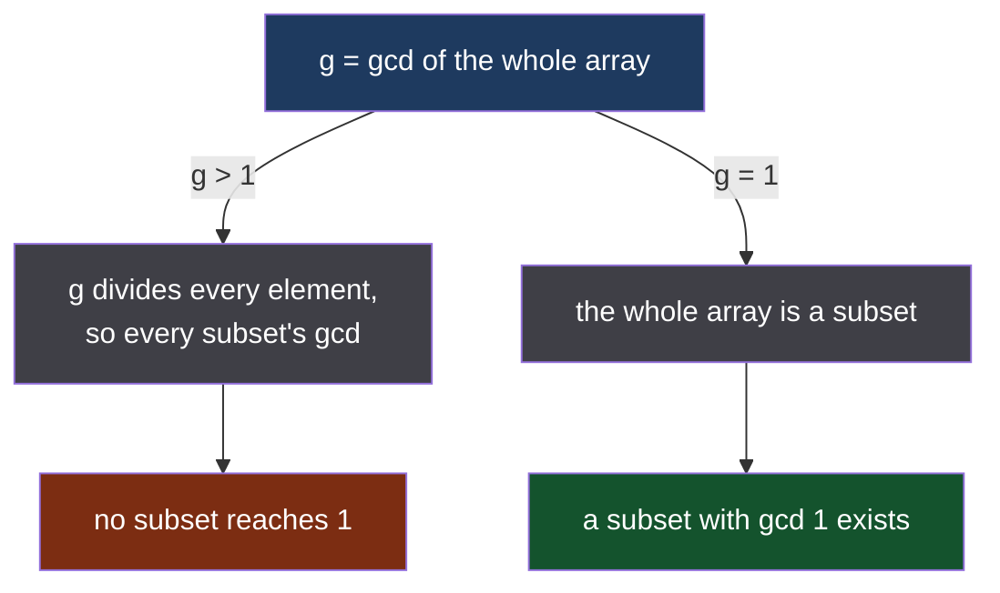
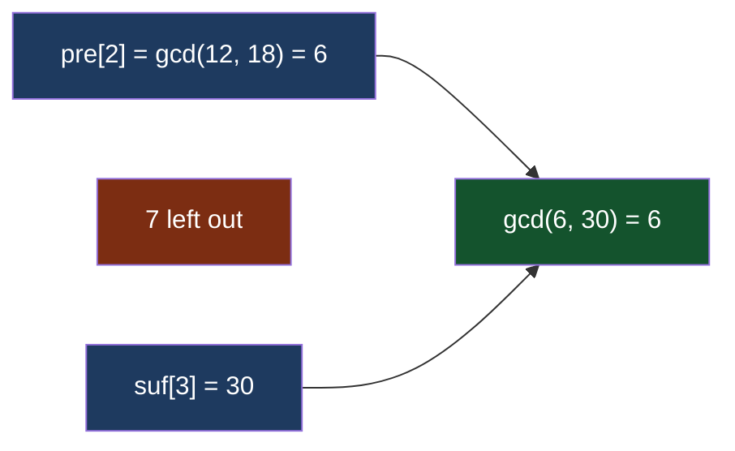

## The gcd is the largest number dividing both

A **divisor** of a is a number d with a % d = 0. A **common divisor** of a and b divides both. The **greatest common divisor**, gcd(a, b), is the largest of them. For 84 and 36:

| Number | Its divisors                             |
| -----: | ---------------------------------------- |
|     84 | 1, 2, 3, 4, 6, 7, 12, 14, 21, 28, 42, 84 |
|     36 | 1, 2, 3, 4, 6, 9, 12, 18, 36             |
|   both | 1, 2, 3, 4, 6, **12**                    |

So gcd(84, 36) = 12, and 84 = 7 × 12, 36 = 3 × 12. Two numbers whose gcd is 1, like 7 and 5, are **coprime**: they share no divisor except 1.

|   a |   b | Common divisors   | gcd(a, b) |
| --: | --: | ----------------- | --------: |
|  84 |  36 | 1, 2, 3, 4, 6, 12 |        12 |
|   7 |   5 | 1                 |         1 |
|  12 |   0 | 1, 2, 3, 4, 6, 12 |        12 |

The gcd decides whether things split into equal parts, how a fraction simplifies (84 / 36 = 7 / 3 after dividing both by 12), and whether a modular inverse exists, covered in [[03-fast-power-and-inverse]].

## Zero and order follow from the definition

- **Order does not matter:** gcd(a, b) = gcd(b, a), because dividing both is the same condition read either way.
- **gcd(a, 0) = |a|:** every d divides 0, since 0 % d = 0, so the common divisors of a and 0 are just the divisors of a, and the largest is |a|.
- **gcd(0, 0) has no largest common divisor:** every positive number divides 0. Code returns 0 by convention, and 0 is the right start for a running gcd, because gcd(0, x) = x.

## Hunting divisors one by one is too slow

No common divisor can exceed the smaller number, so the obvious method starts at min(a, b) and walks down until one divides both. A faster version uses the fact that divisors pair up below √n ([[04-primes-divisors]]): only d up to √min needs trying, together with its partner min / d. Both are correct. Measured on two primes, which share only 1:

| Method           | Pair                          |       Steps |   Time |
| ---------------- | ----------------------------- | ----------: | -----: |
| min down to 1    | 1,000,000,007 and 999,999,937 | 999,999,937 | 640 ms |
| divisors to √min | 1,000,000,007 and 999,999,937 |      31,622 |   0 ms |
| divisors to √min | 10¹⁸ + 3 and 10¹⁸ − 11        | 999,999,999 | 839 ms |

One call at 640 ms already uses most of a time limit, and 10⁵ such calls would take about 18 hours. The √ version rescues `int` inputs and fails again on `long`. Both search for divisors one at a time, and the search is the cost.

The way out is to stop searching: replace the pair by a smaller pair with exactly the same gcd, again and again, until one number is 0 and gcd(a, 0) = a gives the answer.

## Subtracting the smaller keeps the same common divisors

Take a ≥ b. The pairs (a, b) and (a − b, b) have the same set of common divisors:

- **A common divisor of a and b divides a − b.** If a = d × x and b = d × y, then a − b = d × (x − y).
- **A common divisor of a − b and b divides a.** If a − b = d × x and b = d × y, then a = (a − b) + b = d × (x + y).

Each set sits inside the other, so they are equal, and so are their largest members. Subtracting repeatedly from (84, 36), the common divisors never change:

| Pair     | Common divisors   |
| -------- | ----------------- |
| (84, 36) | 1, 2, 3, 4, 6, 12 |
| (48, 36) | 1, 2, 3, 4, 6, 12 |
| (12, 36) | 1, 2, 3, 4, 6, 12 |

Keep taking the smaller from the bigger until the two are equal, and gcd(x, x) = x:


It is correct, and still slow when one number dwarfs the other: (1,000,000,000, 1) takes 999,999,999 subtractions, and the two primes above take 14,285,724.

> [!warning] Subtraction never ends on a 0
> With an input of 0 the two numbers never become equal, and the loop runs forever. Only the % version below handles 0.

## % does all the subtractions at once

In the trace, 84 → 48 → 12 is the same 36 taken away twice. Subtracting b until what is left is smaller than b leaves exactly a % b: 84 − 36 − 36 = 12 = 84 % 36. Each single subtraction keeps the gcd, so all of them together do too:

**gcd(a, b) = gcd(b, a % b)**

The same proof works directly on a = q × b + r with r = a % b: a common divisor of a and b divides r = a − q × b, and a common divisor of b and r divides a = q × b + r. Writing the new pair as (b, a % b) keeps the bigger number first, and when the second number reaches 0 the first is the answer. This is **Euclid's algorithm**:



Two steps instead of four subtractions, and 1 step instead of 999,999,999 for (1,000,000,000, 1).

The order of the inputs never needs checking. If a < b, the first step computes a % b = a and the pair becomes (b, a): gcd(36, 84) goes (36, 84) → (84, 36) → (36, 12) → (12, 0).

```java
public class Euclid {
    static long gcd(long a, long b) {
        while (b != 0) {
            long r = a % b;
            a = b;
            b = r;
        }
        return a;
    }

    public static void main(String[] args) {
        System.out.println(gcd(84, 36) + " " + gcd(36, 84) + " " + gcd(12, 0) + " " + gcd(0, 0));
        System.out.println(gcd(12, -18) + " " + gcd(Math.abs(12), Math.abs(-18)));
    }
}
```

Run:
```text
12 12 12 0
-6 6
```

The recursive form `b == 0 ? a : gcd(b, a % b)` gives the same answers, and its depth equals the step count, which stays under 100 for any `long`, so it never overflows the stack.

> [!warning] A negative input can give a negative gcd
> Java's `%` takes the sign of the left number ([[01-modular-arithmetic]]), so gcd(12, −18) printed −6. Pass `Math.abs(a)` and `Math.abs(b)`.

## Euclid halves the numbers every two steps

After two steps, the pair (a, b) has become (r, …) with r = a % b. Whichever side of a / 2 the number b sits on, r < a / 2:

| Case      | Why r < a / 2                     | Example, a = 100 |
| --------- | --------------------------------- | ---------------- |
| b ≤ a / 2 | r < b ≤ a / 2                     | 100 % 30 = 10    |
| b > a / 2 | b fits once, so r = a − b < a / 2 | 100 % 70 = 30    |

So the first number at least halves every two steps, and the step count is at most about 2 × log₂ a, which is 126 for numbers near 2⁶³. That is O(log max).

The worst inputs make every quotient 1, so each step removes only one copy of b. Those are consecutive **Fibonacci numbers**, 1, 1, 2, 3, 5, 8, 13, …, each the sum of the two before it. F(k+1) % F(k) = F(k−1), so the pair walks down the whole sequence: (89, 55) → (55, 34) → (34, 21) → (21, 13) → (13, 8) → (8, 5) → (5, 3) → (3, 2) → (2, 1) → (1, 0), 9 steps.

| Pair         | Values                                               | Steps |
| ------------ | ---------------------------------------------------- | ----: |
| F(11), F(10) | 89, 55                                               |     9 |
| F(31), F(30) | 1,346,269, 832,040                                   |    29 |
| F(61), F(60) | 2,504,730,781,961, 1,548,008,755,920                 |    59 |
| F(92), F(91) | 7,540,113,804,746,346,429, 4,660,046,610,375,530,309 |    90 |

F(k+1), F(k) takes exactly k − 1 steps, 90 at the top of the `long` range, inside the bound of 126. Over 1,000,000 random pairs below 2⁶⁰ the worst was 58. Every method on one pair:

| Method               | Steps on 1,000,000,007 and 999,999,937 |
| -------------------- | -------------------------------------: |
| min down to 1        |                            999,999,937 |
| divisors to √min     |                                 31,622 |
| repeated subtraction |                             14,285,724 |
| Euclid with %        |                                      7 |

## The gcd of an array folds left to right

Since (a, b) and (gcd(a, b), 0) have the same common divisors, **the common divisors of a and b are exactly the divisors of gcd(a, b)**: for 84 and 36 both lists are 1, 2, 3, 4, 6, 12. So a number divides a, b and c exactly when it divides gcd(a, b) and c:

gcd(a, b, c) = gcd(gcd(a, b), c)

The whole array becomes one running value, started at 0 because gcd(0, x) = x. Each step either keeps it or drops it to one of its own divisors, and once it reaches 1 it stays 1, since gcd(1, x) = 1. So the loop can stop at 1.


For [24, 36, 60] the running value goes 24, 12, 12, and the numbers dividing all three are 1, 2, 3, 4, 6, 12. The fold is at most n Euclid calls, O(n log max).

```java
long g = 0;
for (long x : nums) {
    g = gcd(g, x);
    if (g == 1) break;
}
```

## The gcd of factorials is the factorial of the minimum

The gcd of [5!, 3!, 7!] = gcd(120, 6, 5,040) is 6. Computing the factorials is the trap: they leave `long` at 21!, which wraps to −4,249,290,049,419,214,848 instead of 51,090,942,171,709,440,000.

None needs computing. Let m be the smallest element. For any k ≥ m, k! = m! × (m + 1) × … × k, so m! divides every factorial in the array. And no common divisor can be bigger than m!, because m! is itself one of the numbers. So the gcd is m!:

|   k |    k! | k! / 3! |
| --: | ----: | ------: |
|   3 |     6 |       1 |
|   5 |   120 |      20 |
|   7 | 5,040 |     840 |

## Some subset has gcd 1 exactly when the whole array does

Order does not change a gcd, so asking whether some subsequence has gcd 1 is asking about subsets. Trying them all is 2ⁿ − 1 choices: 16,777,215 subsets for 24 elements took 1,264 ms, and each extra element doubles it. One fold over the whole array settles it:



| Array       | Pairs                                           | Whole array | Subset with gcd 1   |
| ----------- | ----------------------------------------------- | ----------: | ------------------- |
| [6, 10, 15] | gcd(6, 10) = 2, gcd(6, 15) = 3, gcd(10, 15) = 5 |           1 | yes, only all three |
| [6, 12, 18] | every pair shares 6                             |           6 | no                  |

[6, 10, 15] shows why the whole array matters: no pair is coprime, yet all three together are.

## Prefix and suffix gcds leave one element out

To remove exactly one element and make the gcd of the rest as large as possible, refolding the other n − 1 for every choice is O(n²) Euclid calls. Instead, precompute two arrays:

- pre[i] = gcd of the first i elements, nums[0..i−1], with pre[0] = 0.
- suf[i] = gcd of nums[i..n−1], with suf[n] = 0.

Leaving out index i keeps everything before it and everything after it, so the gcd of the rest is gcd(pre[i], suf[i + 1]), one call per index. For [12, 18, 7, 30]:



| Leave out index | Element | pre[i] | suf[i + 1] | gcd of the rest |
| --------------: | ------: | -----: | ---------: | --------------: |
|               0 |      12 |      0 |          1 |               1 |
|               1 |      18 |     12 |          1 |               1 |
|               2 |       7 |      6 |         30 |           **6** |
|               3 |      30 |      1 |          0 |               1 |

```java
long[] pre = new long[n + 1], suf = new long[n + 1];
for (int i = 0; i < n; i++) pre[i + 1] = gcd(pre[i], nums[i]);
for (int i = n - 1; i >= 0; i--) suf[i] = gcd(suf[i + 1], nums[i]);
long best = 0;
for (int i = 0; i < n; i++) best = Math.max(best, gcd(pre[i], suf[i + 1]));
```

Building both arrays is O(n log max). At n = 100,000 this took 4 ms against 38,180 ms for refolding.

> [!warning] The empty side is 0, not 1
> pre[0] = 0 and suf[n] = 0 stand for nothing on that side, and gcd(0, x) = x. A sentinel of 1 would make every answer 1.

## Subtracting one number from another never leaves the multiples of the gcd

Start with positive numbers A. A move picks two of them, x and y, and replaces y by y − x; a number that reaches 0 or below is removed. Moves go on until one number is left. The smallest value it can end at is g = gcd(A), for two reasons:

- **Never below g.** Every number starts as a multiple of g, and a multiple of g minus a multiple of g is still a multiple of g. The last number is positive, and the smallest positive multiple of g is g.
- **g is reachable.** Always subtract the smallest from the largest. That is the subtraction form of Euclid run on the whole set, so the gcd of the set never changes, and a number is only removed when it hits exactly 0.

For [12, 18, 30], with g = 6:

| Step | Move        | Numbers after |
| ---: | ----------- | ------------- |
|    0 |             | 12, 18, 30    |
|    1 | 30 − 12     | 12, 18, 18    |
|    2 | 18 − 12     | 12, 18, 6     |
|    3 | 18 − 6      | 6, 12, 12     |
|    4 | 12 − 6      | 6, 12, 6      |
|    5 | 12 − 6      | 6, 6, 6       |
|    6 | 6 − 6, gone | 6, 6          |
|    7 | 6 − 6, gone | 6             |

A search over every order of moves also gives 6 for [12, 18, 30], and 1 for [6, 10, 15], whose gcd is 1.
