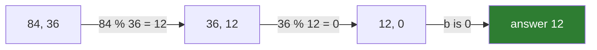

## The starting problem — the biggest square tile

**The task.** You get two whole numbers `a` and `b`, not both 0. Return the largest number that divides both of them exactly, with remainder 0.

**Example.** A floor 84 by 36 must be covered with equal square tiles, no cutting, as large as possible. A tile side has to fit a whole number of times along both walls, so it must divide 84 and 36. The answer is 12: tiles of 12 × 12, laid 7 along one wall and 3 along the other, 21 tiles in all.

|   a |   b | Numbers dividing both | Expected output |
| --: | --: | --------------------- | --------------: |
|  84 |  36 | 1, 2, 3, 4, 6, 12     |              12 |
|   7 |   5 | 1                     |               1 |
|  12 |   0 | 1, 2, 3, 4, 6, 12     |              12 |

**Why it matters.** This number is behind splitting things into equal groups, simplifying fractions and deciding whether a modular inverse exists.

The names, once. A **divisor** of `a` is a number `d` with `a % d == 0`. A **common divisor** of `a` and `b` divides both. The **greatest common divisor**, `gcd(a, b)`, is the largest common divisor. Two numbers with gcd 1, like 7 and 5, are called **coprime**: they share no divisor except 1.

## Three properties fall out of the definition

- **Order does not matter:** `gcd(a, b) = gcd(b, a)`, because dividing both is the same condition read in either order.
- **`gcd(a, 0) = |a|`:** every `d` divides 0 (since `0 % d == 0`), so the common divisors of `a` and 0 are just the divisors of `a`, and the largest is `|a|`.
- **`gcd(0, 0)` is undefined by the definition:** every positive number divides 0, so there is no largest one. Code returns 0 by convention, and 0 is the right value to start a fold over an array, because `gcd(0, x) = x`.

## The naive way — try every candidate from min(a, b) down

No common divisor can be bigger than the smaller number, so start at `min(a, b)` and walk down until one divides both. The first hit is the largest.

A faster brute force uses the fact that divisors come in pairs: if `d` divides `m`, so does `m / d`, and one of the two is at most `√m`. So walk `d` from 1 to `√min`, and for every divisor `d` of the minimum test both `d` and `min / d` against both numbers. That is O(√min) instead of O(min).

```java
public class GcdFactors {
    static long steps = 0;

    static long gcdBrute(long a, long b) {
        steps = 0;
        for (long d = Math.min(a, b); d >= 1; d--) {
            steps++;
            if (a % d == 0 && b % d == 0) return d;
        }
        return Math.max(a, b);
    }

    static long gcdFactors(long a, long b) {
        steps = 0;
        long m = Math.min(a, b), best = 1;
        for (long d = 1; d * d <= m; d++) {
            steps++;
            if (m % d == 0) {
                long other = m / d;
                if (a % d == 0 && b % d == 0) best = Math.max(best, d);
                if (a % other == 0 && b % other == 0) best = Math.max(best, other);
            }
        }
        return best;
    }

    public static void main(String[] args) {
        long s = System.nanoTime();
        long g = gcdBrute(1_000_000_007L, 999_999_937L);
        System.out.println("brute   gcd(1000000007, 999999937) = " + g + "  steps = " + steps + "  time = " + (System.nanoTime() - s) / 1_000_000 + " ms");
        s = System.nanoTime();
        g = gcdFactors(1_000_000_007L, 999_999_937L);
        System.out.println("factors gcd(1000000007, 999999937) = " + g + "  steps = " + steps + "  time = " + (System.nanoTime() - s) / 1_000_000 + " ms");
        s = System.nanoTime();
        g = gcdFactors(1_000_000_000_000_000_003L, 999_999_999_999_999_989L);
        System.out.println("factors gcd(1e18+3, 1e18-11)       = " + g + "  steps = " + steps + "  time = " + (System.nanoTime() - s) / 1_000_000 + " ms");
    }
}
```

Run:
```text
brute   gcd(1000000007, 999999937) = 1  steps = 999999937  time = 640 ms
factors gcd(1000000007, 999999937) = 1  steps = 31622  time = 0 ms
factors gcd(1e18+3, 1e18-11)       = 1  steps = 999999999  time = 839 ms
```

Both are correct (the factor version matched the plain brute force on 100,000 random pairs). The cost is the problem. One call at 640 ms already eats most of a typical time limit; a problem that asks for 10^5 gcds would need about 18 hours by projection from that measurement. The √ version rescues `int` inputs but is back to 839 ms per call for `long` inputs.

> [!danger] Both brute forces are broken at scale, and the numbers prove it. They search for divisors one at a time, and the search is what costs.

**Diagnosis:** the gcd does not have to be hunted for. The fix is to **shrink the pair** to a smaller pair with exactly the same gcd, again and again, until the answer is obvious (one number is 0, and `gcd(a, 0) = a`).

## Shrinking by subtraction — gcd(a, b) = gcd(a − b, b)

Take `a ≥ b`. The claim is that `(a, b)` and `(a − b, b)` have the **same set** of common divisors, so they have the same largest one.

- **Every common divisor of `(a, b)` divides `a − b`.** If `a = d·x` and `b = d·y`, then `a − b = d·(x − y)`.
- **Every common divisor of `(a − b, b)` divides `a`.** If `a − b = d·x` and `b = d·y`, then `a = (a − b) + b = d·(x + y)`.

So the two sets contain each other, they are equal, and their maxima are equal. Checked on the tile example, and the sets were also equal on 2,000 random pairs:

```java
import java.util.*;

public class CommonDivisors {
    static List<Integer> common(int a, int b) {
        List<Integer> out = new ArrayList<>();
        for (int d = 1; d <= Math.max(a, b); d++) {
            if (a % d == 0 && b % d == 0) out.add(d);
        }
        return out;
    }

    public static void main(String[] args) {
        System.out.println("common divisors of (84, 36): " + common(84, 36));
        System.out.println("common divisors of (48, 36): " + common(48, 36));
        System.out.println("common divisors of (12, 36): " + common(12, 36));
    }
}
```

Run:
```text
common divisors of (84, 36): [1, 2, 3, 4, 6, 12]
common divisors of (48, 36): [1, 2, 3, 4, 6, 12]
common divisors of (12, 36): [1, 2, 3, 4, 6, 12]
```

Repeat the subtraction (the bigger minus the smaller) until the two numbers are equal; at that point `gcd(x, x) = x`.

```java
public class GcdSubtract {
    static long gcdSub(long a, long b, boolean trace) {
        long steps = 0;
        while (a != b) {
            if (a > b) a -= b;
            else b -= a;
            steps++;
            if (trace) System.out.println("  -> (" + a + ", " + b + ")");
        }
        System.out.println("  answer " + a + " after " + steps + " subtractions");
        return a;
    }

    public static void main(String[] args) {
        System.out.println("(84, 36)");
        gcdSub(84, 36, true);
        System.out.println("(1000000000, 1)");
        gcdSub(1_000_000_000L, 1L, false);
        System.out.println("(1000000007, 999999937)");
        gcdSub(1_000_000_007L, 999_999_937L, false);
    }
}
```

Run:
```text
(84, 36)
  -> (48, 36)
  -> (12, 36)
  -> (12, 24)
  -> (12, 12)
  answer 12 after 4 subtractions
(1000000000, 1)
  answer 1 after 999999999 subtractions
(1000000007, 999999937)
  answer 1 after 14285724 subtractions
```

It is correct but still slow when one number is much bigger than the other: `(1000000000, 1)` subtracts 1 almost a billion times. Look at the first trace: `84 → 48 → 12` is the same 36 taken away twice in a row.

> [!warning] The subtraction version loops forever if either input is 0, because `a != b` never becomes false. Only the `%` version below handles 0.

## % does all the repeated subtractions at once — gcd(a, b) = gcd(b, a % b)

Subtracting `b` from `a` until what is left is smaller than `b` leaves exactly `a % b`: in the example `84 − 36 − 36 = 12 = 84 % 36`. Since each single subtraction keeps the gcd, so does all of them together. The same two-line proof works directly with `a = q·b + r` where `r = a % b`: a common divisor of `a` and `b` divides `r = a − q·b`, and a common divisor of `b` and `r` divides `a = q·b + r`.

Writing the new pair as `(b, a % b)` keeps the bigger number first, and when `b` reaches 0 the answer is `a`. This is **Euclid's algorithm**.



Iterative and recursive versions, run on the tile example, the billion-subtraction pair, and the edge cases. Both, and the subtraction version, matched the plain brute force on 100,000 random pairs.

```java
public class Euclid {
    static long gcd(long a, long b) {
        while (b != 0) {
            long r = a % b;
            a = b;
            b = r;
        }
        return a;
    }

    static long gcdRec(long a, long b) {
        return b == 0 ? a : gcdRec(b, a % b);
    }

    public static void main(String[] args) {
        System.out.println("gcd(84, 36) = " + gcd(84, 36) + "   gcdRec(84, 36) = " + gcdRec(84, 36));
        System.out.println("gcd(1000000000, 1) = " + gcd(1_000_000_000L, 1L) + "   gcd(1000000007, 999999937) = " + gcd(1_000_000_007L, 999_999_937L));
        System.out.println("gcd(36, 84) = " + gcd(36, 84) + "   first step: 36 % 84 = " + (36 % 84) + ", so the pair becomes (84, 36)");
        System.out.println("gcd(12, 0) = " + gcd(12, 0) + "   gcd(0, 12) = " + gcd(0, 12) + "   gcd(0, 0) = " + gcd(0, 0));
        System.out.println("gcd(12, -18) = " + gcd(12, -18) + "   gcd(Math.abs(12), Math.abs(-18)) = " + gcd(Math.abs(12), Math.abs(-18)));
    }
}
```

Run:
```text
gcd(84, 36) = 12   gcdRec(84, 36) = 12
gcd(1000000000, 1) = 1   gcd(1000000007, 999999937) = 1
gcd(36, 84) = 12   first step: 36 % 84 = 36, so the pair becomes (84, 36)
gcd(12, 0) = 12   gcd(0, 12) = 12   gcd(0, 0) = 0
gcd(12, -18) = -6   gcd(Math.abs(12), Math.abs(-18)) = 6
```

The swap is automatic: when `a < b`, the first step computes `a % b = a` and the pair becomes `(b, a)`, so argument order never needs checking. The zero cases match the properties above, with `gcd(0, 0) = 0` as the code convention. The recursion depth equals the step count, which the next section shows is under 100 for any `long`, so the recursive version never overflows the stack.

> [!warning] Java's `%` takes the sign of the left operand, so Euclid on a negative input can return a negative gcd (`gcd(12, -18)` printed `-6`): pass `Math.abs(a)` and `Math.abs(b)`.

## Euclid takes O(log max) steps — measured on the worst case

**Every two steps, the first number at least halves.** After two steps `(a, b)` becomes `(r, ...)` with `r = a % b`. If `b ≤ a/2`, then `r < b ≤ a/2`. If `b > a/2`, then `b` fits once and `r = a − b < a/2`. Either way `r < a/2`, so the step count is at most about `2·log2(a)`, which is 126 for numbers near 2^63.

The worst inputs are where every quotient is 1, so each step removes only one copy: consecutive **Fibonacci numbers** (each is the sum of the two before it: 1, 1, 2, 3, 5, 8, ...). Then `F(k+1) % F(k) = F(k−1)`, and the pair walks all the way down the sequence.

```java
import java.util.*;

public class EuclidSteps {
    static int steps(long a, long b) {
        int s = 0;
        while (b != 0) {
            long r = a % b;
            a = b;
            b = r;
            s++;
        }
        return s;
    }

    public static void main(String[] args) {
        System.out.println("steps(1000000007, 999999937) = " + steps(1_000_000_007L, 999_999_937L));
        long[] f = new long[93];
        f[1] = 1;
        for (int i = 2; i <= 92; i++) f[i] = f[i - 1] + f[i - 2];
        for (int k : new int[]{10, 30, 60, 91}) {
            System.out.println("steps(F" + (k + 1) + ", F" + k + ") = steps(" + f[k + 1] + ", " + f[k] + ") = " + steps(f[k + 1], f[k]));
        }
        Random rnd = new Random(3);
        int worst = 0;
        for (int t = 0; t < 1_000_000; t++) {
            long x = 1 + (rnd.nextLong() >>> 4), y = 1 + (rnd.nextLong() >>> 4);
            worst = Math.max(worst, steps(x, y));
        }
        System.out.println("worst over 1000000 random pairs below 2^60 = " + worst);
    }
}
```

Run:
```text
steps(1000000007, 999999937) = 7
steps(F11, F10) = steps(89, 55) = 9
steps(F31, F30) = steps(1346269, 832040) = 29
steps(F61, F60) = steps(2504730781961, 1548008755920) = 59
steps(F92, F91) = steps(7540113804746346429, 4660046610375530309) = 90
worst over 1000000 random pairs below 2^60 = 58
```

Fibonacci pair `F(k+1), F(k)` takes exactly `k − 1` steps, 90 at the top of the `long` range, inside the bound of 126. That is O(log max). Every method in this note, on one pair:

| Method               | Steps on (1000000007, 999999937) |
| -------------------- | -------------------------------: |
| min down to 1        |                        999999937 |
| factors up to √min   |                            31622 |
| repeated subtraction |                         14285724 |
| Euclid with `%`      |                                7 |

## On LeetCode

- find-greatest-common-divisor-of-array (LC 1979, 1184): one Euclid call on the smallest and largest element.
- greatest-common-divisor-of-strings (LC 1071, 1398): the answer string has length `gcd(len1, len2)` once the two strings are shown to be built from the same block.
- insert-greatest-common-divisors-in-linked-list (LC 2807, 1279): Euclid on every pair of neighbours.
- number-of-beautiful-pairs (LC 2748, 1301): a coprimality test, `gcd(x, y) == 1`, on the first and last digits.
