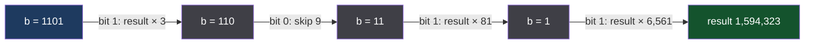
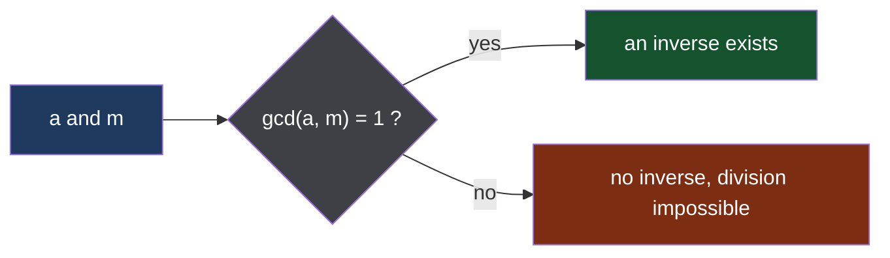
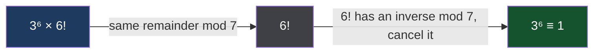

## Multiplying b times is too slow

a^b mod m means a multiplied by itself b times, then the remainder mod m. Taking % m after every multiplication keeps each value below m, as [[01-modular-arithmetic]] shows, so the plain way multiplies by a exactly b times. Nothing overflows, but the number of steps does the damage:

| b    | Multiplications | Time                                |
| ---- | --------------: | ----------------------------------- |
| 10⁹  |   1,000,000,000 | 4,358 ms, measured                  |
| 10¹⁸ |            10¹⁸ | about 138 years, projected from 10⁹ |

Exponents this large are common. Counting answers are often powers, 2ⁿ subsets or 5ⁿ digit strings with n up to 10¹⁵, and the modular inverse later in this note is a power with an exponent of about 10⁹.

## Squaring doubles the exponent

Multiplying by a raises the exponent by 1. Multiplying a power by itself doubles it: a^k × a^k = a^(2k). So squaring again and again gives a¹, a², a⁴, a⁸, …, one new power per multiplication:


After k squarings the exponent is 2^k, so 60 squarings already pass 10¹⁸, since 2⁶⁰ ≈ 1.15 × 10¹⁸. Squaring alone only reaches exponents that are powers of two; the binary digits of b fill the gaps.

## The binary digits of b pick which squares to multiply

Every whole number is a sum of distinct powers of two, read off its binary digits. 13 is 1101 in binary, so 13 = 8 + 4 + 1. Exponents add when powers multiply, so 3¹³ = 3⁸ × 3⁴ × 3¹:

| Bit of 13, from the right |   1 |   0 |   1 |     1 |
| ------------------------- | --: | --: | --: | ----: |
| Power of two              |   1 |   2 |   4 |     8 |
| Square 3^(that power)     |   3 |   9 |  81 | 6,561 |
| Used                      | yes |  no | yes |   yes |

3 × 81 × 6,561 = 1,594,323, which is 3¹³. Four squares and three multiplications instead of thirteen multiplications.

## Read the bits from the right, squaring as you go

The squares are produced in the same order as the bits are read from the right, so one pass does both. Each round looks at the last binary digit of b, multiplies the current square into the result if that digit is 1, squares the base, and drops the digit:

| b in binary | Last bit |  Base | Result after the round |
| ----------- | -------: | ----: | ---------------------: |
| 1101        |        1 |     3 |                      3 |
| 110         |        0 |     9 |                      3 |
| 11          |        1 |    81 |                    243 |
| 1           |        1 | 6,561 |              1,594,323 |



## The loop runs once per binary digit

b has ⌊log₂ b⌋ + 1 binary digits, and each round does at most two multiplications, so fast power is O(log b):

| b       | Binary digits | Rounds | Plain multiplications |
| ------- | ------------: | -----: | --------------------: |
| 13      |             4 |      4 |                    13 |
| 10⁹ + 5 |            30 |     30 |         1,000,000,005 |
| 10¹⁸    |            60 |     60 |                  10¹⁸ |

b = 10¹⁸ took 60 rounds in 2 microseconds, against the 4,358 ms the plain loop spent on b = 10⁹.

## Fast power in Java

In Java the last binary digit of b is `b & 1`, and dropping it is `b >>= 1`:

```java
public class FastPower {
    static long power(long a, long b, long m) {
        long result = 1 % m, base = a % m;
        while (b > 0) {
            if ((b & 1) == 1) result = result * base % m;
            base = base * base % m;
            b >>= 1;
        }
        return result;
    }

    public static void main(String[] args) {
        System.out.println(power(3, 13, 1_000_000_007L));
        System.out.println(power(2, 1_000_000_000_000_000_000L, 1_000_000_007L));
    }
}
```

Run:
```text
1594323
719476260
```

Three details carry the correctness:

| Detail                         | Why                                                                                | Without it                                               |
| ------------------------------ | ---------------------------------------------------------------------------------- | -------------------------------------------------------- |
| `base = a % m` before the loop | a can be up to 10¹⁸, and the first `base * base` would leave `long`                | a = 10¹², b = 5 gives 252,428,229 instead of 648,999,181 |
| `% m` after every multiply     | both factors stay below m, so each product is below m², about 10¹⁸ for m = 10⁹ + 7 | products wrap inside `long`                              |
| `result = 1 % m`, not 1        | when b = 0 the loop never runs, and for m = 1 the answer must be 0                 | b = 0, m = 1 gives 1 instead of 0                        |

> [!warning] A wrong power gives no error
> Skipping `base = a % m` returns a plausible number once a is above about 3 × 10⁹. Nothing crashes; the product of two large bases has silently wrapped inside `long`.

## The inverse replaces division

Remainders cannot be divided, as [[01-modular-arithmetic]] shows: (24 % 7) / (6 % 7) is 0, while 24 / 6 % 7 is 4. In ordinary arithmetic, dividing by 6 is multiplying by 1/6, the number that gives 1 when multiplied by 6. Under mod m that role is played by a whole number x from 1 to m − 1 with

a × x ≡ 1 (mod m)

and x is called the **modular inverse** of a. The sign ≡ reads as leaves the same remainder mod m. Every nonzero remainder mod 7 has one:

| a         |   1 |   2 |   3 |   4 |   5 |   6 |
| --------- | --: | --: | --: | --: | --: | --: |
| inverse x |   1 |   4 |   5 |   2 |   3 |   6 |
| a × x     |   1 |   8 |  15 |   8 |  15 |  36 |
| a × x % 7 |   1 |   1 |   1 |   1 |   1 |   1 |

Finding x by trying every value from 1 to m − 1 is O(m). For a single number mod 10⁹ + 7, the inverse of p − 1, that search took 1,460 ms.

## An inverse exists only when gcd(a, m) = 1

Mod 10, the number 4 has no inverse. Its multiples never land on 1:

| x          |   0 |   1 |   2 |   3 |   4 |   5 |   6 |   7 |   8 |   9 |
| ---------- | --: | --: | --: | --: | --: | --: | --: | --: | --: | --: |
| 4 × x % 10 |   0 |   4 |   8 |   2 |   6 |   0 |   4 |   8 |   2 |   6 |

The reason is the gcd, from [[02-gcd]]. Suppose a × x ≡ 1 (mod m). Then a × x − 1 = k × m for some k, so 1 = a × x − k × m. Any common divisor of a and m divides the right-hand side, so it divides 1. So gcd(a, m) must be 1. For a = 4, m = 10 the gcd is 2, and 2 can never divide 1.

The other direction, gcd 1 means an inverse exists, is true too. Its proof needs a tool these notes do not cover; it held for all 44,850 pairs with 2 ≤ m ≤ 300 when every x was tried.



> [!note] Why a prime modulus
> A prime's only divisors are 1 and itself, so every a from 1 to p − 1 has gcd 1 with p, and every nonzero remainder has an inverse. That is why contests use the prime 10⁹ + 7.

## Fermat: a^(p − 1) ≡ 1 for a prime p

**Fermat's little theorem:** if p is prime and p does not divide a, then a^(p − 1) ≡ 1 (mod p).

Why it holds, on p = 7, a = 3. Multiply 3 by each of 1 to 6 and take mod 7:

| i         |   1 |   2 |   3 |   4 |   5 |   6 |
| --------- | --: | --: | --: | --: | --: | --: |
| 3 × i % 7 |   3 |   6 |   2 |   5 |   1 |   4 |

The six results are 1 to 6 again, each exactly once, only reordered. So their product leaves the same remainder as 1 × 2 × … × 6 = 6!. Both products equal 720 here. But the left product is also (3 × 1)(3 × 2) … (3 × 6) = 3⁶ × 6!:



6! is not a multiple of the prime 7, so it has an inverse, and multiplying both sides by it cancels 6!, leaving 3⁶ ≡ 1. Check: 3⁶ = 729 = 104 × 7 + 1.

The reordering is the whole proof, and it holds for every prime. If i × a ≡ j × a, then p divides (i − j) × a. A prime that divides a product divides one of its factors, and p does not divide a, so p divides i − j. Both i and j lie between 1 and p − 1, so i − j is smaller than p in size, and the only multiple of p that small is 0. So i = j, and the p − 1 multiples are all different.

## So the inverse of a is a^(p − 2)

Split one factor off Fermat: a × a^(p − 2) = a^(p − 1) ≡ 1. So a^(p − 2) % p is the inverse of a, and fast power computes it.

|   a |       p | a^(p − 2) % p |      a × that | Mod p |
| --: | ------: | ------------: | ------------: | ----: |
|   3 |       7 |             5 |            15 |     1 |
|   2 | 10⁹ + 7 |   500,000,004 | 1,000,000,008 |     1 |
|   3 | 10⁹ + 7 |   333,333,336 | 1,000,000,008 |     1 |

For p = 10⁹ + 7 the exponent p − 2 = 1,000,000,005 has 30 binary digits, so one inverse costs 30 rounds, O(log p), against the 1,460 ms of trying every x.

## Fermat is wrong when the modulus is not prime

gcd(3, 10) = 1, so 3 has an inverse mod 10: it is 7, because 3 × 7 = 21. The formula gives something else:

| Modulus |   a | a^(m − 2) % m | a × that % m | True inverse |
| ------: | --: | ------------: | -----------: | -----------: |
|       7 |   3 |             5 |            1 |            5 |
|      10 |   3 |             1 |            3 |            7 |

The theorem needs a prime modulus; for 10 it does not hold.

> [!warning] power(a, m − 2, m) never complains
> It returns a number for any m and any a. For a modulus that is not prime it is usually wrong, and for a % p = 0 it returns 0, which is no inverse, since 0 × 0 = 0. Use Fermat only with a prime modulus and a not a multiple of it.

## Dividing under mod is multiplying by the inverse

With the inverse, (x / y) % p = (x % p) × inverse(y % p) % p, valid when y divides x exactly and p does not divide y. Why: y × inverse(y) ≡ 1, so multiplying x / y by it changes nothing mod p, and (x / y) × y = x.


30! / 28! = 870, but mod p = 10⁹ + 7 only the remainders 30! % p = 109,361,473 and 28! % p = 35,757,887 are known:

| Expression      | Remainders divided | Times the inverse | Correct |
| --------------- | -----------------: | ----------------: | ------: |
| 24 / 6 mod 7    |                  0 |                 4 |       4 |
| 30! / 28! mod p |                  3 |               870 |     870 |

With `power` from above:

```java
static long inverse(long a, long p) {
    return power(a, p - 2, p);
}

static long divide(long x, long y, long p) {
    return x % p * inverse(y, p) % p;
}
```
