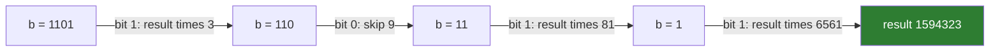

## The starting problem — a^b mod m with b up to 10^18

**The task.** You get three numbers `a`, `b` and `m`, with `a` and `b` as large as 10¹⁸ and usually `m = 10⁹ + 7`. Return `a` multiplied by itself `b` times, written `a^b`, mod `m`.

**Example.**

|   a |    b |       m | Expected output |
| --: | ---: | ------: | --------------: |
|   3 |   13 | 10⁹ + 7 |       1,594,323 |
|   2 |   10 |    1000 |              24 |
|   2 | 10¹⁸ | 10⁹ + 7 |     719,476,260 |

The second row: 2¹⁰ = 1024, and 1024 mod 1000 = 24.

**Why it matters.** Counting answers are often powers (2ⁿ subsets, 5ⁿ digit strings), and the modular inverse in the next note is itself one big power.

The mod rules already say how to keep every intermediate value small: multiply, then take `% m`, at every step. So the naive way multiplies by `a` exactly `b` times.

```java
public class NaivePower {
    static long powNaive(long a, long b, long m) {
        long result = 1 % m;
        for (long i = 0; i < b; i++) result = result * (a % m) % m;
        return result;
    }

    public static void main(String[] args) {
        long m = 1_000_000_007L;
        System.out.println("3^13 % m = " + powNaive(3, 13, m));
        long s = System.nanoTime();
        long r = powNaive(3, 1_000_000_000L, m);
        long ms = (System.nanoTime() - s) / 1_000_000;
        System.out.println("3^1000000000 % m = " + r + "  time = " + ms + " ms");
        System.out.println("projected for b = 1e18: " + ms * 1_000_000_000L / 1000 / 3600 / 24 / 365 + " years");
    }
}
```

Run:
```text
3^13 % m = 1594323
3^1000000000 % m = 235939645  time = 4358 ms
projected for b = 1e18: 138 years
```

The values never overflow, but the loop count does the damage: `b = 10^9` took 4358 ms on its own, and `b = 10^18` is a billion times more, about 138 years by projection from that measurement.

**Diagnosis:** the loop raises the exponent by 1 per multiplication. Squaring raises it much faster: `a^k · a^k = a^(2k)` doubles the exponent in one multiplication.

## Squaring along the binary digits of b

Squaring repeatedly gives `a^1, a^2, a^4, a^8, ...`, one new power per multiplication. Every exponent `b` is a sum of distinct powers of two, read off its binary digits, so `a^b` is the product of the matching squares. For `b = 13`:

`13 = 1101 in binary = 8 + 4 + 1`, so `3^13 = 3^8 · 3^4 · 3^1`

| Bit of 13, from the right | 1   | 0   | 1   | 1    |
| ------------------------- | --- | --- | --- | ---- |
| Power of two              | 1   | 2   | 4   | 8    |
| Square `3^(that power)`   | 3   | 9   | 81  | 6561 |
| Used?                     | yes | no  | yes | yes  |

`3 · 81 · 6561 = 1594323`, the same as the naive answer. The loop reads the bits of `b` from the right with `b & 1` (the last binary digit) and `b >>= 1` (drop that digit), squaring the base every time and multiplying it into the result only when the bit is 1:

```java
public class PowerTrace {
    public static void main(String[] args) {
        long m = 1_000_000_007L, a = 3, b = 13;
        long result = 1, base = a;
        System.out.println("b = 13 = " + Long.toBinaryString(b) + " in binary");
        while (b > 0) {
            long bit = b & 1;
            if (bit == 1) result = result * base % m;
            System.out.println("bit " + bit + ": base = " + base + (bit == 1 ? ", multiply in -> result = " : ", skip        -> result = ") + result);
            base = base * base % m;
            b >>= 1;
        }
    }
}
```

Run:
```text
b = 13 = 1101 in binary
bit 1: base = 3, multiply in -> result = 3
bit 0: base = 9, skip        -> result = 3
bit 1: base = 81, multiply in -> result = 243
bit 1: base = 6561, multiply in -> result = 1594323
```



## Iterative fast power in Java — mod at every multiply

```java
public class FastPower {
    static int iterations = 0;

    static long power(long a, long b, long m) {
        long result = 1 % m;
        long base = a % m;
        iterations = 0;
        while (b > 0) {
            iterations++;
            if ((b & 1) == 1) result = result * base % m;
            base = base * base % m;
            b >>= 1;
        }
        return result;
    }

    public static void main(String[] args) {
        long m = 1_000_000_007L;
        System.out.println("3^13 % m = " + power(3, 13, m) + "   iterations = " + iterations);
        System.out.println("3^1000000000 % m = " + power(3, 1_000_000_000L, m) + "   iterations = " + iterations);
        System.out.println("3^(1e9+5) % m = " + power(3, 1_000_000_005L, m) + "   iterations = " + iterations + "   bits in 1e9+5 = " + Long.toBinaryString(1_000_000_005L).length());
        long s = System.nanoTime();
        long r = power(3, 1_000_000_000_000_000_000L, m);
        System.out.println("3^(1e18) % m = " + r + "   iterations = " + iterations + "   time = " + (System.nanoTime() - s) / 1000 + " microseconds");
    }
}
```

Run:
```text
3^13 % m = 1594323   iterations = 4
3^1000000000 % m = 235939645   iterations = 30
3^(1e9+5) % m = 333333336   iterations = 30   bits in 1e9+5 = 30
3^(1e18) % m = 246336683   iterations = 60   time = 2 microseconds
```

It matched `BigInteger.modPow` on 100,000 random inputs with `a` and `b` below 2^61 and `m` up to 2·10^9.

Three details carry the correctness:

- **`base = a % m` before the loop.** With `a` up to 10^18, the first `base * base` would overflow `long` otherwise.
- **`% m` after every multiplication.** Both factors are then below `m`, so each product is below `m²`, which fits `long` for any `m` up to about 3·10^9 (for `m = 10^9 + 7` the largest product is about 10^18).
- **`result = 1 % m`, not 1.** When `b = 0` the loop never runs, and for `m = 1` the answer must be 0.

## The traps, measured

```java
import java.math.BigInteger;

public class PowerTraps {
    static long powerNoReduce(long a, long b, long m) {
        long result = 1, base = a;
        while (b > 0) {
            if ((b & 1) == 1) result = result * base % m;
            base = base * base % m;
            b >>= 1;
        }
        return result;
    }

    static long power(long a, long b, long m) {
        long result = 1 % m, base = a % m;
        while (b > 0) {
            if ((b & 1) == 1) result = result * base % m;
            base = base * base % m;
            b >>= 1;
        }
        return result;
    }

    public static void main(String[] args) {
        long m = 1_000_000_007L, a = 1_000_000_000_000L, b = 5;
        System.out.println("BigInteger.modPow:      " + BigInteger.valueOf(a).modPow(BigInteger.valueOf(b), BigInteger.valueOf(m)));
        System.out.println("without base = a % m:   " + powerNoReduce(a, b, m));
        System.out.println("with base = a % m:      " + power(a, b, m));
        System.out.println("b = 0, m = 1: result = 1 gives " + powerNoReduce(7, 0, 1) + ", result = 1 % m gives " + power(7, 0, 1));
    }
}
```

Run:
```text
BigInteger.modPow:      648999181
without base = a % m:   252428229
with base = a % m:      648999181
b = 0, m = 1: result = 1 gives 1, result = 1 % m gives 0
```

> [!warning] Skipping `base = a % m` gives a wrong answer with no error at all once `a` is above about 3·10^9: here `a = 10^12` returned 252428229 instead of 648999181, because `10^12 · 10^12` wrapped around inside `long`.

## O(log b) — counting the iterations

The loop runs once per binary digit of `b`, so it runs `⌊log2 b⌋ + 1` times, with at most two multiplications each.

| b        | Bits | Loop iterations | Naive multiplications |
| -------- | ---: | --------------: | --------------------: |
| 13       |    4 |               4 |                    13 |
| 10^9 + 5 |   30 |              30 |            1000000005 |
| 10^18    |   60 |              60 |   1000000000000000000 |

`b = 10^9 + 5` took 30 iterations, and `b = 10^18` took 60 iterations in 2 microseconds, against the 4358 ms the naive loop spent on `b = 10^9`.

> [!note] `3^(10^9 + 5) % (10^9 + 7)` came out as 333333336, and `3 · 333333336 = 1000000008`, which is 1 more than the modulus. That exponent, `p − 2` for the prime `p = 10^9 + 7`, is not an accident; it is how division under a prime modulus is done.

## On LeetCode

- powx-n (LC 50, not rated): the same squaring loop on a `double`, with a negative exponent handled by inverting `x`.
- count-good-numbers (LC 1922, 1675): the answer is `5^(even positions) · 4^(odd positions) % m` with `n` up to 10^15, so both powers need fast power.
- minimum-non-zero-product-of-the-array-elements (LC 1969, 1967): the answer contains a power with an exponent up to 2^59 − 1, computed with fast power after reducing the base.
- super-pow (LC 372, not rated): the exponent is given as a digit array, and `a^b mod 1337` is built digit by digit from fast powers.
