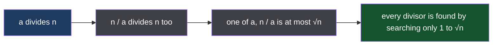
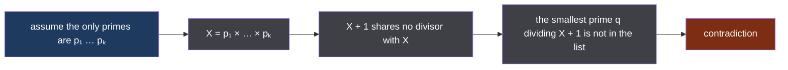
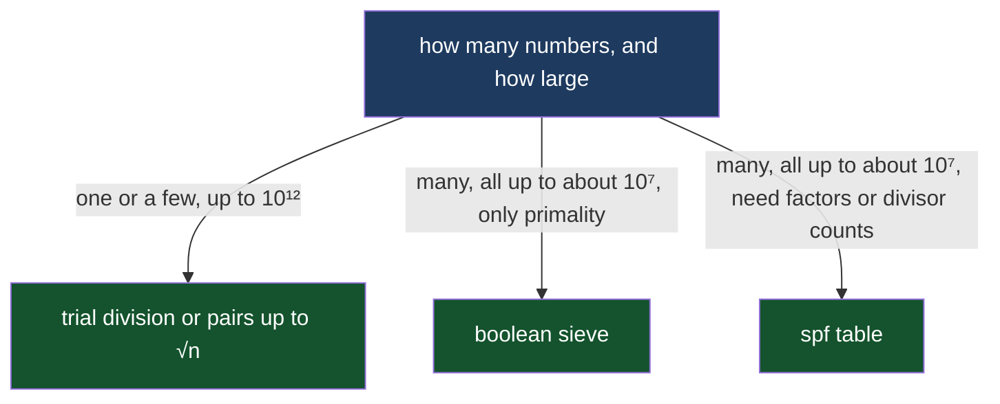

## A prime has exactly two divisors

A **divisor** of n is a positive whole number d that goes into n with no remainder, `n % d == 0`. A **prime** is a positive whole number with exactly two divisors, 1 and itself. Every other number above 1 is **composite**: it has a third divisor.

|   n | Divisors     | Count | Prime |
| --: | ------------ | ----: | ----- |
|   1 | 1            |     1 | no    |
|   2 | 1 2          |     2 | yes   |
|   7 | 1 7          |     2 | yes   |
|   9 | 1 3 9        |     3 | no    |
|  12 | 1 2 3 4 6 12 |     6 | no    |

> [!note] 1, 0 and negatives are not prime
> 1 has one divisor, not two, so the definition shuts it out. 0 and negative numbers are not positive, so they are shut out too. Every prime test needs an explicit answer for them.

## Divisors pair up, and the smaller partner is at most √n

Whenever a divides n, so does n / a, because a × (n / a) = n. So divisors arrive in pairs a × b = n. Written with the smaller partner first:

|   n | Pairs                                |   √n |
| --: | ------------------------------------ | ---: |
|  36 | 1 × 36, 2 × 18, 3 × 12, 4 × 9, 6 × 6 | 6.00 |
|  35 | 1 × 35, 5 × 7                        | 5.92 |

The left partner never passes √n, and that is forced: if both a and b were larger than √n, then a × b would be larger than √n × √n = n. For 36 the two partners meet at 6 × 6, exactly at √36.



## A prime test only searches up to √n

The definition says n is composite when some number from 2 to n − 1 divides it. By the pairing, if a divisor above √n existed, its partner would sit at or below √n, so it is enough to search 2 to √n. This is **trial division**.

The difference is largest on a prime, where the search never stops early:

|               n | Search 2 to n − 1 | Search 2 to √n |
| --------------: | ----------------: | -------------: |
|              97 |                95 |              8 |
|   1,000,000,007 |     1,000,000,005 |         31,621 |
| 999,999,999,989 |        about 10¹² |        999,998 |

The cost falls from about n divisions to about √n, so a number near 10⁹ takes about 31,600 divisions and one near 10¹² about a million.

`i ≤ √n` is written `i * i <= n`, which keeps the comparison in whole numbers:

```java
static boolean isPrime(long n) {
    if (n < 2) return false;
    for (long i = 2; i * i <= n; i++)
        if (n % i == 0) return false;
    return true;
}
```

Each of the three lines guards against one mistake, and each mistake was run:

| Mistake                     | Why it fails                                                                         | Wrong answers seen                                                       |
| --------------------------- | ------------------------------------------------------------------------------------ | ------------------------------------------------------------------------ |
| `i * i < n` instead of `<=` | for p², the only divisor besides 1 and p² is p = √n, where the loop has just stopped | 4, 9, 25, 49 called prime, the only errors up to 100                     |
| `int i` with `i * i <= n`   | 46,341² wraps to −2,147,479,015, which is always `<= n`                              | `Integer.MAX_VALUE`, a prime, called composite after 2,147,483,646 steps |
| no `n < 2` guard            | the loop body never runs, so the function falls through to `true`                    | every n from −10 to 1 called prime                                       |

> [!tip] Keeping `i` as `int`
> Write the condition as `i <= n / i`. No multiplication is left to overflow, it holds exactly when i × i ≤ n for positive whole numbers, and it answers `Integer.MAX_VALUE` correctly.

## There are infinitely many primes

Two neighbours x and x + 1 share no divisor except 1: anything dividing both divides their difference, which is 1. In the language of [[02-gcd]], gcd(x, x + 1) = 1.

Now suppose the primes were a finite list p₁, p₂, …, pₖ, and let X = p₁ × p₂ × … × pₖ. X + 1 is at least 3, so its smallest divisor q above 1 exists and is prime, since a smaller divisor of q would also divide X + 1. Every listed prime divides X, and q cannot divide X because X and X + 1 are neighbours. So q is a prime missing from the list, which was supposed to hold every prime.



X + 1 itself need not be prime, only its prime factors need to be new:

| Primes in the list |      X |  X + 1 | X + 1 is                       |
| ------------------ | -----: | -----: | ------------------------------ |
| 2, 3               |      6 |      7 | prime                          |
| 2, 3, 5, 7         |    210 |    211 | prime                          |
| 2, 3, 5, 7, 11     |  2,310 |  2,311 | prime                          |
| 2 to 13            | 30,030 | 30,031 | 59 × 509, both outside 2 to 13 |

## The sieve crosses out multiples instead of testing divisors

To find every prime up to n, trial division on each number repeats the same work: testing 92 starts again from 2 as if testing 91 had taught nothing. The **sieve of Eratosthenes** goes the cheap way round. Going from a prime to its multiples needs no division, only adding.

Start with 2 to n unmarked and walk upward. The first unmarked number is prime, so cross out all its multiples. The next unmarked number is prime too, because no smaller prime crossed it. Repeat.

For n = 30, with each prime crossing its multiples from 2 × p:

| Prime | Crossed first by this prime            | Already crossed by a smaller prime |
| ----: | -------------------------------------- | ---------------------------------- |
|     2 | 4 6 8 10 12 14 16 18 20 22 24 26 28 30 | none                               |
|     3 | 9 15 21 27                             | 6 12 18 24 30                      |
|     5 | 25                                     | 10 15 20 30                        |
|     7 | none                                   | 14 21 28                           |

What stays unmarked is the primes: 2, 3, 5, 7, 11, 13, 17, 19, 23, 29.

## Crossing starts at i × i and stops once i × i passes n

The table shows the waste. Prime 5 first crosses something new at 25 = 5 × 5, and prime 7 crosses nothing new at all. A multiple k × i with k < i has a prime factor at most k, smaller than i, and that smaller prime crossed it earlier. So the first multiple only i can reach is i × i.

Once i × i > n, the crossing for i would start past n. And every composite up to n has a prime factor at most √n, by the pairing above, so it is already crossed. The outer loop runs only while i × i ≤ n. Measured at n = 10⁷, all three versions produce the same array:

| Version                                 | Outer steps |      Marks |
| --------------------------------------- | ----------: | ---------: |
| cross from 2 × i, outer loop to n       |   9,999,999 | 29,465,738 |
| cross from i × i, outer loop to n       |   9,999,999 | 22,850,051 |
| cross from i × i, outer while i × i ≤ n |       3,161 | 22,850,051 |

Starting at i × i removes 6,615,687 marks. Stopping at √n removes no marks, only empty outer steps, but it also prevents an overflow: with the outer loop running to n, the first prime above 46,340 makes an `int` i × i wrap negative, and at n = 100,000 that crashed with `ArrayIndexOutOfBoundsException: Index -2146737495`. With the outer condition `(long) i * i <= n`, i never passes √n, so i × i fits in an `int` whenever n does.

```java
static boolean[] sieve(int n) {
    boolean[] composite = new boolean[n + 1];
    for (int i = 2; (long) i * i <= n; i++) {
        if (composite[i]) continue;
        for (int j = i * i; j <= n; j += i) composite[j] = true;
    }
    return composite;
}
```

A number k is prime when k ≥ 2 and `composite[k]` is `false`; slots 0 and 1 are never marked. The sieve matched trial division on all 1,000,001 values from 0 to 10⁶.

## The sieve costs about n log log n

Prime p crosses about n / p numbers, so the total is about n × (1/2 + 1/3 + 1/5 + 1/7 + …) over the primes up to √n. That sum grows like ln ln n, which is why the sieve is called O(n log log n):

|          n | Marks / n | Sum of 1/p, p ≤ √n | ln ln n |
| ---------: | --------: | -----------------: | ------: |
|      1,000 |      1.41 |               1.57 |    1.93 |
|    100,000 |      1.93 |               2.02 |    2.44 |
| 10,000,000 |      2.29 |               2.35 |    2.78 |

Marks per number go 1.41, 1.93, 2.29 while n grows ten-thousand-fold, so in practice the sieve is close to linear. Against trial division on every number, both finding the 664,579 primes up to 10⁷:

| Method                         |                    Work |     Time |
| ------------------------------ | ----------------------: | -------: |
| trial division on every number | 1,746,210,133 divisions | 1,623 ms |
| sieve                          |        22,850,051 marks |    55 ms |

The real limit is memory. A Java `boolean[]` takes one byte per entry, about 10 MB for 10⁷ numbers, and an `int[]` of the same length about 41 MB.

## Store the smallest prime factor of every number

Every number above 1 has exactly one **prime factorisation**, the list of primes with repeats that multiply to it: 360 = 2 × 2 × 2 × 3 × 3 × 5. Factorising many numbers by trial division rediscovers the same small primes every time: 360 finds 2, 3 and 5, then 720 finds them again in the same order. For x from 2 to 10⁶ that is 178,693,000 candidate divisors.

The one fact that matters per number is which prime divides it first. The **smallest prime factor** of x, written spf[x], is the smallest prime dividing x, and spf[p] = p for a prime. It is filled by a sieve that writes a prime into each slot instead of crossing it out:

1. Start with spf all 0, meaning no prime has reached the slot yet.
2. Walk i from 2 to N. If spf[i] is still 0, no smaller prime divides i, so i is prime: set spf[i] = i.
3. For that prime, visit i × i, i × i + i, … up to N, and write i into every slot still at 0.

Primes are visited in increasing order, so the first prime to reach a slot is the smallest that divides it, and the still-0 check keeps it there.

|   x | spf[x] | Factorisation |
| --: | -----: | ------------- |
|  12 |      2 | 2 × 2 × 3     |
|  15 |      3 | 3 × 5         |
|  17 |     17 | 17            |
|  25 |      5 | 5 × 5         |
|  27 |      3 | 3 × 3 × 3     |
|  30 |      2 | 2 × 3 × 5     |

spf[1] stays 0, since 1 has no prime factor.

> [!warning] Two differences from the boolean sieve
> The outer loop runs to N, not to √N, because a prime above √N still needs its own spf[p] = p written. And since i now passes 46,340, the inner index i × i must be a `long`.

## Factorising is repeated division by spf[x]

spf[x] is one prime factor of x. Divide it out, and the quotient is a smaller number whose smallest prime factor is again in the table. Repeat until 1:


The primes on the arrows, 2, 2, 2, 3, 3, 5, are the factorisation, already sorted. Each step divides by at least 2, so x at least halves: at most log₂ x steps, which is 19 for any x up to 10⁶ because 2²⁰ = 1,048,576 is past it. The worst case is reached at 524,288 = 2¹⁹, and across all x from 2 to 10⁶ the average is about 3.6 divisions.

```java
static int[] buildSpf(int n) {
    int[] spf = new int[n + 1];
    for (int i = 2; i <= n; i++) {
        if (spf[i] != 0) continue;
        spf[i] = i;
        for (long j = (long) i * i; j <= n; j += i)
            if (spf[(int) j] == 0) spf[(int) j] = i;
    }
    return spf;
}

static List<Integer> factorise(int x, int[] spf) {
    List<Integer> primes = new ArrayList<>();
    while (x > 1) { primes.add(spf[x]); x /= spf[x]; }
    return primes;
}
```

Factorising every x from 2 to 10⁶, with 0 mismatches against trial division:

| Method                           |                 Steps |         Time |
| -------------------------------- | --------------------: | -----------: |
| trial division on every x        |           178,693,000 |       442 ms |
| build spf, then divide by spf[x] | 2,122,048 + 3,626,619 | 7 ms + 45 ms |

The table costs an `int[]` of N + 1 entries, about 4 MB at N = 10⁶ and about 41 MB at 10⁷, which is where it stops being comfortable. A problem that only needs to know which numbers are prime is served by the boolean sieve, four times smaller.

> [!note] Distinct primes only
> To record each prime once, take p = spf[x] and divide it out completely with `while (x % p == 0) x /= p;` before moving on. For 360 that gives 2, 3, 5.

## Divisors listed by pairs count the square root once

The pairing also lists all divisors of one number in about √x steps: walk i while i × i ≤ x, and every i that divides x gives two divisors, i and x / i. The catch is a perfect square, where the pair at √x is i × i and adding both partners adds the same divisor twice:

|   x | Both partners always added   | Count | Correct count |
| --: | ---------------------------- | ----: | ------------: |
|  72 | 1 2 3 4 6 8 9 12 18 24 36 72 |    12 |            12 |
|  36 | 1 2 3 4 6 6 9 12 18 36       |    10 |             9 |

```java
static int countByPairs(int x) {
    int count = 0;
    for (int i = 1; i <= x / i; i++)
        if (x % i == 0) count += (i == x / i) ? 1 : 2;
    return count;
}
```

The same fact says which numbers have an odd number of divisors: every divisor has a different partner except √x, so the count is odd exactly when x is a perfect square. Checked on every x from 1 to 10⁶, with no exception either way.

## The divisor count is the product of (exponent + 1)

Write x as prime powers. 72 = 2³ × 3², and every divisor of 72 is 2ᵃ × 3ᵇ with a from 0 to 3 and b from 0 to 2. It cannot hold another prime, and it cannot hold more 2s or 3s than 72 has:

| ×      |  3⁰ |  3¹ |  3² |
| ------ | --: | --: | --: |
| **2⁰** |   1 |   3 |   9 |
| **2¹** |   2 |   6 |  18 |
| **2²** |   4 |  12 |  36 |
| **2³** |   8 |  24 |  72 |

4 rows times 3 columns gives 12 divisors, matching the list by pairs.

In general, if x = p₁^e₁ × p₂^e₂ × … × pₖ^eₖ, each prime offers e + 1 independent choices, so the number of divisors is (e₁ + 1) × (e₂ + 1) × … × (eₖ + 1). Independent choices multiply by the multiplication rule of [[05-counting]].

|       x | Factorisation             | (e + 1) product       | Divisors |
| ------: | ------------------------- | --------------------- | -------: |
|       1 | no primes                 | empty product         |        1 |
|      36 | 2² × 3²                   | 3 × 3                 |        9 |
|      72 | 2³ × 3²                   | 4 × 3                 |       12 |
| 720,720 | 2⁴ × 3² × 5 × 7 × 11 × 13 | 5 × 3 × 2 × 2 × 2 × 2 |      240 |

The exponents come straight out of the spf table: take p = spf[x], divide it out while it fits and count the divisions, multiply the answer by that count + 1, and continue with what is left. Starting the answer at 1 makes x = 1 come out right with no special case.

```java
static int countDivisors(int x, int[] spf) {
    int count = 1;
    while (x > 1) {
        int p = spf[x], e = 0;
        while (x % p == 0) { x /= p; e++; }
        count *= e + 1;
    }
    return count;
}
```

It matched `countByPairs` on every x from 1 to 10⁶.

## Which method for which input

For 10⁵ random queries, each at most 10⁶, counting divisors:

| Method                    | Work for Q queries up to N |         Steps measured |                  Time |
| ------------------------- | -------------------------- | ---------------------: | --------------------: |
| loop d from 1 to x        | sum of all x               |         50,035,204,670 |               not run |
| pairs up to √x            | about Q × √N               |             66,623,804 |                 94 ms |
| spf build, then exponents | N log log N + Q log N      | 362,516 plus the build | 14 ms, build included |

The gap grows with Q, because pairs pays √x per query and spf pays log x.


