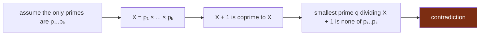

## The starting problem — is this number prime?

**The task.** You get one whole number `n`, anywhere from a negative number up to `Integer.MAX_VALUE` (2,147,483,647). Return `true` if `n` is prime and `false` otherwise.

Two words first. A **divisor** of `n` is a positive integer `d` with `n % d == 0`, meaning `d` goes into `n` with no remainder. A **prime** is a positive integer with **exactly two divisors**: 1 and itself. Nothing else counts.

|   n | Divisors     | Count | Prime |
| --: | ------------ | ----: | ----- |
|   1 | 1            |     1 | no    |
|   2 | 1 2          |     2 | yes   |
|   7 | 1 7          |     2 | yes   |
|   9 | 1 3 9        |     3 | no    |
|  12 | 1 2 3 4 6 12 |     6 | no    |

Expected output for the rows above: `false` for 1, 9 and 12, `true` for 2 and 7.

**Why it matters.** Many problems filter or score numbers by whether they are prime, and the same divisor search starts factorising, the sieve and divisor counting.

> [!note] 1 is not prime
> 1 has one divisor, not two, so the definition shuts it out. 0 and negative numbers are not positive, so they are shut out too. Every primality function needs an explicit answer for them.

## The naive way — try every divisor from 2 to n-1

Translate the definition directly: if any number strictly between 1 and `n` divides `n`, then `n` has a third divisor and is not prime.

```java
public class NaivePrime {
    static long steps = 0;

    static boolean isPrime(int n) {
        if (n < 2) return false;
        for (int i = 2; i <= n - 1; i++) { steps++; if (n % i == 0) return false; }
        return true;
    }

    public static void main(String[] args) {
        int[] tests = {9, 97, 1_000_000_007};
        for (int n : tests) {
            steps = 0;
            boolean p = isPrime(n);
            System.out.println("n = " + n + "  prime = " + p + "  divisions = " + steps);
        }
    }
}
```

Run:

```text
n = 9  prime = false  divisions = 2
n = 97  prime = true  divisions = 95
n = 1000000007  prime = true  divisions = 1000000005
```

It answers correctly, but a prime is the worst case: it never finds a divisor, so it runs all the way to `n - 1`. For `1000000007` that is **1,000,000,005 divisions for one number**. The cost is n-2 divisions for every prime, linear in the value of the number, and LeetCode values go to 10⁹: a few hundred such numbers is already hundreds of billions of divisions.

## Divisors come in pairs, and the smaller one is at most √n

Whenever `a` divides `n`, so does `n / a`, because `a × (n / a) = n`. So divisors arrive in **pairs** `a × b = n`. Here are the pairs with the smaller one written first:

```java
public class FactorPairs {
    public static void main(String[] args) {
        for (int n : new int[]{36, 35}) {
            StringBuilder sb = new StringBuilder();
            for (int a = 1; a <= n; a++) if (n % a == 0 && a <= n / a) sb.append(a).append("x").append(n / a).append("  ");
            System.out.println(n + ": " + sb.toString().trim() + "   sqrt = " + String.format("%.2f", Math.sqrt(n)));
        }
    }
}
```

Run:

```text
36: 1x36  2x18  3x12  4x9  6x6   sqrt = 6.00
35: 1x35  5x7   sqrt = 5.92
```

Look at the left number of every pair: 1, 2, 3, 4, 6 for 36, and 1, 5 for 35. It never passes √n. That is forced, not luck: if both `a` and `b` were bigger than √n, then `a × b` would be bigger than √n × √n = n, and they could not multiply to `n`.

For 36 the two partners meet at 6 × 6, exactly at √36. So the question changes. Instead of asking whether `n` has a divisor in 2..n-1, ask whether it has one in **2..√n**. If a divisor bigger than √n existed, its partner would sit below √n, and the search would already have found the partner.

## The fix — stop when i × i passes n

Comparing against `Math.sqrt(n)` brings in floating point. The exact integer way to say `i ≤ √n` is `i * i <= n`. With `i` declared as `long`:

```java
public class Primality {
    static long steps = 0;

    static boolean isPrime(long n) {
        if (n < 2) return false;
        for (long i = 2; i * i <= n; i++) { steps++; if (n % i == 0) return false; }
        return true;
    }

    static boolean isPrimeDivide(int n) {
        if (n < 2) return false;
        for (int i = 2; i <= n / i; i++) if (n % i == 0) return false;
        return true;
    }

    static boolean isPrimeStrict(int n) {
        if (n < 2) return false;
        for (int i = 2; i * i < n; i++) if (n % i == 0) return false;
        return true;
    }

    static boolean isPrimeNoGuard(long n) {
        for (long i = 2; i * i <= n; i++) if (n % i == 0) return false;
        return true;
    }

    static boolean isPrimeTruth(int n) {
        int divisors = 0;
        for (int d = 1; d <= n; d++) if (n % d == 0) divisors++;
        return divisors == 2;
    }

    public static void main(String[] args) {
        long[] tests = {97, 1_000_000_007L, 999_999_999_989L};
        for (long n : tests) {
            steps = 0;
            System.out.println("n = " + n + "  prime = " + isPrime(n) + "  divisions = " + steps);
        }
        int mismatches = 0;
        StringBuilder strict = new StringBuilder(), noGuard = new StringBuilder();
        for (int n = -10; n <= 50_000; n++) {
            boolean truth = isPrimeTruth(n);
            if (isPrime(n) != truth || isPrimeDivide(n) != truth) mismatches++;
            if (n <= 100 && isPrimeStrict(n) != truth) strict.append(n).append(" ");
            if (n <= 100 && isPrimeNoGuard(n) != truth) noGuard.append(n).append(" ");
        }
        System.out.println("isPrime and isPrimeDivide on -10..50000, mismatches = " + mismatches);
        System.out.println("isPrimeDivide(Integer.MAX_VALUE) = " + isPrimeDivide(Integer.MAX_VALUE));
        System.out.println("i * i < n wrong at (-10..100):      " + strict.toString().trim());
        System.out.println("no n < 2 guard wrong at (-10..100): " + noGuard.toString().trim());
    }
}
```

Run:

```text
n = 97  prime = true  divisions = 8
n = 1000000007  prime = true  divisions = 31621
n = 999999999989  prime = true  divisions = 999998
isPrime and isPrimeDivide on -10..50000, mismatches = 0
isPrimeDivide(Integer.MAX_VALUE) = true
i * i < n wrong at (-10..100):      4 9 25 49
no n < 2 guard wrong at (-10..100): -10 -9 -8 -7 -6 -5 -4 -3 -2 -1 0 1
```

The same prime `1000000007` now takes **31,621 divisions instead of 1,000,000,005**. Even `999999999989`, a prime close to 10¹², takes 999,998, where the loop to n-1 would need about 10¹². Both correct versions, `isPrime` and `isPrimeDivide`, matched the definition (count the divisors, check for exactly two) on all 50,011 values from -10 to 50,000. The last two output lines come from two broken versions, kept in the same program so all four are checked against the same truth; Trap 1 and Trap 3 below read them.

## Trap 1 — `i * i < n` calls 4, 9, 25 and 49 prime

Write the loop with a strict `<` and every square of a prime slips through: the output line for `isPrimeStrict` lists 4, 9, 25 and 49 as the only wrong answers up to 100. Take 49. Its only divisor besides 1 and 49 is 7, and the pair is 7 × 7, so the smaller partner **equals** √49. With `i * i < n` the loop runs i = 2..6, since 7 × 7 = 49 is not less than 49, and stops one step before the only divisor it needed. Every other composite has a partner strictly below √n, which is why only 4, 9, 25 and 49 fail up to 100.

> [!warning] The loop condition is `i * i <= n`, with equals
> The divisor search must include √n itself. A strict `<` is wrong exactly on squares of primes.

## Trap 2 — an int i makes i × i overflow at 46341

An `int` holds at most 2147483647, and a multiplication that goes past it wraps around to a negative number with no error. `i * i` for an `int i` crosses that limit between 46340 and 46341:

```java
public class IntSquareOverflow {
    static long steps = 0;

    static boolean isPrimeIntSquare(int n) {
        if (n < 2) return false;
        for (int i = 2; i * i <= n; i++) { steps++; if (n % i == 0) return false; }
        return true;
    }

    public static void main(String[] args) {
        int a = 46340, b = 46341;
        System.out.println(a + " * " + a + " = " + (a * a));
        System.out.println(b + " * " + b + " = " + (b * b) + "   (as long: " + ((long) b * b) + ")");
        int n = Integer.MAX_VALUE;
        boolean p = isPrimeIntSquare(n);
        System.out.println("n = " + n + "  answer = " + p + "  loop steps = " + steps);
    }
}
```

Run:

```text
46340 * 46340 = 2147395600
46341 * 46341 = -2147479015   (as long: 2147488281)
n = 2147483647  answer = false  loop steps = 2147483646
```

`Integer.MAX_VALUE` is prime, and this loop returns `false` after **2,147,483,646 steps**. Once `i` reaches 46341, `i * i` wraps to a negative number, which is always `<= n`, so the stop condition never fires. The loop keeps going until `i` equals `n` itself, where `n % n == 0` reports a divisor. Wrong answer, and about 46,000 times more steps than the 46,339 the correct loop takes.

Two fixes, both in `Primality.java` above. Declare `i` as `long`, so `i * i` is computed in 64 bits and cannot wrap for any `int` value of `n`. Or keep `i` as `int` and write the condition as `i <= n / i`: no multiplication is left to overflow, for positive integers it holds exactly when `i * i <= n`, and `isPrimeDivide(Integer.MAX_VALUE)` returns `true`.

> [!warning] With n up to 2³¹-1, an int i in `i * i <= n` is a WA or a TLE
> Any prime n above 46340² = 2147395600 drives `i` past 46340. Use `long i`, or `i <= n / i`.

## Trap 3 — without the n < 2 guard, 0, 1 and negatives come out prime

The last output line of `Primality.java`: with the guard removed, every n from -10 to 1 is reported prime. The loop body never runs for them, because `2 * 2 <= n` is already false, and with nothing found the function falls through to `return true`. The guard `if (n < 2) return false;` encodes the part of the definition that no loop checks: a prime is positive and has two divisors.

> [!tip] Three lines to type from memory
> `if (n < 2) return false;` then `for (long i = 2; i * i <= n; i++)` then `if (n % i == 0) return false;`. Cost: about √n divisions, so about 31,600 for n near 10⁹.

## Two neighbours share no divisor except 1

The **gcd** of two numbers is the largest number that divides both; two numbers are **coprime** when their gcd is 1. Claim: `gcd(x, x + 1) = 1` for every positive x. If some d divides both x and x + 1, it divides their difference, and the difference is 1, so d = 1. The program below checks it for every x up to a million (the first output line: none fails) and then uses it for the next section.

```java
public class PrimeFacts {
    static long gcd(long a, long b) { return b == 0 ? a : gcd(b, a % b); }

    static long smallestPrimeFactor(long n) {
        for (long i = 2; i * i <= n; i++) if (n % i == 0) return i;
        return n;
    }

    public static void main(String[] args) {
        int notOne = 0;
        for (long x = 1; x <= 1_000_000; x++) if (gcd(x, x + 1) != 1) notOne++;
        System.out.println("x in 1..1000000 with gcd(x, x + 1) != 1: " + notOne);

        long[] primes = {2, 3, 5, 7, 11, 13};
        long x = 1;
        for (long p : primes) {
            x *= p;
            long q = smallestPrimeFactor(x + 1);
            long c = (x + 1) / q;
            String shape = q == x + 1 ? "prime" : q + " x " + c + (smallestPrimeFactor(c) == c ? ", both prime" : "");
            System.out.println("up to " + p + ":  X = " + x + "  X + 1 = " + (x + 1) + " = " + shape);
        }
    }
}
```

Run:

```text
x in 1..1000000 with gcd(x, x + 1) != 1: 0
up to 2:  X = 2  X + 1 = 3 = prime
up to 3:  X = 6  X + 1 = 7 = prime
up to 5:  X = 30  X + 1 = 31 = prime
up to 7:  X = 210  X + 1 = 211 = prime
up to 11:  X = 2310  X + 1 = 2311 = prime
up to 13:  X = 30030  X + 1 = 30031 = 59 x 509, both prime
```

## There are infinitely many primes

Suppose the opposite: the primes are a finite list p₁, p₂, ..., pₖ. Multiply them all, X = p₁ × p₂ × ... × pₖ, and look at X + 1.

1. X + 1 is at least 3, so it has a smallest divisor q bigger than 1, and q is prime: a smaller divisor of q bigger than 1 would also divide X + 1 and be smaller than q.
2. Every listed prime divides X, because X is their product.
3. q cannot divide X: then q would divide both X and X + 1, and neighbours are coprime.
4. So q is a prime that divides X + 1 but is not in the list. The list was supposed to hold every prime. Contradiction, so no finite list holds them all.



> [!note] X + 1 itself need not be prime
> For 2, 3, 5, 7, 11 the run gives X + 1 = 2311, a prime. Add 13 and X + 1 = 30031 = 59 × 509: not prime, but both of its prime factors are missing from the list 2..13, which is all the proof needs.

## On LeetCode

- `prime-in-diagonal` (LC 2614, 1375): values up to 4·10⁶ on at most 600 diagonal cells, each tested by trial division up to √n.
- `maximum-prime-difference` (LC 3115, 1294): every element is at most 100, so each one is tested with the three-line check above.
- `complete-prime-number` (LC 3765, 1378): every prefix and every suffix of a number up to 10⁹ must be prime, one √n test each.
