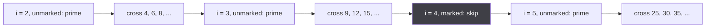

## The starting problem — every prime up to n

**The task.** You get a number `n`, up to 10⁷. Return every prime from 2 to `n`, or just how many there are.

**Example.**

|   n | Expected output                    |   Count |
| --: | ---------------------------------- | ------: |
|  10 | 2, 3, 5, 7                         |       4 |
|  30 | 2, 3, 5, 7, 11, 13, 17, 19, 23, 29 |      10 |
| 10⁷ | too many to list                   | 664,579 |

**Why it matters.** Problems that ask about many numbers at once, which ones are prime or how many primes lie in a range, need this list built once instead of one test per number.

A **prime** has exactly two divisors, 1 and itself; one number is tested by trial division, trying every `i` with `i * i <= n` and stopping at the first `n % i == 0`.

## The naive way — run trial division on every number

The obvious move is to reuse the one-number test in a loop over 2..n and count how many divisions it does in total.

```java
public class NaiveAll {
    static long divisions = 0;

    static boolean isPrime(int n) {
        if (n < 2) return false;
        for (long i = 2; i * i <= n; i++) { divisions++; if (n % i == 0) return false; }
        return true;
    }

    public static void main(String[] args) {
        for (int n : new int[]{1_000, 100_000, 10_000_000}) {
            divisions = 0;
            int count = 0;
            long t0 = System.nanoTime();
            for (int k = 2; k <= n; k++) if (isPrime(k)) count++;
            long ms = (System.nanoTime() - t0) / 1_000_000;
            System.out.println("n = " + n + "  primes = " + count + "  divisions = " + divisions + "  per number = " + String.format("%.1f", (double) divisions / n) + "  time = " + ms + " ms");
        }
    }
}
```

Run:

```text
n = 1000  primes = 168  divisions = 5288  per number = 5.3  time = 0 ms
n = 100000  primes = 9592  divisions = 2745694  per number = 27.5  time = 4 ms
n = 10000000  primes = 664579  divisions = 1746210133  per number = 174.6  time = 1623 ms
```

The work per number keeps climbing: 5.3 divisions per number at n = 1000, 27.5 at 10⁵, **174.6 at 10⁷**, for **1,746,210,133 divisions** in total. Every prime pays its full √k, and there are 664,579 of them below 10⁷. One test case of 10⁷ already costs 1.6 s here; a problem with several such cases does not fit.

## The diagnosis — each number is tested in isolation

Trial division on 91 tries 2, 3, 4, 5, 6 and finds 7. Then trial division on 92 starts again from 2, as if 91 had taught it nothing. The loop never reuses the fact that it already knows which small numbers are prime, and it never uses the cheap direction: going from a prime to its multiples needs no division at all, only addition.

## The fix — cross out multiples instead of testing divisors

The **sieve of Eratosthenes** turns the question around. Start with every number from 2 to n unmarked. Walk upward; the first unmarked number is prime, so cross out all its multiples. The next unmarked number is prime too, because no smaller prime crossed it. Repeat.



Here is the crossing-out done for n = 30, starting each prime's multiples at 2i. A `*` means this prime crossed the number first; a number in brackets means a smaller prime had already crossed it.

```java
public class FirstCrosser {
    public static void main(String[] args) {
        int n = 30;
        int[] crossedBy = new int[n + 1];
        for (int i = 2; i <= n; i++) {
            if (crossedBy[i] != 0) continue;
            StringBuilder sb = new StringBuilder();
            for (int j = 2 * i; j <= n; j += i) {
                sb.append(j).append(crossedBy[j] == 0 ? "* " : "(" + crossedBy[j] + ") ");
                if (crossedBy[j] == 0) crossedBy[j] = i;
            }
            if (sb.length() > 0) System.out.println("i = " + i + ": " + sb.toString().trim());
        }
    }
}
```

Run:

```text
i = 2: 4* 6* 8* 10* 12* 14* 16* 18* 20* 22* 24* 26* 28* 30*
i = 3: 6(2) 9* 12(2) 15* 18(2) 21* 24(2) 27* 30(2)
i = 5: 10(2) 15(3) 20(2) 25* 30(2)
i = 7: 14(2) 21(3) 28(2)
i = 11: 22(2)
i = 13: 26(2)
```

## Marking starts at i × i, because every smaller multiple is already crossed

Read the `i = 5` line: 10, 15 and 20 were already crossed by 2, 3 and 2. The first number 5 crosses itself is **25 = 5 × 5**. That is the general rule. A multiple `k × i` with `k < i` has a prime factor no bigger than `k`, which is smaller than `i`, so that smaller prime crossed it earlier. The first multiple nobody smaller can reach is `i × i`.

## The outer loop stops once i × i passes n

If `i × i > n`, the inner loop for `i` would start beyond n and cross nothing. And every composite up to n has a prime factor at most √n (the factor-pair argument: of the two partners, the smaller is at most √n), so by the time `i` passes √n every composite is already crossed. The outer loop runs only while `i * i <= n`. The three versions side by side at n = 10⁷:

```java
public class SieveVariants {
    static long marks, outer;

    static boolean[] sieve(int n, boolean startAtSquare, boolean stopAtSqrt) {
        boolean[] composite = new boolean[n + 1];
        for (int i = 2; stopAtSqrt ? (long) i * i <= n : i <= n; i++) {
            outer++;
            if (composite[i]) continue;
            long start = startAtSquare ? (long) i * i : 2L * i;
            for (long j = start; j <= n; j += i) { marks++; composite[(int) j] = true; }
        }
        return composite;
    }

    public static void main(String[] args) {
        int n = 10_000_000;
        boolean[] best = null;
        String[] names = {"start 2i, outer to n", "start i*i, outer to n", "start i*i, outer while i*i <= n"};
        boolean[][] flags = {{false, false}, {true, false}, {true, true}};
        for (int v = 0; v < 3; v++) {
            marks = 0; outer = 0;
            boolean[] c = sieve(n, flags[v][0], flags[v][1]);
            if (best == null) best = c;
            System.out.println(names[v] + ":  outer steps = " + outer + "  marks = " + marks + "  same result = " + java.util.Arrays.equals(best, c));
        }
    }
}
```

Run:

```text
start 2i, outer to n:  outer steps = 9999999  marks = 29465738  same result = true
start i*i, outer to n:  outer steps = 9999999  marks = 22850051  same result = true
start i*i, outer while i*i <= n:  outer steps = 3161  marks = 22850051  same result = true
```

Starting at `i * i` removes 6,615,687 marks. Stopping the outer loop at √n does not change the marks at all, only the 9,996,838 pointless outer steps, and it fixes the overflow below. All three produce the same array.

> [!warning] Outer loop to n with `int j = i * i` crashes
> `SieveVariants` keeps `j` as `long` on purpose. With `int j = i * i` and the outer loop running to n, the first prime above 46340 makes `i * i` wrap negative:

```java
public class OverflowSieve {
    public static void main(String[] args) {
        int n = 100_000;
        boolean[] composite = new boolean[n + 1];
        for (int i = 2; i <= n; i++) {
            if (composite[i]) continue;
            for (int j = i * i; j <= n; j += i) composite[j] = true;
        }
        System.out.println("finished");
    }
}
```

Run:

```text
Exception in thread "main" java.lang.ArrayIndexOutOfBoundsException: Index -2146737495 out of bounds for length 100001
	at OverflowSieve.main(OverflowSieve.java:7)
```

With the outer condition `(long) i * i <= n`, `i` never passes √n, so `i * i` fits in an `int` whenever n does.

## The sieve in Java, and its cost

```java
public class Sieve {
    static long marks = 0;

    static boolean[] sieve(int n) {
        boolean[] composite = new boolean[n + 1];
        for (int i = 2; (long) i * i <= n; i++) {
            if (composite[i]) continue;
            for (int j = i * i; j <= n; j += i) { marks++; composite[j] = true; }
        }
        return composite;
    }

    static boolean isPrime(int n) {
        if (n < 2) return false;
        for (long i = 2; i * i <= n; i++) if (n % i == 0) return false;
        return true;
    }

    public static void main(String[] args) {
        boolean[] c = sieve(30);
        StringBuilder sb = new StringBuilder();
        for (int k = 2; k <= 30; k++) if (!c[k]) sb.append(k).append(" ");
        System.out.println("primes up to 30: " + sb.toString().trim());

        for (int n : new int[]{1_000, 100_000, 10_000_000}) {
            marks = 0;
            long t0 = System.nanoTime();
            boolean[] comp = sieve(n);
            long ms = (System.nanoTime() - t0) / 1_000_000;
            int count = 0;
            double reciprocals = 0;
            for (int k = 2; k <= n; k++) if (!comp[k]) { count++; if ((long) k * k <= n) reciprocals += 1.0 / k; }
            System.out.println("n = " + n + "  primes = " + count + "  marks = " + marks + "  time = " + ms + " ms");
            System.out.println("    marks / n = " + String.format("%.2f", (double) marks / n) + "   sum of 1/p for p <= sqrt n = "
                + String.format("%.2f", reciprocals) + "   ln ln n = " + String.format("%.2f", Math.log(Math.log(n))));
        }

        boolean[] comp = sieve(1_000_000);
        int mismatches = 0;
        for (int k = 0; k <= 1_000_000; k++) if ((k >= 2 && !comp[k]) != isPrime(k)) mismatches++;
        System.out.println("0..1000000 against trial division, mismatches = " + mismatches);
    }
}
```

Run:

```text
primes up to 30: 2 3 5 7 11 13 17 19 23 29
n = 1000  primes = 168  marks = 1411  time = 0 ms
    marks / n = 1.41   sum of 1/p for p <= sqrt n = 1.57   ln ln n = 1.93
n = 100000  primes = 9592  marks = 193078  time = 1 ms
    marks / n = 1.93   sum of 1/p for p <= sqrt n = 2.02   ln ln n = 2.44
n = 10000000  primes = 664579  marks = 22850051  time = 55 ms
    marks / n = 2.29   sum of 1/p for p <= sqrt n = 2.35   ln ln n = 2.78
0..1000000 against trial division, mismatches = 0
```

Matched trial division on all 1,000,001 values from 0 to 10⁶, and it finds the same 664,579 primes below 10⁷ as the naive loop, with **22,850,051 marks against 1,746,210,133 divisions**, about 76 times less work, 55 ms against 1,623 ms. Where the cost comes from: prime p crosses about n / p numbers, so the total is about n × (1/2 + 1/3 + 1/5 + 1/7 + ...) over the primes up to √n. That sum of prime reciprocals grows like ln ln n, which is why the sieve is called **O(n log log n)**.

|        n | Marks / n | Sum of 1/p, p ≤ √n | ln ln n |
| -------: | --------: | -----------------: | ------: |
|     1000 |      1.41 |               1.57 |    1.93 |
|   100000 |      1.93 |               2.02 |    2.44 |
| 10000000 |      2.29 |               2.35 |    2.78 |

Marks per number go 1.41, 1.93, 2.29 while n grows ten-thousand-fold: **not constant, but close to it**. In practice the sieve is linear with a small factor. The sum of 1/p runs about 0.4 below ln ln n on every row, a constant gap, so it grows at the same rate; marks / n sits a little under the sum because each prime starts at p² rather than at p.

## Memory — one byte per number

The sieve's real limit is memory. A Java `boolean[]` stores one byte per entry, so the array for 10⁷ costs about 10 MB, and an `int[]` of the same length costs four times that:

```java
public class Memory {
    static long used() {
        Runtime r = Runtime.getRuntime();
        for (int k = 0; k < 5; k++) System.gc();
        return r.totalMemory() - r.freeMemory();
    }

    public static void main(String[] args) {
        int n = 10_000_000;
        long before = used();
        boolean[] composite = new boolean[n + 1];
        long afterBoolean = used();
        int[] ints = new int[n + 1];
        long afterInt = used();
        System.out.println("boolean[" + (n + 1) + "] took about " + (afterBoolean - before) / 1_000_000 + " MB");
        System.out.println("int[" + (n + 1) + "] took about " + (afterInt - afterBoolean) / 1_000_000 + " MB");
        System.out.println("lengths: " + composite.length + " and " + ints.length);
    }
}
```

Run:

```text
boolean[10000001] took about 10 MB
int[10000001] took about 41 MB
lengths: 10000001 and 10000001
```

> [!tip] When to sieve
> Many primality questions about numbers up to about 10⁷: sieve once, then answer each question by reading `composite[x]`. One or a few numbers, or values up to 10¹²: trial division to √n, no array.

## On LeetCode

- `count-primes` (LC 204, not rated): count the primes below n for n up to 5·10⁶, the sieve exactly as written.
- `closest-prime-numbers-in-range` (LC 2523, 1650): sieve up to 10⁶, then scan the primes in [left, right] for the closest neighbouring pair.
- `prime-subtraction-operation` (LC 2601, 1779): values up to 1000, so a sieve gives the list of primes to subtract from each element.
