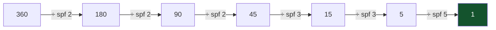

## The starting problem — factorise a million numbers

**The task.** You get an array of up to 10⁶ numbers, each between 2 and N = 10⁶. For every number, return its **prime factorisation**: the list of primes, with repeats, that multiply to it. Every number above 1 has exactly one such list.

**Example.** `nums = [360, 17, 30]`:

| Number | Prime factorisation   | Expected output    |
| -----: | --------------------- | ------------------ |
|    360 | 2 × 2 × 2 × 3 × 3 × 5 | [2, 2, 2, 3, 3, 5] |
|     17 | 17 is itself prime    | [17]               |
|     30 | 2 × 3 × 5             | [2, 3, 5]          |

**Why it matters.** Problems about shared factors, coprime splits or divisor counts all start by factorising every element, and with a million elements the speed of that step decides the verdict.

## The naive way — trial division on every value

Factorising one number by trial division: try i = 2, 3, 4, ... while `i * i <= x`, divide out each i as long as it fits, and whatever is left above 1 at the end is itself a prime. Run that on every x from 2 to 10⁶:

```java
import java.util.ArrayList;
import java.util.List;

public class NaiveFactor {
    static long divisions = 0;

    static List<Integer> factorise(int x) {
        List<Integer> primes = new ArrayList<>();
        for (int i = 2; (long) i * i <= x; i++) {
            divisions++;
            while (x % i == 0) { primes.add(i); x /= i; }
        }
        if (x > 1) primes.add(x);
        return primes;
    }

    public static void main(String[] args) {
        System.out.println("360 = " + factorise(360));
        System.out.println("999983 = " + factorise(999_983));
        divisions = 0;
        int n = 1_000_000;
        long t0 = System.nanoTime();
        for (int x = 2; x <= n; x++) factorise(x);
        long ms = (System.nanoTime() - t0) / 1_000_000;
        System.out.println("factorise every x in 2.." + n + ": divisions tried = " + divisions + "  time = " + ms + " ms");
    }
}
```

Run:

```text
360 = [2, 2, 2, 3, 3, 5]
999983 = [999983]
factorise every x in 2..1000000: divisions tried = 178693000  time = 442 ms
```

**178,693,000 candidate divisors** for one pass over the range. A prime like 999983 pays for every candidate up to its √x and finds nothing. With several test cases, or a value range of 10⁷, this is the part that times out.

## The diagnosis — the same small primes are rediscovered for every x

Factorising 360 finds 2, then 3, then 5. Factorising 720 finds 2, 3 and 5 again, by trying the same candidates in the same order. The work that matters is one fact per number: **which prime divides it first**. If that fact were stored for every x up to N, factorising would need no search at all.

## The fix — store the smallest prime factor of every number

The **smallest prime factor** of x, written `spf[x]`, is the smallest prime that divides x. For a prime, `spf[p] = p`. It is filled by a sieve that writes a number into each slot instead of crossing it out:

1. Make `int[] spf` of size N + 1, all zero. Zero means no prime has reached this slot yet.
2. Walk i from 2 to N. If `spf[i]` is still zero, no smaller prime divides i, so i is prime: set `spf[i] = i`.
3. For that prime i, visit the multiples i × i, i × i + i, ... up to N, and write i into every slot that is still zero.

Primes are visited in increasing order, so the first prime to reach a slot is the smallest one that divides it, and the `still zero` check keeps it there. Marking starts at i × i for the same reason as in the sieve: a multiple k × i with k < i has a prime factor smaller than i, which already wrote into that slot.

> [!warning] Two differences from the sieve
> The outer loop runs to N, not to √N, because a prime above √N still needs its own `spf[p] = p` written. And since i now passes 46340, `i * i` overflows an `int` (46341² wraps negative), so the inner index is a `long`.

Here is the array for 1..30, printed by the same builder used below, next to the factorisation it produces:

```java
public class SpfTable {
    static int[] buildSpf(int n) {
        int[] spf = new int[n + 1];
        for (int i = 2; i <= n; i++) {
            if (spf[i] != 0) continue;
            spf[i] = i;
            for (long j = (long) i * i; j <= n; j += i) if (spf[(int) j] == 0) spf[(int) j] = i;
        }
        return spf;
    }

    static String factorise(int x, int[] spf) {
        StringBuilder sb = new StringBuilder();
        while (x > 1) {
            int p = spf[x];
            sb.append(sb.length() == 0 ? "" : " x ").append(p);
            x /= p;
        }
        return sb.toString();
    }

    public static void main(String[] args) {
        int[] spf = buildSpf(30);
        for (int x = 1; x <= 15; x++) {
            String left = String.format("%2d  spf %2d  %-12s", x, spf[x], x == 1 ? "(none)" : factorise(x, spf));
            String right = String.format("%2d  spf %2d  %s", x + 15, spf[x + 15], factorise(x + 15, spf));
            System.out.println(left + "   " + right);
        }
    }
}
```

Run:

```text
 1  spf  0  (none)         16  spf  2  2 x 2 x 2 x 2
 2  spf  2  2              17  spf 17  17
 3  spf  3  3              18  spf  2  2 x 3 x 3
 4  spf  2  2 x 2          19  spf 19  19
 5  spf  5  5              20  spf  2  2 x 2 x 5
 6  spf  2  2 x 3          21  spf  3  3 x 7
 7  spf  7  7              22  spf  2  2 x 11
 8  spf  2  2 x 2 x 2      23  spf 23  23
 9  spf  3  3 x 3          24  spf  2  2 x 2 x 2 x 3
10  spf  2  2 x 5          25  spf  5  5 x 5
11  spf 11  11             26  spf  2  2 x 13
12  spf  2  2 x 2 x 3      27  spf  3  3 x 3 x 3
13  spf 13  13             28  spf  2  2 x 2 x 7
14  spf  2  2 x 7          29  spf 29  29
15  spf  3  3 x 5          30  spf  2  2 x 3 x 5
```

1 has no prime factor, so its slot stays 0 and the factorising loop never touches it.

## Factorising x is repeated division by spf[x]

`spf[x]` is one prime factor of x. Divide it out, and the quotient is a smaller number whose smallest prime factor is again in the array. Repeat until the quotient is 1. For 360:



The primes written on the arrows, 2, 2, 2, 3, 3, 5, are the factorisation, and they come out already sorted. Each step divides by at least 2, so x at least halves every time: **at most log₂ x steps**, which is 19 for any x up to 10⁶ because 2²⁰ = 1048576 is already above it.

## The whole thing, measured

```java
import java.util.ArrayList;
import java.util.List;

public class Spf {
    static long buildSteps = 0, queryDivisions = 0;

    static int[] buildSpf(int n) {
        int[] spf = new int[n + 1];
        for (int i = 2; i <= n; i++) {
            if (spf[i] != 0) continue;
            spf[i] = i;
            for (long j = (long) i * i; j <= n; j += i) {
                buildSteps++;
                if (spf[(int) j] == 0) spf[(int) j] = i;
            }
        }
        return spf;
    }

    static List<Integer> factorise(int x, int[] spf) {
        List<Integer> primes = new ArrayList<>();
        while (x > 1) {
            queryDivisions++;
            primes.add(spf[x]);
            x /= spf[x];
        }
        return primes;
    }

    static List<Integer> trialDivision(int x) {
        List<Integer> primes = new ArrayList<>();
        for (int i = 2; (long) i * i <= x; i++) while (x % i == 0) { primes.add(i); x /= i; }
        if (x > 1) primes.add(x);
        return primes;
    }

    public static void main(String[] args) {
        int n = 1_000_000;
        long t0 = System.nanoTime();
        int[] spf = buildSpf(n);
        long buildMs = (System.nanoTime() - t0) / 1_000_000;
        System.out.println("build spf[0.." + n + "]: inner steps = " + buildSteps + "  time = " + buildMs + " ms");

        int worst = 0, worstX = 0;
        t0 = System.nanoTime();
        for (int x = 2; x <= n; x++) {
            long before = queryDivisions;
            factorise(x, spf);
            if (queryDivisions - before > worst) { worst = (int) (queryDivisions - before); worstX = x; }
        }
        long queryMs = (System.nanoTime() - t0) / 1_000_000;
        System.out.println("factorise every x in 2.." + n + ": divisions = " + queryDivisions + "  time = " + queryMs + " ms");
        System.out.println("most divisions for one x: " + worst + " at x = " + worstX + " = " + factorise(worstX, spf));
        System.out.println("360 = " + factorise(360, spf));

        int mismatches = 0;
        for (int x = 2; x <= n; x++) if (!factorise(x, spf).equals(trialDivision(x))) mismatches++;
        System.out.println("2.." + n + " against trial division, mismatches = " + mismatches);
    }
}
```

Run:

```text
build spf[0..1000000]: inner steps = 2122048  time = 7 ms
factorise every x in 2..1000000: divisions = 3626619  time = 45 ms
most divisions for one x: 19 at x = 524288 = [2, 2, 2, 2, 2, 2, 2, 2, 2, 2, 2, 2, 2, 2, 2, 2, 2, 2, 2]
360 = [2, 2, 2, 3, 3, 5]
2..1000000 against trial division, mismatches = 0
```

Matched trial division on every x from 2 to 10⁶, with 0 mismatches. The first x to reach the worst case is 524288 = 2¹⁹, at **19 divisions**, exactly the log₂ bound. Across all 999,999 values the average is about 3.6 divisions.

| Approach                         | Steps for all x in 2..10⁶ |    Time here |
| -------------------------------- | ------------------------: | -----------: |
| trial division on every x        |                 178693000 |       442 ms |
| build spf, then divide by spf[x] |         2122048 + 3626619 | 7 ms + 45 ms |

## Cost, and when it is worth building

- **Build:** about N log log N steps, the same order as the sieve: 2,122,048 inner steps for N = 10⁶.
- **One factorisation:** O(log x) divisions, at most 19 for x ≤ 10⁶.
- **Q queries:** O(N log log N + Q log N) in total.
- **Memory:** an `int[]` of N + 1 entries, 4 bytes each. About 4 MB at N = 10⁶; an `int[]` of 10⁷ + 1 entries was measured at about 41 MB, which is where the method stops being comfortable.

> [!tip] When to reach for spf
> Many values, all bounded by about 10⁶ or 10⁷, and the problem needs their prime factors: build `spf` once. A problem that only needs to know which numbers are prime is served by the plain boolean sieve, which is four times smaller.

> [!note] Distinct primes only
> Many problems want the set of distinct prime factors, not the list with repeats. Inside the loop, divide out `p = spf[x]` with `while (x % p == 0) x /= p;` and record p once: for 360 that gives 2, 3, 5.

## On LeetCode

- `distinct-prime-factors-of-product-of-array` (LC 2521, 1413): the primes of a product are the union of the primes of each value, values up to 1000.
- `longest-subarray-with-at-most-k-distinct-prime-factors` (LC 4032, 1759): up to 10⁵ values, each at most 10⁵, all factorised before a sliding window counts primes.
- `largest-component-size-by-common-factor` (LC 952, 2272): values up to 10⁵ are joined through their prime factors, one spf factorisation each.
- `split-the-array-to-make-coprime-products` (LC 2584, 2159): values up to 10⁶; a split is valid when no prime factor appears on both sides.
- `greatest-common-divisor-traversal` (LC 2709, 2172): up to 10⁵ values linked through shared prime factors.
