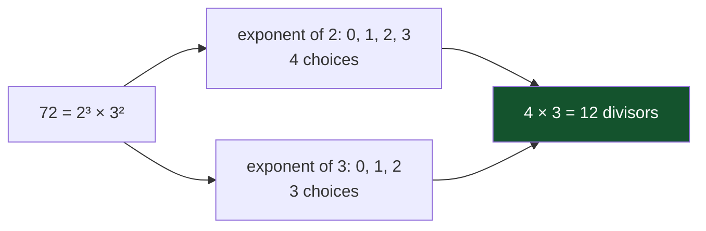
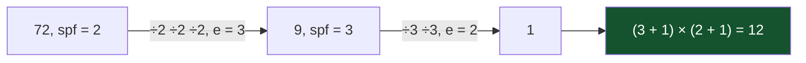

## The starting problem — how many divisors does x have?

**The task.** You get up to Q = 10⁵ numbers, each at most N = 10⁶. For each one, return how many **divisors** it has: positive numbers `d` with `x % d == 0`.

**Example.** `queries = [36, 72, 1, 7]`:

|   x | Divisors                                | Expected output |
| --: | --------------------------------------- | --------------: |
|  36 | 1, 2, 3, 4, 6, 9, 12, 18, 36            |               9 |
|  72 | 1, 2, 3, 4, 6, 8, 9, 12, 18, 24, 36, 72 |              12 |
|   1 | 1                                       |               1 |
|   7 | 1, 7                                    |               2 |

Expected output: `[9, 12, 1, 2]`.

**Why it matters.** Divisor counts decide problems about factors, perfect squares (the only numbers with an odd count) and how many ways a number splits into equal parts.

The definition gives the naive answer straight away: loop d from 1 to x and count. That is x steps per query. For the 10⁵ random queries used at the end of this note the values add up to **50,035,204,670 steps**, so it is never run.

## Finding the divisors in O(√x) — by pairs

Divisors come in pairs `i × (x / i) = x`, and the smaller partner of every pair is at most √x. So walk i only while `i <= x / i` (the overflow-safe way to write `i * i <= x`), and every hit gives two divisors at once: `i` and `x / i`.

One catch: when x is a perfect square, the pair at √x is `i × i`, and adding both partners adds the same divisor twice.

```java
import java.util.ArrayList;
import java.util.Collections;
import java.util.List;

public class Pairs {
    static List<Integer> divisors(int n, boolean squareOnce) {
        List<Integer> ds = new ArrayList<>();
        for (int i = 1; i <= n / i; i++) {
            if (n % i != 0) continue;
            ds.add(i);
            if (!squareOnce || i != n / i) ds.add(n / i);
        }
        Collections.sort(ds);
        return ds;
    }

    public static void main(String[] args) {
        for (int n : new int[]{72, 36}) {
            System.out.println(n + " both always: " + divisors(n, false) + "  count = " + divisors(n, false).size());
            System.out.println(n + " square once: " + divisors(n, true) + "  count = " + divisors(n, true).size());
        }
    }
}
```

Run:

```text
72 both always: [1, 2, 3, 4, 6, 8, 9, 12, 18, 24, 36, 72]  count = 12
72 square once: [1, 2, 3, 4, 6, 8, 9, 12, 18, 24, 36, 72]  count = 12
36 both always: [1, 2, 3, 4, 6, 6, 9, 12, 18, 36]  count = 10
36 square once: [1, 2, 3, 4, 6, 9, 12, 18, 36]  count = 9
```

72 is not a square, so both versions agree on 12. For 36 the version that always adds both partners lists 6 twice and counts **10 instead of 9**.

> [!warning] Count the square root once
> Inside the pair loop the line is `count += (i == x / i) ? 1 : 2;`. Without the check every perfect square is over-counted by exactly one.

This costs about √x steps per query: 1000 for x near 10⁶. Good for one number. For 10⁵ queries it is 66,623,804 steps in the measurement below, and the method has no way to share work between queries.

## The count can be read off the prime factorisation

Write x as a product of prime powers. For 72, divide out the 2s and then the 3s:

```java
public class FromFactorisation {
    public static void main(String[] args) {
        int n = 72;
        int a = 0, b = 0, x = n;
        while (x % 2 == 0) { a++; x /= 2; }
        while (x % 3 == 0) { b++; x /= 3; }
        System.out.println(n + " = 2^" + a + " x 3^" + b + "  leftover = " + x);
        System.out.println("(a + 1) x (b + 1) = " + (a + 1) + " x " + (b + 1) + " = " + (a + 1) * (b + 1));

        System.out.println("       3^0  3^1  3^2");
        int listed = 0;
        for (int i = 0; i <= a; i++) {
            StringBuilder row = new StringBuilder(String.format("2^%d  ", i));
            for (int j = 0; j <= b; j++) {
                int d = (int) (Math.pow(2, i) * Math.pow(3, j));
                row.append(String.format("%5d", d));
                if (n % d == 0) listed++;
            }
            System.out.println(row);
        }
        int brute = 0;
        for (int d = 1; d <= n; d++) if (n % d == 0) brute++;
        System.out.println("grid entries that divide 72 = " + listed + "   divisors by brute force = " + brute);
    }
}
```

Run:

```text
72 = 2^3 x 3^2  leftover = 1
(a + 1) x (b + 1) = 4 x 3 = 12
       3^0  3^1  3^2
2^0      1    3    9
2^1      2    6   18
2^2      4   12   36
2^3      8   24   72
grid entries that divide 72 = 12   divisors by brute force = 12
```

72 = 2³ × 3². Every divisor of 72 is 2ᵃ × 3ᵇ with **a chosen from 0..3 and b chosen from 0..2**, nothing else. It cannot contain any other prime, and it cannot contain more 2s or 3s than 72 has. The grid above is every such choice: 4 rows times 3 columns, all 12 entries divide 72, and brute force agrees there are exactly 12.



The 12 divisors, sorted: 1, 2, 3, 4, 6, 8, 9, 12, 18, 24, 36, 72.

The general rule: if x = p₁^e₁ × p₂^e₂ × ... × pₖ^eₖ, then

**number of divisors = (e₁ + 1) × (e₂ + 1) × ... × (eₖ + 1)**

Each prime contributes e + 1 choices, 0 up to e copies of itself, and the choices are independent, so they multiply.

|      x | Factorisation             | (e + 1) product       | Divisors |
| -----: | ------------------------- | --------------------- | -------: |
|      1 | (no primes)               | empty product         |        1 |
|     36 | 2² × 3²                   | 3 × 3                 |        9 |
|     72 | 2³ × 3²                   | 4 × 3                 |       12 |
| 720720 | 2⁴ × 3² × 5 × 7 × 11 × 13 | 5 × 3 × 2 × 2 × 2 × 2 |      240 |

> [!note] x = 1
> 1 has no prime factors, the product has no terms, and an empty product is 1. The code starts `count` at 1, which gives the right answer for x = 1 with no special case.

## Q queries — factorise each x with the spf array

The rule needs each prime's exponent, and the smallest prime factor array gives the factorisation of any x ≤ N in O(log x) divisions: `spf[x]` is the smallest prime dividing x, built for all x up to N by a sieve that writes each prime into the slots of its multiples. So for each query, take `p = spf[x]`, divide p out while it fits and count how many times (the exponent e), multiply the answer by e + 1, and continue with what is left.



```java
import java.util.Random;

public class DivisorQueries {
    static long steps = 0;

    static int[] buildSpf(int n) {
        int[] spf = new int[n + 1];
        for (int i = 2; i <= n; i++) {
            if (spf[i] != 0) continue;
            spf[i] = i;
            for (long j = (long) i * i; j <= n; j += i) if (spf[(int) j] == 0) spf[(int) j] = i;
        }
        return spf;
    }

    static int countWithSpf(int x, int[] spf) {
        int count = 1;
        while (x > 1) {
            int p = spf[x], e = 0;
            while (x % p == 0) { steps++; x /= p; e++; }
            count *= e + 1;
        }
        return count;
    }

    static int countWithPairs(int x) {
        int count = 0;
        for (int i = 1; i <= x / i; i++) {
            steps++;
            if (x % i == 0) count += (i == x / i) ? 1 : 2;
        }
        return count;
    }

    public static void main(String[] args) {
        int n = 1_000_000, q = 100_000;
        int[] queries = new int[q];
        Random rnd = new Random(42);
        long sumX = 0;
        for (int k = 0; k < q; k++) { queries[k] = 1 + rnd.nextInt(n); sumX += queries[k]; }
        System.out.println("loop 1..x on every query would take " + sumX + " steps");

        long t0 = System.nanoTime();
        long sum = 0;
        for (int x : queries) sum += countWithPairs(x);
        System.out.println("pairs: " + q + " queries, steps = " + steps + "  time = " + (System.nanoTime() - t0) / 1_000_000 + " ms  checksum = " + sum);

        steps = 0;
        t0 = System.nanoTime();
        int[] spf = buildSpf(n);
        sum = 0;
        for (int x : queries) sum += countWithSpf(x, spf);
        System.out.println("spf:   " + q + " queries, steps = " + steps + "  time = " + (System.nanoTime() - t0) / 1_000_000 + " ms (build included)  checksum = " + sum);

        System.out.println("d(1) = " + countWithSpf(1, spf) + "  d(72) = " + countWithSpf(72, spf) + "  d(720720) = " + countWithSpf(720720, spf));
        int mismatches = 0;
        for (int x = 1; x <= n; x++) if (countWithSpf(x, spf) != countWithPairs(x)) mismatches++;
        System.out.println("1.." + n + " spf count against pair count, mismatches = " + mismatches);
    }
}
```

Run:

```text
loop 1..x on every query would take 50035204670 steps
pairs: 100000 queries, steps = 66623804  time = 94 ms  checksum = 1395759
spf:   100000 queries, steps = 362516  time = 14 ms (build included)  checksum = 1395759
d(1) = 1  d(72) = 12  d(720720) = 240
1..1000000 spf count against pair count, mismatches = 0
```

The spf count matched the pair count on every x from 1 to 10⁶, with 0 mismatches, and both give the same checksum on the 10⁵ random queries. `d(720720) = 240` is the row in the table above.

| Method                     | Work for Q queries of size up to N | Steps measured, Q = 10⁵, N = 10⁶ |
| -------------------------- | ---------------------------------- | -------------------------------: |
| loop d = 1..x              | sum of all x                       |                      50035204670 |
| pairs up to √x             | about Q √N                         |                         66623804 |
| spf build, then divide out | N log log N + Q log N              |            362516 plus the build |

The spf build for N = 10⁶ takes about 2.1 million inner steps, the same order as the sieve, and is paid once. After that each query costs at most log₂ x divisions, so the total is **O(N log log N + Q log N)**, roughly **N + Q log N** in practice. At this size both the pair method (94 ms) and spf (14 ms, build included) fit; the gap grows with Q, because pairs pays √x per query and spf pays log x.

> [!tip] Which one
> One number, or a few: pairs up to √x, no array. Many numbers, all bounded by about 10⁶ or 10⁷: build spf once, then use the (e + 1) product.

## On LeetCode

- `the-kth-factor-of-n` (LC 1492, 1232): list the divisors of n by pairs and pick the k-th smallest.
- `three-divisors` (LC 1952, 1204): (e₁ + 1)(e₂ + 1)... = 3 forces a single prime with exponent 2, so n must be the square of a prime.
- `number-of-common-factors` (LC 2427, 1172): the common divisors of a and b are the divisors of gcd(a, b), counted by pairs.
- `count-array-pairs-divisible-by-k` (LC 2183, 2246): each value is reduced to its gcd with k, a divisor of k, and the divisors of k are enumerated by pairs.
