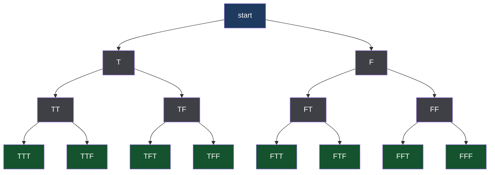
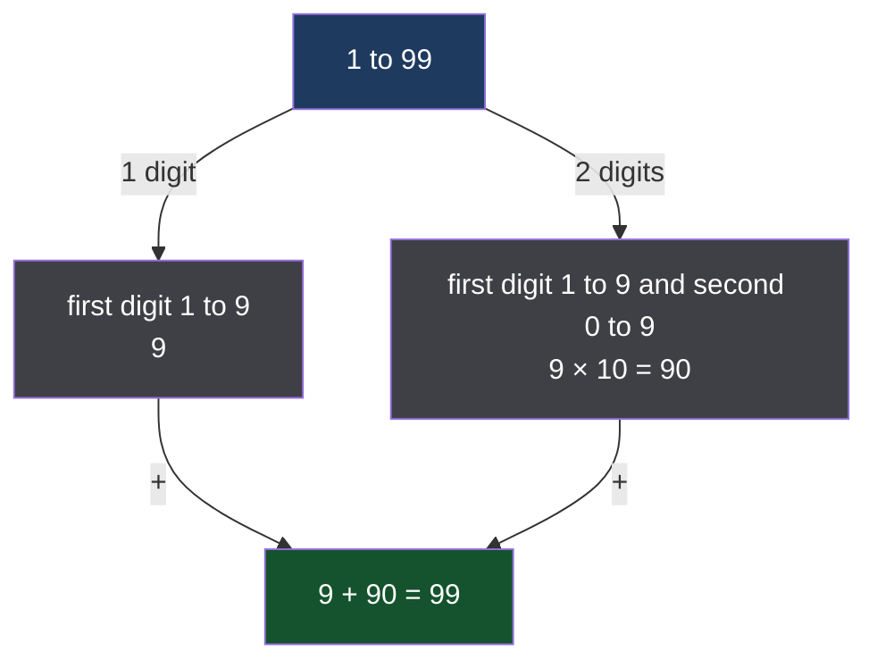
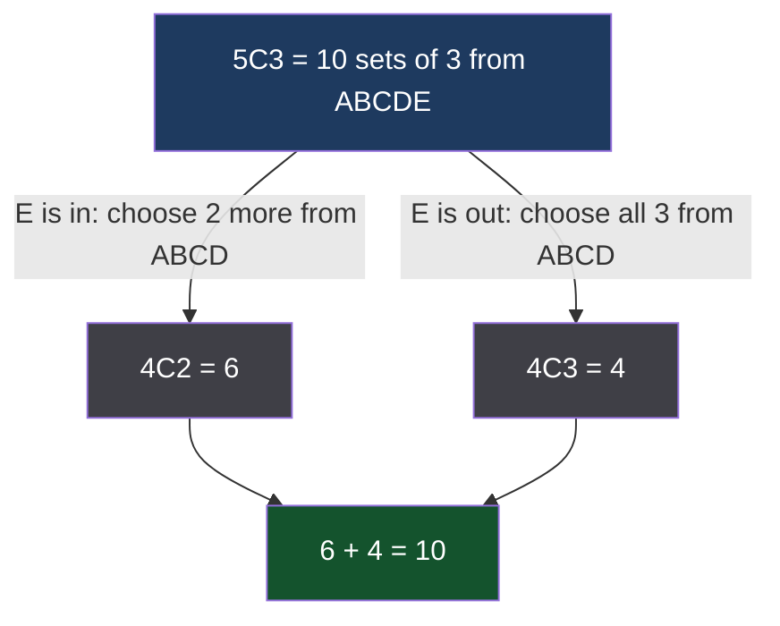
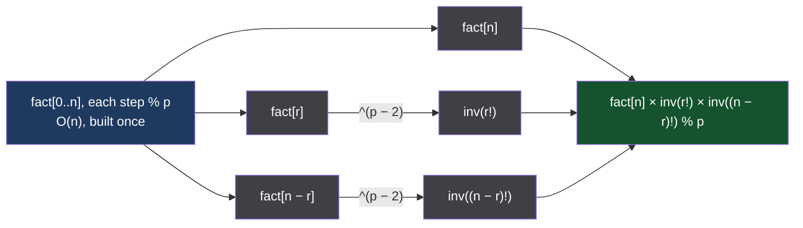

## Choices made one after another multiply

A string of 3 letters, each `T` or `F`, is built in three steps: pick letter 1, then letter 2, then letter 3. Each step has 2 options, and the number of options at a step does not depend on what was picked before. Steps like that are called **independent**.



Level 1 has 2 nodes. Each splits in 2, so level 2 has 2 × 2 = 4, and level 3 has 2 × 2 × 2 = 8. The tree is the full listing; the product is its size.

> [!note] Multiplication rule
> If a thing is built by a sequence of steps, and step i always has cᵢ options whatever was chosen earlier, the number of things is c₁ × c₂ × … × cₖ. The signal word is **and**: letter 1 **and** letter 2 **and** letter 3.

So n letters give 2ⁿ strings. Two nested loops are the same rule: the pairs of digits 00 to 99 are 10 choices for the first digit and 10 for the second, and the inner loop runs in full once per pass of the outer, 10 × 10 = 100 times.

| Letters n |                        2ⁿ |
| --------: | ------------------------: |
|         3 |                         8 |
|        20 |                 1,048,576 |
|        28 |               268,435,456 |
|        40 |         1,099,511,627,776 |
|        62 | 4,611,686,018,427,387,904 |

Listing every string costs one step per string. Building all strings of 28 letters one by one took 2,520 ms, and each 2 extra letters multiply the time by about 4, so 40 letters would take about 3 hours. The product gives 2⁴⁰ in 40 multiplications. The count has to come from the shape of the choices, not from visiting each outcome.

These products outgrow `long` fast (2⁶³ already wraps), which is why counting answers are asked mod 10⁹ + 7 and reduced after every multiplication; see [[01-modular-arithmetic]].

## Separate cases add

Count the whole numbers from 1 to 99. Every one of them has either 1 digit or 2 digits, never both. Cases that share no member are called **disjoint**.



Inside one case the multiplication rule works as before: a 2-digit number is a first digit **and** a second digit, 9 × 10 = 90. Across the cases the counts add, because every number sits in exactly one case: 9 + 90 = 99, which is right, since 1 to 99 holds 99 numbers. Multiplying the cases would give 9 × 90 = 810, and that counts something else: a pair made of one 1-digit number **and** one 2-digit number.

> [!note] Addition rule
> If every thing falls in exactly one of several cases, the total is the sum of the counts of the cases. The signal word is **or**: 1 digit **or** 2 digits.

> [!warning] The cases must be disjoint
> If a thing can sit in two cases at once, adding counts it twice. From 1 to 10 there are 5 even numbers and 3 multiples of 3, but 5 + 3 = 8 is wrong: 6 is in both, and the true count is 7.

## And multiplies, or adds

Most counting problems use both rules: split into disjoint cases with **or**, count each case as a chain of steps with **and**, then add the cases.

| The thing is built as           | Rule           | Operation | Example                        | Count |
| ------------------------------- | -------------- | --------- | ------------------------------ | ----: |
| step 1 and step 2 and …         | multiplication | multiply  | letter 1, 2 and 3, each T or F |     8 |
| step 1 and step 2               | multiplication | multiply  | first digit and second digit   |   100 |
| one case or another, never both | addition       | add       | 1 digit or 2 digits            |    99 |

## Lining up n things gives n!

Arrange the five letters A B C D E in a row. Position 1 has 5 options, position 2 has the 4 letters left, then 3, 2, 1. By the multiplication rule there are 5 × 4 × 3 × 2 × 1 = 120 rows. The product n × (n − 1) × … × 1 is **n factorial**, written n!. By agreement 0! = 1: there is one way to arrange nothing.

## Arranging r of n gives nPr = n! / (n − r)!

An ordered pick of 3 of the five letters, such as `ABC` or `BCA`, is a row of length 3: 5 options for the first place, 4 for the second, 3 for the third, so 5 × 4 × 3 = 60. This factorial that stops after r factors is **nPr**, n permute r:

nPr = n × (n − 1) × … × (n − r + 1) = n! / (n − r)!

Dividing by (n − r)! removes the factors from n − r down to 1 that the pick never uses: 5! / 2! = 120 / 2 = 60.

## Ignoring order divides by r!

Now count the sets of 3 letters, where `ABC` and `BCA` are the same set. Listing all 60 ordered picks and grouping them by their letters shows every set appearing exactly 6 times, once for each of its 3! orders: `ABC`, `ACB`, `BAC`, `BCA`, `CAB`, `CBA`. So the 60 ordered picks are the sets each counted 3! times, and dividing removes the repeat.


The number of ways to choose r of n when order does not matter is **nCr**, n choose r, also written C(n, r):

nCr = nPr / r! = n! / (r! × (n − r)!)

| Question           | Order matters | Formula                    | n = 5, r = 3 |
| ------------------ | ------------- | -------------------------- | -----------: |
| arrange all n      | yes           | n!                         |          120 |
| pick r and arrange | yes           | nPr = n! / (n − r)!        |           60 |
| choose r           | no            | nCr = n! / (r! × (n − r)!) |           10 |

## Factorials overflow a long at 21!

The factorial formula looks ready to code, but the factorials themselves do not fit:

| Value     |                In a `long` |                      Exact |
| --------- | -------------------------: | -------------------------: |
| 20!       |  2,432,902,008,176,640,000 |  2,432,902,008,176,640,000 |
| 21!       | −4,249,290,049,419,214,848 | 51,090,942,171,709,440,000 |
| C(21, 10) |                    −29,335 |                    352,716 |

20! is the last factorial below the `long` limit of about 9.2 × 10¹⁸. C(21, 10) is only 352,716, yet the formula returns −29,335 because its 21! had already wrapped. A `% m` at the end cannot repair a value that was wrong before the `%`.

> [!warning] Never compute nCr from long factorials once n > 20
> The result is silently wrong. The two ways out are below: build nCr from additions only (Pascal), or reduce every factorial mod p and replace the division by an inverse (Fermat).

## Four identities, each from counting twice

| Identity                 | Why                                                                      | Example                |
| ------------------------ | ------------------------------------------------------------------------ | ---------------------- |
| nC0 = nCn = 1            | one way to choose nothing, one way to choose everything                  | 5C0 = 5C5 = 1          |
| nC1 = n                  | choosing one item is naming it, and there are n names                    | 5C1 = 5                |
| nCr = nC(n − r)          | choosing the r that go in is the same act as choosing the n − r left out | 5C3 = 5C2 = 10         |
| nC0 + nC1 + … + nCn = 2ⁿ | see below                                                                | 1 + 4 + 6 + 4 + 1 = 16 |

The last one counts every subset of n items two ways. Each item is in or out, 2 independent options per item, so 2ⁿ subsets by the multiplication rule. Or sort the subsets by size: nCk of them have size k, and every subset has exactly one size, so the total is the sum of the nCk by the addition rule. The same subsets counted twice, so the two counts are equal. All four identities were checked against exact values for every n from 1 to 60 and every r, with 0 failures.

## Pascal's rule: the last item is in or out

Split the 10 sets of 3 from A B C D E by one question: is E in the set?



Every set is in exactly one case, so by the addition rule 5C3 = 4C2 + 4C3 = 6 + 4 = 10. The same split works for any n and r:

nCr = (n − 1)C(r − 1) + (n − 1)Cr

> [!tip] nCr is 0 when r > n
> Pascal's rule at r = n asks for (n − 1)Cn, and nobody can choose more items than exist. The code must return 0 there, not fail.

## The Pascal table needs only additions

Pascal's rule builds row n from row n − 1:

|   n | r = 0 |   1 |   2 |   3 |   4 |   5 |
| --: | ----: | --: | --: | --: | --: | --: |
|   0 |     1 |     |     |     |     |     |
|   1 |     1 |   1 |     |     |     |     |
|   2 |     1 |   2 |   1 |     |     |     |
|   3 |     1 |   3 |   3 |   1 |     |     |
|   4 |     1 |   4 |   6 |   4 |   1 |     |
|   5 |     1 |   5 |  10 |  10 |   5 |   1 |

Each entry is the one above it plus the one above and to the left. Row 4 is the 1, 4, 6, 4, 1 that sums to 2⁴, and row 5 holds 5C3 = 10.

Every entry is a sum, so it can be reduced mod m at every step, and two remainders below 10⁹ + 7 add to less than the `int` limit. The table never divides, so it works for **any modulus m, prime or not**. The cost is one addition per cell, O(n · r) time. The table up to n = 1,000 took 4 ms and gave C(1000, 500) % (10⁹ + 7) = 159,835,829, with all 501,500 entries matching exact values.

## One row is enough if j runs downward

Row n needs only row n − 1, so a single array can be updated in place, cutting memory to O(r). The update is row[j] = row[j] + row[j − 1], and both values on the right must still be from the previous row. Going from row 1 to row 2, starting from [1, 1, 0]:

| Direction | First step           | Second step          | Row 2     |
| --------- | -------------------- | -------------------- | --------- |
| downward  | j = 2: 0 + old 1 = 1 | j = 1: 1 + 1 = 2     | [1, 2, 1] |
| upward    | j = 1: 1 + 1 = 2     | j = 2: 0 + new 2 = 2 | [1, 2, 2] |

Upward, row[1] is overwritten before row[2] reads it. Each wrong entry feeds the next, and by row 4 the upward loop gives [1, 4, 9, 14, 14] instead of [1, 4, 6, 4, 1].

```java
static int nCr(int n, int r) {
    int[] row = new int[r + 1];
    row[0] = 1;
    for (int i = 1; i <= n; i++)
        for (int j = Math.min(i, r); j >= 1; j--)
            row[j] = (row[j] + row[j - 1]) % 1_000_000_007;
    return row[r];
}
```

> [!warning] An upward j loop compiles, runs and returns wrong numbers
> Loop j from min(i, r) down to 1.

## Pascal is too slow for n = 10⁶

The one-row update does about n × r additions. Measured with r = n / 2:

|      n |      r |   Time |
| -----: | -----: | -----: |
| 10,000 |  5,000 |  47 ms |
| 20,000 | 10,000 | 183 ms |
| 40,000 | 20,000 | 725 ms |

Each doubling of n multiplies the time by about 4. Going to n = 10⁶ is 25 times n and 25 times r, 625 times the work, about 8 minutes (extrapolated from the measured step, not run). For large n the factorial formula is needed again, with its two problems solved: overflow by reducing each factorial mod p as it is built, and division by an inverse.

## Division becomes a multiplication by the inverse

Reducing the factorials mod p and then dividing fails: C(20, 10) comes out as 0 instead of 184,756, because division does not work on remainders ([[01-modular-arithmetic]]). Dividing by a mod p means multiplying by the **modular inverse** of a, the x with a × x % p = 1; for a prime p, Fermat's little theorem gives it as a^(p − 2) % p, computed by fast power in about 30 steps. Both are taught in [[03-fast-power-and-inverse]]. The formula becomes:

nCr % p = n! × inv(r!) × inv((n − r)!) % p



The factorial array is built once for the largest n, and each nCr after that costs two fast powers. `power` is the fast power from [[03-fast-power-and-inverse]]:

```java
static final long MOD = 1_000_000_007;
static long[] fact;

static void build(int n) {
    fact = new long[n + 1];
    fact[0] = 1;
    for (int i = 1; i <= n; i++) fact[i] = fact[i - 1] * i % MOD;
}

static long nCr(int n, int r) {
    if (r < 0 || r > n) return 0;
    return fact[n] * power(fact[r], MOD - 2) % MOD * power(fact[n - r], MOD - 2) % MOD;
}
```

It gives C(5, 3) = 10, C(30, 15) = 155,117,520 and C(40000, 20000) = 990,659,852, the same as Pascal, and C(10⁶, 5 × 10⁵) = 996,692,777 in 7 ms including the factorial array.

| Method                         | Time         | Works for any modulus | C(10⁶, 5 × 10⁵) |
| ------------------------------ | ------------ | --------------------- | --------------- |
| one-row Pascal                 | O(n · r)     | yes                   | about 8 minutes |
| factorials, divide after %     | O(n)         | no                    | wrong           |
| factorials and Fermat inverses | O(n + log p) | prime p only          | 7 ms            |

## Fermat needs p prime, and r and n − r below p

The inverse method inherits two conditions:

- **p must be prime.** For a modulus that is not prime, a^(m − 2) is not the inverse, and for some a no inverse exists.
- **r! and (n − r)! must not be multiples of p.** k! contains the factor p exactly when k ≥ p, so both r < p and n − r < p are needed. The simple safe version is n < p, which implies both.

A small prime, p = 7, and the non-prime modulus 10 break them easily. The true values come from Pascal, which never divides:

| Case           | Fermat gives | True value | Why                                        |
| -------------- | -----------: | ---------: | ------------------------------------------ |
| C(8, 4) mod 7  |            0 |          0 | r = 4 and n − r = 4, both below 7: right   |
| C(8, 1) mod 7  |            0 |          1 | n − r = 7, so 7! is a multiple of 7: wrong |
| C(4, 2) mod 10 |            4 |          6 | 10 is not prime: wrong                     |

Across every n up to 40 with p = 7, all 49 cases with r < 7 and n − r < 7 were right, and 518 of the other 812 were wrong.

> [!warning] Small or non-prime modulus means Pascal
> With p = 10⁹ + 7 and n up to about 10⁶, n < p always holds. The trap is a problem whose modulus is small or not prime: there the Fermat method silently returns wrong values, and the Pascal table, which never divides, is the tool.
