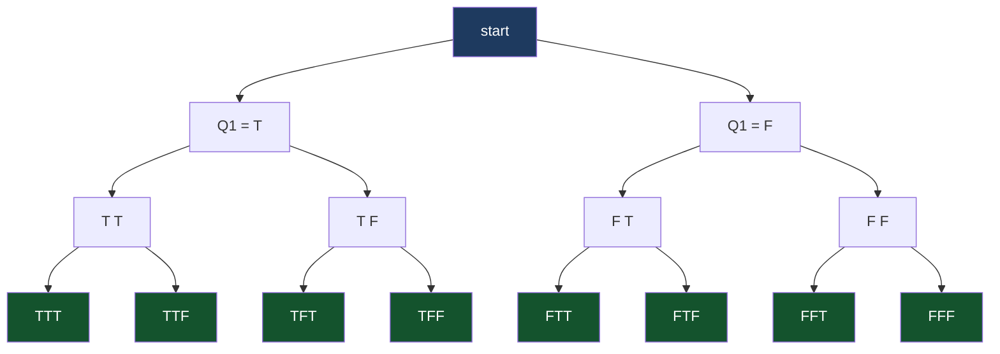
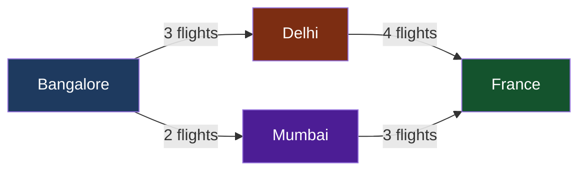

## The starting problem — answer sheets for a true/false quiz

**The task.** A quiz has `n` questions, and each is answered `T` (true) or `F` (false). Return how many different answer sheets a student can hand in. Two sheets are different if they differ in at least one answer.

**Example.**

|   n | Every possible sheet                   |   Expected output |
| --: | -------------------------------------- | ----------------: |
|   1 | T, F                                   |                 2 |
|   2 | TT, TF, FT, FF                         |                 4 |
|   3 | TTT, TTF, TFT, TFF, FTT, FTF, FFT, FFF |                 8 |
|  40 | too many to list                       | 1,099,511,627,776 |

**Why it matters.** Almost every counting problem is built from the two rules this quiz leads to: choices made one after another multiply, and separate cases add.

---

## The naive way — list every sheet

The direct way is to build every sheet: try `T` for question 1 and fill the rest, then try `F` for question 1 and fill the rest, and count the finished sheets.

```java
public class AnswerSheets {
    static long count;

    static void listAll(int question, int n, StringBuilder sheet, boolean print) {
        if (question == n) {
            count++;
            if (print) System.out.println(sheet);
            return;
        }
        for (char answer : new char[]{'T', 'F'}) {
            sheet.append(answer);
            listAll(question + 1, n, sheet, print);
            sheet.deleteCharAt(sheet.length() - 1);
        }
    }

    public static void main(String[] args) {
        count = 0;
        listAll(0, 3, new StringBuilder(), true);
        System.out.println("n=3  sheets=" + count);

        for (int n = 20; n <= 28; n += 2) {
            count = 0;
            long start = System.nanoTime();
            listAll(0, n, new StringBuilder(), false);
            long ms = (System.nanoTime() - start) / 1_000_000;
            System.out.println("n=" + n + "  sheets=" + count + "  time=" + ms + " ms");
        }
    }
}
```

Run:
```text
TTT
TTF
TFT
TFF
FTT
FTF
FFT
FFF
n=3  sheets=8
n=20  sheets=1048576  time=15 ms
n=22  sheets=4194304  time=51 ms
n=24  sheets=16777216  time=175 ms
n=26  sheets=67108864  time=633 ms
n=28  sheets=268435456  time=2520 ms
```

For 3 questions there are 8 sheets, all listed above. But every 2 extra questions multiply the time by about 4: 175 ms, 633 ms, 2520 ms. At 28 questions it already takes 2.5 seconds. Going from 28 to 40 questions is six more steps of 4, so about 2.5 × 4096 ≈ 10,300 seconds, close to 3 hours (extrapolated from the measured step, not run).

> [!danger] Listing gives the right count, but a 40-question quiz takes hours. The count has to come from the shape of the choices, not from visiting each sheet.

---

## Why it breaks — listing costs one step per outcome

The program does no wasted work: each sheet is built once. The problem is that it builds them at all. Counting by listing can never be faster than the number of things listed, and that number doubles with every question. What is needed is a way to read the count off the structure of the choices.

---

## Choices made one after another multiply — the multiplication rule

A sheet is filled in three steps: answer question 1, then question 2, then question 3. Each step has 2 options, and the number of options at a step does not depend on what was picked at the earlier steps. Steps like that are called **independent**.



Level 1 of the tree has 2 nodes. Each of them splits in 2, so level 2 has 2 × 2 = 4. Each of those splits in 2 again, so level 3 has 2 × 2 × 2 = 8, which are exactly the 8 sheets listed by the brute force. The tree is the listing; the product is its size.

> [!important] **Multiplication rule.** If a thing is built by a sequence of steps, and step `i` always has `c_i` options no matter what was chosen at the earlier steps, the number of things is `c_1 × c_2 × ... × c_k`. The signal word is **and**: answer Q1 **and** Q2 **and** Q3.

For a quiz of `n` questions that is `2^n`. The program below computes it with a plain loop and also checks the second example: a class has 10 boys and 10 girls, and a pair is one boy **and** one girl. Pick the boy (10 options), then the girl (10 options for every boy).

```java
public class MultiplicationRule {
    public static void main(String[] args) {
        for (int n : new int[]{3, 20, 28, 40, 62}) {
            long sheets = 1;
            for (int q = 0; q < n; q++) sheets *= 2;
            System.out.println("n=" + n + "  2^n=" + sheets);
        }

        int boys = 10, girls = 10;
        int listed = 0;
        for (int b = 1; b <= boys; b++) {
            for (int g = 1; g <= girls; g++) {
                listed++;
            }
        }
        System.out.println("boy-girl pairs listed=" + listed + "  boys*girls=" + boys * girls);
    }
}
```

Run:
```text
n=3  2^n=8
n=20  2^n=1048576
n=28  2^n=268435456
n=40  2^n=1099511627776
n=62  2^n=4611686018427387904
boy-girl pairs listed=100  boys*girls=100
```

The rule matches the brute force at `n = 3, 20, 28`, and gives the 40-question answer, 1,099,511,627,776, in 40 multiplications instead of 3 hours. The nested loops listed 100 boy-girl pairs, the same as 10 × 10. Two nested loops are the multiplication rule written as code: the inner loop runs in full once for every pass of the outer one.

> [!warning] The count grows fast. `2^62` still fits in a `long` (largest value about `9.22 × 10^18`), but `2^63` does not, and `2^31` already overflows an `int` (largest value 2,147,483,647). LeetCode counting problems return the answer modulo `10^9 + 7` for exactly this reason; the product is then reduced after every multiplication, since `(a × b) mod m = ((a mod m) × (b mod m)) mod m`.

---

## Separate ways add — the addition rule

A new question. To fly from Bangalore to France a traveller can go **via Delhi** or **via Mumbai**. There are 3 flights from Bangalore to Delhi and 4 from Delhi to France; there are 2 flights from Bangalore to Mumbai and 3 from Mumbai to France. How many routes are there?

Each route is one of two kinds, and a route cannot be both kinds at once, because it stops either in Delhi or in Mumbai. Cases that share no member are called **disjoint**.



Inside one case the multiplication rule works as before: via Delhi is a Bangalore-Delhi flight **and** a Delhi-France flight, 3 × 4 = 12 routes; via Mumbai is 2 × 3 = 6 routes. Across the cases the counts add, because every route sits in exactly one case. The program lists every route by name to check.

```java
import java.util.ArrayList;
import java.util.List;

public class Routes {
    public static void main(String[] args) {
        String[] bangaloreToDelhi = {"BD1", "BD2", "BD3"};
        String[] delhiToFrance = {"DF1", "DF2", "DF3", "DF4"};
        String[] bangaloreToMumbai = {"BM1", "BM2"};
        String[] mumbaiToFrance = {"MF1", "MF2", "MF3"};

        List<String> routes = new ArrayList<>();
        for (String first : bangaloreToDelhi)
            for (String second : delhiToFrance)
                routes.add(first + "+" + second);
        int viaDelhi = routes.size();
        for (String first : bangaloreToMumbai)
            for (String second : mumbaiToFrance)
                routes.add(first + "+" + second);
        int viaMumbai = routes.size() - viaDelhi;

        System.out.println("via Delhi listed=" + viaDelhi + "  3*4=" + 3 * 4);
        System.out.println("via Mumbai listed=" + viaMumbai + "  2*3=" + 2 * 3);
        System.out.println("all routes listed=" + routes.size() + "  3*4 + 2*3=" + (3 * 4 + 2 * 3));
        System.out.println("wrong, multiplying the cases: (3*4)*(2*3)=" + (3 * 4) * (2 * 3));
        System.out.println("first routes: " + routes.subList(0, 5));
    }
}
```

Run:
```text
via Delhi listed=12  3*4=12
via Mumbai listed=6  2*3=6
all routes listed=18  3*4 + 2*3=18
wrong, multiplying the cases: (3*4)*(2*3)=72
first routes: [BD1+DF1, BD1+DF2, BD1+DF3, BD1+DF4, BD2+DF1]
```

The listing finds 18 routes, which is 12 + 6. Multiplying the two cases would give 72, and that number counts something else: a pair made of one Delhi route **and** one Mumbai route, which is two trips, not one.

> [!important] **Addition rule.** If every thing falls in exactly one of several cases, the total is the sum of the counts of the cases. The signal word is **or**: via Delhi **or** via Mumbai.

> [!warning] The addition rule needs the cases to be disjoint. If a thing could sit in two cases at once, adding counts it twice. Before adding, check that no single thing belongs to two cases.

---

## Telling the two rules apart

Most counting problems mix both rules: split into cases with **or**, count each case as a chain of steps with **and**, then add the cases.

| Question to ask                                | Answer       | Rule           | Operation | Example                 | Count |
| ---------------------------------------------- | ------------ | -------------- | --------- | ----------------------- | ----: |
| Is the thing built by doing step 1 and step 2? | and          | Multiplication | multiply  | answer Q1 and Q2 and Q3 |     8 |
| Is the thing built by doing step 1 and step 2? | and          | Multiplication | multiply  | one boy and one girl    |   100 |
| Does the thing take one path or another path?  | or, disjoint | Addition       | add       | via Delhi or via Mumbai |    18 |

> [!tip] A quick self-check: count the smallest case by listing, as with the 8 sheets of a 3-question quiz above. If the formula and the listing disagree, a rule was applied where its condition does not hold.

---

## On LeetCode

- count-good-numbers (LC 1922, 1675) — multiplication rule: every even index has 5 digit options and every odd index has 4, so the count is a product of two powers, taken modulo `10^9 + 7` with fast power.
- count-number-of-ways-to-place-houses (LC 2320, 1608) — the two sides of the street are independent steps, so the answer is the count for one side multiplied by itself.
- ways-to-split-array-into-good-subarrays (LC 2750, 1598) — the cut between each pair of neighbouring 1s is chosen independently, so the numbers of cut positions in the gaps multiply.
- count-number-of-texts (LC 2266, 1857) — the pressed string splits into runs of one key, each run is decoded independently and the counts multiply; inside a run, the last letter is one of a few disjoint cases whose counts add.
