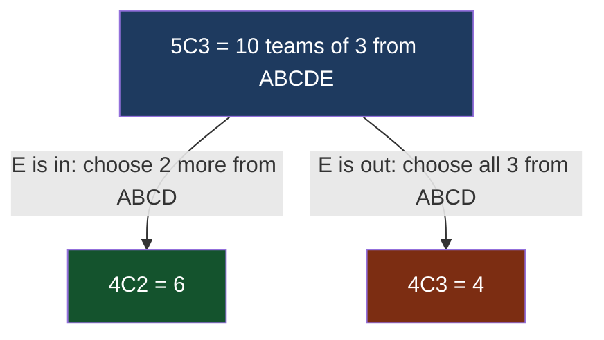

## The starting problem — five people, a line, a podium and a team

**The task.** Five people, `A B C D E`, run a race. Answer three questions:

| Question                                                                                                                  | Does order matter? | Expected output |
| ------------------------------------------------------------------------------------------------------------------------- | ------------------ | --------------: |
| In how many orders can all five stand in a line?                                                                          | yes                |             120 |
| In how many ways can gold, silver and bronze go to three of them? Gold A with silver B differs from gold B with silver A. | yes                |              60 |
| In how many ways can a team of three be picked? ABC and BCA are the same team.                                            | no                 |              10 |

Then the same questions for 1000 people, answered mod 10⁹ + 7.

**Why it matters.** Arranging, ranking and choosing are the three shapes behind most counting problems, and telling which one a problem asks for is half of solving it.

---

## The naive way — build every arrangement and count

The program builds every ordered pick of `r` people by trying each unused person in each position. For teams it sorts the letters of each podium, so `BCA` and `ABC` both become `ABC`, and counts the distinct results. Then it times lining up 9, 10 and 11 people.

```java
import java.util.*;

public class Enumerate {
    static void build(String people, int r, String picked, List<String> out) {
        if (picked.length() == r) { out.add(picked); return; }
        for (char p : people.toCharArray())
            if (picked.indexOf(p) < 0) build(people, r, picked + p, out);
    }

    static String sorted(String s) {
        char[] c = s.toCharArray();
        Arrays.sort(c);
        return new String(c);
    }

    public static void main(String[] args) {
        List<String> lines = new ArrayList<>(), podiums = new ArrayList<>();
        build("ABCDE", 5, "", lines);
        build("ABCDE", 3, "", podiums);
        Map<String, Integer> teams = new TreeMap<>();
        for (String p : podiums) teams.merge(sorted(p), 1, Integer::sum);
        System.out.println("lines=" + lines.size() + "  podiums=" + podiums.size() + "  teams=" + teams.size());
        System.out.println("podiums per team: " + new TreeSet<>(teams.values()));
        System.out.println("podiums of team ABC: " + podiums.stream().filter(p -> sorted(p).equals("ABC")).toList());
        System.out.println("teams with E: " + teams.keySet().stream().filter(t -> t.contains("E")).count());
        for (int n = 9; n <= 11; n++) {
            List<String> all = new ArrayList<>();
            long start = System.nanoTime();
            build("ABCDEFGHIJK".substring(0, n), n, "", all);
            System.out.println("line up " + n + ": " + all.size() + " in " + (System.nanoTime() - start) / 1_000_000 + " ms");
        }
    }
}
```

Run:
```text
lines=120  podiums=60  teams=10
podiums per team: [6]
podiums of team ABC: [ABC, ACB, BAC, BCA, CAB, CBA]
teams with E: 6
line up 9: 362880 in 56 ms
line up 10: 3628800 in 506 ms
line up 11: 39916800 in 6494 ms
```

The answers are 120 lines, 60 podiums and 10 teams. But every extra person multiplies the time by about 10: 56 ms for 9 people, 506 ms for 10, 6494 ms for 11. Each step makes one outcome, and adding a person multiplies the outcomes by `n`, so 1000 people is out of reach. The counts have to come from the structure of the choices, using the multiplication rule: a chain of independent choices has as many outcomes as the product of the numbers of options.

---

## Lining up n people — n!

Fill the line one position at a time. Position 1 has 5 options, position 2 has the 4 people left, then 3, 2, 1. By the multiplication rule there are `5 × 4 × 3 × 2 × 1 = 120` lines. The product `n × (n-1) × ... × 1` is **n factorial**, written `n!`. By agreement `0! = 1`: there is one way to line up nobody.

## Picking r and arranging them — nPr

A podium is a line of length 3: gold has 5 options, silver 4, bronze 3, so `5 × 4 × 3 = 60`. This factorial that stops after `r` factors is written `nPr`, **n permute r**, the number of ordered picks of `r` out of `n`:

`nPr = n × (n-1) × ... × (n-r+1) = n! / (n-r)!`

Dividing by `(n-r)!` removes the factors from `n-r` down to 1 that the podium never uses: `5! / 2! = 120 / 2 = 60`.

## Choosing r when order does not matter — nCr = nPr / r!

The run printed `podiums per team: [6]`: every team appears as exactly 6 podiums, the `3! = 6` orders of its members, listed above for `ABC`. So the 60 podiums are the 10 teams each counted `3!` times, and dividing removes the repeat. The number of ways to choose `r` out of `n` when order does not matter is `nCr`, **n choose r**:

`nCr = nPr / r! = n! / (r! × (n-r)!)`


| Question           | Order matters | Formula                | 5 people, r = 3 |
| ------------------ | ------------- | ---------------------- | --------------: |
| line up all n      | yes           | n!                     |             120 |
| pick r and arrange | yes           | nPr = n! / (n-r)!      |              60 |
| choose r           | no            | nCr = n! / (r! (n-r)!) |              10 |

---

## The factorial formula overflows a long at 21!

`n! / (r! (n-r)!)` looks ready to code. The program computes factorials in a `long` beside the exact value from `BigInteger`, Java's class for integers of any size.

```java
import java.math.BigInteger;

public class Factorials {
    public static void main(String[] args) {
        long[] fact = new long[23];
        BigInteger[] exact = new BigInteger[23];
        fact[0] = 1;
        exact[0] = BigInteger.ONE;
        for (int i = 1; i <= 22; i++) {
            fact[i] = fact[i - 1] * i;
            exact[i] = exact[i - 1].multiply(BigInteger.valueOf(i));
            if (i >= 20) System.out.println(i + "!  long=" + fact[i] + "  exact=" + exact[i]);
        }
        System.out.println("Long.MAX_VALUE = " + Long.MAX_VALUE);
        System.out.println("C(21,10) by long factorials = " + fact[21] / (fact[10] * fact[11]));
        System.out.println("C(21,10) exact              = " + exact[21].divide(exact[10].multiply(exact[11])));
    }
}
```

Run:
```text
20!  long=2432902008176640000  exact=2432902008176640000
21!  long=-4249290049419214848  exact=51090942171709440000
22!  long=-1250660718674968576  exact=1124000727777607680000
Long.MAX_VALUE = 9223372036854775807
C(21,10) by long factorials = -29335
C(21,10) exact              = 352716
```

`20!` is the last factorial that fits. `21!` is about `5.1 × 10^19`, above the `long` maximum, and wraps to a negative number. `C(21, 10)` is only 352,716, yet the formula returns `-29335` because its intermediate `21!` had already overflowed. A `% m` at the end cannot repair a value that was wrong before the `%`. What is needed is a way to build `nCr` from additions only, which can be reduced modulo `m` at every step.

> [!warning] Never compute `nCr` from `long` factorials once `n > 20`. The result is silently wrong.

---

## The identities, each with its reason

- **`nC0 = nCn = 1`.** One way to choose nobody, one way to choose everybody.
- **`nC1 = n`.** Choosing one item is naming it, and there are `n` names.
- **`nCr = nC(n-r)`.** Choosing the `r` who go to the final is the same act as choosing the `n-r` who stay behind: `5C3 = 5C2 = 10`.
- **`nC0 + nC1 + ... + nCn = 2^n`.** Count every group of any size, the pick anything count, two ways. Each item is in or out, 2 independent options per item, so `2^n` groups by the multiplication rule. Or sort the groups by size: `nCk` of them have size `k`, every group has one size, so the total is the sum of `nCk` by the addition rule. Same groups, so the two counts are equal. For 4 items the sizes give `1, 4, 6, 4, 1` (row 4 of the table below), adding to 16 = `2^4`.

## Pascal's rule — include or exclude the last item

Split the 10 teams of 3 from `A B C D E` by one question: is `E` in the team?

- **`E` is in:** the other 2 come from `A B C D`, so `4C2 = 6` teams.
- **`E` is out:** all 3 come from `A B C D`, so `4C3 = 4` teams.

Every team is in exactly one case, so by the addition rule `5C3 = 4C2 + 4C3 = 6 + 4 = 10`; the run above printed `teams with E: 6`. The same split works for any `n` and `r`:

`nCr = (n-1)C(r-1) + (n-1)Cr`



Every identity above was checked against exact `BigInteger` values for every `n` from 1 to 60 and every `r`: 0 failures in all of them.

> [!tip] `nCr` must return 0 when `r > n`: Pascal's rule at `r = n` asks for `(n-1)Cn`, and nobody can choose more items than exist.

---

## The Pascal table — nCr % m with additions only

Pascal's rule builds row `i` from row `i-1`, and each entry is a sum, so it can be reduced at every step: `(a + b) mod m = ((a mod m) + (b mod m)) mod m`. Two values below `10^9 + 7` add to less than the `int` maximum of 2,147,483,647, so nothing overflows.

```java
public class PascalTable {
    static final int MOD = 1_000_000_007;

    static int[][] build(int n, int r) {
        int[][] c = new int[n + 1][r + 1];
        for (int i = 0; i <= n; i++) {
            c[i][0] = 1;
            for (int j = 1; j <= Math.min(i, r); j++)
                c[i][j] = (c[i - 1][j - 1] + c[i - 1][j]) % MOD;
        }
        return c;
    }

    public static void main(String[] args) {
        int[][] small = build(5, 5);
        for (int i = 0; i <= 5; i++) System.out.println("n=" + i + ": " + java.util.Arrays.toString(java.util.Arrays.copyOf(small[i], i + 1)));

        long start = System.nanoTime();
        int[][] c = build(1000, 1000);
        System.out.println("table to n=1000 in " + (System.nanoTime() - start) / 1_000_000 + " ms, C(1000,500) % MOD = " + c[1000][500]);
    }
}
```

Run:
```text
n=0: [1]
n=1: [1, 1]
n=2: [1, 2, 1]
n=3: [1, 3, 3, 1]
n=4: [1, 4, 6, 4, 1]
n=5: [1, 5, 10, 10, 5, 1]
table to n=1000 in 4 ms, C(1000,500) % MOD = 159835829
```

Row 4 is the `1, 4, 6, 4, 1` of the pick anything count, and row 5 holds `5C3 = 10`. All 501,500 entries up to `n = 1000` were checked against exact `BigInteger` values reduced modulo `10^9 + 7`: 0 wrong. The cost is one addition per cell, **O(n · r) time** and **O(n · r) memory**. It suits `n` up to a few thousand, and it works for any modulus `m`, prime or not, because it never divides.

---

## One row is enough — but j must go downward

Row `i` needs only row `i-1`, so a single array can be updated in place, row after row. Memory drops to **O(r)**; time stays O(n · r). The direction of the inner loop decides whether it works.

```java
import java.util.Arrays;

public class OneRow {
    static final int MOD = 1_000_000_007;

    static int[] row(int n, int r, boolean downward) {
        int[] row = new int[r + 1];
        row[0] = 1;
        for (int i = 1; i <= n; i++) {
            int top = Math.min(i, r);
            if (downward) for (int j = top; j >= 1; j--) row[j] = (row[j] + row[j - 1]) % MOD;
            else for (int j = 1; j <= top; j++) row[j] = (row[j] + row[j - 1]) % MOD;
        }
        return row;
    }

    public static void main(String[] args) {
        System.out.println("row 2, j downward: " + Arrays.toString(row(2, 2, true)));
        System.out.println("row 2, j upward:   " + Arrays.toString(row(2, 2, false)));
        System.out.println("row 4, j downward: " + Arrays.toString(row(4, 4, true)));
        System.out.println("row 4, j upward:   " + Arrays.toString(row(4, 4, false)));
        System.out.println("C(1000,500) % MOD, downward = " + row(1000, 500, true)[500]);
    }
}
```

Run:
```text
row 2, j downward: [1, 2, 1]
row 2, j upward:   [1, 2, 2]
row 4, j downward: [1, 4, 6, 4, 1]
row 4, j upward:   [1, 4, 9, 14, 14]
C(1000,500) % MOD, downward = 159835829
```

The update is `row[j] = row[j] + row[j-1]`, and both values on the right must still be from the previous row. Trace row 1 to row 2 upward, starting from `[1, 1, 0]`: `row[1] = 1 + 1 = 2`, correct; then `row[2] = 0 + row[1]`, but `row[1]` is already the new 2, so `row[2] = 2` instead of `0 + 1 = 1`. Downward, `row[2]` is computed first, while `row[1]` still holds the old 1. Upward, each wrong entry feeds the next, and by row 4 the result is `1 4 9 14 14`.

> [!warning] In the one-row Pascal update, loop `j` from `min(i, r)` down to 1. An upward loop compiles, runs and returns wrong numbers.

The downward version gives the same `C(1000, 500) % MOD = 159835829` as the full table.

---

## On LeetCode

- pascals-triangle (LC 118, not rated) — build the table row by row with Pascal's rule.
- pascals-triangle-ii (LC 119, not rated) — one row in O(r) memory: the in-place update with `j` going downward.
- unique-paths (LC 62, not rated) — a path through an `m × n` grid is a choice of which `m-1` of its `m+n-2` moves go down, so the answer is `(m+n-2)C(m-1)`.
- find-triangular-sum-of-an-array (LC 2221, 1317) — the final value is the sum of `(n-1)Ci × nums[i]` mod 10; 10 is not prime, so the coefficients come from a Pascal row, which never divides.
- number-of-ways-to-reorder-array-to-get-same-bst (LC 1569, 2288) — the left and right subtrees interleave in `(L+R)CL` ways, read from a Pascal table modulo `10^9 + 7`.
