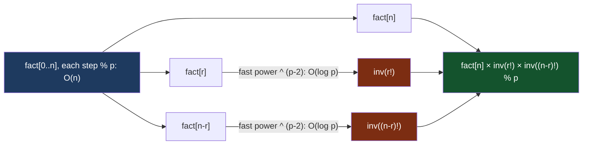

## The starting problem — C(1000000, 500000) mod 10^9 + 7

**The task.** You get `n` and `r`, with `n` up to 10⁶. Return `nCr`, the number of ways to choose `r` items out of `n` when order does not matter, mod `p = 10⁹ + 7`. It equals `n! / (r! × (n-r)!)`, and it also follows Pascal's rule `nCr = (n-1)C(r-1) + (n-1)Cr`.

**Example.**

|   n |       r | nCr                 | Expected output |
| --: | ------: | ------------------- | --------------: |
|   5 |       3 | 10                  |              10 |
|  30 |      15 | 155,117,520         |     155,117,520 |
| 10⁶ | 5 × 10⁵ | 301,027 digits long |     996,692,777 |

**Why it matters.** Counting problems with large inputs, such as choosing positions, paths through a grid or arrangements with repeats, reduce to `nCr` mod 10⁹ + 7, often for many different `n` and `r`.

---

## The naive way — the one-row Pascal update

Pascal's rule uses only additions, so every step can be reduced modulo `p` and nothing overflows. The one-row version updates a single array in place, with `j` going downward so that `row[j-1]` still holds the previous row's value.

```java
public class SlowPascal {
    static final int MOD = 1_000_000_007;

    static int nCr(int n, int r) {
        int[] row = new int[r + 1];
        row[0] = 1;
        for (int i = 1; i <= n; i++)
            for (int j = Math.min(i, r); j >= 1; j--)
                row[j] = (row[j] + row[j - 1]) % MOD;
        return row[r];
    }

    public static void main(String[] args) {
        for (int n : new int[]{10_000, 20_000, 40_000}) {
            long start = System.nanoTime();
            int c = nCr(n, n / 2);
            long ms = (System.nanoTime() - start) / 1_000_000;
            System.out.println("C(" + n + "," + n / 2 + ") % MOD = " + c + "  time=" + ms + " ms");
        }
    }
}
```

Run:
```text
C(10000,5000) % MOD = 2413012  time=47 ms
C(20000,10000) % MOD = 703593270  time=183 ms
C(40000,20000) % MOD = 990659852  time=725 ms
```

The answers are correct, but each doubling of `n` multiplies the time by about 4: 47 ms, 183 ms, 725 ms. The loop does about `n × r` additions. Going from `n = 40,000` to `1,000,000` is 25 times the `n` and 25 times the `r`, so 625 times the work: about 725 ms × 625 ≈ 8 minutes (extrapolated from the measured step, not run).

> [!danger] Pascal is correct and costs O(n · r). At `n = 10^6` it takes minutes, far beyond a LeetCode time limit.

---

## Why the factorial formula does not just work

The factorial formula needs only `n` multiplications. The factorials themselves overflow a `long` from `21!` onward, so each one has to be reduced as it is built, using the rule `(a × b) mod p = ((a mod p) × (b mod p)) mod p`. That gives `n! % p`, `r! % p` and `(n-r)! % p`. The trouble is the division. The program reduces the factorials and then divides.

```java
import java.math.BigInteger;

public class DivideAfterMod {
    static final long MOD = 1_000_000_007;

    public static void main(String[] args) {
        for (int n : new int[]{10, 20, 30}) {
            int r = n / 2;
            long[] fact = new long[n + 1];
            fact[0] = 1;
            for (int i = 1; i <= n; i++) fact[i] = fact[i - 1] * i % MOD;
            long divided = fact[n] / (fact[r] * fact[n - r] % MOD);

            BigInteger exact = BigInteger.ONE;
            for (int i = 0; i < r; i++)
                exact = exact.multiply(BigInteger.valueOf(n - i)).divide(BigInteger.valueOf(i + 1));
            System.out.println("C(" + n + "," + r + ")  divide after %: " + divided
                    + "  correct: " + exact.mod(BigInteger.valueOf(MOD)));
        }
    }
}
```

Run:
```text
C(10,5)  divide after %: 252  correct: 252
C(20,10)  divide after %: 0  correct: 184756
C(30,15)  divide after %: 0  correct: 155117520
```

At `n = 10` nothing was reduced yet (`10! = 3,628,800` is below `p`), so plain division works. From `n = 20` the factorials are remainders, and the remainder of a product says nothing about the remainder of a quotient: `20! % p` is just some number below `p`, not a multiple of `10! % p` squared, so the integer division returns 0.

> [!warning] Division does not survive `% p`. The rule `(a × b) mod p = ((a mod p) × (b mod p)) mod p` exists for `+`, `-` and `×`, but there is no such rule for `/`. Dividing reduced values gives wrong answers with no error.

---

## Dividing by a means multiplying by the inverse of a

The **modular inverse** of `a` modulo `p` is the number `x` in `1 .. p-1` with `(a × x) % p = 1`. It plays the role of `1/a`: instead of dividing by `a`, multiply by `x`. For example, the inverse of 2 modulo `10^9 + 7` is 500,000,004, because `2 × 500,000,004 = 1,000,000,008`, which leaves remainder 1.

So the division in the factorial formula becomes two multiplications:

`nCr % p = n! × inv(r!) × inv((n-r)!) % p`

with every factorial reduced modulo `p` as it is built.

---

## Fermat gives the inverse: a^(p-2) mod p

**Fermat's little theorem** says that when `p` is prime and `a` is not a multiple of `p`, `a^(p-1) % p = 1`. Split one factor off: `a × a^(p-2) % p = 1`. That is exactly the definition of the inverse, so:

`inv(a) = a^(p-2) % p`

The exponent `p - 2 = 1,000,000,005` is far too large to multiply out one step at a time. **Fast power** computes it in about `log2(p) ≈ 30` steps: write the exponent in binary, square the base at every step, and multiply the result by the current base whenever the current bit of the exponent is 1. Each product is reduced modulo `p`, and two values below `p` multiply to less than about `10^18`, which fits in a `long`.



---

## The full method in code

```java
public class NcrModP {
    static final long MOD = 1_000_000_007;

    static long power(long base, long exp) {
        long result = 1;
        base %= MOD;
        while (exp > 0) {
            if ((exp & 1) == 1) result = result * base % MOD;
            base = base * base % MOD;
            exp >>= 1;
        }
        return result;
    }

    static long inverse(long a) {
        return power(a, MOD - 2);
    }

    static long nCr(int n, int r) {
        if (r < 0 || r > n) return 0;
        long[] fact = new long[n + 1];
        fact[0] = 1;
        for (int i = 1; i <= n; i++) fact[i] = fact[i - 1] * i % MOD;
        return fact[n] * inverse(fact[r]) % MOD * inverse(fact[n - r]) % MOD;
    }

    public static void main(String[] args) {
        System.out.println("inverse(2) = " + inverse(2) + "  2 * inverse(2) % MOD = " + 2 * inverse(2) % MOD);
        System.out.println("C(5,3) = " + nCr(5, 3));
        System.out.println("C(30,15) = " + nCr(30, 15));
        System.out.println("C(40000,20000) = " + nCr(40_000, 20_000));
        long start = System.nanoTime();
        long big = nCr(1_000_000, 500_000);
        long ms = (System.nanoTime() - start) / 1_000_000;
        System.out.println("C(1000000,500000) = " + big + "  time=" + ms + " ms");
    }
}
```

Run:
```text
inverse(2) = 500000004  2 * inverse(2) % MOD = 1
C(5,3) = 10
C(30,15) = 155117520
C(40000,20000) = 990659852
C(1000000,500000) = 996692777  time=7 ms
```

The check `2 × inverse(2) % MOD = 1` confirms the inverse. `C(5,3) = 10` is the small case; `C(30,15) = 155117520` is the value the divide-after-mod version got wrong; `C(40000,20000)` matches the Pascal run above. `C(1000000, 500000)` took 7 ms, against the minutes Pascal would need.

The cost: building the factorial array is `n` multiplications, **O(n)**, and the two inverses are two fast powers, **O(log p)** each. In total **O(n + log p)** time and O(n) memory for the array.

The method matched exact `BigInteger` values on 10,030 random inputs: 10,000 with `n` up to 2000 and every `r`, and 30 with `n` up to `10^6` and `r` or `n - r` at most 300, with 0 wrong. The three large values above also match an independent exact computation of `C(n, r)` reduced modulo `p`.

| Method                       | Time         | Works for any modulus | `C(10^6, 5 × 10^5)`    |
| ---------------------------- | ------------ | --------------------- | ---------------------- |
| one-row Pascal               | O(n · r)     | yes                   | minutes (extrapolated) |
| factorials, divide after `%` | O(n)         | no                    | wrong                  |
| factorials and Fermat        | O(n + log p) | prime `p` only        | 7 ms                   |

---

## The condition — p prime, and r and n-r below p

Fermat's theorem needs two things, and the method inherits both.

- **`p` must be prime.** For a modulus that is not prime, `a^(m-2)` is not the inverse, and for some `a` no inverse exists at all.
- **The numbers being inverted, `r!` and `(n-r)!`, must not be multiples of `p`.** A factorial `k!` contains the factor `p` exactly when `k ≥ p`. So both `r < p` and `n - r < p` are needed. The safe and simple version is `n < p`, which implies both.

The program tests both conditions with a small prime, `p = 7`, where they are easy to break, and with the non-prime modulus 10. The true values come from the Pascal update, which never divides and so works for any modulus.

```java
public class Conditions {
    static long power(long base, long exp, long m) {
        long result = 1;
        base %= m;
        while (exp > 0) {
            if ((exp & 1) == 1) result = result * base % m;
            base = base * base % m;
            exp >>= 1;
        }
        return result;
    }

    static long fermatNcr(int n, int r, long m) {
        long[] fact = new long[n + 1];
        fact[0] = 1;
        for (int i = 1; i <= n; i++) fact[i] = fact[i - 1] * i % m;
        return fact[n] * power(fact[r], m - 2, m) % m * power(fact[n - r], m - 2, m) % m;
    }

    static long pascalNcr(int n, int r, long m) {
        long[] row = new long[r + 1];
        row[0] = 1 % m;
        for (int i = 1; i <= n; i++)
            for (int j = Math.min(i, r); j >= 1; j--) row[j] = (row[j] + row[j - 1]) % m;
        return row[r];
    }

    public static void main(String[] args) {
        long p = 7;
        System.out.println("p=7  C(8,4): fermat=" + fermatNcr(8, 4, p) + "  true=" + pascalNcr(8, 4, p));
        System.out.println("p=7  C(8,1): fermat=" + fermatNcr(8, 1, p) + "  true=" + pascalNcr(8, 1, p));
        int okCases = 0, okWrong = 0, badCases = 0, badWrong = 0;
        for (int n = 0; n <= 40; n++) {
            for (int r = 0; r <= n; r++) {
                boolean wrong = fermatNcr(n, r, p) != pascalNcr(n, r, p);
                if (r < p && n - r < p) { okCases++; if (wrong) okWrong++; }
                else { badCases++; if (wrong) badWrong++; }
            }
        }
        System.out.println("p=7, n<=40, r and n-r < p:  cases=" + okCases + "  wrong=" + okWrong);
        System.out.println("p=7, n<=40, otherwise:      cases=" + badCases + "  wrong=" + badWrong);
        System.out.println("m=10 (not prime)  C(4,2): fermat=" + fermatNcr(4, 2, 10) + "  true=" + pascalNcr(4, 2, 10));
    }
}
```

Run:
```text
p=7  C(8,4): fermat=0  true=0
p=7  C(8,1): fermat=0  true=1
p=7, n<=40, r and n-r < p:  cases=49  wrong=0
p=7, n<=40, otherwise:      cases=812  wrong=518
m=10 (not prime)  C(4,2): fermat=4  true=6
```

`C(8,4) = 70` has `r = 4` and `n - r = 4`, both below 7, and the method returns the true value 0 (70 is a multiple of 7) even though `n = 8` is not below `p`. `C(8,1) = 8` has `n - r = 7`, so `7!` is a multiple of 7, its power is 0, and the method returns 0 instead of `8 % 7 = 1`. Across every `n` up to 40, all 49 cases with `r < 7` and `n - r < 7` were right, and 518 of the other 812 were wrong. With modulus 10, `C(4,2) = 6` comes out as 4.

> [!warning] With `p = 10^9 + 7` and LeetCode limits of `n` up to about `10^6`, `n < p` always holds. The trap is a problem whose modulus is small or not prime: there the Fermat method silently returns wrong values, and the Pascal table, which never divides, is the tool.

---

## On LeetCode

- count-anagrams (LC 2514, 2070) — each word contributes `len! / (count of each letter)!`, so the divisions become multiplications by Fermat inverses of factorials modulo `10^9 + 7`.
- number-of-ways-to-reach-a-position-after-exactly-k-steps (LC 2400, 1751) — the walk is fixed by which of its `k` steps go right, so the answer is `C(k, (k + d) / 2)` for distance `d` when `k` and `d` have the same parity, modulo `10^9 + 7`.
- count-the-number-of-arrays-with-k-matching-adjacent-elements (LC 3405, 2310) — choose which `k` of the `n - 1` neighbouring pairs are equal, `C(n-1, k)`, then multiply by `m × (m-1)^(n-1-k)` with fast power, for `n` up to `10^5`.
- count-all-valid-pickup-and-delivery-options (LC 1359, 1723) — the count is `(2n)! / 2^n`, and the division by `2^n` becomes a multiplication by its Fermat inverse.
