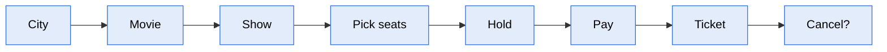
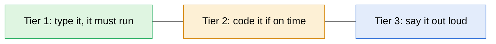
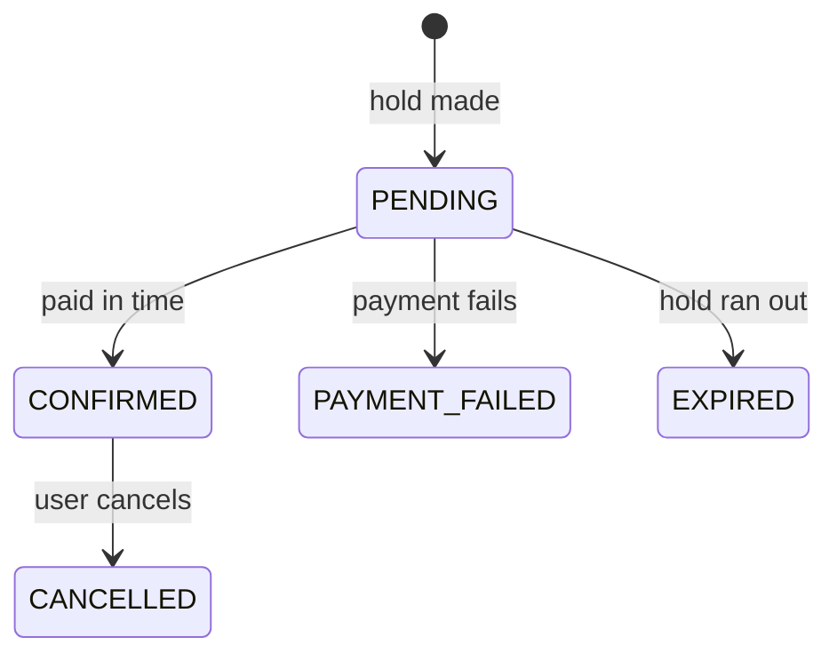
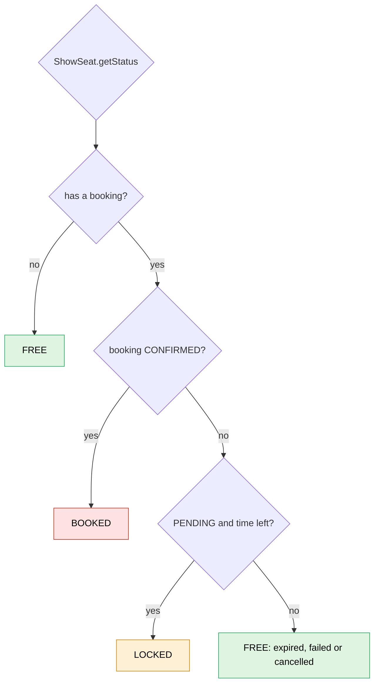
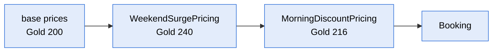
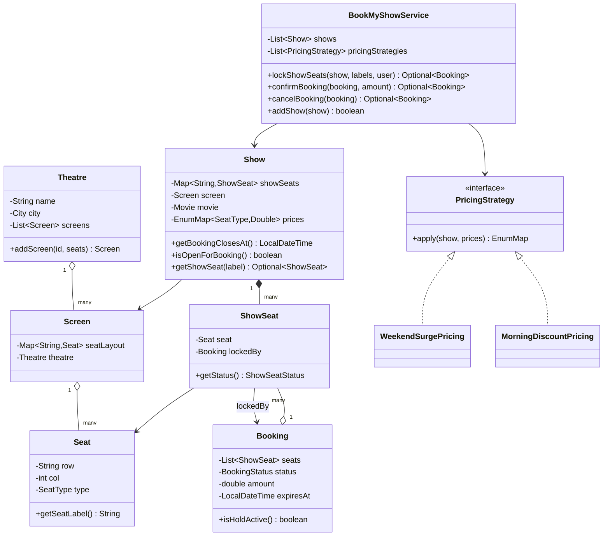

> [!abstract] BookMyShow
> Flavor A (domain modeling) plus the spoken flavor D cut · Rebuild target: tier 1 in 60 min from a blank editor · Patterns: Strategy pipeline (pricing), Singleton and Facade (the service) · Mechanics: all-or-nothing hold under one lock, a hold that expires, seat status worked out from its booking

---

## 📄 Problem Statement

Design a movie ticket booking system like BookMyShow. Users find a movie, pick a show, choose seats and book them. The code must run.

This is the prompt as the interviewer gives it, deliberately vague. Everything below the next heading was pulled out by asking.

---

## ❓ Clarifying questions

### How to generate them

Questions do not come from thinking hard about the system as a whole. They come from walking the user's journey one step at a time and asking the same three things at every step.



| Lens | The question at each step | What it found here |
|---|---|---|
| **Who** does this? | a user, or an admin or organiser? | an admin creates cities, theatres, screens and shows |
| **How many** at once? | one seat or several, one screen or several? | one booking can hold several seats |
| **What if** it fails? | seat taken, payment fails, time runs out? | all or nothing; payment failure frees the seats; a hold ends after 5 minutes |

> [!tip] The journey has an end, and the end gets a question too
> After the ticket comes the question nobody walks to: can it be undone? That is how cancellation gets found.

---

## ✅ Functional Requirements

**Admin**

1. **Setup.** An admin adds cities, theatres, screens and shows. A screen has a fixed seat layout: rows of seats, each with a type (Silver, Gold, Platinum). A show is a movie on a screen at a start time, with **a price for each seat type**.
2. **No overlapping shows.** A show cannot be added to a screen at a time that overlaps another show on that screen.

**User**

3. **Find a movie.** The user picks a city and sees the movies playing there; a movie can be found by its exact name.
4. **Find a show.** Picking a movie lists the theatres in that city and their shows. Picking a theatre lists its shows. Only shows that have not started are listed or bookable.
5. **Seat layout.** For a chosen show, the user sees the screen's layout with each seat marked free, held or booked.
6. **Hold, all or nothing.** The user holds several seats of one show in one go. If any of them is held or booked, **none are held**, and the user is told which ones were unavailable.
7. **Hold expiry.** A hold lasts **5 minutes from the moment it is made**. After that its seats are free again.
8. **Pay.** Paying for a hold either confirms the booking or frees the seats at once if the payment fails. A payment for a hold that has already expired is rejected.
9. **Ticket.** A confirmed booking carries a unique id, the show, the seats with their types, and the total: the sum of each seat's price for its type in that show.
10. **One show at a time.** Booking a seat for one show does not block that seat for any other show.
11. **Cancel.** A confirmed booking can be cancelled, and its seats become free again.

## ⚙️ Non-functional Requirements

1. **Concurrency.** When many users go for the same seat at the same instant, exactly one gets it, and a multi-seat hold is never left half-taken. A hold paid twice at the same moment (a double click, two devices) confirms one booking and charges once.
2. **Freshness.** An expired hold counts as free the moment anyone looks at the seat or tries to hold it, not when a cleanup job gets round to it. The seat map may be a moment out of date; the hold attempt is the final check.
3. **Ease of change.** A new pricing rule (weekend prices) or a new payment method is a new class, with no edits to the booking flow.

### Out of scope (do not build)

Refunds · persistence · several servers (talk about it, do not build it) · time-range search · REST · real payment gateway · login · notifications · other event types such as concerts or sports (the design must not block them) · surge scale of millions of users.

---

## ⚖️ Judgment calls

Claims only; each is argued at its class.

1. Booking status lives on the seat-in-a-show, not on the physical seat. See [[#ShowSeat]].
2. A seat does not store its own status; it works it out from its booking, so nothing is ever released. See [[#ShowSeat]].
3. One class carries a booking from hold to ticket, by changing status. See [[#Booking]].
4. A hold expires at whichever comes first: 5 minutes, or the moment booking closes. See [[#Booking]].
5. The rule for when booking closes is one method on the show. See [[#Show]].
6. The caller passes seat labels; the service looks the seats up in the show. See [[#BookMyShowService]].
7. One lock around check-all-then-mark-all makes the hold all or nothing. See [[#BookMyShowService]].
8. Payment checks run read-first, change-last, and name the one state allowed to pay. See [[#BookMyShowService]].
9. Pricing rules are strategies applied as a pipeline in a loop, not decorators. See [[#PricingStrategy]].

---

## 🔩 Classes

Bottom-up: enums, then plain data, then the classes that make decisions. Every class is tagged with its tier: **T1** is typed in the round and must run, **T2** is coded if layer 1 runs by about minute 30, **T3** is said out loud.



### Enums (T1)

#### SeatType

From FR1: a seat has a type. `SILVER`, `GOLD`, `PLATINUM`, and nothing else.

> [!warning] The price does not belong in the enum
> `GOLD(200)` fixes Gold at 200 for every show forever, while FR1 says each show sets its own price per type. An enum constant is a fact that never changes; a price changes per show, so it lives on the show.

#### ShowSeatStatus

From FR5: what the seat map shows. `FREE`, `LOCKED`, `BOOKED`. It is never stored; [[#ShowSeat]] works it out.

#### BookingStatus

From FR7, FR8 and FR11: where a booking is in its life. `PENDING`, `CONFIRMED`, `PAYMENT_FAILED`, `CANCELLED`, `EXPIRED`.



Only `PENDING` with time left holds seats, and only `CONFIRMED` books them. Every other status frees them, with no code doing the freeing.

### Plain data (T1)

#### City, User, Movie

Records: a name, an id and an email, an id and a title. Nothing about them changes after creation.

> [!info] When a class can be a record
> A record stores exactly the fields in its header and generates the constructor, getters named `name()` rather than `getName()`, `equals`, `hashCode` and `toString`. It fits when all three hold: its fields are exactly its constructor inputs, no method changes a field, and no field holds something changeable like a `List`. `Show` fails the first (it builds a seat map), `ShowSeat` and `Booking` fail the second.

#### Seat

From FR1: one physical chair. It owns its row, column and type, and gives out its label, `A5`. It never changes and has no status: the same chair is used by every show on the screen.

#### Screen

From FR1 and FR5: a fixed layout of seats. It owns a `Map<String, Seat>` keyed by label, and knows the theatre it belongs to.

> [!bug] Reject a duplicate where it enters
> The caller passes a plain list of seats and the screen builds the map itself, checking each label first. A bare `put` of a second A5 silently replaces the first, so a screen given two A5s would quietly hold one and turn a Gold A5 into Silver. The check throws instead: `A5 Seat already exists`.

#### Theatre

From FR1 and FR4: a name, a city and its screens. Screens are created through `theatre.addScreen(id, seats)`, and the `Screen` constructor is package-private, so a screen cannot exist without its theatre.

> [!tip] Why the theatre builds its screens
> A screen needs to know its theatre (a show must walk show to screen to theatre to city for search), and a theatre lists its screens. If each took the other in its constructor, neither could be built first. Building the screen inside `addScreen` and handing it `this` removes the chicken-and-egg, and a screen can no longer be filed under the wrong theatre.

### Classes that decide (T1 unless marked)

#### Show

From FR1, FR2, FR4 and FR5: one movie on one screen at one time, with a price per seat type. It builds its own `ShowSeat` for every seat of its screen, keyed by label, and it owns the rule for when booking closes.

> [!important] One rule, one method
> The check for whether a show can still be booked was once pasted in four places. The copies drifted to three different cutoffs and one flipped comparison, so the listing showed only started shows. Now `getBookingClosesAt()` and `isOpenForBooking()` live on the show, because the start time is the show's data, and every caller asks it.

#### ShowSeat

From FR5, FR6 and FR10: one seat in one show. It owns the physical `Seat` and a pointer to the booking that holds it, and nothing else.

> [!danger] The course flaw: status on the physical seat
> A status on `Seat` would block A5 for every show once one show booked it. Status that depends on a context (this show) lives on the association class, `ShowSeat`, which exists once per seat per show. A show's seats never become free again after it ends; the next show has its own fresh ShowSeats.

The seat does not store a status. It asks its booking every time:



> [!important] Store a fact once, and work the rest out from it
> Two rules decide where state lives.
> - **One fact shared by many objects (1 to many):** one booking covers several seats, so its status lives on the booking and the seats point at it. Stored on each seat, one payment becomes three writes that can disagree.
> - **A state that changes with nobody acting:** a hold expiring. Store the deadline, not the status, and compute the status when asked. A stored `LOCKED` needs some code to run at the exact moment of expiry, and nothing is guaranteed to run then.
>
> Together they deleted every release loop. Parking Lot could keep `OCCUPIED` on `Spot` because there one ticket covers one spot and never expires on its own.

| Write the status into the seats | Work it out from the booking |
|---|---|
| pay: write BOOKED into every seat | pay: `booking.setStatus(CONFIRMED)` |
| expire: someone must release the seats, and nothing runs at minute 5 | expire: the next `getStatus()` answers FREE |
| release an old booking: frees seats another user now holds | nothing is ever released, so nothing is wrongly freed |
| cancel: loop and free | cancel: `booking.setStatus(CANCELLED)` |

#### Booking

From FR6 to FR9 and FR11: one hold, from the click to the ticket. It owns its id, show, user, seats, status, amount and expiry.

> [!tip] One class, not Hold plus Ticket
> A hold and a ticket had the same fields (id, show, seats, user); the only difference was whether it was paid, which is a status. Two classes would mean copying the seats across at payment and re-pointing every ShowSeat. One class changes one field.

> [!important] A hold never promises more time than the show allows
> The hold ends at whichever comes first: 5 minutes from now, or the moment booking closes (5 minutes before the start). A hold made 6 minutes before the show honestly says pay within 1 minute. Before this, it promised 5 minutes, and a payment 15 seconds later was refused.

> [!info] Instant or LocalDateTime
> `Instant` is one exact moment, the same everywhere; `LocalDateTime` is a wall-clock reading with no time zone, like the time printed on a ticket. Java will not compare one with the other, and the show already used `LocalDateTime`, so the whole build uses it. Run with the machine in two zones, `Instant.now()` read 16:28 in both while `LocalDateTime.now()` read 21:58 in Asia/Kolkata and 16:28 in UTC. Fine in one JVM; in production, store `Instant` and convert only for display.

#### PricingStrategy

From NFR3 and the extension test. **T3 in the round: say it, code it only if asked.** One method: given the show and the prices so far, return the adjusted prices. `WeekendSurgePricing(20)` and `MorningDiscountPricing(10)` take their setting in the constructor, so every rule shares one signature.



| Pipeline of strategies (chosen) | Decorator |
|---|---|
| each rule stands alone; a loop chains them | each rule holds the rule inside it and calls it |
| add or remove a rule: `rules.add(...)` | rewrite the nesting line |
| order is the list order, which is the order the admin added them | order is fixed by how the constructors nest |

> [!tip] Say both, then choose
> Each rule is a strategy behind one interface, applied as a pipeline in the order the admin added them. Decorator would also chain them, but nesting buys nothing here; it earns its place where layers of behaviour are composed once, as in a logger.

#### BookMyShowService

From FR2 to FR11 and NFR1. A Singleton and the facade for the whole flow: it holds the shows, theatres and pricing rules, and runs search, hold, confirm and cancel. Hold and confirm are T1; search, cancel and the overlap check are T2.

> [!important] Ids in, objects looked up inside
> `lockShowSeats` takes seat labels, not seat objects, and fetches each one from the show it was told about. A real client can only send text, such as a JSON body with a show id and seat labels, and it must not be trusted to hand over objects. Taking objects let a caller book a seat of another show, or list A5 twice and pay double.

> [!important] Check every seat, then mark every seat, inside one lock
> `synchronized` on `lockShowSeats` makes the whole check-then-mark one step. If Beta's request slipped in between Alpha's check and Alpha's marking, both would think B5 was free. Locking each seat on its own, as Parking Lot's `tryOccupy` did for one spot, is not enough when one booking takes several seats.

> [!important] Read checks first, changes last
> `confirmBooking` first asks whether the booking is still waiting for payment, then whether the hold is alive, then whether the show is open, then whether the amount is right, and only then changes anything. Run in another order, a retried payment on an already-paid booking reached a branch that freed its seats. The first check names the one state allowed to pay, `PENDING`, so a status added later is refused by default: a payment retried after `PAYMENT_FAILED` cannot confirm a seat someone else has since taken.

---

## 🧱 Class Diagram



---

## 🎯 Build Scope

| Tier | What | In the full build | In the round |
|---|---|---|---|
| T1 | enums, `Seat`, `Screen`, `Theatre`, `Show`, `ShowSeat`, `Booking`, `lockShowSeats`, `confirmBooking`, a short driver | about 300 lines | type it; it must run |
| T2 | cancel, search by city, movie and theatre, the overlap check | about 40 lines | 5 to 10 lines each, if layer 1 runs by minute 30 |
| T3 | pricing rules, the two-thread demo, the expiry demo, several servers, telling the user which seats were taken | about 75 lines plus the long driver | said out loud, pointing at the line that would handle it |

The full build is 759 lines and shows every case; the round wants about 300 to 350.

```text
 min  0-10   questions
 min 10-30   LAYER 1: classes + hold + pay + the short driver   <- must run
 min 30-42   LAYER 2: expiry + failed payment                    <- build if on time
 min 42-52   LAYER 3: cancel, search, overlap                    <- usually spoken
 min 52-60   walk through the concurrency answer
```

> [!example] What gets said rather than shown
> - What happens if the payment fails: the booking becomes `PAYMENT_FAILED` and its seats read FREE at once.
> - What happens after 5 minutes: nothing runs; the next look at the seat answers FREE, because the booking carries its deadline.
> - Two users on one seat: `synchronized` on `lockShowSeats`, this line.
> - Weekend prices: one new class behind `PricingStrategy`.
> - Several servers: the lock moves to the database, `UPDATE show_seat SET booking_id = ? WHERE id = ? AND version = ?`.

---

## 🔑 Key code

All from `Case Studies/A - Domain Modeling/BookMyShow/src/`.

**`Show` owns when booking closes** (one rule, every caller asks):

```java
public LocalDateTime getBookingClosesAt() {
    return startTime.minusMinutes(5);
}

public boolean isOpenForBooking() {
    return LocalDateTime.now().isBefore(getBookingClosesAt());
}

public Optional<ShowSeat> getShowSeat(String label) {
    return Optional.ofNullable(showSeats.get(label));
}
```

**`ShowSeat.getStatus`** (the status is worked out, never stored):

```java
public ShowSeatStatus getStatus() {
    if (lockedBy == null) {
        return ShowSeatStatus.FREE;
    }
    if (lockedBy.getStatus().equals(BookingStatus.CONFIRMED)) {
        return ShowSeatStatus.BOOKED;
    }
    if (lockedBy.isHoldActive()) {
        return ShowSeatStatus.LOCKED;
    }
    return ShowSeatStatus.FREE;
}
```

**`Booking`: the honest deadline and the one question the seat asks:**

```java
LocalDateTime holdEndsAt = LocalDateTime.now().plusMinutes(5);
LocalDateTime bookingClosesAt = show.getBookingClosesAt();
this.expiresAt = holdEndsAt.isBefore(bookingClosesAt) ? holdEndsAt : bookingClosesAt;

public boolean isHoldActive() {
    return status.equals(BookingStatus.PENDING) && LocalDateTime.now().isBefore(expiresAt);
}
```

**`lockShowSeats`** (labels in, look up, check all, then mark all, under one lock):

```java
public synchronized Optional<Booking> lockShowSeats(Show show, List<String> seatLabels, User user) {

    if (!show.isOpenForBooking()) {
        return Optional.empty();
    }

    if (seatLabels.isEmpty()) {
        return Optional.empty();
    }

    List<ShowSeat> showSeats = new ArrayList<>();
    for (String label : seatLabels) {
        Optional<ShowSeat> showSeat = show.getShowSeat(label);
        if (showSeat.isEmpty()) {
            return Optional.empty();
        }
        if (!showSeats.contains(showSeat.get())) {
            showSeats.add(showSeat.get());
        }
    }

    for (ShowSeat showSeat : showSeats) {
        if (!showSeat.getStatus().equals(ShowSeatStatus.FREE)) {
            return Optional.empty();
        }
    }

    Booking booking = new Booking(java.util.UUID.randomUUID().toString(), show, showSeats, user, priceFor(show));

    for (ShowSeat showSeat : showSeats) {
        showSeat.setLockedBy(booking);
    }
    return Optional.of(booking);
}
```

**`confirmBooking`** (read checks first, the change last):

```java
public synchronized Optional<Booking> confirmBooking(Booking booking, double amount) {

    if (!booking.getStatus().equals(BookingStatus.PENDING)) {
        return Optional.empty();
    }

    if (booking.getExpiresAt().isBefore(LocalDateTime.now())) {
        booking.setStatus(BookingStatus.EXPIRED);
        return Optional.empty();
    }

    Show show = booking.getShow();

    if (!show.isOpenForBooking()) {
        return Optional.empty();
    }

    if (amount != booking.getAmount()) {
        booking.setStatus(BookingStatus.PAYMENT_FAILED);
        return Optional.empty();
    }

    booking.setStatus(BookingStatus.CONFIRMED);
    return Optional.of(booking);
}
```

**`addShow`** (T2; I start before you end, and you start before I end, so back-to-back shows are allowed):

```java
public boolean addShow(Show show) {
    for (Show existing : shows) {
        if (existing.getScreen().equals(show.getScreen())
                && show.getStartTime().isBefore(existing.getEndTime())
                && existing.getStartTime().isBefore(show.getEndTime())) {
            return false;
        }
    }
    shows.add(show);
    return true;
}
```

**The pricing pipeline** (T3; the service runs the rules, the booking only records the result):

```java
private EnumMap<SeatType, Double> priceFor(Show show) {
    EnumMap<SeatType, Double> prices = new EnumMap<>(show.getPrices());
    for (PricingStrategy pricingStrategy : pricingStrategies) {
        prices = pricingStrategy.apply(show, prices);
    }
    return prices;
}
```

```java
public class WeekendSurgePricing implements PricingStrategy {

    private final double surgePercentage;

    public WeekendSurgePricing(double surgePercentage) {
        this.surgePercentage = surgePercentage;
    }

    @Override
    public EnumMap<SeatType, Double> apply(Show show, EnumMap<SeatType, Double> prices) {
        DayOfWeek day = show.getStartTime().getDayOfWeek();
        if (day != DayOfWeek.SATURDAY && day != DayOfWeek.SUNDAY) {
            return prices;
        }

        EnumMap<SeatType, Double> surged = new EnumMap<>(SeatType.class);
        for (SeatType type : prices.keySet()) {
            double price = prices.get(type);
            surged.put(type, price + price * surgePercentage / 100);
        }
        return surged;
    }
}
```

Adding the weekend rule cost a new interface and class plus one edit each to `Booking` and the service; adding the morning rule after it cost one new class and no edits to the booking flow. With both rules on, a Gold seat listed at 200:

```text
MONDAY 18:00 -> 200.0
MONDAY 10:00 -> 180.0
SATURDAY 18:00 -> 240.0
SATURDAY 10:00 -> 216.0
SATURDAY 12:00 -> 240.0
show's own listed price after all that: 200.0
```

### Seat A5 through its whole life

Run against the build, winding a booking's clock back instead of waiting 5 minutes:

```text
Alpha holds A5,B5:            A5 LOCKED, B5 LOCKED
5 min pass, nobody acts:      A5 FREE, B5 FREE
Beta holds A5, map opened:    A5 LOCKED (Beta's: true), B5 FREE
Alpha pays late:              rejected, A5 still Beta's: true
Beta pays:                    A5 BOOKED
Alpha tries A5 again:         rejected
Beta's 5 min pass after pay:  A5 BOOKED
Beta cancels:                 A5 FREE, booking CANCELLED
Alpha tries A5 again:         got it
race hold, 500 rounds, bad: 0 | double click pay, 2000 rounds, both accepted: 0
```

### The tier-1 driver (rebuild target)

```java
public class ShortMain {
    public static void main(String[] args) {
        BookMyShowService service = BookMyShowService.getInstance();

        Theatre nexus = new Theatre("t1", "Nexus Mall", new City("HSR"));
        Screen audi = nexus.addScreen("audi-1", List.of(
                new Seat("A", 5, SeatType.SILVER), new Seat("B", 5, SeatType.GOLD), new Seat("C", 5, SeatType.PLATINUM)));

        EnumMap<SeatType, Double> prices = new EnumMap<>(SeatType.class);
        prices.put(SeatType.SILVER, 150.0);
        prices.put(SeatType.GOLD, 200.0);
        prices.put(SeatType.PLATINUM, 300.0);
        LocalDateTime start = LocalDateTime.now().plusDays(1).withHour(18).withMinute(0).withSecond(0).withNano(0);
        Show show = new Show("s1", audi, new Movie("m1", "Dune"), start, start.plusHours(2), prices);
        service.addTheatres(nexus);
        service.addShow(show);

        Booking alpha = service.lockShowSeats(show, List.of("A5", "B5"), new User("u1", "alpha@x.com")).get();
        System.out.println("Alpha holds A5, B5, pays " + alpha.getAmount());
        System.out.println("Beta tries B5, C5: " + (service.lockShowSeats(show, List.of("B5", "C5"), new User("u2", "beta@x.com")).isPresent() ? "held" : "rejected"));

        service.confirmBooking(alpha, alpha.getAmount());
        System.out.println("Alpha's booking: " + alpha.getStatus());
        for (ShowSeat seat : service.getShowSeats(show)) {
            System.out.println("  " + seat.getShowSeatLabel() + " " + seat.getStatus());
        }
    }
}
```

```text
Alpha holds A5, B5, pays 350.0
Beta tries B5, C5: rejected
Alpha's booking: CONFIRMED
  C5 FREE
  B5 BOOKED
  A5 BOOKED
```

---

## 🗣️ Jargon

| Term | Meaning here |
|---|---|
| association class | `ShowSeat`: one object per pairing of a seat and a show, carrying what belongs to the pair |
| all-or-nothing claim | a hold either takes every requested seat or none |
| check-then-act race | two threads both check A5 is free before either marks it |
| lazy expiry | work out whether a hold has expired at the moment someone asks |
| eager expiry | a background timer that frees expired holds every few seconds, and shows stale LOCKED seats between sweeps |
| derived state | a status computed from other data instead of stored |
| single source of truth | one stored copy of each fact |
| idempotent confirm | paying a booking twice confirms it once |
| strategy pipeline | strategies behind one interface, applied one after another in a loop |
| optimistic locking | `UPDATE ... WHERE version = ?`, the multi-server answer for the seat claim |

---

## 🎯 Strong-hire talking points

- **The concurrency answer, named precisely:** check every seat, then mark every seat, inside one `synchronized` method; confirm checks status first, so a double click confirms once. Measured: one winner in 500 races, zero double charges in 2000.
- **I never release holds:** a hold carries its deadline and the seat works its status out from it, so an expired hold is free the instant anyone looks, with no sweeper thread.
- **Where the lock is too coarse:** the lock is on the whole service, so a hold for one show waits behind a hold for another. Locking per show lets shows proceed in parallel.
- **Across several servers:** an in-process lock no longer covers it; move the claim into the database with a version column, or a short Redis lease that expires with the hold.
- **ShowSeat, not Seat:** status that depends on a show lives on the seat-in-a-show; on the physical seat it would block A5 for every show.
- **Ids in:** the client sends a show id and seat labels; the server looks up its own objects and never trusts objects from the client.
- **Pricing:** a strategy pipeline in the order the admin added the rules; the second rule cost one class and no edits.
- **Time:** one zone in one JVM, so wall-clock time is fine; in production I would store `Instant` and convert for display.
