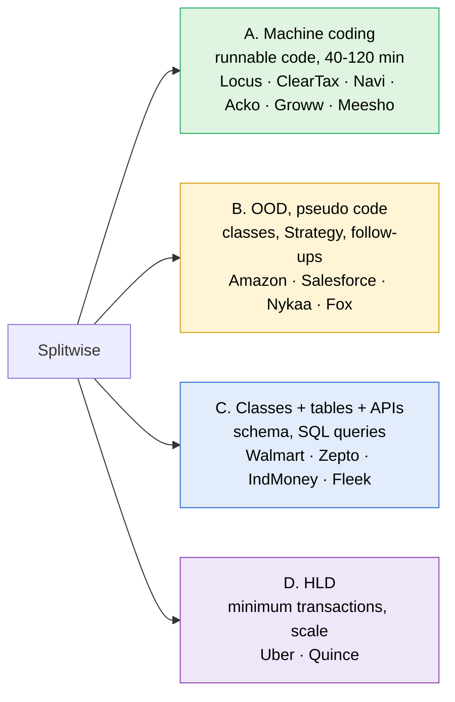
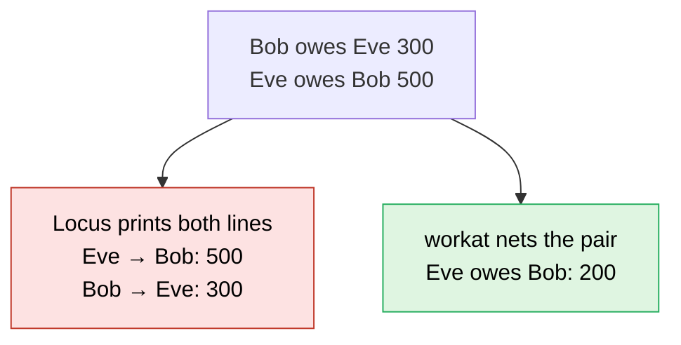

> [!abstract] Splitwise: who asks it, in what format, and what they probe
> Every LeetCode Discuss post that names Splitwise was pulled through LeetCode's own API and read newest first. 139 posts matched: 3 in 2019, 4 in 2020, 11 in 2021, 33 in 2022, 6 in 2023, 30 in 2024, 31 in 2025 and 21 in 2026 up to October. The 2024 to 2026 posts were read, plus the workat.tech problem statement that most Indian rounds copy. The company rows and problem statements below come from them.

> [!warning] What the count is and is not
> A post counts once it mentions Splitwise, so prep diaries and resource lists are inside the 139. The tables below use only posts that describe a real round. Formats are read from what the candidate wrote; where a post does not say whether code had to run, the row says so.

---

## The same problem, four formats



| Format | What you hand over | Seen at (newest first) |
|---|---|---|
| **A. Machine coding** | Code that runs, with a driver, often against given sample input | Navi SDE-2 (Sep 2026, 90 min), Locus.sh SDE-3 (May 2026), RingCentral SDE-3 (Apr 2026), super.money SDE-2 (Mar 2026, AI coding allowed), Acko SDE-1 (Mar 2026, 60 min), ClearTax (Jan 2026, 90 min), Swiggy SDE-1 (Oct 2025, 60 min), Groww SDE-II (Aug 2025, 2 h), Meesho SDE-3 (Jul 2025), OpenTable SDE-2 (Feb 2025), ShareChat SDE-1 (Mar 2025, 40 min in an IDE), Flexport SDE-1 (Feb 2025), Razorpay SSE (Dec 2024), Meesho SDE-1 and SDE-2 (2024, HackerRank tests), Groww SDE-3 (Sep 2024, 2 h), Setu (2024, working code plus schema) |
| **B. OOD, pseudo code** | Entities, relationships, the split Strategy, then follow-up questions on it | Nykaa SDE-1 (Sep 2026), Salesforce MTS (Aug 2026), Amazon SDE-2 (Apr 2026, plus APIs), Salesforce SMTS (Mar 2026), Fox SDE-2 (Feb 2026), Nielsen MTS4 (Feb 2026, in Google Docs), Amazon SDE-2 (Oct 2025, expense management only), Flexport SWE-1 (Aug 2025), Amazon bar raiser (May 2025, currency conversion), Winzo SSE (Jan 2025), Tekion SDE-2 |
| **C. Classes, tables and APIs** | Class list, DB schema, API shapes, sometimes SQL queries on the schema | IndMoney L4 (Apr 2026), Spinny (Oct 2025), Salesforce MTS (Jun 2025), Fleek (May 2025), Amazon SDE-2 (Feb 2025, strong hire), Walmart SDE-3 (Jan 2025), PhonePe (Nov 2024), Zepto SSE (Sep 2024, no code), INDMoney SSE (2024, schema plus queries), Cvent SSE (2024), Cars24 SSE (Feb 2024) |
| **D. HLD** | Architecture, schema, concurrent expense entries, scaling large groups | Uber SDE-2 (Nov 2025), Quince SDE-2 (Jun 2025) |

> [!important] Splitwise is the machine-coding problem
> Of the 2025 and 2026 rounds that describe a format, about 12 wanted running code, 11 wanted classes with pseudo code, 6 wanted tables and APIs and 2 were HLD. BookMyShow leaned the other way, towards classes plus tables. Splitwise is where a working build with a driver is most often the bar, and where a partial build is most often rejected.

---

## Problem statements to practise, with time limits

| Prompt | Format | Time | Source |
|---|---|---|---|
| 1. Locus.sh: commands in, balances and minimum settlement out | A | not stated | Locus.sh SDE-3, May 2026 |
| 2. ClearTax: three splits, rounding, validation | A | 90 min | ClearTax, Jan 2026 |
| 3. workat.tech: the Flipkart original | A | 90 min | practice statement most rounds copy |
| 4. Acko: users, groups, owed within a group and overall | A | 60 min, 50 of it coding | Acko SDE-1, Mar 2026 |
| 5. Razorpay: equal split only, but extensible | A | not stated | Razorpay SSE, Dec 2024 |
| 6. Salesforce: one input line, two lookups in O(1) | B | not stated | Salesforce MTS, Aug 2026 |
| 7. Meesho: four methods, hidden test cases | A | 2 h | Meesho SDE-1 and SDE-2, 2024 |

> [!danger] The 60-minute lesson
> Swiggy SDE-1 (Oct 2025): 60 minutes, about 15 of them gone on introductions and requirements, and the interviewer expected a fully working app. The candidate started with a UML diagram, finished part of it, and was rejected. Meesho SDE-1 (Sep 2024): all features built, 2 of 3 hidden tests passed, and the third failed on an edge case; rejected. Get the three splits and the balance print running first, and test the edges (sums that do not add up, rounding) before anything else.

### 1. Locus.sh SDE-3: commands in, balances and minimum settlement out

The fullest statement found. Requirements, condensed from the post:
- Add expenses, split among a set of people with EQUAL, EXACT or PERCENT.
- Check balances: what a user owes and is owed.
- Check net balance: positive means others owe the user, negative means the user owes.
- Settle debt optimally: the minimum number of payments that clears everyone.
- Additional scope: a category on each expense, and spend per category.

Input and output from the post:

```text
ADD_EXPENSE Alice 1200 4 Alice Bob Charlie David EQUAL
ADD_EXPENSE Bob 1500 3 Bob Eve Frank EXACT 0 500 1000
ADD_EXPENSE Charlie 2400 3 Alice David Charlie PERCENT 40 20 40
ADD_EXPENSE Eve 900 3 Eve Alice Bob EQUAL
ADD_EXPENSE Frank 1800 2 Frank David EXACT 0 1800

SHOW_BALANCE Bob
Bob → Alice: 300
Eve → Bob: 500
Frank → Bob: 1000
Bob → Eve: 300

SHOW_NET_BALANCE
name | debt | receivables | balance
Alice | 1260 | 900 | -360
Bob | 600 | 1500 | 900
Charlie | 300 | 1440 | 1140
David | 2580 | 0 | -2580
Eve | 500 | 600 | 100
Frank | 1000 | 1800 | 800

SETTLE_DEBT_OPTIMIZED
David pays Charlie 1140
David pays Bob 900
David pays Frank 540
Alice pays Frank 260
Alice pays Eve 100
```

Checked by hand: the six net balances sum to 0, David's three payments add to his 2580, and Alice's two add to her 360.

### 2. ClearTax: three splits, rounding, validation (90 min)

A proper machine-coding round with a detailed statement and edge cases. Condensed from the post:
- A user has an id, a name and an email.
- Expenses split EQUAL, EXACT or PERCENT, with validation per split type.
- Keep who owes whom; show simplified balances for everyone and balances for one user.
- Round to 2 decimal places.
- Expected: modular code across several files, a new split type easy to add, and a main method that demonstrates every case; unit tests optional.

The candidate finished in time using a polymorphic split (one class per type) and a balance sheet of user-to-user amounts, in Java 21.

### 3. workat.tech: the Flipkart original (90 min)

The statement Swiggy (Jan 2024) and others point to directly.

| Part | Content |
|---|---|
| User | id, name, email, mobile number; users are created in `main`, not read as input |
| Expense | one payer, any amount, any users, type EQUAL, EXACT or PERCENT |
| Validation | PERCENT shares total 100; EXACT shares total the amount |
| Rounding | 2 decimals; 100 split three ways is 33.34, 33.33, 33.33, the first person takes the extra |
| Output | one line per non-zero balance, `<user-x> owes <user-y>: <amount>`; `No balances` when there are none |
| Optional | a name, notes and images on an expense; SHARE split (2:1:1:1); a passbook of every transaction a user took part in; simplify debts |

```text
SHOW
SHOW u1
EXPENSE u1 1000 4 u1 u2 u3 u4 EQUAL
SHOW u4
SHOW u1
EXPENSE u1 1250 2 u2 u3 EXACT 370 880
SHOW
EXPENSE u4 1200 4 u1 u2 u3 u4 PERCENT 40 20 20 20
SHOW u1
SHOW
```

The last `SHOW` prints:

```text
User1 owes User4: 230
User2 owes User1: 620
User2 owes User4: 240
User3 owes User1: 1130
User3 owes User4: 240
```

### 4. Acko SDE-1: groups, owed within a group and overall (60 min)

Five minutes of requirements, fifty of coding, five of discussion. Add users, create groups, add members, add expenses, and show the total owed or owing both within one group and across all groups. The interviewer said equal split alone was enough for the time; the candidate had built unequal split anyway, and when asked how it would be added, showed it already working. That impressed the interviewer.

### 5. Razorpay SSE: equal split only, but extensible

An in-memory expense-sharing app. Add an expense divided equally; get all expenses a user added; get a user's balance, both the final number and the simplified balance with each other user; get every expense a user is part of. Only equal split had to be implemented, but the solution had to be ready for more.

### 6. Salesforce MTS: one input line, two lookups in O(1)

Working code was not expected; requirements, entities and clean production-style code were. Input was one payer, an amount, a list of users and a split type. Two outputs: what every person owes to whom, and how much A owes B. The candidate answered both in O(1) and was rated hire, which means the balances were kept up to date on every expense rather than worked out when asked.

### 7. Meesho SDE-1 and SDE-2: four methods, hidden tests (2 h)

`addUser`, `addExpense` with EQUAL, EXACT and PERCENT, `showBalances`, `showBalancesForUser`, run on HackerRank against 3 test cases. Both SDE-1 reports passed 2 of 3 and failed an edge case; the SDE-2 report ran out of time.

---

## Two answers the samples disagree on



| Question | Locus.sh | workat.tech |
|---|---|---|
| Two people owe each other: one line or two? | two lines, both directions kept | one line, netted (User4 was owed 250 by User1, then User1 owed 480 to User4, printed as User1 owes User4: 230) |
| Settle across the whole group? | yes, as its own command, minimum payments | optional simplify, shown on a pair-by-pair example |

> [!tip] Ask it in the room
> Whether a pair is netted, and whether the whole group is simplified, changes the data structure. Both samples are real and they disagree, so it is a clarifying question, not an assumption.

> [!info] Minimum payments is its own LeetCode problem
> Settling a group in the fewest payments is LeetCode 465, Optimal Account Balancing, rated Hard and premium only. Winzo (Jan 2025) asked it inside the LLD round and the candidate used dynamic programming; Rippling's phone screen (Aug 2024) asked for any settlement first and the optimal one as a five-minute follow-up, answered with a greedy approach. How exact versus greedy compare is not verified here yet.

---

## The same problem under other names

| Name in the round | Where | What changes |
|---|---|---|
| Expense tracker, similar to Splitwise | Navi SDE-2 (Sep 2026) | nothing, same core |
| Expense-sharing application | ClearTax, Razorpay, OpenTable | nothing, same core |
| Settle a list of transactions | Rippling SDE-2 phone screen (Aug 2024) | input is `<from, to, amount>`, output is who pays whom |
| Wallet and ledger | Groww SDE-2 (Sep 2026) | one wallet per user, debit fails on low balance, an idempotency key returns the original transaction on a repeat |
| Expense rule engine | Rippling SDE-2 (Jun 2026) | not the same core: rules over expenses (category banned, trip total capped), graded on adding a rule easily |

> [!tip] Model a ledger of who owes whom, not a group
> Every same-core variant is a pair-keyed amount that each expense moves. A design where each expense updates a map of balances, with the split worked out by a Strategy, moves to all of them; groups are a filter on top.

---

## What interviewers probe

| Probe | Reported at |
|---|---|
| EQUAL, EXACT and PERCENT behind one interface; adding a new split type | nearly every report; many Strategy follow-ups at Amazon (Oct 2025) |
| Show balances for everyone and for one user | ClearTax, Locus, Meesho, workat, Razorpay |
| Validation (EXACT sums to the amount, PERCENT to 100) and 2-decimal rounding | ClearTax, workat; the Meesho edge case |
| Groups, and balance within a group versus overall | Acko, Groww (2022, user-to-group settle), Cars24 |
| Simplify debts or minimum payments | Locus, Uber, Winzo, Dezerv (2024), Rippling |
| DB schema, APIs, SQL on the schema | Walmart, Zepto, IndMoney, INDMoney, Cvent, Fleek, Salesforce, Amazon, PhonePe, Spinny |
| Balances readable in O(1) | Salesforce (Aug 2026), Spinny (computing balances efficiently) |
| Concurrent expense entries, idempotency | Uber HLD; an Amazon candidate (Oct 2025) raised idempotency and got stuck in its follow-ups |
| Extras | currency conversion (Amazon bar raiser), categories (Locus), SHARE split and passbook (workat), edit expense and history (Cars24), metrics per day, month, user, group (Amazon Feb 2025) |
| Java internals after the build | Meesho SDE-3: streams, garbage collection, ConcurrentHashMap |

---

## Sources

All LeetCode Discuss, read through LeetCode's API on 2026-10-14, plus the workat.tech practice statement.

| Date | Post |
|---|---|
| — | [workat.tech: Design Splitwise](https://workat.tech/machine-coding/practice/splitwise-problem-0kp2yneec2q2/) |
| 2026-09-30 | [Navi SDE-2](https://leetcode.com/discuss/post/8549192/) |
| 2026-09-29 | [Nykaa SDE-1](https://leetcode.com/discuss/post/8546152/) |
| 2026-09-24 | [Groww SDE-2, wallet and ledger](https://leetcode.com/discuss/post/8537835/) |
| 2026-08-14 | [Salesforce MTS](https://leetcode.com/discuss/post/8461169/) |
| 2026-06-30 | [Rippling SDE-2, expense rule engine](https://leetcode.com/discuss/post/8367124/) |
| 2026-05-01 | [Locus.sh SDE-3](https://leetcode.com/discuss/post/8122004/) |
| 2026-04-15 | [RingCentral SDE-3](https://leetcode.com/discuss/post/7930184/) |
| 2026-04-03 | [IndMoney L4](https://leetcode.com/discuss/post/7766968/) |
| 2026-04-01 | [Amazon SDE-2](https://leetcode.com/discuss/post/7744728/) |
| 2026-03-29 | [super.money SDE-2](https://leetcode.com/discuss/post/7714552/) |
| 2026-03-26 | [Salesforce SMTS](https://leetcode.com/discuss/post/7696934/) |
| 2026-03-20 | [Uber SDE-2](https://leetcode.com/discuss/post/7672800/) |
| 2026-03-01 | [Acko SDE-1](https://leetcode.com/discuss/post/7617272/) |
| 2026-02-16 | [Fox SDE-2](https://leetcode.com/discuss/post/7584501/) |
| 2026-02-04 | [Nielsen MTS4](https://leetcode.com/discuss/post/7551916/) |
| 2026-01-23 | [ClearTax](https://leetcode.com/discuss/post/7518434/) |
| 2025-10-24 | [Spinny SDE-1](https://leetcode.com/discuss/post/7296411/) |
| 2025-10-15 | [Swiggy SDE-1](https://leetcode.com/discuss/post/7278246/) |
| 2025-10-06 | [Amazon SDE-2](https://leetcode.com/discuss/post/7253754/) |
| 2025-08-14 | [Flexport SWE-1](https://leetcode.com/discuss/post/7079214/) |
| 2025-08-05 | [Groww SDE-II](https://leetcode.com/discuss/post/7046387/) |
| 2025-07-20 | [Meesho SDE-3](https://leetcode.com/discuss/post/6982468/) |
| 2025-06-28 | [Quince SDE-2](https://leetcode.com/discuss/post/6894686/) |
| 2025-06-25 | [Salesforce MTS](https://leetcode.com/discuss/post/6883899/) |
| 2025-05-21 | [Fleek](https://leetcode.com/discuss/post/6766537/) |
| 2025-05-08 | [Amazon bar raiser](https://leetcode.com/discuss/post/6725210/) |
| 2025-04-05 | [Tekion SDE-2](https://leetcode.com/discuss/post/6620070/) |
| 2025-04-04 | [Winzo SSE](https://leetcode.com/discuss/post/6616321/) |
| 2025-03-12 | [OpenTable SDE-2](https://leetcode.com/discuss/post/6528220/) |
| 2025-03-03 | [ShareChat SDE-1](https://leetcode.com/discuss/post/6489146/) |
| 2025-02-13 | [Amazon SDE-2](https://leetcode.com/discuss/post/6418112/) |
| 2025-02-11 | [Flexport SDE-1](https://leetcode.com/discuss/post/6408852/) |
| 2025-01-19 | [Walmart SDE-3](https://leetcode.com/discuss/post/6303081/) |
| 2024-12-24 | [Razorpay SSE](https://leetcode.com/discuss/post/6180241/) |
| 2024-12-14 | [PhonePe](https://leetcode.com/discuss/post/6145158/) |
| 2024-09-20 | [Meesho SDE-1](https://leetcode.com/discuss/post/5811098/) |
| 2024-09-13 | [Zepto SSE](https://leetcode.com/discuss/post/5781556/) |
| 2024-09-12 | [Groww SDE-3](https://leetcode.com/discuss/post/5777593/) |
| 2024-09-09 | [Multiple SDE-2 reports, Setu](https://leetcode.com/discuss/post/5761804/) |
| 2024-08-17 | [Meesho SDE-2](https://leetcode.com/discuss/post/5650118/) |
| 2024-08-05 | [Rippling SDE-2](https://leetcode.com/discuss/post/5590877/) |
| 2024-06-11 | [Dezerv SSE](https://leetcode.com/discuss/post/5295640/) |
| 2024-04-27 | [INDMoney SSE](https://leetcode.com/discuss/post/5079972/) |
| 2024-03-29 | [Cvent SSE](https://leetcode.com/discuss/post/4941966/) |
| 2024-03-04 | [Cars24 SSE](https://leetcode.com/discuss/post/4824010/) |
| 2024-01-10 | [Swiggy SDE-2](https://leetcode.com/discuss/post/4540407/) |
| 2022-05-06 | [Groww SDE-2](https://leetcode.com/discuss/post/2013143/) |
